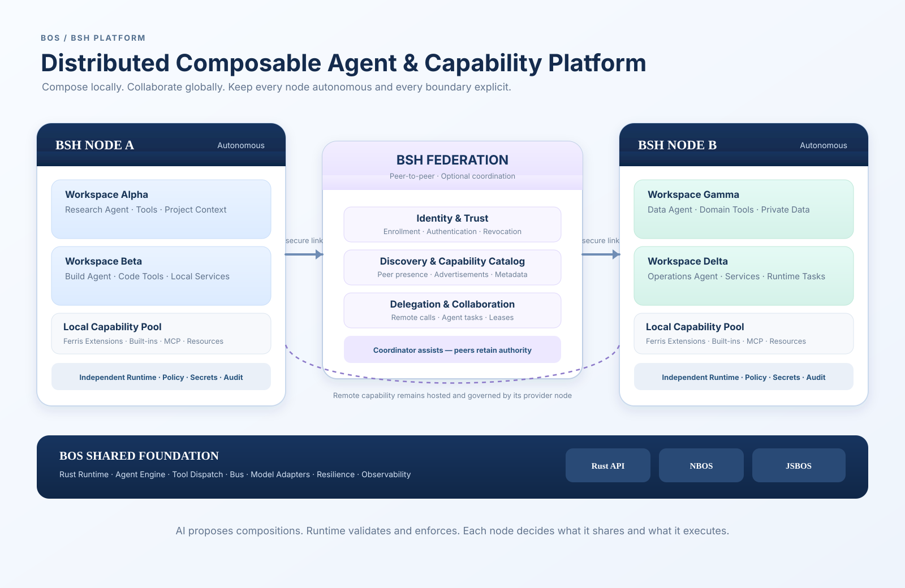
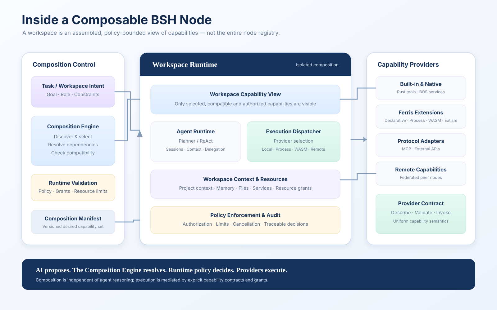
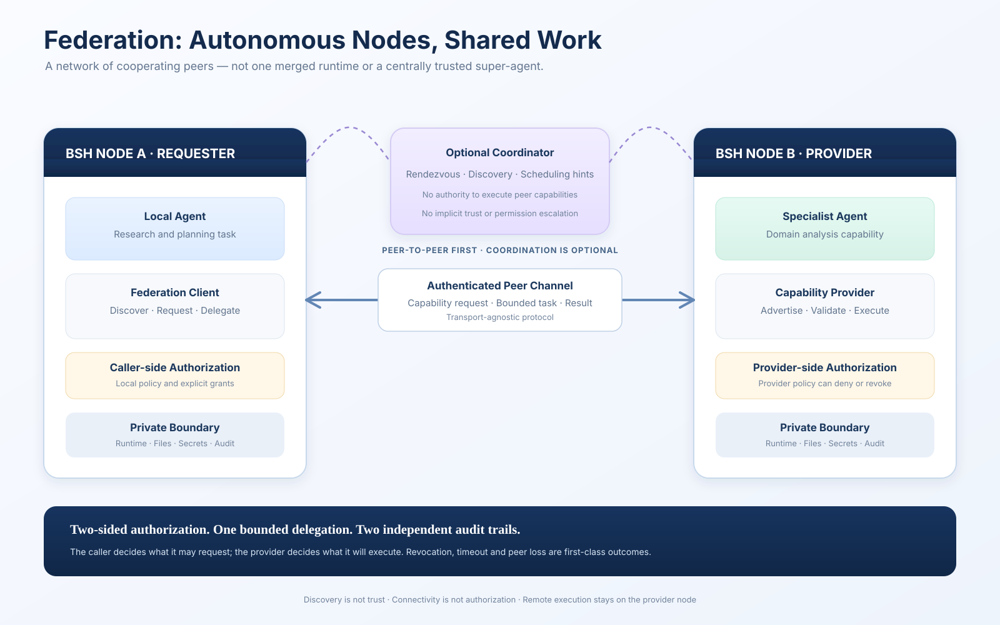
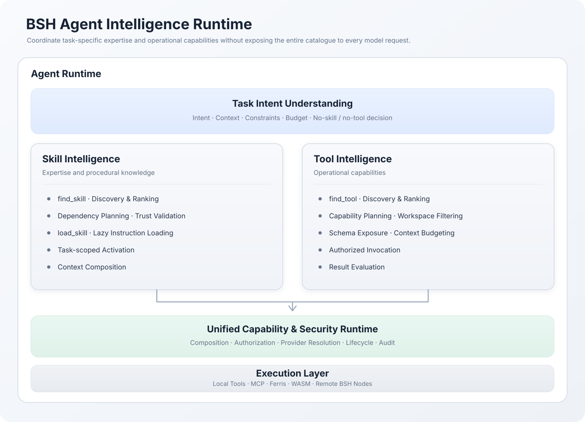

# BOS / BSH Architecture

> **BSH is a Distributed Composable Agent & Capability Platform.**  
> Each BSH node is an AI-native composable capability container. Multiple autonomous nodes can federate to discover capabilities, delegate work and collaborate — without merging their runtimes or trust boundaries.

**Architecture principle:** One Runtime. Composable Workspaces. Collaborative Agents. Federated Capabilities. Independent Trust Boundaries.

This document explains the platform through three architecture visuals, then defines the responsibilities and boundaries behind them. It distinguishes the current BOS implementation from the target BSH 2.0 architecture: diagrams describe the intended platform shape; the status section identifies what exists today and what remains under development.

---

## 0. BSH goal, product intent and architecture directives

### 0.1 Product goal

BSH's goal is to become a **Distributed Composable Agent & Capability Platform**, with each BSH Node acting as an **AI-Native Composable Capability Container**.

BSH should let people and AI Agents assemble purpose-built work environments on demand from independently governed capabilities. A task should receive the expertise, tools, services, models, resources and collaborating agents it needs — no more and no less — within an explicit Workspace and its policy boundaries.

A single BSH Node must be useful and autonomous on its own. Multiple BSH Nodes must also be able to discover one another's published capabilities, delegate bounded work and collaborate as a Federation. Federation is a core platform capability and a strategic differentiator, not merely a remote-tool transport feature. Nodes collaborate without merging their runtimes, data ownership, security kernels or trust boundaries.

**Product promise:** Compose Capabilities. Empower AI.

**Platform principle:** One Runtime. Composable Workspaces. Collaborative Agents. Federated Capabilities. Independent Trust Boundaries.

### 0.2 What BSH is intended to deliver

1. **On-demand AI workspaces:** create task- or purpose-specific Workspaces by composing only the required capabilities, context, policies and resource grants.
2. **Composable capabilities:** make tools, Skills, extensions, services, models and resources discoverable through explicit, versioned contracts and provider boundaries.
3. **Agent-directed composition with runtime governance:** allow Agents and planners to discover, recommend and propose compositions; deterministic runtime components validate, authorize, activate and execute them.
4. **Multiple agents and interfaces:** support agents operating in distinct Workspaces and interfaces while reusing the same governed runtime and capability model.
5. **Federated collaboration:** allow autonomous Nodes to publish approved metadata, discover granted remote capabilities, delegate bounded tasks and collaborate while retaining independent authority.
6. **Secure, observable execution:** provide explicit identity, trust, authorization, isolation, budgets, cancellation, lifecycle, provenance and audit across local and remote execution.
7. **Extensible implementation:** support native/BOS capabilities, Ferris extensions, MCP integrations, WASM and remote providers through adapters to common platform contracts rather than making any one integration protocol the platform model.

### 0.3 Binding architecture directives

These directives guide architecture, implementation and review. A design that conflicts with one must document the trade-off and obtain an explicit architecture decision rather than silently weakening the platform contract.

| Directive | Required interpretation |
|---|---|
| **Runtime First** | Runtime code owns lifecycle, composition validation, authorization, execution, cancellation, recovery and audit. Prompt instructions and model output are never enforcement mechanisms. |
| **Capability First** | A capability is the canonical unit of discoverable and governable operation. Provider implementations are replaceable behind stable, versioned contracts. |
| **Composition over Monolith** | Build purpose-specific Workspaces from independently managed capabilities. Do not turn BSH into one fixed, globally enabled tool bundle. |
| **AI-Native, not AI-authoritative** | AI may discover, rank, plan and propose. Deterministic runtime policy decides what is valid and permitted. |
| **Security by Construction** | Identity, trust, least privilege, isolation, resource limits and audit are part of the composition and invocation contracts, not optional afterthoughts. |
| **Federation without authority merger** | Nodes may collaborate and delegate, but each Node remains authoritative for its own providers, data, policy, execution and audit. Remote use requires explicit caller-side and provider-side authorization. |
| **Progressive disclosure** | Discover from compact metadata; load Skill instructions and expose Tool schemas only when selected and validated. Never inject the entire catalogue into every model request. |
| **Explicit ownership and contracts** | Keep Capability, Provider, Registry, Composition, Workspace, Agent, Execution Context and Federation responsibilities distinct. Avoid duplicate registries, competing authorization engines and ambiguous lifecycle ownership. |
| **Observable and verifiable behavior** | Important lifecycle transitions and security decisions must be correlated, testable and auditable. Document target behavior separately from verified implementation. |

### 0.4 Responsibility boundaries

The platform is a coordinated set of components, not a monolithic application with interchangeable responsibilities:

- **BSH** owns the product experience and the composition/workspace control plane: Workspaces, Agent interaction, capability views, policy integration, task orchestration and Federation participation.
- **BOS** provides the shared Rust-native Agent and capability execution foundation: runtime primitives, providers, tool/Skill integration, messaging and language bindings.
- **Ferris** provides the extension package and extension-runtime framework. BSH/BOS integrate extension contributions through explicit host/provider contracts.
- **Capability Providers** implement operations. They do not independently decide the requesting Workspace's authority.
- **Federation** connects autonomous BSH Nodes. It does not create a global registry with global execution authority or a Workspace spanning multiple Nodes.

These are architectural ownership boundaries. They do not require every logical responsibility to become a separate process, crate or service immediately.

### 0.5 Non-goals and prohibited shortcuts

BSH is not intended to become:

- A monolithic Agent application whose capabilities are hard-coded into one permanent tool list.
- A prompt-only tool/Skill orchestration framework where model instructions enforce security.
- A global shared runtime in which Federation peers surrender local execution or data authority.
- An MCP-specific platform; MCP is one adapter among several.
- A system where discovering a capability, loading a Skill, exposing a schema or receiving an advertisement automatically grants permission.
- A platform that claims a feature is complete because a type, registry entry or happy-path API exists without lifecycle, policy, failure, recovery and integration evidence.

### 0.6 Architecture decision and implementation discipline

The current BSH 2.0 architecture decisions remain authoritative: **ADR-001 = hybrid, ADR-002 = independent, ADR-003 = hybrid**. New designs must preserve these decisions unless a superseding ADR is explicitly accepted.

For every substantial feature:

1. State the user/task outcome and which platform goal it advances.
2. Identify the owning subsystem and its public contract.
3. Define identity, authority, lifecycle, state ownership and failure semantics.
4. Define local and federated behavior, including trust and revocation where applicable.
5. Define budgets, observability, security tests and acceptance criteria.
6. Separate implemented behavior, implementation gaps and target architecture in documentation and review reports.

The architecture is successful only when a Workspace can be composed for a concrete purpose, safely used by its Agent, and — where granted — collaborate with other autonomous Nodes without bypassing the same governance guarantees.

## 1. The platform at a glance

A BSH installation is an autonomous node. Inside each node, capabilities are assembled into task-specific workspaces. Across nodes, Federation enables explicitly authorized remote capability use and agent collaboration.

The platform has three scales:

| Scale | What is composed | Main responsibility |
|---|---|---|
| **Capability** | Tools, skills, extensions, services, models and resources | Expose a well-defined operation through a provider contract |
| **Workspace** | Agents, capability views, context, policies and resource grants | Create an isolated environment for a purpose or task |
| **Federation** | Independent BSH nodes and their published capabilities | Discover, delegate and collaborate across node boundaries |

The hierarchy matters: a workspace does not own the whole node registry, and a federation does not become a shared global runtime.

## 2. Inside one BSH node

A node has a local capability plane and a composition control path.

### 2.1 Composition Engine

The Composition Engine is an independent subsystem. It is not part of the ReAct loop and must not be implemented as prompt-side tool selection alone.

Its responsibilities are to:

- Discover candidate capabilities from local providers and explicitly allowed remote peers.
- Resolve capability identity, version, dependencies and compatibility.
- Assemble a versioned composition manifest.
- Produce a workspace-scoped capability view.
- Validate permissions, policy constraints and resource budgets before activation.
- Support deterministic activation, update, rollback and teardown.

**AI proposes; the runtime disposes.** An agent or planner may propose a composition, but deterministic runtime code validates it. Model output is never an authorization decision.

### 2.2 Workspace Runtime

A Workspace is the activated unit of composition. It binds together:

- One or more agents and their session/context boundaries.
- A deliberately scoped set of capabilities.
- Model/provider choices and execution configuration.
- Project context, memory and explicitly granted resources.
- Policy, resource limits, lifecycle and audit context.

A workspace receives a **Capability View**, not unrestricted access to every capability installed on the node. The view is the contract exposed to its agents and tools.

### 2.3 Capability and provider model

A Capability describes an operation that can be discovered, authorized and invoked. A Capability Provider supplies its implementation.

The model must keep these responsibilities distinct:

| Concept | Responsibility |
|---|---|
| **Capability descriptor** | Stable identity, description, input/output contract, version and declared requirements |
| **Provider** | Implements the operation using a supported execution mechanism |
| **Registry** | Tracks known local descriptors and provider registrations |
| **Workspace Capability View** | The subset made visible and available to one workspace |
| **Execution Dispatcher** | Resolves an authorized invocation to its provider and execution boundary |

These are logical responsibilities; they do not imply that each must immediately become a separate crate or service. Avoid creating competing registries with unclear ownership.

### 2.4 Ferris and integrations

Ferris is the extension package/runtime framework used by BSH. It owns extension package validation, dependency/lifecycle management and supported extension execution providers. BSH adapts extension contributions into platform capabilities through explicit host contracts.

MCP is an integration protocol and adapter. It is not the canonical Capability model. MCP tools, resources and prompts may be represented through suitable BSH adapters without making MCP the internal abstraction for every capability.

## 3. Federation: multiple autonomous BSH nodes

Federation connects nodes; it does not merge them. Each node retains authority over its own execution, data and policy.

### 3.1 Federation responsibilities

| Plane | Responsibility |
|---|---|
| **Identity & Trust** | Node identity, enrollment, peer authentication, trust establishment and revocation |
| **Discovery & Control** | Peer discovery, capability advertisements, metadata and optional coordination |
| **Delegation & Collaboration** | Bounded task delegation, remote agent interaction, leases and task state |
| **Data & Execution** | Authorized remote invocation and minimal exchange of task inputs/results |

The topology is **hybrid P2P**: peers can communicate directly; an optional coordinator may assist with rendezvous, discovery or scheduling. A coordinator is not the execution authority for remote nodes.

The protocol is **transport-agnostic**. A transport such as Zenoh may be used as an implementation substrate, but transport connectivity alone does not establish identity, trust or authorization.

### 3.2 Remote capability semantics

A remote capability is a local descriptor/proxy for an operation hosted by another node. It is not a copy of the remote implementation and does not transfer ownership of the provider's resources.

A remote invocation must pass two independent authorization gates:

1. **Caller-side authorization:** the requesting node permits this workspace/agent to invoke the remote capability with the requested scope.
2. **Provider-side authorization:** the provider node independently validates the peer identity, delegation, capability policy and requested operation.

Either side may deny or revoke access. Discovery is not trust; advertisement is not authorization.

### 3.3 Delegation and collaboration

Delegation must be bounded and attributable. A delegation contract should carry a task identity, caller identity, target peer, allowed capability/scope, deadline, resource budget and correlation/idempotency metadata.

Do not assume distributed exactly-once execution. Network failure can leave an invocation outcome unknown. Use idempotency keys, deduplication where appropriate, durable task state, leases and explicit unknown-outcome handling. Sub-delegation should be denied by default unless the grant explicitly permits attenuated delegation.

### 3.4 Data and resource boundaries

Federation should exchange the minimum data needed for a task. Resource access should use explicit grants or leases rather than copying a peer's full environment. Knowledge federation should prefer delegated queries and minimized results over unrestricted replication of source data.

## 4. Agent execution and capability composition

The Agent Runtime and Composition Engine solve different problems:

- **Agent Runtime:** reasons about the task, manages sessions, calls the model and requests capability invocations.
- **Composition Engine:** determines which capabilities are assembled and exposed to a workspace.
- **Execution Dispatcher:** routes a permitted invocation to the correct local or remote provider.
- **Policy layer:** makes the authorization decision at the relevant boundary and records it.

The agent reasoning loop must not silently expand its own privileges. Tool availability is derived from the active workspace capability view and current policy grants.

### 4.1 Agent Intelligence Runtime

The Agent Intelligence Runtime is the task-facing intelligence layer inside the Agent Runtime. It coordinates two sibling subsystems — **Skill Intelligence** and **Tool Intelligence** — under a shared task intent. They cooperate, but they are not the same abstraction:

- **Skill Intelligence** selects procedural knowledge and task guidance: what expertise, instructions and repeatable methods should shape the work?
- **Tool Intelligence** selects operational capabilities: what authorized operations can advance the work?
- **Unified Capability & Security Runtime** remains the authority for composition, authorization, provider resolution, invocation lifecycle and audit. It is not replaced by either intelligence subsystem.

#### 4.1.1 Shared task intent

Both subsystems receive a common, explicit task scope rather than independently interpreting an unbounded conversation. The scope should identify:

- Task and parent/delegation identities, owning agent and workspace.
- User intent, relevant conversation/project context and expected outcome.
- Applicable workspace policy, principal and granted resource/capability view.
- Constraints such as allowed providers, data boundaries, deadlines and execution mode.
- Context, schema, time and resource budgets.
- Cancellation signal, correlation identifiers and lifecycle ownership.

The runtime must be able to decide that a task needs no additional Skill and/or no additional Tool. Discovery is conditional, bounded and task-relevant; it is not a mandatory prelude to every model request.

#### 4.1.2 Skill Intelligence

Skill Intelligence manages expertise and procedural instructions. Its target responsibilities are:

1. **Discovery and ranking:** use `find_skill` to identify candidates from compact metadata; rank by task relevance and declared metadata.
2. **Planning:** select a compatible set, resolve required/optional dependencies and detect conflicts or cycles.
3. **Trust validation:** verify source/provenance, version and integrity, and apply workspace/user policy before loading or activation.
4. **Progressive loading:** use `load_skill` only for selected Skills; load referenced resources only when needed.
5. **Task-scoped activation:** associate activation with the owning task/session and clean it up on completion, cancellation or failure.
6. **Context composition:** inject only approved, activated instructions into the owning task's model context under deterministic ordering and explicit per-Skill/aggregate budgets.

A Skill is guidance and procedural knowledge, not an execution permission. Skill instructions cannot grant tools, change a principal's authority, weaken policy or override the Capability Security boundary. A Skill may describe a tool prerequisite, but the runtime must independently resolve and authorize that capability.

#### 4.1.3 Tool Intelligence

Tool Intelligence manages discovery and selection of operational capabilities. Its target responsibilities are:

1. **Discovery and ranking:** use `find_tool` to retrieve a bounded candidate set using exact-name, lexical and metadata-aware retrieval, with optional semantic retrieval.
2. **Workspace filtering:** derive candidates from the current approved Workspace Capability View, not an unrestricted node-global registry.
3. **Capability planning:** select the minimal relevant operations and resolve capability identity, version, provider and dependencies where applicable.
4. **Schema exposure:** reveal only the selected tool definitions and schemas needed for the current task, with cumulative per-turn/task context budgets and revision-aware invalidation.
5. **Authorized invocation:** route calls through the existing capability invocation contract, carrying workspace, principal, task/correlation, deadline, cancellation and delegation context.
6. **Result evaluation:** distinguish successful results from denial, validation failure, timeout, cancellation, provider failure and unknown remote outcome; feed observations back into task reasoning and evaluation.

A model-visible tool name or schema is an adapter surface, not the authority identity. Stable capability identity and current runtime policy govern invocation. Discovery, ranking, schema exposure and prior successful invocation do not guarantee future authorization: policy and revocation must be checked at the authoritative invocation boundary.

#### 4.1.4 Shared lifecycle and control flow

The intended task-scoped lifecycle is:

`Task Intent → Discover → Plan → Validate → Load / Expose → Activate / Invoke → Observe → Evaluate → Cleanup`

Skill and Tool branches may proceed independently or iteratively. For example, a selected Skill may identify a needed operation, after which Tool Intelligence discovers it; a Tool result may reveal that another Skill is required. The runtime coordinates these iterations under bounded planning and execution budgets.

| Stage | Skill Intelligence | Tool Intelligence | Authoritative control |
|---|---|---|---|
| **Discover** | Find Skill metadata and candidate instructions | Find tool/capability descriptors | Bounded discovery scope and approved metadata sources |
| **Plan** | Select Skills and resolve dependencies/conflicts | Select operations and capability composition proposals | Deterministic validation of identities, versions and compatibility |
| **Validate** | Check provenance, integrity and Skill policy | Check Workspace Capability View and provider eligibility | Policy and authorization; model output is not authority |
| **Load / Expose** | Load selected instructions and required resources | Expose selected schemas to the model | Task scope, context budgets and revision checks |
| **Activate / Invoke** | Activate instructions for the owning task/session | Invoke through the capability runtime | Workspace/principal authorization, provider isolation and execution limits |
| **Observe / Evaluate** | Record activation/use and task contribution | Record selection, invocation and result outcome | Correlated audit, telemetry and privacy/retention policy |
| **Cleanup** | Release activation and task-scoped instruction state | Expire dynamic schemas and invocation state | Deterministic cleanup on success, failure, cancellation and session end |

The lifecycle must be idempotent within its documented scope. Partial activation or composition failure must not leave a partially trusted task context. Concurrent tasks and delegated agents must not share mutable activation state, dynamically exposed schemas or unscoped instruction context.

#### 4.1.5 Context and budget governance

Progressive disclosure is a platform invariant, not merely a prompt optimization:

- Keep global Skill and Tool catalogues out of ordinary model requests.
- Keep discovery metadata compact; load full Skill instructions or tool schemas only after selection and validation.
- Apply aggregate budgets across repeated discovery calls, not just a per-call result limit.
- Account for the serialized representation actually sent to the model; make budget exhaustion explicit rather than silently truncating required instructions or schemas.
- Deduplicate stable identities/revisions without allowing cache hits to bypass current trust, workspace, version or authorization checks.
- Keep task context, Skill instructions, tool schemas, conversation history and untrusted tool results distinguishable and traceable by provenance.

#### 4.1.6 Security, Federation and authority boundaries

The intelligence subsystems do not introduce a parallel security model:

- Skill trust controls whether instructions may be loaded and used; it does not grant execution permissions.
- Tool retrieval relevance does not grant capability access. The Workspace Capability View and invocation-time authorization remain authoritative.
- Local and remote tools use the same capability contract. Remote invocation additionally requires caller-side and provider-side authorization as defined in the Federation model.
- Federated Skill discovery should exchange approved metadata only by default. Remote Skill bodies/resources require explicit trust and policy; remote discovery does not authorize remote execution.
- Delegated tasks carry attenuated scope, task identity, deadline, budgets and correlation metadata. Sub-delegation is denied unless explicitly granted.
- Revocation, policy changes, provider loss and cancellation must take effect at the relevant load/activation/invocation boundary; stale discovery results are never proof of current permission.

#### 4.1.7 Observability and evaluation

The runtime should correlate task intent, discovery query, candidate/rank, selected Skill or capability identity/version, activation or schema exposure, invocation, authorization decision, provider outcome and task result. Evaluation should measure at least:

- Discovery quality: Precision@K, Recall@K and MRR.
- Selection quality: activation/selection precision, unnecessary activation/invocation and no-Skill/no-Tool decision accuracy.
- Runtime quality: discovery/activation/invocation latency, failure classes, cancellation and cleanup correctness.
- Efficiency: instruction/schema bytes and estimated tokens, context-budget exhaustion and cache effectiveness.
- Outcome: task success and contribution compared with a baseline without the selected Skill/Tool.

Telemetry should avoid retaining full prompts, arguments, results or sensitive instruction bodies by default. Evaluation must not automatically change trust, permissions or authorization policy.

## 5. BOS implementation foundation

BOS supplies the Rust-native execution foundation used by BSH and the language bindings.

| Component | Current responsibility |
|---|---|
| `crates/react` | ReAct engine, LLM client/provider adapters, tool contracts and execution loop |
| `crates/agent` | Agent assembly, sessions, skills, tools, MCP integration, hooks and plugins |
| `crates/bus` | Messaging abstractions, publish/subscribe and query/RPC patterns |
| `crates/config` | Configuration loading and validation |
| `crates/logging` | Tracing and logging initialization |
| `crates/nbos` | Python bindings over BOS functionality |
| `crates/jsbos` | JavaScript / Node.js bindings over BOS functionality |
| BSH application | GPUI desktop host, workspaces, agent interaction and extension integration |
| Ferris framework | Extension packages, lifecycle and execution-provider abstractions |

The language bindings are interfaces to the shared implementation, not separate agent engines. Lower-level crates should remain independent of higher-level application concerns.

### 5.1 Dependency direction

The intended dependency direction remains layered:

- `react` owns reasoning and LLM execution primitives; it must not depend on `agent`.
- `agent` composes the ReAct layer with sessions, tools, skills, MCP and lifecycle integration.
- `bus`, `config` and `logging` provide infrastructure without depending on agent/application layers.
- `nbos` and `jsbos` marshal calls across language boundaries; business logic remains in Rust crates.
- BSH integrates these crates as a host application.
- Ferris manages extensions; BSH adapts extension contributions into its capability model.

The composition and federation subsystems should be introduced without reversing these dependency rules or embedding platform policy inside the ReAct loop.

## 6. Security and trust model

Security boundaries are architectural boundaries, not UI settings.

1. **Node autonomy:** each node owns its identity, runtime, secrets, filesystem, policy and audit records.
2. **Workspace isolation:** each workspace receives only its declared context, resource grants and capability view.
3. **Capability authorization:** every invocation is checked against the active principal, workspace, capability and scope.
4. **Provider isolation:** Process/WASM/other providers retain their execution-specific isolation controls; a capability grant is not equivalent to OS sandboxing.
5. **Federation authorization:** remote calls require caller-side and provider-side authorization.
6. **Fail closed:** unknown identity, invalid policy, expired grant or unverifiable peer must not silently fall back to permissive execution.
7. **Auditability:** record the caller, workspace, capability, provider, policy decision, peer and outcome without leaking secrets.

Revocation, timeout, cancellation, peer loss and ambiguous remote outcomes are normal protocol states and require explicit handling.

## 7. Architecture decisions

The current BSH 2.0 direction is summarized below.

| ADR | Decision | Consequence |
|---|---|---|
| **ADR-001** | Hybrid composition | Declarative/static composition boundaries plus runtime composition |
| **ADR-002** | Independent Composition Engine | Composition lifecycle is independent of Agent/ReAct reasoning |
| **ADR-003** | Hybrid capability execution | One capability contract over multiple provider/execution models |
| **ADR-004** | Hybrid P2P federation | Direct peer communication with optional coordination |
| **ADR-005** | Transport-agnostic federation protocol | Protocol semantics are not coupled to a single transport |
| **ADR-006** | Independent node runtime and security boundary | No shared authority over peer execution or secrets |
| **ADR-007** | Local composition with explicitly authorized remote capabilities | Remote capabilities enter a workspace only through explicit policy/grant |

## 8. Implementation status and scope

The architecture is intentionally forward-looking, but documentation must not imply that planned features are already shipped.

| Capability | Status framing |
|---|---|
| Rust Agent Runtime, ReAct execution and model/tool integration | Existing BOS foundation |
| Python and JavaScript bindings | Existing BOS interfaces; verify release compatibility separately |
| BSH GPUI desktop host and local agent workspace | Existing product foundation |
| Ferris extension framework and supported extension providers | Existing extension direction; provider-specific isolation varies |
| MCP integration and BOS messaging primitives | Existing integration/communication foundations |
| First-class Capability descriptors and provider contracts | BSH 2.0 architecture work |
| Independent Composition Engine and Workspace Capability View | Target architecture; implement in staged increments |
| BSH node identity, federation discovery and trust enrollment | Target architecture |
| Remote capability invocation and bounded delegation | Target architecture |
| Skill Intelligence discovery, loading and task-scoped activation | Existing `find_skill` / `load_skill` foundations; end-to-end runtime orchestration is evolving |
| Tool Intelligence discovery and deferred schema exposure | Existing `find_tool` and deferred-tool foundations; workspace-authoritative discovery and cumulative context budgeting are evolving |
| Unified Agent Intelligence Runtime across Skills and Tools | Target architecture; sibling subsystems and shared task lifecycle are being integrated |
| Skill/Tool evaluation and federated metadata discovery | Target architecture; effectiveness measurement and governed cross-node discovery remain open work |
| Cross-node multi-agent collaboration and resource federation | Later target architecture |

The architecture diagrams describe the target system shape. They are not a claim that federation, distributed scheduling or every composition lifecycle feature is already available in a released build.

## 9. Recommended implementation sequence

1. **Architecture and source audit:** map current tools, extensions, agents, resources, policies and bus APIs to the target domain model. Record concrete gaps before adding abstractions.
2. **Capability foundation:** define stable descriptors, provider contracts, versioning and invocation context; adapt existing built-ins and extensions.
3. **Composition Engine:** resolve dependencies and compatibility, validate policy, and produce a workspace-scoped capability view.
4. **Workspace Runtime:** activate, isolate, update and tear down compositions with bounded context and resources.
5. **Federation identity and discovery:** implement explicit enrollment, peer authentication, advertisements and revocation.
6. **Remote capability and delegation:** implement dual authorization, bounded requests, leases, idempotency and audit.
7. **Multi-agent and resource collaboration:** add richer coordination only after the two-node security and failure model is verified.

The first federation milestone should remain deliberately small: two enrolled nodes, authenticated discovery, one remote capability, dual authorization, bounded request/response, audit on both sides, and tests for denial, revocation, timeout, peer loss and duplicate requests.

## 10. Related documentation

- [BOS / BSH README](README.md)
- [BSH extension platform](docs/bsh-extension.md)
- [BSH Built-in Tools 2.0](docs/bsh-built-in-tools-2.0.md)
- [Agent Intelligence Runtime diagram](docs/assets/diagrams/bsh-agent-intelligence-runtime.svg)
- [Skill Intelligence requirements](https://github.com/open1s/bos/issues?q=is%3Aissue+is%3Aopen+Skill+Intelligence)
- [Tool Intelligence requirements](https://github.com/open1s/bos/issues?q=is%3Aissue+is%3Aopen+Tool+Intelligence)
- [BOS / BSH textbook](docs/BOS-BSH-Textbook.md)
- [Security policy](SECURITY.md)
- [Contributor onboarding](ONBOARDING.md)

---

**Design north star:** BSH is not a single agent with a large tool list. It is a platform for assembling purpose-built agent workspaces and connecting autonomous nodes into a governed network of capabilities.
