<p align="right">
  <a href="README.md">English</a> · <b>中文</b>
</p>

<p align="center">
  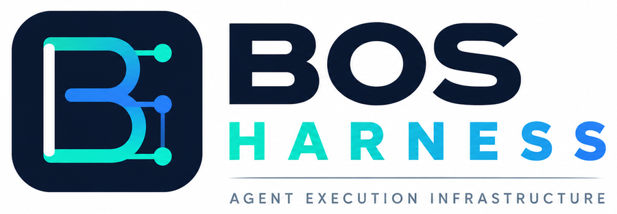
</p>

<h1 align="center">BOS — Brain Operating System</h1>

<p align="center">
  <strong>分布式、可组合的 Agent 与 Capability 平台</strong>
</p>

<p align="center">
  将 Agent、工具、运行时与资源组合成面向任务的工作空间。<br>
  连接独立的 BSH 节点，让 Agent 跨机器、跨信任边界协同工作。
</p>

<p align="center">
  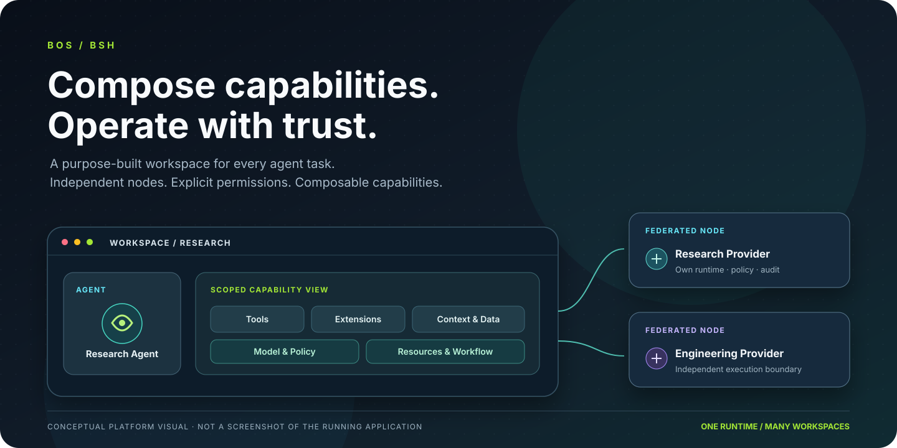
</p>

<p align="center">
  <a href="https://pypi.org/project/nbos"></a>
  <a href="https://www.npmjs.com/package/@open1s/jsbos"></a>
  <a href="https://github.com/open1s/bos/actions/workflows/rust.yml"></a>
  <a href="https://github.com/open1s/bos/actions/workflows/binding-parity.yml"></a>
  <a href="https://img.shields.io/github/license/open1s/bos"></a>
</p>

<p align="center">
  <a href="#bos-是什么">BOS 是什么</a> ·
  <a href="#bsh-平台定位">BSH 平台定位</a> ·
  <a href="#总体架构">总体架构</a> ·
  <a href="#快速开始">快速开始</a> ·
  <a href="#文档">文档</a>
</p>

---

## BOS 是什么？

**BOS 是一个以 Rust 为核心，用于构建、组合和运行分布式 AI Agent 系统的平台基础。**

BSH 是 BOS 面向用户和 Agent 系统运营者的核心产品。它不只是一个桌面 Agent 工作空间，而是一个**分布式、可组合的 Agent 与 Capability 平台**。

单个 BSH 节点首先是一个 Capability Container：可以将 Agent、工具、扩展、模型、上下文和资源按需装配为面向特定任务的工作空间。多个独立 BSH 节点进一步组成 Federation，使 Agent 和 Capability 能够跨机器发现、委派和组合，同时保留各节点独立的 Runtime 与安全边界。

BOS 提供统一执行基础和多语言开发接口；BSH 则把这些能力组织成可组合、可运营、可分布式协作的 Agent 平台。

| 层次 | 职责 |
|---|---|
| **BOS Runtime** | Rust 原生 Agent 执行、工具分发、模型集成、消息通信与运行时治理 |
| **BSH Node** | 承载工作空间、Agent、扩展和本地资源的桌面与运行时宿主；完整可组合容器是 BSH 2.0 的目标 |
| **Composition Engine** | 目标子系统：独立于 Agent 推理，解析、校验并激活面向任务的 Capability 组合 |
| **Ferris Extension Framework** | 管理扩展包、加载、生命周期和多种执行 Provider |
| **Federation** | 目标子系统：连接自治节点，并提供经过明确授权的远程能力与 Agent 服务 |
| **Rust / NBOS / JSBOS** | 访问同一套 BOS 实现的 Rust、Python 和 JavaScript 接口 |

### 一句话理解平台

**One Runtime. Composable Workspaces. Collaborative Agents. Federated Capabilities. Independent Trust Boundaries.**

一个 Runtime、可组合的工作空间、协同工作的 Agent、联邦化的能力，以及相互独立的信任边界。

## BSH 平台定位

BSH 有两个相互补充的核心角色。

<p align="center">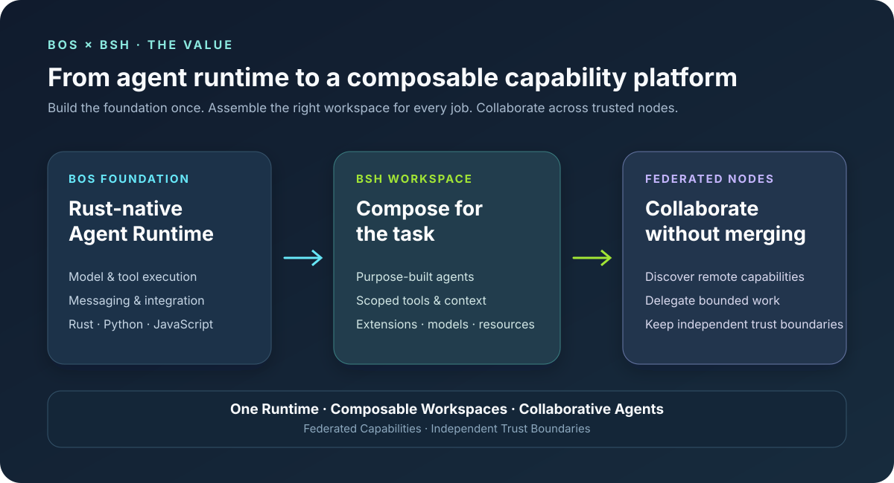</p>

BSH 将 BOS 的底层能力转化为可运营的工作环境：按任务装配能力，在受治理的 Workspace 中执行，通过扩展持续增强，并在需要协作时连接独立节点。

### 1. 可组合的 Capability Container

一个 BSH 节点只装配当前用途真正需要的能力。每个 Workspace 都可以获得经过裁剪的 Capability View，而不是把节点上安装的全部工具暴露给每一个 Agent。

一个 Composition 可以包含：

- **Agents** —— 面向任务的 Agent、专业角色和受委派的工作者。
- **Tools & Skills** —— 内置工具、自定义工具、Skills 和 MCP 集成。
- **Extensions** —— 由 Ferris 管理的宿主扩展与隔离扩展包。
- **Models & Policies** —— 模型 Provider、路由选择、权限和执行约束。
- **Context & Resources** —— 项目文件、记忆、服务以及显式授权的资源。
- **Workflows** —— 可复用的任务组合与协同 Agent 活动。

Composition 是平台的一等能力，不是 Agent Prompt 的附属行为。Composition Engine 独立于 ReAct/Agent 推理引擎。AI 可以提出装配方案，但最终由 Runtime 确定性地校验兼容性、依赖、权限和资源限制，再决定是否激活。

<p align="center">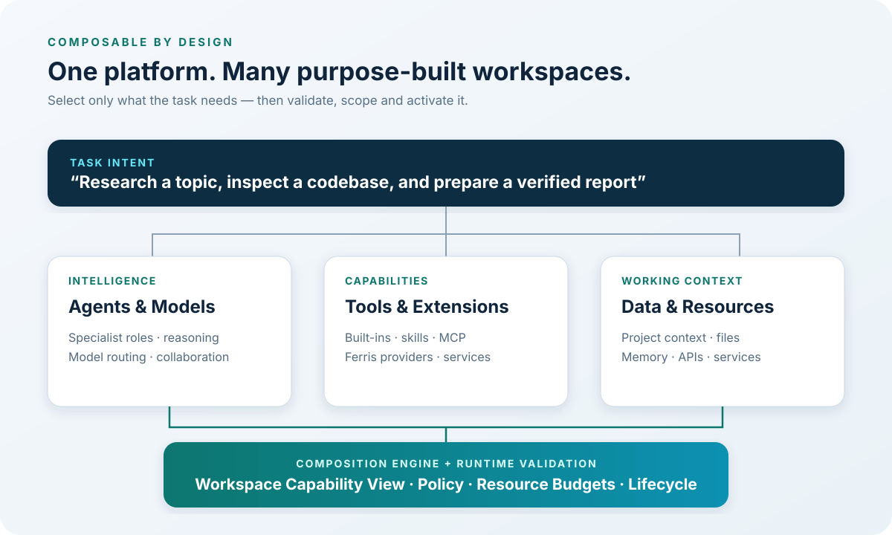</p>

### 2. 分布式 Agent 与 Capability 平台

每个 BSH 安装都是一个自治节点。多个节点可以组成 Federation，在保留各自身份、Runtime、策略、密钥、文件和审计记录的前提下进行协作。

目标 Federation 能力包括：

- **节点与能力发现** —— 发现 Peer 以及它们主动发布的能力。
- **远程 Capability 调用** —— 通过本地、受策略约束的接口调用远程能力。
- **Agent 任务委派** —— 将边界明确的任务委派给其他节点上的 Agent，并接收结果。
- **多 Agent 协作** —— 当任务需要分布式专业能力或资源时，跨节点协调多个 Agent。
- **资源协作** —— 请求访问经过选择的服务或资源，而不是复制整个节点环境。
- **独立治理** —— 请求方和提供方双端授权；任何一端都可以拒绝或撤销访问。

Federation 不是把多个节点合并成一个超级进程。协调器可以辅助节点会合、发现或调度，但不取得 Peer 的执行控制权。远程 Capability 始终由远程节点提供，发现不代表信任。

<p align="center">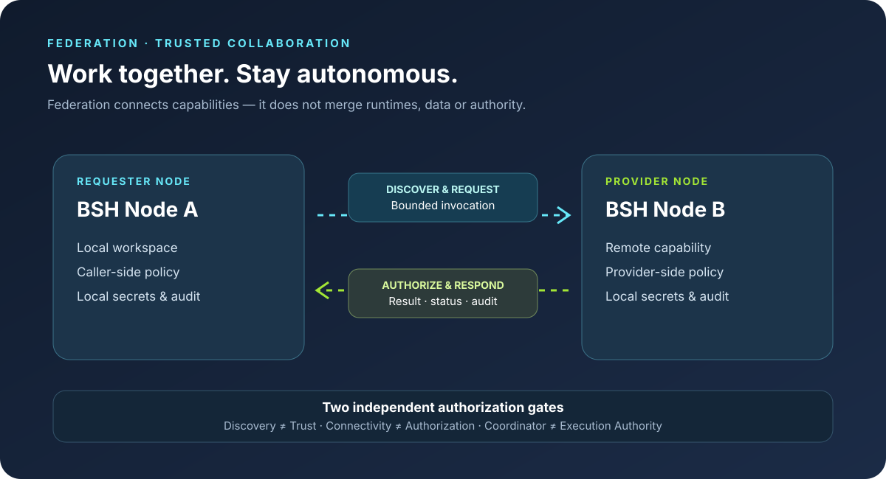</p>

> **实现状态说明：** BOS 已具备 Rust Runtime、Agent/Tool 执行、消息通信基础、BSH 桌面宿主、Ferris 扩展框架和 MCP 集成。完整的 BSH Composition 与 Federation 模型是平台的目标架构，将分阶段实现。上面列出的目标 Federation 能力不代表所有功能已经正式可用。

## BSH 可以组合出什么？

BSH 面向的是**按任务装配的工作空间**，而不是一个默认拥有全部工具权限的万能 Agent。下面三个场景展示同一套 BOS 基础如何组合成不同用途的工作环境。它们是组合蓝图示例，不代表这些预置方案已经开箱交付。

### Research Workspace · 研究工作空间

<p align="center">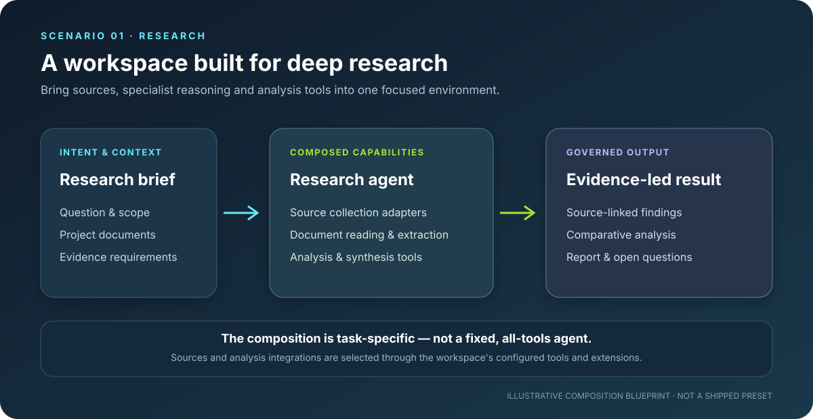</p>

将研究目标、项目文档和选定的信息源集成，与研究 Agent 及分析工具组合起来。Workspace 可以围绕证据收集、信息提取、结果比较和结构化报告进行配置。信息源检索和专业分析能力由该 Workspace 配置的工具与扩展提供。

### Software Engineering Workspace · 软件工程工作空间

<p align="center">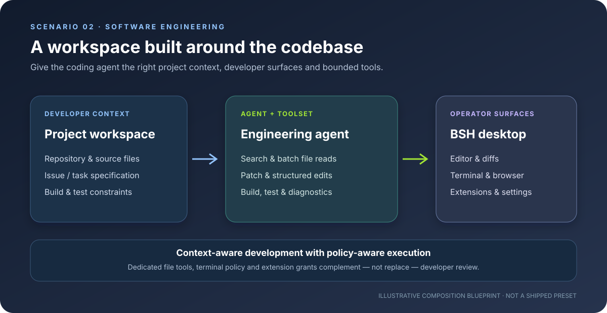</p>

为 Coding Agent 提供代码仓库上下文和聚焦的工具集合：文件发现与批量读取、结构化编辑、终端操作、浏览器访问以及相关扩展。BSH 桌面端已经提供编辑器、Diff、终端和浏览器等操作界面；专用工具和执行策略则约束 Agent 的实际操作。开发者仍需审查代码变更和测试结果。

### Distributed Multi-Agent Workspace · 分布式多 Agent 工作空间

<p align="center">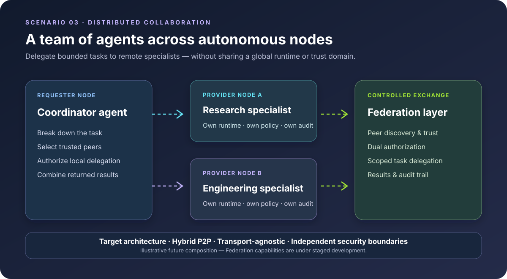</p>

协调 Workspace 可以将有明确边界的研究或工程任务委派给其他 BSH 节点上的专业 Agent，再汇总结果。每个节点保留自己的 Runtime、Secrets、Policy 和 Audit；远程任务必须经过调用方和提供方的双端授权。

> **路线图状态：** 分布式场景展示的是 BSH Federation 的目标架构。节点注册、发现、远程 Capability 调用和跨节点任务委派将分阶段实现；这不代表完整工作流当前已经可用。

## 总体架构

BOS 将共享执行基础、本地组合和跨节点协作分离。

<p align="center">
  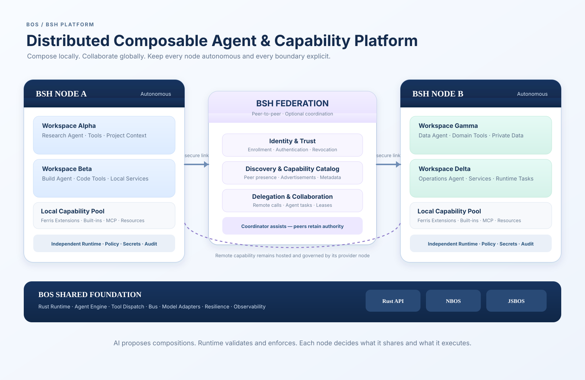
</p>

### 单节点架构

在一个 BSH 节点内部，各子系统有明确的职责边界：

<p align="center">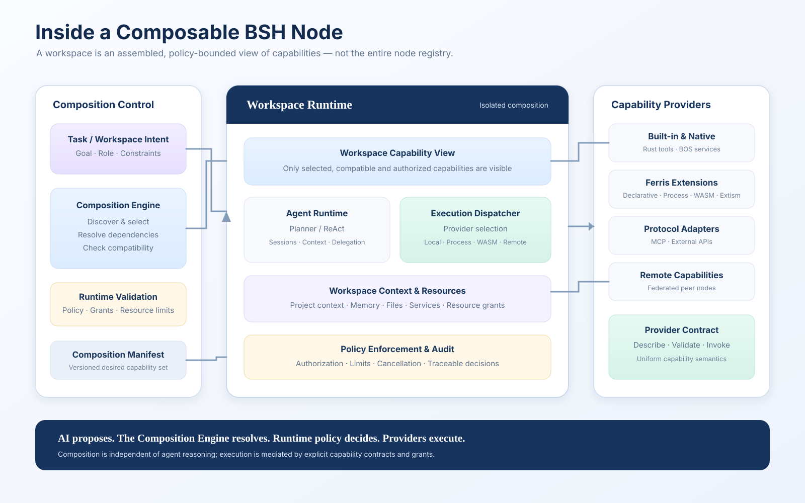</p>

| 子系统 | 职责 |
|---|---|
| **Agent Runtime** | 运行 Agent 和推理循环，管理 Session，协调工具调用 |
| **Capability System** | 描述可用操作，并管理对 Capability Provider 的访问 |
| **Composition Engine** | 目标：解析面向任务的组合方案，生成 Workspace Capability View |
| **Workspace Runtime** | 目标：激活并治理 Composition，管理其上下文、资源与生命周期 |
| **Ferris** | 管理扩展包、Provider、生命周期和执行边界 |
| **Policy & Audit** | 执行现有授权与运行控制；统一的组合级策略和审计模型仍是目标 |
| **Bus & Adapters** | 为本地组件和外部系统提供消息通信与集成边界 |

### Federation 架构

Federation 连接节点，但不合并节点。

| 平面 | 职责 |
|---|---|
| **Identity & Trust** | 节点身份、注册、信任建立、撤销和 Peer 认证 |
| **Discovery & Control** | Peer 发现、Capability 公告、策略元数据和协调 |
| **Delegation & Collaboration** | 有边界的任务委派、远程 Agent 交互、租约和任务状态 |
| **Data & Execution** | 经授权的远程调用，以及最小化的任务输入和结果交换 |

Federation Protocol 与底层传输解耦。Zenoh 等传输可以作为实现基础，但仅仅建立传输连接并不代表身份可信、访问已授权或双方已建立信任。

### BSH 扩展框架与 Agent 模型

<p align="center">
  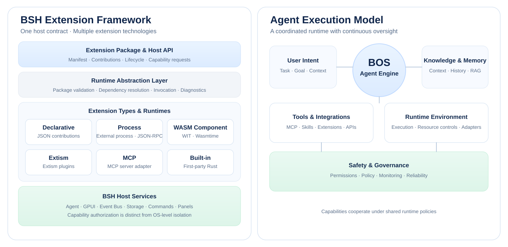
</p>

扩展框架是集成在 BSH 中的子系统，通过明确契约向宿主提供能力，而不是另建一套 Agent Runtime。MCP 是集成协议和 Adapter，不是平台的标准 Capability 模型。

## 为什么选择 BOS？

- **Rust 原生执行。** 原生应用和语言绑定共享同一套底层实现。
- **面向组合设计。** 将 Agent、工具、扩展、模型、上下文和资源装配成面向任务的工作空间。
- **Agent Runtime。** ReAct 执行协调模型响应、工具调用、结果观察和生命周期 Hooks。
- **面向 LLM 的工具设计。** 通过工具契约、Schema 和有界输出，帮助模型更准确地选择和使用能力。
- **可扩展执行。** Ferris 支持 Declarative、Process、WASM Component、Extism、MCP 和 Built-in 等 Provider。
- **分布式通信基础。** Bus 为系统组件提供 Pub/Sub、Query/Response 和 RPC 模式。
- **执行边界治理。** Capability 授权、Sandbox、资源限制和审计属于 Runtime 的职责。
- **多语言互操作。** Rust、Python 和 JavaScript 接口使用同一套底层实现。

## BOS 开发者基础

BOS 将核心实现集中在 Rust 中，并通过 Rust、Python 和 JavaScript 接口向不同技术栈开放。BSH 则是构建在同一基础之上的操作与管理工作空间。

<p align="center">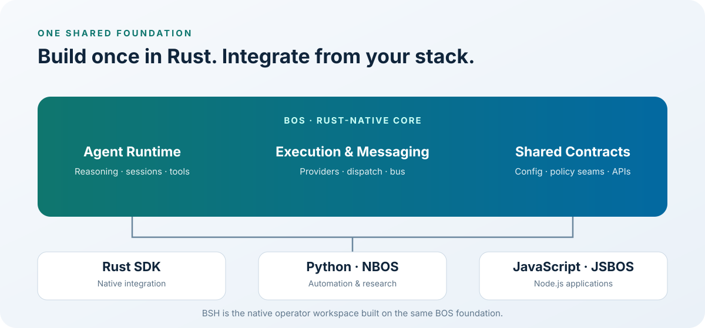</p>

## 快速开始

根据应用场景选择开发接口。

### Python

```bash
pip install nbos
```

```python
from nbos import BrainOS, tool

@tool("Add two numbers")
def add(a: int, b: int) -> int:
    return a + b

async with BrainOS() as brain:
    agent = brain.agent("assistant").register(add)
    print(await agent.ask("What is 2 + 2?"))
```

指南：[Python 使用指南](docs/python-user-guide.md)

### JavaScript / Node.js

```bash
npm install @open1s/jsbos
```

```javascript
import { BrainOS, ToolDef } from "@open1s/jsbos";

const add = new ToolDef(
  "add",
  "Add two numbers",
  (args) => args.a + args.b,
  { type: "object", properties: { a: { type: "number" }, b: { type: "number" } }, required: ["a", "b"] },
);

const brain = new BrainOS();
await brain.start();
const agent = await brain.agent("assistant").register(add).start();
console.log(await agent.runSimple("What is 2 + 2?"));
await brain.stop();
```

指南：[JavaScript 使用指南](docs/javascript-user-guide.md)

### Rust

从 workspace 中引入所需 Crate，直接使用 Rust Runtime：

```rust
use agent::{Agent, AgentConfig};

#[tokio::main]
async fn main() -> Result<(), Box<dyn std::error::Error>> {
    let config = AgentConfig::default()
        .name("assistant")
        .model("gpt-4o")
        .base_url("https://api.openai.com/v1")
        .api_key(std::env::var("OPENAI_API_KEY")?);

    let agent = Agent::from_config(config);
    println!("{}", agent.run_simple("Hello").await?);
    Ok(())
}
```

指南：[Rust 使用指南](docs/rust-user-guide.md)

### 运行 BSH

```bash
git clone https://github.com/open1s/bos
cd bos
cargo build --release -p bsh
./target/release/bsh
```

BSH 需要 Rust 1.97+ 和 Zig 0.16（用于构建 Ghostty 终端集成）。
macOS 也可以使用 `./crates/bsh/make-dev-app.sh` 打包开发版本。
Linux 构建依赖见 [Rust workflow](.github/workflows/rust.yml)。

### 安装 BSH

预编译安装包发布在 [Releases](https://github.com/open1s/bos/releases)。
各版本支持的平台和安装格式以 Release 说明为准，每个版本均附带
`SHA256SUMS` 校验文件。

Tag 驱动的构建、签名和公证流程见
[docs/bsh-release.md](docs/bsh-release.md)。

## BSH 桌面环境

BSH 提供基于 GPUI 的原生环境，用于开发、使用和运营 Agent。它也是本地工作空间以及未来分布式工作空间的操作界面。

- **Workspace 与 Session** —— 组织项目和持久化对话。
- **Agent 交互** —— 流式响应、任务计划、消息队列和可见的子 Agent 活动。
- **集成终端** —— Ghostty 终端界面，并在命令执行前进行策略检查。
- **浏览器面板** —— 在 Agent 工作空间中使用嵌入式 WebView。
- **代码编辑器** —— 文件树、标签页、Diff 和 tree-sitter 语言语法。
- **设置与凭据** —— Provider 配置和加密 Vault。
- **双语界面** —— 中文与英文。
- **扩展能力** —— 增加工具、命令、面板、提示词、上下文、技能、主题、语言服务、Agent 角色、工作流、存储和 Hooks。

### BSH 界面预览

> **以下均为界面占位图，并非真实应用截图。** 在将其作为产品界面证据使用前，请替换为实际运行的 BSH 截图。

| 主工作空间 | Agent 会话 |
|---|---|
| 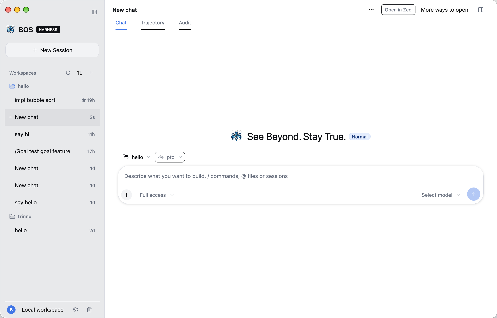 | 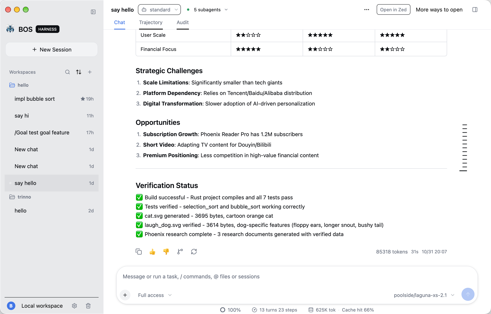 |

| 扩展管理器 | 模型与设置 |
|---|---|
| 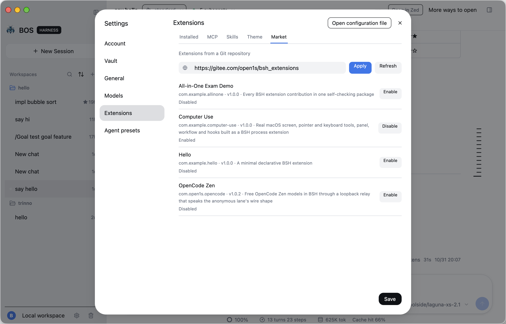 | 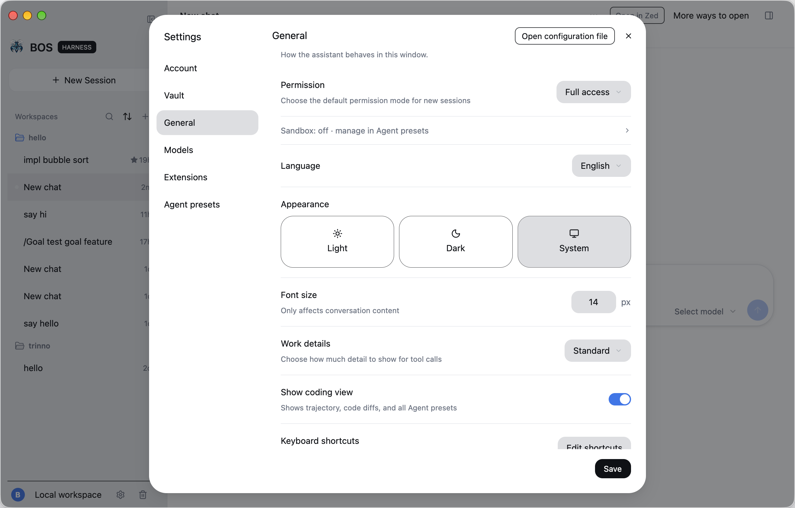 |

替换要求：[BSH 截图替换指南](docs/assets/bsh-showcase/README.md)。

## Ferris 扩展框架

[Ferris](crates/ferris-core/) 是 BSH 使用的扩展框架。它将扩展包和生命周期管理与宿主 Agent 推理引擎分离。BSH 通过明确的契约和权限检查，将扩展提供的功能适配为宿主 Capability。

| Provider | 适用场景 |
|---|---|
| **Declarative** | JSON 定义的工具、面板、提示词和主题 |
| **Process** | 通过 JSON-RPC 通信的现有程序和服务 |
| **WASM Component** | 使用 WebAssembly Component Model 与 WIT 的可移植组件 |
| **Extism** | 接入现有 Extism 插件 |
| **MCP** | 通过 Adapter 复用 MCP Server |
| **Built-in** | 集成到宿主的第一方 Rust 能力 |

创建并验证扩展：

```bash
bsh ext new com.acme.hello --dir hello
bsh ext validate hello
bsh ext mock hello echo '{"text":"hi"}'
bsh ext install hello
bsh ext list
bsh ext doctor
```

从以下资料开始：
- [BSH 扩展平台](docs/bsh-extension.md)
- [WIT 接口](crates/bsh/wit/extension.wit)
- [扩展示例](examples/extensions/)

**安全说明：**扩展能力授权与操作系统级隔离是不同的控制层。实际执行能力因操作系统和扩展运行时而异。当前契约与限制请参阅 [BSH 扩展平台](docs/bsh-extension.md) 和 [安全策略](SECURITY.md)。

## 模型配置

BOS 支持 OpenAI 兼容接口、Anthropic、NVIDIA NIM、Google AI 和 OpenRouter。
在 `~/.bos/conf/config.toml` 中配置默认模型：

```toml
[global_model]
api_key = "your-api-key"
base_url = "https://api.openai.com/v1"
model = "gpt-4"

[llm.nvidia]
api_key = "nv-..."
base_url = "https://integrate.api.nvidia.com/v1"
model = "nvidia/your-model"
```

如果调用参数和配置文件都没有提供 key，绑定接口会读取
`OPENAI_API_KEY`。BSH 可在 **设置 → 模型** 中管理 Provider，
敏感凭据存储在加密 Vault 中。

## 文档

| 资料 | 内容 |
|---|---|
| [BOS / BSH 实战手册](docs/BOS-BSH-Textbook.md) | Runtime、桌面宿主与扩展框架的深入指南 |
| [总体架构](ARCHITECTURE.md) | 当前组件职责与架构说明 |
| [BSH 2.0 Workspace 验收规范](docs/bsh-2.0-e2e-acceptance.md) | 基于现有代码的差距分析、端到端演示场景与安全验收标准 |
| [Rust 使用指南](docs/rust-user-guide.md) | 在 Rust 中嵌入和使用 BOS |
| [Python 使用指南](docs/python-user-guide.md) | 在 Python 中使用 BOS |
| [JavaScript 使用指南](docs/javascript-user-guide.md) | 在 Node.js / JavaScript 中使用 BOS |
| [BSH 扩展平台](docs/bsh-extension.md) | Manifest、Provider、生命周期、Capability、CLI 与安全 |
| [BSH 内置工具 2.0](docs/bsh-built-in-tools-2.0.md) | 面向 LLM 的工具契约、批量文件操作、输出预算与基准测试计划 |
| [贡献者上手指南](ONBOARDING.md) | 配置开发环境 |
| [设置](docs/bsh-settings-spec.md) · [终端策略](docs/bsh-terminal-policy.md) · [Hooks](docs/bsh-hook-system.md) | 子系统规范 |
| [BSH 发布流程](docs/bsh-release.md) | 安装包、签名与发布工作流 |
| [REX 指南](docs/rex-user-guide.md) · [诊断](docs/diagnostics.md) | 资源工具与故障排查 |
| [Wiki](https://github.com/open1s/bos/wiki) · [更新日志](CHANGELOG.md) | 使用指南与版本记录 |

## 构建、测试与贡献

```bash
cargo build --workspace
cargo test --workspace
cargo clippy --workspace --all-targets -- -D warnings
cargo fmt --all
RUSTDOCFLAGS="-D warnings" cargo doc --no-deps
```

Python 和 JavaScript 绑定测试：

```bash
cd crates/nbos  && maturin develop && pytest -m "not llm"
cd crates/jsbos && npm install && npx ava
```

- [贡献指南](CONTRIBUTING.md)
- [安全策略](SECURITY.md)
- [GitHub Issues](https://github.com/open1s/bos/issues)
- [Good first issues](https://github.com/open1s/bos/labels/good%20first%20issue)

如果 BOS 对你有帮助，欢迎给仓库点一个 Star，也欢迎分享你的项目和使用案例。真实反馈能帮助更多开发者发现 BOS，也能帮助平台确定后续方向。

## License

MIT OR Apache-2.0 · [Releases](https://github.com/open1s/bos/releases)
