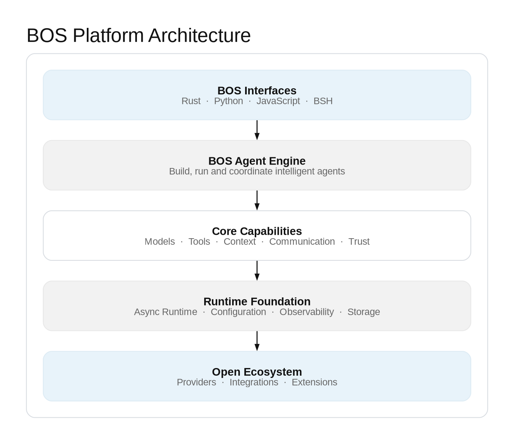

<p align="right">
  <a href="README.md">English</a> · <b>中文</b>
</p>

<p align="center">
  
</p>

<h1 align="center">BOS — Rust 原生 AI Agent 平台</h1>

<p align="center">
  <strong>One Runtime. Multiple Interfaces. One Extensible Agent Workspace.</strong><br>
  一个运行时，多种开发接口，一个可扩展的 Agent 工作空间。
</p>

<p align="center">
  以统一的 Rust Runtime 为核心，通过 Rust、Python 和 JavaScript 接口构建 Agent，
  并在原生 GPUI 桌面工作空间 BSH 中开发、使用和管理 Agent。
</p>

<p align="center">
  <a href="https://pypi.org/project/nbos"></a>
  <a href="https://www.npmjs.com/package/@open1s/jsbos"></a>
  <a href="https://github.com/open1s/bos/actions/workflows/rust.yml"></a>
  <a href="https://github.com/open1s/bos/actions/workflows/binding-parity.yml"></a>
  <a href="https://img.shields.io/github/license/open1s/bos"></a>
</p>

<p align="center">
  <a href="#快速开始">快速开始</a> ·
  <a href="#总体架构">总体架构</a> ·
  <a href="#bsh-agent-工作空间">BSH 工作空间</a> ·
  <a href="#扩展平台">扩展平台</a> ·
  <a href="#文档">文档</a>
</p>

---

## BOS 是什么？

**BOS 是一个以共享 Rust 执行内核为基础的 AI Agent 平台。**
你可以直接通过 Rust 使用 Runtime，通过 NBOS（Python）和 JSBOS（JavaScript）
调用同一套底层实现，也可以在原生 GPUI 桌面工作空间 BSH 中开发和运行 Agent。

| 组成 | 定位 | 适用场景 |
|---|---|---|
| **BOS Runtime** | 共享的 Rust Agent 执行核心 | 将 Agent 能力嵌入应用和服务 |
| **Rust** | Runtime 的原生开发接口 | 构建 Rust 应用与基础设施 |
| **NBOS** | 同一 Runtime 的 Python 接口 | Python 应用、自动化和原型开发 |
| **JSBOS** | 同一 Runtime 的 JavaScript / Node.js 接口 | Node.js 服务和 JavaScript 工具 |
| **BSH** | 原生 GPUI Agent 工作空间 | 在统一桌面环境中开发、使用和管理 Agent |
| **Extension Platform** | BSH 内部的扩展层 | 通过工具、命令、面板等能力定制工作空间 |

## 总体架构

BOS 将共享执行核心与开发者接口、桌面工作空间分离。Rust 应用、NBOS 和 JSBOS
使用同一套原生 Runtime；BSH 是直接基于 BOS Crate 构建的 GPUI 原生应用。
Extension Platform 扩展的是 BSH，而不是另建一套 Agent Runtime。

<p align="center">
  
</p>

Runtime 集成 Agent 编排、工具与技能分发、消息通信、模型适配和弹性治理。
配置、遥测、记忆、能力控制及外部集成提供基础支撑。下图展示系统子系统、集成边界和协作关系，而不是按时间顺序执行的流程。

### BSH 扩展框架与 Agent 模型

配套图展示 BSH 扩展框架的宿主边界，以及 Agent Runtime 所依赖的协作能力。扩展框架是集成在 BSH 中的子系统；Agent 模型由多个协作能力构成，并受统一的安全与运行时治理约束。

<p align="center">
  
</p>

### Agent 执行流程

ReAct 执行循环将模型推理与受策略约束的工具执行结合起来。工具结果会回到会话上下文，
Agent 持续迭代，直到生成最终响应或达到配置的执行边界。

## 为什么选择 BOS？

- **统一执行模型。** Rust、Python 和 JavaScript 接口共享同一套 Rust 实现，
  不需要维护多套独立 Agent 引擎。
- **Agent 编排。** 通过 ReAct 执行循环协调模型响应、工具调用、结果观察和生命周期 Hooks。
- **模型互操作。** Provider 适配器支持 OpenAI 兼容接口、Anthropic、NVIDIA NIM、
  Google AI 和 OpenRouter。
- **MCP 集成。** 通过 stdio 或 HTTP 连接 MCP Server，使用其工具、资源和提示模板。
- **多 Agent 通信。** 消息总线支持发布/订阅、请求/响应和 RPC。
- **上下文复用。** 按需加载目录化 `SKILL.md` 技能，并支持内存或文件型记忆。
- **运行治理。** 提供重试、限流、熔断、执行期限、指标和能力授权。
- **工作空间扩展。** BSH 支持 Declarative、Process、WASM Component、Extism、
  MCP 和 Built-in 等扩展类型。

## 快速开始

根据你的应用场景选择开发接口。

### Python

```bash
pip install nbos
```

```python
from nbos import BrainOS, tool

@tool("Add two numbers")
def add(a: int, b: int) -> int:
    return a + b

async with BrainOS() as brain:
    agent = brain.agent("assistant").register(add)
    print(await agent.ask("What is 2 + 2?"))
```

指南：[Python 使用指南](docs/python-user-guide.md)

### JavaScript / Node.js

```bash
npm install @open1s/jsbos
```

```javascript
import { BrainOS, ToolDef } from "@open1s/jsbos";

const add = new ToolDef(
  "add",
  "Add two numbers",
  (args) => args.a + args.b,
  { type: "object", properties: { a: { type: "number" }, b: { type: "number" } }, required: ["a", "b"] },
);

const brain = new BrainOS();
await brain.start();
const agent = await brain.agent("assistant").register(add).start();
console.log(await agent.runSimple("What is 2 + 2?"));
await brain.stop();
```

指南：[JavaScript 使用指南](docs/javascript-user-guide.md)

### Rust

从 workspace 中引入所需 Crate，直接使用 Rust Runtime：

```rust
use agent::{Agent, AgentConfig};

#[tokio::main]
async fn main() -> Result<(), Box<dyn std::error::Error>> {
    let config = AgentConfig::default()
        .name("assistant")
        .model("gpt-4o")
        .base_url("https://api.openai.com/v1")
        .api_key(std::env::var("OPENAI_API_KEY")?);

    let agent = Agent::from_config(config);
    println!("{}", agent.run_simple("Hello").await?);
    Ok(())
}
```

指南：[Rust 使用指南](docs/rust-user-guide.md)

### 运行 BSH

```bash
git clone https://github.com/open1s/bos
cd bos
cargo build --release -p bsh
./target/release/bsh
```

BSH 需要 Rust 1.97+ 和 Zig 0.16（用于构建 Ghostty 终端集成）。
macOS 也可以使用 `./crates/bsh/make-dev-app.sh` 打包开发版本。
Linux 构建依赖见 [Rust workflow](.github/workflows/rust.yml)。

## BSH Agent 工作空间

**BSH 将 Agent 执行能力与日常开发工具整合到一个原生桌面工作空间。**
它基于 GPUI 构建，并使用 BOS Runtime。

- **工作区与会话** —— 组织项目和持久化对话。
- **Agent 交互** —— 流式响应、任务计划、消息队列和可见的子 Agent 活动。
- **集成终端** —— Ghostty 终端界面，并在命令执行前进行策略检查。
- **浏览器面板** —— 在 Agent 工作空间中使用嵌入式 WebView。
- **代码编辑器** —— 文件树、标签页、Diff 和 tree-sitter 语言语法。
- **设置与凭据** —— Provider 配置和加密 Vault。
- **双语界面** —— 中文与英文。
- **扩展能力** —— 增加工具、命令、面板、提示词、上下文、技能、主题、
  语言服务、Agent 角色、工作流、存储和 Hooks。

### BSH 界面预览

> **以下均为界面占位图，并非真实应用截图。** 在将其作为产品界面证据使用前，请替换为实际运行的 BSH 截图。

| 主工作空间 | Agent 会话 |
|---|---|
|  |  |

| 扩展管理器 | 模型与设置 |
|---|---|
|  |  |

替换要求：[BSH 截图替换指南](docs/assets/bsh-showcase/README.md)。

## 扩展平台

Extension Platform 是 BSH 的工作空间扩展层。扩展包通过
`extension.toml` 描述；BSH 负责校验包内容、解析依赖、管理生命周期，
并在扩展请求宿主能力时检查相应权限。

| 运行时 | 适用场景 |
|---|---|
| **Declarative** | JSON 定义的工具、面板、提示词和主题 |
| **Process** | 通过 JSON-RPC 通信的现有程序和服务 |
| **WASM Component** | 使用 WebAssembly Component Model 与 WIT 的可移植组件 |
| **Extism** | 接入现有 Extism 插件 |
| **MCP** | 复用 MCP Server |
| **Built-in** | 集成到 BSH 的第一方 Rust 能力 |

创建并验证扩展：

```bash
bsh ext new com.acme.hello --dir hello
bsh ext validate hello
bsh ext mock hello echo '{"text":"hi"}'
bsh ext install hello
bsh ext list
bsh ext doctor
```

从以下资料开始：
- [扩展开发指南](docs/bsh-extension-dev-guide.md)
- [扩展标准](docs/bsh-extension-standard.md)
- [WIT 接口](crates/bsh/wit/extension.wit)
- [扩展示例](examples/extensions/)

**安全说明：**扩展能力授权与操作系统级隔离是不同的控制层。
实际执行能力因操作系统和扩展运行时而异。当前契约与限制请参阅
[扩展标准](docs/bsh-extension-standard.md) 和 [安全策略](SECURITY.md)。

### 扩展包生命周期

扩展包从 Manifest 校验开始，经过依赖解析、不可变版本安装和运行时激活。
宿主能力授权是独立的安全边界；操作系统级隔离能力取决于具体运行时和平台。

## 模型配置

BOS 支持 OpenAI 兼容接口、Anthropic、NVIDIA NIM、Google AI 和 OpenRouter。
在 `~/.bos/conf/config.toml` 中配置默认模型：

```toml
[global_model]
api_key = "your-api-key"
base_url = "https://api.openai.com/v1"
model = "gpt-4"

[llm.nvidia]
api_key = "nv-..."
base_url = "https://integrate.api.nvidia.com/v1"
model = "nvidia/your-model"
```

如果调用参数和配置文件都没有提供 key，绑定接口会读取
`OPENAI_API_KEY`。BSH 可在 **设置 → 模型** 中管理 Provider，
敏感凭据存储在加密 Vault 中。

## 文档

| 资料 | 内容 |
|---|---|
| [BOS / BSH 实战手册](docs/BOS-BSH-Textbook.md) | Runtime、桌面工作空间与扩展平台的深入指南 |
| [总体架构](ARCHITECTURE.md) | 组件职责与架构说明 |
| [Rust 使用指南](docs/rust-user-guide.md) | 在 Rust 中嵌入和使用 BOS |
| [Python 使用指南](docs/python-user-guide.md) | 在 Python 中使用 BOS |
| [JavaScript 使用指南](docs/javascript-user-guide.md) | 在 Node.js / JavaScript 中使用 BOS |
| [扩展开发指南](docs/bsh-extension-dev-guide.md) | 创建和测试 BSH 扩展 |
| [扩展标准](docs/bsh-extension-standard.md) | Manifest、运行时与能力授权契约 |
| [贡献者上手指南](ONBOARDING.md) | 配置开发环境 |
| [设置](docs/bsh-settings-spec.md) · [终端策略](docs/bsh-terminal-policy.md) · [Hooks](docs/bsh-hook-system.md) | 子系统规范 |
| [REX 指南](docs/rex-user-guide.md) · [诊断](docs/diagnostics.md) | 资源工具与故障排查 |
| [Wiki](https://github.com/open1s/bos/wiki) · [更新日志](CHANGELOG.md) | 使用指南与版本记录 |

## 构建、测试与贡献

```bash
cargo build --workspace
cargo test --workspace
cargo clippy --workspace --all-targets -- -D warnings
cargo fmt --all
RUSTDOCFLAGS="-D warnings" cargo doc --no-deps
```

Python 和 JavaScript 绑定测试：

```bash
cd crates/nbos  && maturin develop && pytest -m "not llm"
cd crates/jsbos && npm install && npx ava
```

- [贡献指南](CONTRIBUTING.md)
- [安全策略](SECURITY.md)
- [GitHub Issues](https://github.com/open1s/bos/issues)
- [Good first issues](https://github.com/open1s/bos/labels/good%20first%20issue)

如果 BOS 对你有帮助，欢迎给仓库点一个 Star，也欢迎分享你的项目和使用案例。
真实反馈能帮助更多开发者发现 BOS，也能帮助项目确定后续方向。

## License

MIT OR Apache-2.0 · Version 3.0.2 · [Releases](https://github.com/open1s/bos/releases)
