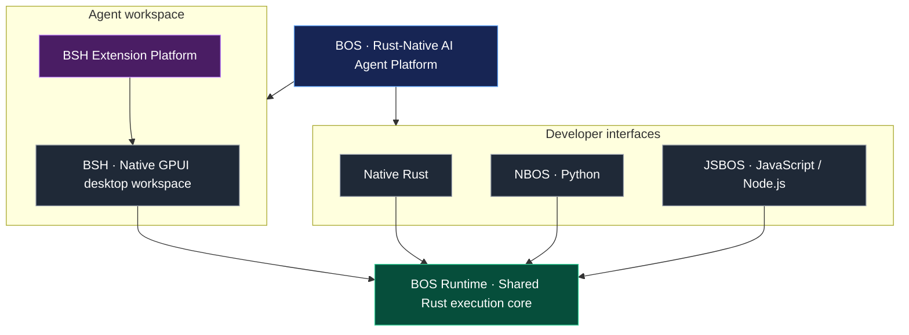

<p align="right">
  <b>English</b> · <a href="README-ZH.md">中文</a>
</p>

<p align="center">
  
</p>

<h1 align="center">BOS — The Rust-Native AI Agent Platform</h1>

<p align="center">
  <strong>One Runtime. Multiple Interfaces. One Extensible Agent Workspace.</strong>
</p>

<p align="center">
  Build with Rust, Python, and JavaScript. Develop and operate agents in BSH,
  the native desktop workspace built on BOS Runtime.
</p>

<p align="center">
  <a href="https://pypi.org/project/nbos"></a>
  <a href="https://www.npmjs.com/package/@open1s/jsbos"></a>
  <a href="https://github.com/open1s/bos/actions/workflows/rust.yml"></a>
  <a href="https://github.com/open1s/bos/actions/workflows/binding-parity.yml"></a>
  <a href="https://img.shields.io/github/license/open1s/bos"></a>
</p>

<p align="center">
  <a href="#quick-start">Quick start</a> ·
  <a href="#architecture">Architecture</a> ·
  <a href="#bsh-agent-workspace">BSH workspace</a> ·
  <a href="#extension-platform">Extensions</a> ·
  <a href="#documentation">Documentation</a>
</p>

---

## What is BOS?

**BOS is a Rust-native AI Agent Platform built around one shared execution core.**
Use the runtime directly from Rust, access it through the NBOS Python and JSBOS
JavaScript interfaces, or work with agents in BSH—the native GPUI desktop workspace.

| Part | Role | When to use it |
|---|---|---|
| **BOS Runtime** | Shared Rust agent execution core | Embed agent capabilities in applications and services |
| **Rust** | Native interface to the runtime | Build Rust applications and infrastructure |
| **NBOS** | Python interface to the same runtime | Python applications, automation and prototyping |
| **JSBOS** | JavaScript / Node.js interface to the same runtime | Node.js services and JavaScript tooling |
| **BSH** | Native GPUI agent workspace | Develop, use and operate agents in an integrated desktop environment |
| **Extension Platform** | Extensibility layer within BSH | Adapt the workspace with tools, commands, panels and other contributions |

## Architecture

The product is organised into three layers: a shared runtime, developer
interfaces, and the BSH workspace. The Extension Platform extends BSH; it is
not a separate runtime or a replacement for the BOS Runtime.



NBOS and JSBOS expose the shared native implementation through language
bindings. BSH is a native application that consumes BOS crates directly.

## Why BOS?

- **One execution model.** Rust, Python and JavaScript interfaces share the
  same Rust implementation rather than maintaining independent agent engines.
- **Agent orchestration.** ReAct execution coordinates model responses, tool
  calls, observations and lifecycle hooks.
- **Model interoperability.** Provider adapters support OpenAI-compatible
  endpoints, Anthropic, NVIDIA NIM, Google AI and OpenRouter.
- **MCP integration.** Connect to MCP servers over stdio or HTTP and work with
  their tools, resources and prompts.
- **Multi-agent communication.** A message bus provides publish/subscribe,
  query/response and RPC patterns.
- **Reusable context.** Load directory-based `SKILL.md` skills and use
  in-memory or file-backed memory.
- **Operational controls.** Configure retries, rate limiting, circuit
  breaking, execution deadlines, metrics and capability authorization.
- **An extensible workspace.** Extend BSH with declarative, process,
  WASM Component, Extism, MCP and built-in packages.

## Quick start

Choose the interface that fits your application.

### Python

```bash
pip install nbos
```

```python
from nbos import BrainOS, tool

@tool("Add two numbers")
def add(a: int, b: int) -> int:
    return a + b

async with BrainOS() as brain:
    agent = brain.agent("assistant").with_tools(add)
    print(await agent.ask("What is 2 + 2?"))
```

Guide: [Python user guide](docs/python-user-guide.md)

### JavaScript / Node.js

```bash
npm install @open1s/jsbos
```

```javascript
import { BrainOS, ToolDef } from "@open1s/jsbos";

const add = new ToolDef(
  "add",
  "Add two numbers",
  (args) => args.a + args.b,
  { type: "object", properties: { result: { type: "number" } }, required: ["result"] },
  { type: "object", properties: { a: { type: "number" }, b: { type: "number" } }, required: ["a", "b"] },
);

const brain = new BrainOS();
await brain.start();
const agent = await brain.agent("assistant").register(add).start();
console.log(await agent.runSimple("What is 2 + 2?"));
```

Guide: [JavaScript user guide](docs/javascript-user-guide.md)

### Rust

Use the runtime crates directly from the workspace:

```rust
use agent::{Agent, AgentConfig};

#[tokio::main]
async fn main() {
    let config = AgentConfig::default()
        .name("assistant")
        .model("openai/gpt-4o")
        .api_key(std::env::var("OPENAI_API_KEY").unwrap_or_default());

    let agent = Agent::from_config(config);
    println!("{}", agent.run_simple("Hello").await.expect("agent run"));
}
```

Guide: [Rust user guide](docs/rust-user-guide.md)

### Run BSH

```bash
git clone https://github.com/open1s/bos
cd bos
cargo build --release -p bsh
./target/release/bsh
```

BSH requires Rust 1.97+ and Zig 0.16 to build its Ghostty terminal integration.
On macOS, a development app can also be packaged with
`./crates/bsh/make-dev-app.sh`. See the
[Rust workflow](.github/workflows/rust.yml) for Linux build dependencies.

## BSH agent workspace

**BSH brings agent execution and everyday development tools into one native
desktop workspace.** It is built with GPUI and the BOS Runtime.

- **Workspaces and sessions** — organise projects and persistent conversations.
- **Agent-first interaction** — streaming responses, task plans, queued
  messages and visible subagent activity.
- **Integrated terminal** — Ghostty terminal surface with command-policy checks.
- **Browser pane** — embedded WebView for browsing alongside an agent.
- **Code editor** — file tree, tabs, diffs and tree-sitter language grammars.
- **Settings and credentials** — provider configuration and an encrypted vault.
- **Bilingual interface** — English and Chinese.
- **Extensions** — add tools, commands, panels, prompts, contexts, skills,
  themes, language services, agent roles, workflows, storage and hooks.

## Extension Platform

The Extension Platform is BSH's workspace extensibility layer. Packages are
described by `extension.toml`; BSH validates package contents, resolves
dependencies, manages lifecycle and evaluates capability permissions when an
extension requests host functionality.

| Runtime | Intended use |
|---|---|
| **Declarative** | JSON-defined tools, panels, prompts and themes |
| **Process** | Existing programs and services communicating through JSON-RPC |
| **WASM Component** | Portable components using the WebAssembly Component Model and WIT |
| **Extism** | Existing Extism plugins |
| **MCP** | Reuse an MCP server |
| **Built-in** | First-party Rust functionality linked into BSH |

Create and validate a package:

```bash
bsh ext new com.acme.hello --dir hello
bsh ext validate hello
bsh ext mock hello echo '{"text":"hi"}'
bsh ext install hello
bsh ext list
bsh ext doctor
```

Start here:
- [Extension developer guide](docs/bsh-extension-dev-guide.md)
- [Extension standard](docs/bsh-extension-standard.md)
- [WIT interface](crates/bsh/wit/extension.wit)
- [Extension examples](examples/extensions/)

**Security note:** extension capability authorization and operating-system
isolation are separate controls. Enforcement differs by operating system and
runtime. Consult the [extension standard](docs/bsh-extension-standard.md) and
[security policy](SECURITY.md) for the current contract and limitations.

## Model configuration

BOS supports OpenAI-compatible endpoints, Anthropic, NVIDIA NIM, Google AI
and OpenRouter. Configure a default model in `~/.bos/conf/config.toml`:

```toml
[global_model]
api_key = "your-api-key"
base_url = "https://api.openai.com/v1"
model = "gpt-4"

[llm.nvidia]
api_key = "nv-..."
base_url = "https://integrate.api.nvidia.com/v1"
model = "nvidia/your-model"
```

If the call and configuration file do not provide a key, the bindings read
`OPENAI_API_KEY`. BSH manages providers in **Settings → Models** and stores
sensitive credentials in its encrypted vault.

## Documentation

| Resource | Description |
|---|---|
| [BOS / BSH textbook](docs/BOS-BSH-Textbook.md) | In-depth guide to the runtime, desktop workspace and extensions |
| [Architecture](ARCHITECTURE.md) | Component responsibilities and architecture |
| [Rust user guide](docs/rust-user-guide.md) | Embed and use BOS from Rust |
| [Python user guide](docs/python-user-guide.md) | Use BOS from Python |
| [JavaScript user guide](docs/javascript-user-guide.md) | Use BOS from Node.js and JavaScript |
| [Extension developer guide](docs/bsh-extension-dev-guide.md) | Build and test BSH extensions |
| [Extension standard](docs/bsh-extension-standard.md) | Manifest, runtime and capability contract |
| [Contributor onboarding](ONBOARDING.md) | Set up a development environment |
| [Settings](docs/bsh-settings-spec.md) · [Terminal policy](docs/bsh-terminal-policy.md) · [Hooks](docs/bsh-hook-system.md) | Subsystem specifications |
| [REX guide](docs/rex-user-guide.md) · [Diagnostics](docs/diagnostics.md) | Resource tooling and troubleshooting |
| [Wiki](https://github.com/open1s/bos/wiki) · [Changelog](CHANGELOG.md) | Guides and release history |

## Build, test and contribute

```bash
cargo build --workspace
cargo test --workspace
cargo clippy --workspace --all-targets -- -D warnings
cargo fmt --all
RUSTDOCFLAGS="-D warnings" cargo doc --no-deps
```

Python and JavaScript binding tests:

```bash
cd crates/nbos  && maturin develop && pytest -m "not llm"
cd crates/jsbos && npm install && npx ava
```

- [Contributing guide](CONTRIBUTING.md)
- [Security policy](SECURITY.md)
- [GitHub issues](https://github.com/open1s/bos/issues)
- [Good first issues](https://github.com/open1s/bos/labels/good%20first%20issue)

If BOS is useful to you, consider starring the repository and sharing what you
build with it. Feedback and real-world examples help others discover BOS and
help guide its development.

## License

MIT OR Apache-2.0 · Version 3.0.2 · [Releases](https://github.com/open1s/bos/releases)
