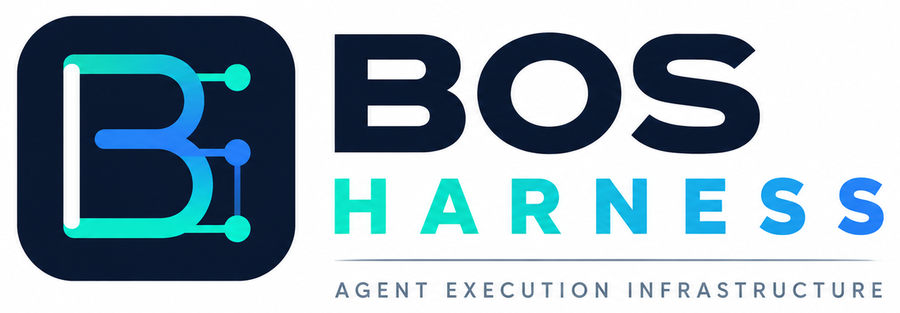
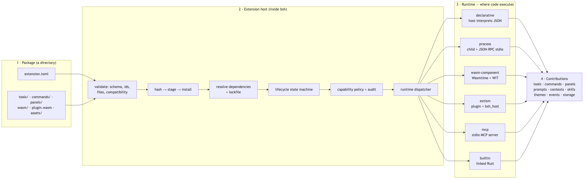
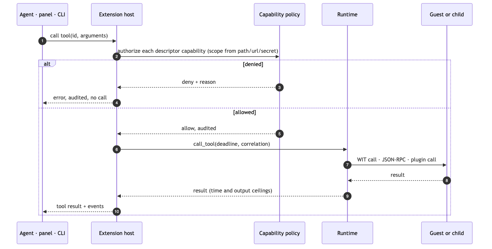

<p align="right">
  <b>English</b> · <a href="README-ZH.md">中文</a>
</p>

<p align="center">
  
</p>

<h1 align="center">BOS — The Rust-Native AI Agent Platform</h1>

<p align="center">
  <strong>One Rust core. Three developer interfaces. One native agent workspace.</strong>
</p>

<p align="center">
  BOS (BrainOS) is a composable platform for building, embedding, and operating AI agents.
  Its Rust runtime brings orchestration, tools, MCP, skills, memory, and multi-agent
  communication together behind one execution core. Use it directly from Rust, or through
  the NBOS Python and JSBOS JavaScript SDKs. <strong>BSH (BOS Harness)</strong> brings that
  same runtime into a native desktop workspace for agent-driven development.
</p>

<p align="center">
  <a href="https://pypi.org/project/nbos"></a>
  <a href="https://www.npmjs.com/package/@open1s/jsbos"></a>
  <a href="https://github.com/open1s/bos/actions/workflows/rust.yml"></a>
  <a href="https://github.com/open1s/bos/actions/workflows/binding-parity.yml"></a>
  <a href="https://img.shields.io/github/license/open1s/bos"></a>
  <a href="docs/BOS-BSH-Textbook.md"></a>
</p>

<p align="center">
  <a href="#quick-start">Quick start</a> ·
  <a href="#why-bos">Why BOS</a> ·
  <a href="#bsh-native-agent-workspace">BSH desktop app</a> ·
  <a href="#extension-platform">Extension platform</a> ·
  <a href="#documentation">Documentation</a>
</p>

---

## What is BOS?

**BOS provides the shared runtime foundation for building and operating AI agents.**

Instead of tying agent behavior to one language or one interface, BOS separates the
execution engine from the way developers use it. The Rust runtime provides the core
capabilities; NBOS and JSBOS expose the same engine to Python and JavaScript; and BSH
delivers a native desktop environment powered by that runtime. Embed agents in your own
software, or use the integrated workspace to develop and operate them.

| Product | What it does | Best for |
|---|---|---|
| **BOS Runtime** | Rust agent engine, tools, skills, memory, MCP client, multi-agent bus, policies and observability | Developers embedding agents into applications and services |
| **NBOS** | Python bindings for the shared BOS engine | Python applications, automation and prototypes |
| **JSBOS** | Node.js / JavaScript bindings for the shared BOS engine | Node.js services, developer tools and JavaScript automation |
| **BSH** | Native desktop AI agent workspace with chat, terminal, browser, editor and extensions | People who want an integrated environment to build and operate agents |

## Why BOS?

BOS is built around a simple architectural principle: **the agent runtime should not be
locked to a language, application, or interface.** One Rust implementation powers the native
runtime, the Python and JavaScript SDKs, and the BSH desktop application. Teams get one
execution model to embed in products, automate from scripts, and operate through a desktop
workspace.

- **One engine, three languages.** Build on the Rust core or use the Python and JavaScript
  bindings. The bindings share the same underlying implementation and are checked for API
  parity in CI.
- **Agent orchestration, not only chat.** Run the ReAct loop, stream model output, invoke tools,
  process observations, and continue execution with lifecycle hooks.
- **MCP built in.** Connect to Model Context Protocol servers over stdio or HTTP; discover and
  call tools and access resources and prompts.
- **Multi-agent communication.** Use publish/subscribe, query/response, and caller/callable RPC
  through a dedicated message bus.
- **Skills and memory.** Load directory-based `SKILL.md` knowledge on demand and retain useful
  context with in-memory or file-backed memory.
- **Operational controls.** Configure retries, rate limiting, circuit breaking, execution
  deadlines, token/tool metrics, and capability-based authorization.
- **Extensible by design.** Embed BOS in your application, or extend BSH with declarative,
  process, WASM Component, Extism, MCP, and built-in packages.

## Quick start

### Python

```bash
pip install nbos
```

```python
from nbos import BrainOS, tool

@tool("Add two numbers")
def add(a: int, b: int) -> int:
    return a + b

async with BrainOS() as brain:
    agent = brain.agent("assistant").with_tools(add)
    print(await agent.ask("What is 2 + 2?"))
```

### JavaScript / Node.js

```bash
npm install @open1s/jsbos
```

```javascript
import { BrainOS, ToolDef } from "@open1s/jsbos";

const add = new ToolDef(
  "add",
  "Add two numbers",
  (args) => args.a + args.b,
  { type: "object", properties: { result: { type: "number" } }, required: ["result"] },
  { type: "object", properties: { a: { type: "number" }, b: { type: "number" } }, required: ["a", "b"] },
);

const brain = new BrainOS();
await brain.start();
const agent = await brain.agent("assistant").register(add).start();
console.log(await agent.runSimple("What is 2 + 2?"));
```

### Rust

Add the crate you need from this workspace and use the same runtime directly:

```rust
use agent::{Agent, AgentConfig};

#[tokio::main]
async fn main() {
    let config = AgentConfig::default()
        .name("assistant")
        .model("openai/gpt-4o")
        .api_key(std::env::var("OPENAI_API_KEY").unwrap_or_default());

    let agent = Agent::from_config(config);
    println!("{}", agent.run_simple("Hello").await.expect("agent run"));
}
```

### Run BSH

```bash
git clone https://github.com/open1s/bos
cd bos
cargo build --release -p bsh
./target/release/bsh
```

BSH needs Rust 1.97+ and Zig 0.16 (the terminal pane builds Ghostty). On macOS, you can
also package a development build with `./crates/bsh/make-dev-app.sh`. For Linux build
dependencies, see the install list in [the Rust workflow](.github/workflows/rust.yml).

## Model and provider configuration

BOS supports OpenAI-compatible endpoints, Anthropic, NVIDIA NIM, Google AI, and OpenRouter.
Configure a default model in `~/.bos/conf/config.toml`:

```toml
[global_model]
api_key = "your-api-key"
base_url = "https://api.openai.com/v1"
model = "gpt-4"

[llm.nvidia]
api_key = "nv-..."
base_url = "https://integrate.api.nvidia.com/v1"
model = "nvidia/your-model"
```

Environment variables are also supported: `OPENAI_API_KEY`, `LLM_BASE_URL`, and
`LLM_MODEL`. In BSH, configure providers under **Settings → Models**. Sensitive values
are stored in its encrypted vault rather than plain-text settings.

BSH manages providers in **Settings → Models**. Sensitive credentials are stored in its
encrypted vault rather than written as plain text in the settings file.

---

## The BOS approach

| Design principle | How BOS implements it |
|---|---|
| **One shared runtime** | A Rust core powers native Rust applications, NBOS, JSBOS, and BSH. |
| **Agents as workflows, not just chat** | A ReAct loop coordinates model output, tool calls, observations, and lifecycle hooks. |
| **Interoperability** | MCP connects existing tool servers over stdio and HTTP; provider adapters connect supported model APIs. |
| **Multi-agent collaboration** | A dedicated bus supports publish/subscribe, query/response, and RPC communication. |
| **Reusable knowledge and context** | Directory-based `SKILL.md` skills and in-memory or file-backed memory provide reusable context. |
| **Operational control** | Retry policies, rate limiting, circuit breaking, deadlines, metrics, and capability authorization support controlled execution. |
| **An extensible runtime** | BSH supports declarative, process, WASM Component, Extism, MCP, and built-in extensions. |

BOS treats security boundaries as engineering guarantees that must be implemented and verified,
not as blanket marketing claims. Enforcement varies by operating system and execution path.
Windows AppContainer isolation for BSH Process/MCP extensions and Job Object resource limits
remain tracked work ([#43](https://github.com/open1s/bos/issues/43), [#39](https://github.com/open1s/bos/issues/39)).

---

## Inside the BOS runtime

- **Agent loop** — `crates/react` runs the ReAct cycle: stream, call tools, observe, continue.
  Hooks fire at the seams (`before_tool_call`, `after_llm_call`, `on_complete`, `on_error`, …)
  so a host can observe or gate a step without forking the engine.
- **Providers** — any OpenAI-compatible endpoint, the Anthropic protocol, NVIDIA NIM, Google
  AI and OpenRouter, selected by config or by the model's vendor prefix.
- **Tools** — wrap a closure with `FunctionTool`/`AsyncFunctionTool`, or implement
  `Tool`/`AsyncTool` and register it; the agent reaches them through the `react` seam, never
  through the bus.
- **Skills** — point the agent at a directory of `SKILL.md` folders and the model gets the
  catalogue in its system prompt, then calls `load_skill` for the full instructions.
- **Memory** — `InMemoryMemory` ranks by keyword overlap and recency; `FileMemory` persists the
  same ranking to JSON lines so it survives a restart. Filters scope recall; `{{memory}}` places
  it in the prompt.
- **MCP** — connect to servers you already have, over stdio or HTTP, and use their tools,
  resources and prompts as if they were native.
- **The bus** — `Publisher`/`Subscriber` for events, `Queryable` for request/response, and
  `Callable`/`Caller` for RPC. A session attaches all of them to one transport.
- **Sandbox** — `heel` is the one sandbox implementation: the workspace is the only writable place,
  executable bytes are written nowhere, reads are opt-in above a baseline, and network goes
  through a policy.
- **Observability** — tracing through `crates/logging`, plus call metrics (tokens, tool calls,
  wall time, rate-limit waits) that both bindings expose.

### MCP, without a wrapper library

```python
from nbos import McpClient

client = await McpClient.spawn("npx", ["-y", "@modelcontextprotocol/server-filesystem", "/tmp"])
await client.initialize()

tools = await client.list_tools()
print(await client.call_tool("echo", '{"text": "hello"}'))
```

| Capability | What you get |
|---|---|
| **Agent loop** | ReAct execution, streaming, tool calls, observations, lifecycle hooks |
| **LLM providers** | OpenAI-compatible APIs, Anthropic protocol, NVIDIA NIM, Google AI, OpenRouter |
| **Tools** | Sync and async tools, custom tool traits, JSON-schema-based definitions |
| **MCP** | stdio and HTTP clients; tools, resources and prompts |
| **Multi-agent bus** | Pub/sub, query/response, and RPC |
| **Skills** | On-demand loading from `SKILL.md` directories |
| **Memory** | In-memory and file-backed memory, metadata filters, prompt injection |
| **Resilience** | Retry classification, rate limiting, circuit breaker and deadlines |
| **Observability** | Tracing plus per-run token, tool-call, timing and rate-limit metrics |

### One runtime, consistent SDKs

NBOS and JSBOS are language interfaces over the same native engine, not independent
reimplementations. CI checks the public API surfaces, native wrapper mappings, and API
documentation for drift.

| | Python | JavaScript |
|---|---|---|
| Import | `from nbos import BrainOS, tool` | `import { BrainOS, ToolDef } from "@open1s/jsbos"` |
| Runtime | `async with BrainOS() as brain:` | `const brain = new BrainOS(); await brain.start()` |
| Create agent | `brain.agent("assistant")` | `brain.agent("assistant")` |
| Register tools | `.with_tools(add)` | `.register(toolDef)` |
| Run | `await agent.ask("…")` | `await agent.runSimple("…")` |

## BSH: native AI agent workspace

**BSH is the native desktop product built on the BOS runtime.**
It brings agent sessions, projects, terminal, browser, code editor, and extensions into one
GPUI workspace. Rather than keeping the agent in a separate chat window, BSH places agent
execution alongside the tools developers use to do real work.

- **Workspaces and sessions** — organize projects and persistent conversations; search,
  pin, archive, fork and restore sessions.
- **Agent-first chat** — streaming responses, turn navigation, task plans, queued messages,
  visible subagent runs and scheduled tasks.
- **Integrated terminal** — Ghostty terminal surface with command-policy checks.
- **Browser pane** — embedded WebView for browsing alongside an agent.
- **Code editor** — file tree, tabs, diffs and tree-sitter language grammars.
- **Encrypted settings** — model/provider configuration and an encrypted vault using
  Argon2id and XChaCha20-Poly1305.
- **Bilingual interface** — English and Chinese.
- **Extension platform** — add tools, commands, panels, prompts, contexts, skills, themes,
  language services, agent roles, workflows, storage and hooks.

## Extension platform

The BOS runtime is designed to be embedded in applications; BSH is designed to be extended
around developer workflows. Each extension is described by `extension.toml`. BSH validates
the manifest and package contents, resolves dependencies, manages lifecycle, and applies
capability policies when an extension requests host functionality.

<p align="center">
  
</p>

### Six extension runtimes

| Runtime | Use it for | Extension implementation |
|---|---|---|
| **Declarative** | JSON-defined tools, panels, prompts and themes | Configuration; no guest code |
| **Process** | Existing programs and command-line tools | Child process using line-delimited JSON-RPC |
| **WASM Component** | Portable components with a typed interface | WebAssembly Component Model and WIT |
| **Extism** | Existing Extism plugins | Extism plugin with the `bsh_host` import surface |
| **MCP** | Reusing an MCP server | MCP server over stdio |
| **Built-in** | First-party functionality | Rust code linked into the host |

<p align="center">
  
</p>

### Build and test an extension

```bash
export BSH=./target/release/bsh

$BSH ext new com.acme.hello --dir hello
$BSH ext validate hello
$BSH ext mock hello echo '{"text":"hi"}'
$BSH ext install hello
$BSH ext list
$BSH ext doctor
$BSH ext grant com.acme.hello workspace.write --scope workspace
$BSH ext logs com.acme.hello
```

Explore the examples in [`examples/extensions/`](examples/extensions/):
[`hello`](examples/extensions/hello),
[`process-echo`](examples/extensions/process-echo),
[`wasm-echo`](examples/extensions/wasm-echo),
[`extism-echo`](examples/extensions/extism-echo),
[`mcp-echo`](examples/extensions/mcp-echo), and
[`extism-hook`](examples/extensions/extism-hook).

The extension contract and developer resources:

- [Extension standard](docs/bsh-extension-standard.md) — normative manifest, capability and runtime contract.
- [Extension developer guide](docs/bsh-extension-dev-guide.md) — build your first package.
- [WIT interface](crates/bsh/wit/extension.wit) — typed WASM component contract.
- [Hook system](docs/bsh-hook-system.md) — lifecycle and observation hooks.
- [Validation script](scripts/ci/verify-bsh-examples.sh) — example validation used by CI.

**Security note:** extension authorization and OS-level isolation are separate layers.
Available sandbox enforcement differs by operating system and runtime; Windows isolation
for Process and MCP extension children is tracked separately. See
[the extension security standard](docs/bsh-extension-standard.md) and
[open security issues](https://github.com/open1s/bos/issues).

## Repository structure

```
crates/
├── agent/        agent runtime, tools, skills, memory, MCP, policies
├── react/        ReAct engine and LLM client
├── bus/          pub/sub, query/response and RPC
├── config/       configuration loading and discovery
├── logging/      tracing and instrumentation
├── qserde/       rkyv-based serialization for the bus
├── resource/     resource subsystem and rex CLI
├── bsh/          native desktop harness and extension platform
├── nbos/         Python bindings (pip install nbos)
└── jsbos/        JavaScript bindings (npm install @open1s/jsbos)
```

See [ARCHITECTURE.md](ARCHITECTURE.md) for the component and dependency model.

## Documentation

| Resource | Description |
|---|---|
| [BOS / BSH textbook](docs/BOS-BSH-Textbook.md) | 34-chapter practical guide to the runtime, desktop app and extension platform |
| [Python user guide](docs/python-user-guide.md) | Use BOS from Python |
| [JavaScript user guide](docs/javascript-user-guide.md) | Use BOS from Node.js and JavaScript |
| [Rust user guide](docs/rust-user-guide.md) | Embed and extend the Rust runtime |
| [Extension standard](docs/bsh-extension-standard.md) · [Developer guide](docs/bsh-extension-dev-guide.md) | Package contract and extension development |
| [Architecture](ARCHITECTURE.md) · [Onboarding](ONBOARDING.md) | System design and contributor setup |
| [Settings](docs/bsh-settings-spec.md) · [Terminal policy](docs/bsh-terminal-policy.md) · [Hooks](docs/bsh-hook-system.md) | Detailed subsystem specifications |
| [REX guide](docs/rex-user-guide.md) · [Diagnostics](docs/diagnostics.md) | Resource CLI and troubleshooting |
| [Wiki](https://github.com/open1s/bos/wiki) · [Changelog](CHANGELOG.md) | Guides and release history |

## Build, test and contribute

```bash
cargo build --workspace
cargo test --workspace
cargo clippy --workspace --all-targets -- -D warnings
cargo fmt --all
RUSTDOCFLAGS="-D warnings" cargo doc --no-deps
```

Python and JavaScript bindings have their own test suites:

```bash
cd crates/nbos  && maturin develop && pytest -m "not llm"
cd crates/jsbos && npm install && npx ava
```

- [Contributing guide](CONTRIBUTING.md)
- [Security policy](SECURITY.md)
- [GitHub issues](https://github.com/open1s/bos/issues)
- [Good first issues](https://github.com/open1s/bos/labels/good%20first%20issue)

If BOS is useful to you, consider **starring the repository** and sharing what you build with it.
Stars, issues, discussions and real-world examples help other developers discover the project
and help us prioritize what to improve.

## License

MIT OR Apache-2.0 · Version 3.0.2 · [Releases](https://github.com/open1s/bos/releases)
