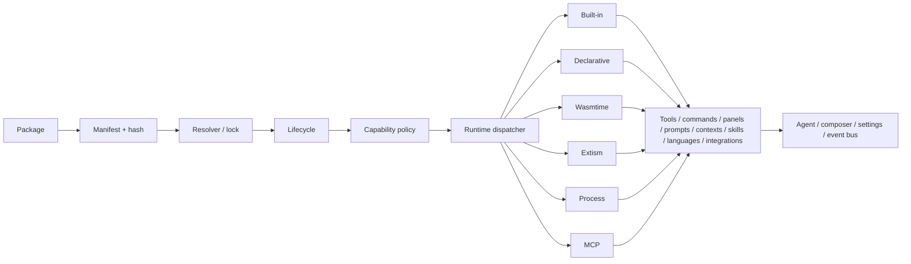
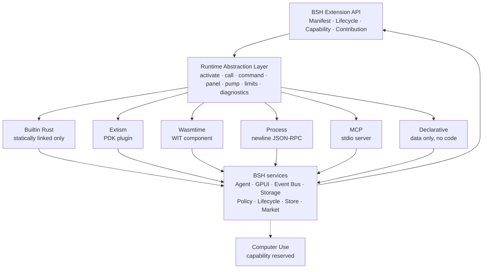

# BOS / BSH and the Extension Platform

### A comprehensive textbook for architects, package authors and operators

**Status:** BSH 3.x, extension API 1.0

**Normative companions:** `docs/bsh-extension-standard.md`, `crates/bsh/src/extension`

**Design background:** `docs/BSH_Extension_Framework_Design.md`

This book is the single narrative reference for the BOS/BSH extension system. It
merges the design rationale, the normative package contract, the developer guide,
the conformance matrix, the market contract and the review findings into one
text. It is written to be read in order by a new contributor and used as a
reference by an experienced package author.

Where this book and `bsh-extension-standard.md` disagree, the standard wins.
Where the standard and `crates/bsh/src/extension` disagree, the code and the
standard are both wrong somewhere, and the disagreement is a bug to fix in the
same change.

### How the source documents map into this book

| Source | Used for | Chapters |
|---|---|---|
| `docs/BSH_Extension_Framework_Design.md` | architecture, taxonomy, decisions, roadmap context | 2–12, 24 |
| `docs/bsh-extension-standard.md` | normative manifest, protocols, limits, security | 4–12, appendices |
| `docs/bsh-extension-dev-guide.md` | tutorials and runtime recipes | 13–20 |
| `docs/bsh-extension-conformance.md` | implementation status and honest gaps | 21, 24 |
| `docs/bsh-extension-market.md` | Git market contract and UI | 12, 23 |
| `docs/bsh-extension-review.md` | product/architecture/user findings | 24, 25 |
| `crates/bsh/src/extension` | current behaviour; second authority | throughout |

The older documents remain the short-form references; this book is the
narrative, the tutorial path and the operational checklist in one place.

### Three reading paths

- **New package author:** 1 → 2 → 4 → 5 → 13, then 7/9/21 as needed.
- **Runtime implementer:** 3 → 6 → 14/15/16/17 → 9 → 21/22.
- **Architect/operator:** 1 → 2 → 3 → 9 → 10 → 12 → 24, with 21/23 for release.

---

## Table of contents

**Part I — Orientation**

1. [BOS and BSH in one chapter](#1-bos-and-bsh-in-one-chapter)
2. [The extension mental model](#2-the-extension-mental-model)
3. [Architecture and boundaries](#3-architecture-and-boundaries)

**Part II — The contract**

4. [Package anatomy and the manifest](#4-package-anatomy-and-the-manifest)
5. [Every contribution kind](#5-every-contribution-kind)
6. [Choosing and implementing a runtime](#6-choosing-and-implementing-a-runtime)
7. [The declarative UI contract](#7-the-declarative-ui-contract)
8. [Events and host hooks](#8-events-and-host-hooks)
9. [Capabilities, trust and security](#9-capabilities-trust-and-security)
10. [Lifecycle, store, integrity and locking](#10-lifecycle-store-integrity-and-locking)
11. [Observability and the developer CLI](#11-observability-and-the-developer-cli)
12. [Registry and the Git market](#12-registry-and-the-git-market)

**Part III — Tutorials**

13. [Your first declarative package](#13-your-first-declarative-package)
14. [A process extension](#14-a-process-extension)
15. [A WASM component](#15-a-wasm-component)
16. [An Extism plugin](#16-an-extism-plugin)
17. [An MCP server](#17-an-mcp-server)
18. [Language and integration extensions](#18-language-and-integration-extensions)
19. [One package, every surface](#19-one-package-every-surface)
20. [A built-in Rust extension](#20-a-built-in-rust-extension)

**Part IV — Engineering and operations**

21. [Testing an extension end to end](#21-testing-an-extension-end-to-end)
22. [Debugging and troubleshooting](#22-debugging-and-troubleshooting)
23. [Packaging, signing and publishing](#23-packaging-signing-and-publishing)
24. [Design decisions, non-goals and limits](#24-design-decisions-non-goals-and-limits)
25. [Template index and author checklist](#25-template-index-and-author-checklist)

**Appendices**

- [A. Manifest skeleton](#appendix-a-manifest-skeleton)
- [B. Capability reference](#appendix-b-capability-reference)
- [C. Event reference](#appendix-c-event-reference)
- [D. Declarative UI nodes](#appendix-d-declarative-ui-nodes)
- [E. CLI quick reference](#appendix-e-cli-quick-reference)
- [F. Glossary](#appendix-f-glossary)

---

# Part I — Orientation

## 1. BOS and BSH in one chapter

BOS is a Rust agent platform. Its core layers are deliberately small and point
in one direction:

```text
bindings (Python / Node)
        |
     agent  ──────► react ──────► bus
        |                         |
        └──────────► config ──────┘
```

- **bus** carries sessions, pub/sub, queries and callable RPC.
- **react** owns the LLM and tool seams (`LlmClient`, `Tool`/`AsyncTool`).
- **agent** builds an agent, its tools, skills, memory, hooks and sessions.
- **config** loads configuration.
- **bindings** expose the same vocabulary to Python and JavaScript.

BSH is the desktop harness built on that platform: a GPUI application with a
sidebar, transcript, composer, right panel, terminal, browser, settings, MCP,
skills indexes, agent presets and — the subject of this book — an extension
platform.

### 1.1 Why BSH has an extension platform

Without an extension contract, every new capability edits the shell. That does
not scale: the shell becomes a bundle of unrelated features, third parties
cannot ship safely, and a failed optional feature can break the whole app. The
extension platform makes capabilities packages with:

- a versioned manifest;
- a hashed, immutable install;
- a declared capability set and an explicit grant;
- a lifecycle with health and failure isolation;
- one of several execution boundaries;
- a host-owned UI and event contract.

### 1.2 The two questions every package answers

The host always asks two independent questions:

1. **What does it contribute?** A tool, a panel, a provider, a language service…
2. **Where does its code run?** Declarative, process, WASM, Extism, MCP, built-in.

A third question is orthogonal: **how much do we trust it?** Built-in, verified,
community, local. Trust changes the default policy, never the code contract.

This is why the taxonomy in the design separates contribution type from runtime.
A tool may be declarative, process, WASM or built-in. A panel may be declarative
or runtime-backed. A language service may be process or WASM.

### 1.3 What the reader should be able to do after this book

- design a package with the right runtime and contributions;
- write a manifest that validates on the first try;
- implement tools, commands, prompts, contexts, skills, panels, themes,
  languages, integrations, providers, presets and workflows;
- implement a process/WASM/Extism/MCP guest correctly, including handshake,
  limits and cancellation;
- apply the capability model without accidentally widening authority;
- test, package, sign, publish and operate the package;
- diagnose the common failures — denial, stale action, missing grant, crashed
  runtime, quota, no reactor, market cache, Windows/Unix path differences.


### 1.4 The BOS crate map

| Crate | Role | Depends on |
|---|---|---|
| `bus` | sessions, pub/sub, query, callable RPC, rkyv wire payloads | `qserde`, `logging` |
| `config` | TOML/YAML loading and discovery | `logging` |
| `react` | ReAct loop, `LlmClient`, `Tool`/`AsyncTool`, templates | `bus`, `config`, `logging` |
| `agent` | agent builder, skills, hooks, plugins, sessions, memory | `react` |
| `nbos` / `jsbos` | Python and Node bindings | `agent` |
| `resource` | standalone resource subsystem and `rex` CLI | independent |
| `bsh` | GPUI desktop harness and extension platform | `agent`, `bus`, `react`, `config` |

The dependency direction is intentional: a lower layer never imports the shell.
The extension platform lives inside `bsh`, but its non-UI parts are usable by the
CLI and tests without a window.

### 1.5 One agent turn, and where extensions sit

```text
reader message
  -> session/trajectory append
  -> system prompt build (prompts, contexts, skills, memory)
  -> LLM request (provider/model)
  -> tool plan
  -> tool registry lookup (host built-ins + extension tools)
  -> tool call (MCP / WASM / process / declarative / built-in)
  -> event + progress + audit
  -> next turn or final answer
  -> trajectory settle (session.updated, trajectory.recorded, agent.completed)
```

Extension seams on that path:

| Seam | What an extension contributes |
|---|---|
| Instruction | prompt/context documents, skills, agent presets |
| Model | model/provider descriptors |
| Tool | tool descriptors and runtime calls |
| MCP | an MCP server mapped to tools/resources/prompts |
| UI | panels, commands, themes |
| Session/trajectory | event subscriptions and lifecycle hooks |
| Audio | `audio.captured` event surface; attachments are the current producer |
| HTTP | policy-checked `fetch` in WASM/Extism; `network.request` event |
| Storage | isolated per-extension key/value namespace |

### 1.6 The BSH application map

```text
BshApp
  Shell
    header (workspace, tabs, model picker, settings)
    sidebar (sessions, extension left panels)
    transcript (messages, tool cards, errors)
    composer (prompt, / commands, @ files, model, permission)
    right panel (review, extensions, terminal, browser)
    bottom dock (extension bottom panels)
    settings dialog (all settings sections)
  Session/AppState
  ExtensionHost (global, built on demand)
  MCP manager, skills index, provider registry
```

UI contributions are mounted by the shell, not by the package. The shell asks
the host for `panels()`, `commands()`, `themes()` and status rows; a package
never receives a `Window` or `Entity`.

### 1.7 Why a separate extension host instead of ad-hoc plugins

Ad-hoc plugins usually grow three problems: no stable bytes, no policy and no
failure isolation. The host solves them with a manifest contract, a hashed
immutable store, capability policies, lifecycle health and runtime boundaries.
The cost is ceremony; the benefit is that an installed third-party package can
be listed, disabled, audited and removed without editing the shell.


---

## 2. The extension mental model

### 2.1 A package is a directory with a contract

```text
my-extension/
  extension.toml        the contract
  tools/…               contributions
  commands/…
  prompts/…
  contexts/…
  languages/…
  integrations/…
  skills/…
  panels/…
  themes/…
  providers/…
  presets/…
  workflows/…
  migrations/…
  schemas/…
  assets/…
  server.py | wasm/… | plugin.wasm
```

The manifest **declares**; the files **implement**. A declared contribution with
no file is a validation error. The host never silently contributes less than the
manifest says.

### 2.2 Declaration is not permission

```toml
[capabilities]
required = ["workspace.write"]
```

This is a request. It is not a grant. The host checks it at activation and each
call against the policy store. A package can be installed, enabled and visible
while still denied; its status row says why and the error names the grant command.

### 2.3 The host owns every object it renders

No extension hands the host a GPUI object, pointer or closure across a runtime
boundary. The public UI contract is a bounded JSON tree. The host validates it,
renders it with its own widgets, owns focus and routes actions back with a
revision. This is what makes a declarative panel safe to load from a process or a
WASM guest.

### 2.4 The lifecycle is a state machine, not a convention

```text
Discovered -> Validating -> Resolved -> Installing -> Installed
Installed -> Loading -> Starting -> Active
Active -> Suspending -> Suspended -> Starting
Active -> Stopping -> Unloaded
any non-Unloaded -> Failed
Failed -> Loading (retry)
Unloaded -> Loading (reinstall)
```

A transition outside the table is an error. Failure is always legal; the goal is
to stop a broken package without stopping the app.

### 2.5 The extension boundary in one diagram



---

## 3. Architecture and boundaries


### 3.0 The design view and the implemented view

The original design is a four-layer stack. It is the right mental model: a
package contract, one runtime abstraction, several execution technologies, and
the BSH services those technologies may reach.

```text
┌──────────────────────────────────────────────────────────────┐
│                    BSH Extension API                         │
│      Manifest · Lifecycle · Capability · Contribution        │
└───────────────────────────┬──────────────────────────────────┘
                            ↓
┌──────────────────────────────────────────────────────────────┐
│              Runtime Abstraction Layer                       │
│   unified lifecycle, call, error, cancellation, diagnostics  │
└───────────────────────────┬──────────────────────────────────┘
                            ↓
┌────────────────┬────────────────┬────────────────────────────┐
│ Native         │ Extism         │ Wasmtime                   │
│ Builtin Rust   │ Function       │ WIT Components             │
│                │ Plugins        │                            │
└────────────────┴────────────────┴────────────────────────────┘
                            ↓
┌──────────────────────────────────────────────────────────────┐
│                     BSH Services                             │
│      Agent · GPUI · Event Bus · Storage · Computer Use       │
└──────────────────────────────────────────────────────────────┘
```

The implemented architecture keeps those layers and adds the runtimes and
services that the first diagram simplified away. Nothing below is a second
design; it is the same design with the real names.



#### 3.0.1 Gap register against the original design

| Design element | Implemented reality | Verdict |
|---|---|---|
| Extension API: Manifest | `extension.toml` + strict validation | matches |
| Extension API: Lifecycle | `LifecycleManager`, persisted state, retry/quarantine | matches |
| Extension API: Capability | `PolicyEngine` + grants + audit + per-call scope | matches |
| Extension API: Contribution | tools, commands, prompts, contexts, skills, panels, themes, providers, presets, workflows, languages, integrations, events | matches and broader |
| Runtime Abstraction | `Runtime` trait: activate/deactivate/tool/command/panel/pump | matches; cancellation/limits are per runtime, not one global switch |
| **Native / Builtin Rust** | `runtime.kind=builtin`, statically linked, first-party only | matches; “Native” must not be read as a dynamic-library ABI |
| **Extism** | `runtime.kind=extism`, PDK exports + `bsh_host`, WASI disabled | matches |
| **Wasmtime / WIT Components** | `runtime.kind=wasm-component`, WIT contract, fuel/memory/epoch limits | matches |
| *(missing from the design)* **Process** | `runtime.kind=process`, JSON-RPC over stdio, handshake token, OS limits | implemented; now shown |
| *(missing from the design)* **MCP** | `runtime.kind=mcp`, tools/resources/prompts mapped | implemented; now shown |
| *(missing from the design)* **Declarative** | pure file contributions, no executable code | implemented; now shown |
| **Agent** | tools, prompts, contexts, skills, commands consumed at agent build | matches |
| **GPUI** | panels, themes, commands mounted by the host | matches |
| **Event Bus** | bounded pub/sub with wildcard subscriptions and pump | matches |
| **Storage** | per-extension namespace, atomic writes, quotas | matches |
| **Computer Use** | `computer.use` capability is declared and audited; **no screen/pointer/keyboard host API or tool exists** | **open gap** |
| *(missing from the design)* Policy/Lifecycle/Store/Market | policy, lifecycle, hashed store, lock, market exist below the API | implemented; now shown as platform services |

The one real functional gap is **Computer Use**. The design lists it beside
Agent/GPUI/Event Bus/Storage, but the extension platform only carries its
capability bit; there is no `computer.use` host function, no screen/input tool,
and therefore no extension that can use it. Do not advertise it as a working
service. Implementing it needs a separate, security-critical host subsystem
(screen capture, coordinate mapping, pointer/keyboard injection, per-call
consent, and a platform matrix); until then it remains a reserved capability.

Two nomenclature fixes matter for readers:

- say **Builtin Rust**, not “Native”, because native dynamic libraries are an
explicit non-goal;
- say **GPUI** (the UI toolkit), not “GPU”.


### 3.1 The modules in `crates/bsh/src/extension`

| Module | Responsibility |
|---|---|
| `types.rs` | ids, versions, lifecycle vocabulary, errors |
| `manifest.rs` | parse and validate `extension.toml` |
| `package.rs` | hashed store, staging, atomic install, state, crash history |
| `resolver.rs` | dependency/version resolution and lockfile |
| `capability.rs` | capability vocabulary, grants, scopes, policy, audit, network rate |
| `lifecycle.rs` | state machine, health |
| `runtime/mod.rs` | runtime trait, tool descriptors, lazy activation, retry |
| `runtime/builtin.rs` | first-party Rust |
| `runtime/declarative.rs` | pure file contributions |
| `runtime/process.rs` | JSON-RPC over stdio |
| `runtime/wasm.rs` | Wasmtime component runtime |
| `runtime/extism.rs` | Extism plugin runtime and host bridge |
| `runtime/mcp.rs` | MCP stdio client |
| `runtime/workflow.rs` | sequential same-package workflows |
| `events.rs` | bounded event bus and subscriptions |
| `storage.rs` | contained per-extension storage |
| `ui.rs` | declarative UI validation and revisions |
| `agent.rs` | tools, commands, panels, prompts, contexts, skills |
| `host.rs` | discovery, resolution, activation, status, doctor, shutdown |
| `cli.rs` | `bsh ext …` |
| `market.rs` | Git market index and install |

### 3.2 Boundaries the code enforces

- **GPUI is never imported by the extension platform.** The UI consumes a JSON
tree and status rows.
- **The platform does not depend on the BSH application crate.** It is usable by
the CLI and tests without a window.
- **Runtime code never receives host objects.** It receives JSON and policy-checked
host functions/stdio.
- **The agent sees tools, not runtimes.** A tool call is normalized before it
reaches the agent.
- **The host owns shutdown.** Closing the app drains runtimes, subscriptions and
children; see §21.

### 3.3 Dependency direction (conceptual)

```text
bsh application
  ├── bsh GPUI host
  ├── agent runtime
  └── extension platform
        ├── types/manifest/package/resolver
        ├── capability/lifecycle/events/storage/ui
        └── runtime adapters (builtin, declarative, process, wasm, extism, mcp)
```

The public contract is the manifest + JSON + WIT + process protocol. There is no
public Rust trait ABI. Built-in Rust is first-party only, linked into the binary.


---

### 3.4 The activation pipeline, step by step

A package becomes a live capability through one deterministic pipeline. Knowing
these steps is what lets an author predict *when* a contribution appears and
*why* it does not.

```text
1 discovery        ExtensionStore::scan_installed
2 selection        select_active_versions (one version per id)
3 validation       Package::manifest + contribution files
4 runtime build    build_runtime -> declarative/process/WASM/Extism/MCP/builtin
5 workflow wrap    WorkflowRuntime::new, if workflows are declared
6 dependency       resolver::resolve -> lock.toml
7 capability       policy.authorize_required at activation
8 activation       manager: Loading -> Starting -> Active
9 event wiring     start_event_pump for active subscribers
10 cache/status    status_cache, languages, integrations
11 agent build     extension::install -> tools/commands/prompts/skills/panels
12 UI build        Shell::new -> provider refresh, themes, panels, commands
13 first call      LazyRuntime::ensure -> runtime.activate -> call
14 shutdown        host.shutdown -> pump stops, runtimes close
```

| Step | Implementation | Output |
|---|---|---|
| discovery | `ExtensionHost::rebuild` → `store.scan_installed` | package roots + errors |
| selection | `select_active_versions` | one active version per id |
| validation | `Package` / `Manifest::validate` | accepted bytes or failure |
| runtime build | `ExtensionHost::build_runtime` | `Runtime` + tool descriptors + contributions |
| dependency | `resolver::resolve` | ordered set + `lock.toml` |
| capability | `PolicyEngine::authorize_required` | allowed or denial reason |
| activation | `LifecycleManager` | `Loading`/`Starting`/`Active` |
| wiring | `start_event_pump`, `languages`, `integrations` | live subscriptions/descriptors |
| agent | `ExtensionHost::apply` | agent tools, plugin commands/panels, prompt text, skills |
| UI | `Shell::new`, `Settings` | views, tabs, theme, inventory |
| call | `LazyRuntime::ensure` → runtime | result/progress/error |

Two rules fall out of this order:

- **Installation is not activation.** A package is installed, listed and
  inspectable before it is applied. “resolved” means resolved, not running.
- **Descriptor load is not process spawn.** A process runtime is constructed at
  step 4 but its child starts at step 13 (or at warm-start for `on-startup`).
  This is why a package can be “applied” while its first tool call still fails
  on a missing launcher.

### 3.5 The extension-point inventory

There are seven families of extension point (agent, UI, model, logic, data,
events and host). A package usually uses one contribution family plus one runtime
family; it can mix contribution families.

| Family | Point | Host surface | Consumer | Effect |
|---|---|---|---|---|
| Agent | Tool | `tools/<id>.json` + runtime | `Agent::try_add_async_tool` | model can call it |
| Agent | Prompt | `prompts/<id>.md` | `Agent::append_system_prompt` | instruction text |
| Agent | Context | `contexts/<id>.md` | prompt append with glob gate | scoped instruction |
| Agent | Skill | `skills/<id>/SKILL.md` | `Agent::register_skills_from_dir` | skill index/loader |
| Agent | Command | `commands/<id>.md` | `CommandSurface` + plugin registry | composer template |
| UI | Panel | `panels/<id>.json` | `PanelSurface` → `ExtensionPanelView` | mounted UI |
| UI | Theme | `themes/<id>.json` | `ThemePalette` | panel/shell palette |
| Model | Provider | `providers/models/<id>.json` | `model_provider_surfaces` | selectable endpoint |
| Model | Agent role | `providers/agents/<id>.json` | `preset_surfaces` | selectable preset |
| Model | Preset | `presets/<id>.json` | `preset_surfaces` | selectable preset |
| Logic | Workflow | `workflows/<id>.json` | `WorkflowRuntime` | tool composed of tools |
| Data | Language | `languages/<id>.json` | `LanguageEntry` + `language_check` | diagnostics service |
| Data | Integration | `integrations/<id>.json` | `IntegrationEntry` + `run_integration` | tool/command dispatch |
| Events | Hook | `contributes.events` | `EventBus` + pump | event delivery |
| Events | Publisher | `contributes.publishes` | `EventBus` | outbound notification |
| Host | MCP | `runtime.kind=mcp` | `runtime/mcp.rs` | tools/resources/prompts |
| Host | Storage | `extension.storage` | host functions | contained data |
| Host | HTTP | `network.http` | `fetch` host function | outbound request |

#### 3.5.1 The contribution-registry map

```text
package bytes
  -> runtime loader (declarative / process / wasm / extism / mcp / builtin)
  -> LoadedExtension { tools, contributions, runtime, trust }
       |
       +--> entry.tools --------> ExtensionHost::apply ----> Agent tool registry
       +--> commands -----------> command_surfaces -------> Shell.extension_commands
       +--> prompts/contexts ---> apply -------------------> Agent system prompt
       +--> skills_dir ---------> apply -------------------> Agent skill loader
       +--> panels -------------> panel_surfaces ---------> Shell panel views
       +--> themes -------------> theme_surfaces ---------> Settings picker + Shell
       +--> model_providers ----> model_provider_surfaces -> settings plugin providers
       +--> presets/agents -----> preset_surfaces --------> settings plugin presets
       +--> languages ----------> languages() -------------> language_check / CLI
       +--> integrations -------> integrations() ----------> run_integration / CLI
       +--> workflows ----------> WorkflowRuntime --------> tool registry
       +--> events -------------> event pump -------------> guest event entry
```

The left side is bytes; the right side is the only code allowed to consume them.
A contribution that is not listed in this map has no consumer, which is a bug or
an explicitly documented gap.

#### 3.5.2 Where the reader sees each extension point

| Surface | Extension point | Management view |
|---|---|---|
| Settings → Extensions → Installed | packages, capabilities, tools, approvals | Enable/Disable, status |
| Settings → Extensions → MCP | MCP inventory (host) | MCP tab |
| Settings → Extensions → Skills | skills (host) | Skills tab |
| Settings → Extensions → Theme | contributed palettes | Theme tab |
| Settings → Extensions → Market | Git market entries | Install/Refresh |
| Composer `/` and `+` | commands | command palette |
| Composer model chip | model providers | model picker |
| Agent preset picker | presets/agent roles | preset menu |
| Left sidebar | `left` panels | mounted panel |
| Right panel | `right` panels | Extensions tab |
| Bottom dock | `bottom` panels | composer dock |
| Center column | `center` panels | Extensions tab |
| Agent prompt | prompts/contexts/skills | system prompt (not directly visible) |
| Tool registry | tools/workflows | model tool schema |
| Event bus | hooks | not a visible control |
| CLI | every point | `bsh ext …` diagnostics |

This table is the quick answer to “where does my extension show up?” If a
contribution has no row here, it is consumed headlessly (language/integration)
or it is not wired. Check §3.6 before designing around it.

Not every point is a UI point. In particular:

- **No arbitrary UI callback.** The only UI contract is a panel document; there
  is no “draw this GPUI view” extension point.
- **No session/trajectory mutator.** Extensions observe session/trajectory
  events; they cannot rewrite transcript rows.
- **No audio capture hook.** `audio.captured` is a notification; the producer is
  the attachment capture path, not an extension API.
- **No tool middleware.** A package contributes tools; it cannot wrap every
  host tool. Use an event subscription for observation.
- **No instruction override.** Prompt/context contributions append text; they do
  not replace the host system prompt.
- **No generic HTTP proxy.** `network.http` is a capability for a runtime’s
  `fetch`; it is not an extension endpoint that arbitrary host HTTP calls route
  through.

### 3.6 How each kind becomes effective

#### 3.6.1 Tool: descriptor → agent registry → model call

1. The runtime loader reads `tools/<id>.json` and validates the descriptor.
2. `ExtensionHost::rebuild` stores `entry.tools` and (for workflows) replaces the
   descriptor set with the workflow wrapper’s descriptors.
3. At agent build, `caps::build_agent_for_session_inner` calls
   `crate::extension::install` after built-in bundles and before MCP.
4. `ExtensionHost::apply` constructs `ExtensionTool` and registers it with
   `agent.try_add_async_tool` under `<last-id-segment>__<tool-id>`.
5. The model sees the qualified name in the tool schema. A call enters
   `ExtensionTool::call`, which checks per-tool capabilities, builds a
   `CallContext`, applies the timeout, calls the runtime, emits
   `tool.invoked/completed/failed`, and returns a normalized result.
6. `LazyRuntime` starts the process/WASM guest on the first call if it is not
   warm.

**When it appears:** after the next agent build. Installing a package mid-session
updates the host inventory immediately, but the current agent’s tool list is
fixed at build time; start a new turn/session or rebuild the agent.

**Choose it when:** the model must decide to perform an action or retrieve data.

#### 3.6.2 Command: Markdown → composer palette

1. `commands/<id>.md` is parsed into a `CommandContribution` with description and
   template.
2. `ExtensionHost::command_surfaces` qualifies the id and returns
   `CommandSurface { name, description, template }`.
3. `Shell::new` stores `cached_commands()` in `extension_commands`.
4. `command_menu` lists them after built-in rows; choosing one consumes the `/`
   token and inserts the template into the draft.
5. The agent plugin registry also receives a `PluginCommand` at build time for
   the legacy plugin surface.

**When it appears:** after the shell rebuild/refresh. Composer commands do not
execute code; they insert prompt templates. A command can also be an
integration/panel action, where a runtime with `commands/execute` executes it;
a command that needs arbitrary work should still be a tool.

**Choose it when:** the reader needs a reusable prompt/instruction shortcut.

#### 3.6.3 Prompt and context: text → system prompt

1. Markdown frontmatter supplies description; the body is prompt material.
2. For every applied package, `ExtensionHost::apply` calls `append_prompt` with
   the prompt/context capability.
3. Prompts append unconditionally; contexts are gated by `context_matches`
   against the open workspace’s `paths:` globs.
4. Both are bounded by per-section and total prompt budgets; an empty body is
   skipped; a denied capability silently omits the section (the policy is the
   authority).

**When it appears:** at agent build, per session. Changing workspace changes
which scoped contexts match.

**Choose it when:** the model needs background rules, workspace facts or style
constraints. Use `prompts` for global, `contexts` for path-scoped.

#### 3.6.4 Skill: directory → agent skill loader

1. `skills/<id>/SKILL.md` is validated at package load.
2. `ExtensionHost::apply` passes the package’s `skills/` directory to
   `Agent::register_skills_from_dir`.
3. The agent indexes the skill; when it loads, the host publishes
   `skill.loaded` with the skill name and bytes.

**When it appears:** at agent build. A declared skill with no file fails
validation, not silently disappears.

**Choose it when:** the capability is a procedure/knowledge pack the agent should
load on demand, not a deterministic function. Use a tool when the model must get
a computed result.

#### 3.6.5 Panel: JSON document → mounted view → action

1. `panels/<id>.json` is validated into a `PanelContribution` with location,
   visibility, theme and `UiDocument`.
2. `ExtensionHost::panel_surfaces` returns `PanelSurface` with runtime, owner,
   panel id, title, theme and initial document.
3. `Shell::new` calls `crate::extension::panels` once per location and creates
   an `ExtensionPanelView` for left/right/bottom/center. The center tab is only
   present when a center panel exists.
4. The view validates the document and renders it with host widgets. A panel
   action calls `runtime.call_tool(action, payload)`, then falls back to
   `runtime.command(action, payload)` on `NotFound`.
5. The result must be a `UiDocument`; its revision must be newer than the
   rendered revision. The view applies it and rerenders; a stale action is
   refused.

**When it appears:** after the shell builds the panel view. A package installed
mid-session needs a shell refresh/new window for a new panel to mount. The
Settings pane no longer duplicates panels; it lists packages and themes.

**Choose it when:** the reader needs persistent, interactive UI. Keep the
document bounded and let the host own the chrome.

#### 3.6.6 Theme: palette → tokens

1. `themes/<id>.json` parses into `ThemePalette`; unknown tokens are ignored,
   known missing tokens fall back.
2. `panel_surfaces` attaches the first theme to that package’s panels, so a
   panel gets its palette without a global selection.
3. `theme_surfaces` exposes every theme as `ext.<package>.<theme>`; the Settings
   picker writes `global.general.extension_theme` and applies the tokens
   immediately.
4. At shell startup, the stored id is resolved against the host themes and
   `theme::set_extension_tokens` overlays the named fields; a missing theme
   clears the overlay rather than failing the launch.

**When it appears:** panel theme immediately; global theme on selection and at
next launch.

**Choose it when:** you need visual identity. Do not use a theme to hide
functional state; tokens may fall back.

#### 3.6.7 Language: descriptor → diagnostics call

1. `languages/<id>.json` declares display name, extensions, required tool and
   optional syntax.
2. The host validates that the tool is declared, then collects `LanguageEntry`
   for applied packages.
3. `ExtensionHost::language_check(owner, language, path)` reads at most 1 MiB,
   calls the tool with `{path,text,language}` and returns the runtime result.
4. The CLI exposes it as `bsh ext language-check`; the agent can call the same
   tool directly.

**Current consumer:** host API and CLI. The editor gutter is not wired; the
`syntax` field is metadata, not a renderer. Do not promise gutter diagnostics in
a package README.

**Choose it when:** you have a real parser/diagnostic engine for a language and
want a declared, discoverable service.

#### 3.6.8 Integration: descriptor → action dispatch

1. `integrations/<id>.json` declares name, kind and a required tool/command
   action.
2. Applied packages populate `IntegrationEntry`.
3. `ExtensionHost::run_integration(owner, integration, arguments)` looks up the
   descriptor and dispatches the action through the runtime (tool first; command
   for command actions).
4. The CLI exposes `bsh ext integrate`; there is no generic outbound HTTP proxy.

**Choose it when:** an external system has a named, reusable action that should
be discoverable (GitHub, browser, terminal, custom). If you just need a tool, a
plain tool is simpler.

#### 3.6.9 Model provider: JSON → settings tree → picker

1. `providers/models/<id>.json` parses as a settings `Provider`.
2. `ExtensionHost::model_provider_surfaces` keys it `ext.<package>.<id>`.
3. `caps::refresh_plugin_providers` runs at shell assembly, opens/refreshes the
   host, merges contributed providers only when the reader has not defined the
   same id, and calls `settings.global.set_plugin_providers` with the
   `requires_key` bit.
4. The model picker reads the plugin providers from settings. A provider with
   `requires_key=false` is selectable without a credential; absent/true is
   key-bearing and needs the vault.

**When it appears:** on the next shell refresh/relaunch; the refresh function is
called during `Shell::new`, so a clean restart is the reliable path.

**Choose it when:** you add an OpenAI-compatible endpoint or a local model. Do
not put API keys in the descriptor.

#### 3.6.10 Agent role / preset: JSON → plugin presets

1. `presets/<id>.json` and `providers/agents/<id>.json` parse as settings
   `Preset` documents.
2. `preset_surfaces` keys them `ext.<package>.<id>` and
   `ext.<package>.agent.<id>`.
3. `caps::refresh_plugin_providers` calls `settings.global.set_plugin_presets`.
4. The preset picker and agent build read the merged preset tree.

**Choose it when:** you need a reusable agent role, module bundle or permission
preset. A preset changes choices; it does not execute code.

#### 3.6.11 Workflow: JSON → tool wrapper

1. `workflows/<id>.json` validates step names and same-package tool references.
2. `ExtensionHost::rebuild` wraps the base runtime in `WorkflowRuntime` when any
   workflow is declared, and advertises one tool per workflow.
3. A workflow tool call runs its steps sequentially through the inner runtime;
   `{{input.x}}` and `{{steps.name.x}}` are substituted.
4. The descriptor’s capability union is checked like any tool.

**Choose it when:** the logic is a deterministic sequence of tools in one
package. Do not use it to call another package’s tools.

#### 3.6.12 Event hook: subscription → pump → guest

1. `contributes.events` is validated at package load; a trailing `.*` is allowed
   for subscriptions.
2. `start_event_pump` subscribes each active runtime’s topics to the host bus.
3. The app calls `crate::extension::publish(topic, payload)` at the real seam
   (session created, tool completed, model completed, UI/session lifecycle, etc.).
4. The pump calls the guest’s event entry (`events/event` for process,
   `on-event` for WASM, `bsh_event` for Extism) with the envelope.
5. A full queue drops; publication never blocks. Shutdown removes subscriptions.

**Choose it when:** you need observation/telemetry/reaction, not a synchronous
answer. Use a tool for request/response.

#### 3.6.13 MCP: server → mapped tools/resources/prompts

1. `runtime.kind=mcp` starts the stdio server and performs initialize.
2. The MCP runtime maps `tools/list` to BSH tool descriptors,
   `resources/list|read` to contexts, `prompts/list|get` to prompts.
3. Those contributions flow through the same `apply` path; there is no separate
   MCP agent registry.
4. Progress notifications become BSH tool progress; no panel UI is mapped.

**Choose it when:** an MCP server already exists. Do not write a BSH runtime to
re-implement an available MCP server.

#### 3.6.14 UI/session/trajectory/audio/HTTP hooks

These are event or host-function seams, not new contribution types:

| Need | Seam | What is actually possible |
|---|---|---|
| Session log/trajectory | `session.created/updated/deleted`, `trajectory.recorded` | observe and react; no transcript rewrite |
| UI lifecycle | panel actions, `ui.panels`/`ui.commands`/`ui.theme` | host-rendered UI only |
| Audio | `audio.captured` | notification; no capture API |
| HTTP | `network.http` + `fetch` host function | runtime’s outbound call, policy-checked |
| Model | provider descriptors + `model.*` events | endpoint selection, not a middleware chain |
| Instruction | prompts/contexts/skills + `instruction.build` | append text; no override |
| Tool | tool descriptors + `tool.*` events | contribute/call; no global middleware |
| MCP | MCP runtime + `mcp.connected` | map an existing server |

### 3.7 Choosing an extension point

Start from the reader-visible outcome, not from the API you want to write.

| Requirement | Best point(s) | Usually not |
|---|---|---|
| “The agent can compute/fetch X.” | tool | a command or prompt |
| “A reusable instruction.” | prompt/command | a tool that returns text |
| “Facts only in this repo.” | scoped context | a global prompt |
| “A procedure the agent loads.” | skill | a tool with a huge description |
| “A reusable panel.” | declarative panel | arbitrary UI callback |
| “A visual identity.” | theme | CSS/HTML |
| “A new model endpoint.” | model provider | a tool wrapper |
| “A role/preset.” | preset/agent provider | prompt only |
| “A fixed sequence of tools.” | workflow | a process that reimplements tools |
| “A language diagnostic.” | language + tool | descriptor-only stub |
| “A third-party system action.” | integration + tool/command | raw HTTP from a panel |
| “React when X happens.” | event subscription | polling in a tool |
| “Expose an existing MCP server.” | MCP runtime | reimplementation |
| “Add a first-party core feature.” | built-in Rust | a local package claiming builtin |

Runtime choice follows the point: declarative for data/templates; process for
real runtimes; WASM/Extism for portable untrusted code; MCP for existing servers;
builtin for linked first-party code.

### 3.8 The implementation workflow

1. **Name the outcome.** “The model can call GitHub search” → tool; “the reader
   sees a Git panel” → panel; “the agent knows repo conventions” → context.
2. **Pick the smallest point.** One tool beats a panel that shells out; a
   command beats a tool that only returns a prompt.
3. **Pick the runtime.** Pure transformation → declarative; Python/Node/CLI →
   process; existing WASM/Extism/MCP → that runtime; first-party → builtin.
4. **Write the manifest and files.** Declare every id; add the file; validate.
5. **Declare only necessary capabilities.** Start with the low-risk set; add
   high-risk only with a scoped grant.
6. **Test the bytes.** `validate`, `mock`, `install`, `info`, `doctor`.
7. **Test the seam.** Call the tool through the agent/CLI; click the panel;
   publish an event; check the model picker; run language/integration check.
8. **Test denial and failure.** Missing grant, wrong scope, crashed runtime,
   stale action, oversized output.
9. **Package and sign.** Hash, sign, trust, publish to the market/registry.
10. **Document the effect path.** Say which agent build/shell refresh exposes it,
    what the reader must do, and what is intentionally not wired.

A package that changes a contribution but not its runtime can usually keep the
same manifest and test recipe. A package that changes runtime must re-test
handshake, limits, cancellation and shutdown; those are runtime-specific, not
contribution-specific.


# Part II — The contract

## 4. Package anatomy and the manifest

### 4.1 Identity

An extension id is a reverse-domain identifier:

- at least two dot-separated segments;
- 1–128 bytes total, each segment 1–63 bytes;
- lowercase letters, digits, hyphen and underscore;
- each segment starts and ends with a letter or digit.

Examples: `com.example.git-assistant`, `com.bos.bsh.extensions`.

The id is the directory name, a TOML key and part of every qualified tool name,
so the grammar is narrower than DNS on purpose.

A **contribution id** is dotted and lowercase, 1–96 bytes, each segment 1–63
bytes. It is unique within one package across every contribution kind: a tool
and a command cannot both be `git.status`.

A tool id becomes a model-facing function name by qualifying it with the last
extension-id segment:

```text
com.example.git-assistant + git.status -> git-assistant__git_status
```

The result is capped at 64 characters. A collision is reported; the later tool
is not registered and never replaces a built-in.

### 4.2 Compatibility

```toml
[compatibility]
bsh = ">=3.0.0, <4.0.0"
extension_api = "^1.0"
```

- `bsh` is checked against the host crate version.
- `extension_api` is checked against `EXTENSION_API_VERSION` (1.0.0).
- `ui_api` is optional and produces a warning on mismatch.

An incompatible package is listed with its failure but never activated.

### 4.3 The full manifest

```toml
schema_version = "1.0"

[extension]
id = "com.example.git-assistant"
name = "Git Assistant"
version = "1.0.0"
description = "Git tools for the BSH agent"
authors = ["Example Developer"]
license = "MIT"
repository = "https://example.com/git-assistant"
homepage = "https://example.com"

[compatibility]
bsh = ">=3.0.0, <4.0.0"
extension_api = "^1.0"

[runtime]
kind = "process"
entry = "python3"
args = ["server.py"]
startup = "on-demand"
protocol = "jsonrpc-2.0"

[runtime.env]
LOG_LEVEL = "info"

[capabilities]
required = ["process.execute", "agent.tools.register"]
optional = ["workspace.write", "network.http"]

[contributes]
tools = ["git.status", "git.diff"]
commands = ["git.refresh"]
panels = ["git.panel"]
prompts = ["git.prompt"]
contexts = ["git.context"]
languages = ["git.rust"]
integrations = ["git.github"]
skills = ["git.helper"]
workflows = ["git.release"]
themes = ["git.dark"]
presets = ["git.readonly"]
model_providers = ["example"]
agent_providers = ["reviewer"]
events = ["workspace.opened", "tool.*"]
publishes = ["git.changed"]

[configuration]
schema = "schemas/config.schema.json"
defaults = { mode = "safe" }

[resources]
max_memory_mb = 128
max_execution_ms = 5000
max_concurrent_calls = 4
max_output_bytes = 1048576

[dependencies]
"com.example.base" = "^1.0"
```

Rules that surprise authors:

- unknown fields are refused;
- `entry` is forbidden for `declarative`;
- `builtin` cannot be claimed by an installed package;
- process entry is a package-relative executable or an allowlisted launcher:
  `python3`, `python`, `node`, `bun`, `deno`, `sh`, `bash`;
- process args may not point outside the package;
- the host clears the environment and forwards only `PATH`, `HOME`, `TMPDIR`,
  `LANG`, `LC_ALL` plus `runtime.env`; it refuses `PATH`, `LD_PRELOAD`,
  `DYLD_*`, `PYTHONPATH`, `NODE_OPTIONS` in the manifest;
- resources above the ceiling are invalid, not silently clamped;
- dependencies are one selected version per id; cycles and missing ids fail.

### 4.4 Package layout, file by file

| Path | Meaning |
|---|---|
| `extension.toml` | required manifest |
| `README.md`, `LICENSE` | recommended |
| `tools/<id>.json` | one per declared tool |
| `commands/<id>.md` | one per declared command |
| `prompts/<id>.md` | one per declared prompt |
| `contexts/<id>.md` | one per declared context |
| `languages/<id>.json` | one per declared language |
| `integrations/<id>.json` | one per declared integration |
| `skills/<id>/SKILL.md` | one per declared skill |
| `panels/<id>.json` | one per declared panel |
| `themes/<id>.json` | one per declared theme |
| `workflows/<id>.json` | one per declared workflow |
| `providers/models/<id>.json` | model provider descriptor |
| `providers/agents/<id>.json` | agent role descriptor |
| `presets/<id>.json` | agent/module preset descriptor |
| `migrations/<name>.toml` | data migrations |
| `schemas/` | configuration schemas |
| `assets/` | package-relative images/icons |
| `plugin.wasm` / `wasm/…` | runtime entry |

The file name is the **full** contribution id. `git.status` lives at
`tools/git.status.json`, not `tools/status.json`. This prevents two contributions
with the same leaf name from colliding.

### 4.5 Resources in practice

| Field | Default | Scope |
|---|---|---|
| `max_memory_mb` | 256 | WASM StoreLimits, Extism pages, process RSS watchdog |
| `max_execution_ms` | 30000 | per call; process handshake has its own 10 s |
| `max_concurrent_calls` | 4 | declared allowance; process serializes on one child |
| `max_output_bytes` | 1048576 | tool result, process line/result |

### 4.6 Configuration

`[configuration]` names a JSON Schema and defaults. The host merges the defaults
with `extension-data/<id>/config.json`, validates the result against the
supported schema subset, and exposes it through the WASM host function and the
process/MCP `initialize` handshake. `bsh ext config <id>` reads or writes it;
`schema` prints the schema.

### 4.7 Migrations

```toml
from = "1.0.0"
to = "1.1.0"
[set]
mode = "safe"
```

Migrations run when the package version differs from the recorded data version.
The final document is validated against the new schema before it is written. A
failed migration must leave the previous document intact.

---

## 5. Every contribution kind

This chapter is the catalogue. For each kind: file shape, which runtimes support
it, how the host consumes it, and the traps.

### 5.1 Tools

A tool is an agent-callable function. Every runtime can contribute one.

```json
{
  "description": "Read the status of one Git path.",
  "input_schema": {
    "type": "object",
    "properties": { "path": { "type": "string" } },
    "required": ["path"]
  },
  "capabilities": ["workspace.read"],
  "implementation": { "kind": "echo_arguments" }
}
```

Fields:

- `description` 1–4096 bytes; defaults to package name + id;
- `input_schema` any JSON object; defaults to an empty object schema;
- `capabilities` checked per call, in addition to activation;
- `implementation` required for declarative tools, ignored by others.

Declarative implementations:

| Kind | Result |
|---|---|
| `echo_arguments` | arguments unchanged |
| `constant` | fixed JSON value |
| `template` | string with top-level `{{name}}` placeholders |

The host qualifies the id and calls it. Tool output is capped by
`max_output_bytes`. Process tools may stream `$/progress`; WASM uses the host
`progress` function; MCP forwards `notifications/progress`.

### 5.2 Commands

```markdown
---
description: Greet the reader
---
Say hello and name the open workspace.
```

Commands are Markdown templates. They appear in the composer’s `/` card and the
`+` command list after built-in rows. Choosing one replaces the slash token with
the template, the same path a typed prompt takes. A command is not an executable
shell command.

### 5.3 Prompts and contexts

Both are Markdown appended to the system prompt. The difference is scope:

- `prompts/<id>.md` is always injected when the package is applied;
- `contexts/<id>.md` may add `paths:` frontmatter and is injected only when a
glob matches the open workspace.

```markdown
---
description: Rust workspace facts
paths: src/**/*.rs, tests/**/*.rs
---
This workspace is a Rust crate.
```

Empty/absent scope means always. A scoped context with no open workspace never
matches.

### 5.4 Skills

```markdown
---
name: git-helper
description: Explain Git state
version: 1.0.0
---
Use the git tools to inspect the working tree before answering.
```

The package declares `skills = ["git-helper"]`; the host registers the package’s
`skills/` directory through `Agent::register_skills_from_dir`. Skills emit
`skill.loaded` when they enter the built agent. A declared skill with no
`SKILL.md` is refused.

### 5.5 Panels

A panel is a bounded declarative UI document (chapter 7). It can mount in the
left sidebar, right panel, bottom composer dock or center Extensions tab. The
host validates the document, renders it, and routes actions back to the owning
runtime with a revision.

### 5.6 Themes

```json
{
  "name": "Midnight",
  "colors": {
    "page": "#0b0d10",
    "text": "#e6e8eb",
    "muted": "#9aa0a6",
    "accent": "#4176e6",
    "border": "#2a2f36"
  }
}
```

Known tokens: `page`, `text`, `muted`, `faint`, `border`, `border-soft`,
`accent`, `error`, `success`, `warn`, `new-session-fill`, `hover`. Missing
tokens fall back to the host palette. The first theme applies to the package’s
panels; Settings → Extensions → Theme can apply it app-wide.

### 5.7 Languages

```json
{
  "name": "Python",
  "extensions": ["py"],
  "tool": "diagnose",
  "syntax": "python"
}
```

- `extensions` are bare (`py`, not `.py`); 1–64 entries;
- `tool` is required and must be a declared tool;
- `syntax` is optional metadata.

The host calls the tool with `{path,text,language}` and expects
`{ok,diagnostics}`. Dispatch is available through
`bsh ext language-check <id> <lang> <path>` and `ExtensionHost::language_check`.
The editor gutter is not wired yet; this is a named gap, not a hidden promise.

### 5.8 Integrations

```json
{
  "name": "GitHub",
  "kind": "github",
  "action": "github-search"
}
```

`kind` is `github`, `browser`, `terminal` or `custom`. `action` is required and
must be a declared tool or command. The host dispatches it through
`bsh ext integrate <id> <integration> [json]` and
`ExtensionHost::run_integration`. Command actions require a runtime that
implements `commands/execute` (process, Extism, WASM, workflow). Declarative
commands are prompt templates, so a declarative package should expose panel
actions as tools.

### 5.9 Model providers

`providers/models/<id>.json` is a settings Provider document: `name`,
`base_url`, `api_mode`, `requires_key`, and one flattened table per model keyed
by nickname.

```json
{
  "name": "Local",
  "base_url": "http://127.0.0.1:8080/v1",
  "api_mode": "chat",
  "requires_key": false,
  "local-model": {
    "model": "local-model",
    "name": "Local Model",
    "max_tokens": 8192,
    "input_types": ["text"]
  }
}
```

`requires_key = false` declares an open or anonymous lane. Absent/true is
key-bearing. It is a policy bit, not a secret; `api_key_vault` remains the
credential source.

### 5.10 Agent roles and presets

`providers/agents/<id>.json` and `presets/<id>.json` map to selectable presets
(plugins, permission, level, system prompt). They merge into the settings preset
maps; there is no separate code adapter API.

### 5.11 Workflows

```json
{
  "description": "Run release checks",
  "input_schema": {"type": "object"},
  "steps": [
    {"name": "check", "tool": "lint", "arguments": {"path": "{{input.path}}"}},
    {"name": "report", "tool": "echo", "arguments": {"lint": "{{steps.check}}"}}
  ]
}
```

A workflow is advertised as its own tool. Steps call tools in the SAME package.
The descriptor carries the union of step capabilities. `{{input.x}}` and
`{{steps.name.x}}` are substituted before the call.

### 5.12 Events

`events` are subscriptions; `publishes` are allowed outbound topics. See chapter
8. A wildcard `tool.*` is allowed only for subscriptions.

### 5.13 Storage

No manifest field is needed beyond the `extension.storage` capability. The host
owns `extension-data/<id>/`; keys are relative paths, values cap at 8 MiB, a
namespace caps at 10,000 files, writes are atomic, and symlinks are refused.

---

## 6. Choosing and implementing a runtime

### 6.1 The decision table

| Need | Runtime |
|---|---|
| Pure mapping/template/panel data | declarative |
| Python/Node/CLI/language server | process |
| Portable third-party logic | wasm-component |
| Existing Extism plugin / PDK | extism |
| Existing MCP server | mcp |
| First-party linked code, tight host integration | builtin |
| Workflow of same-package tools | workflow |

Rules of thumb:

- **Declarative** is the cheapest and safest. If a tool can be a constant, echo
  or template and the UI can be a JSON document, use it.
- **Process** is the escape hatch for real runtimes. It is not a security
  boundary by itself: the host adds environment filtering, working-directory
  confinement, executable allowlists, grants, timeouts and an OS sandbox where
  available.
- **WASM** is the preferred third-party code boundary. It is not automatically
  safe: host functions, fuel/memory limits and capability checks are the safety.
- **Extism** is a WASM flavor with a simpler PDK and a single `bsh_host` ABI.
  WASI is disabled, so the bridge is the only host effect.
- **MCP** is an adapter, not the core contract. It maps tools/resources/prompts
  into BSH contributions.
- **Built-in** is first-party only. An installed package cannot claim it.

### 6.2 Declarative runtime

Loads every declared file and executes only pure bodies. It has no process, no
WASM and no ambient I/O. It supports tools, commands, prompts, contexts, skills,
panels, themes, presets, providers and workflows. Its commands are prompt
templates; panel actions that name a tool are dispatched to the tool (tool-first
routing), otherwise the command seam is used.

### 6.3 Process runtime

The transport is newline-delimited JSON-RPC 2.0 over stdin/stdout, one object per
line, UTF-8. stderr is diagnostic and is logged with the extension id.

Handshake:

```json
{"jsonrpc":"2.0","id":1,"method":"initialize","params":{
  "protocolVersion":"1.0",
  "extensionId":"com.example.server",
  "host":{"name":"bsh","version":"3.0.2"},
  "token":"<per-session nonce>"
}}
```

The guest answers with the same `protocolVersion` prefix and the same token. The
token is also exported as `BSH_IPC_TOKEN`. A mismatch kills the child and
refuses the package.

Calls:

```json
{"jsonrpc":"2.0","id":2,"method":"tools/call","params":{
  "name":"git.status","arguments":{"path":"."},"correlationId":"6f1c…"
}}
```

Commands use `commands/execute` with `{name,arguments}`. Events arrive as
`events/event` notifications with `{event}`. Progress uses `$/progress`. Shutdown
is a request with a 1 s deadline, then the host kills the child.

Limits: 4 MiB per line; `max_output_bytes` per result; per call
`min(caller deadline, max_execution_ms)`; 10 s handshake; calls serialize through
one child. A timed-out call kills the session; the next call starts a fresh
child.

### 6.4 WASM component runtime

The WIT contract is `crates/bsh/wit/extension.wit`. The host validates the
component, binds host interfaces, enforces `StoreLimits` for memory, fuel plus an
epoch deadline for time, and policy-checks every host function: `read_file`,
`write_file`, `fetch`, `storage_*`, `read_secret`, `configuration`, `emit`,
`subscribe`, `progress`. Cancellation traps the guest. `examples/extensions/wasm-echo`
is the smallest working guest.

### 6.5 Extism runtime

Exports: `bsh_tools`, `bsh_call_tool`, `bsh_command`, `bsh_panel`, `bsh_event`.
Host bridge: `bsh_host(input: String) -> String`, request `{"op":…}`, response
`{"ok":true,"value":…}` or `{"ok":false,"error":…}`. Ops: `read_file`,
`write_file`, `fetch`, `storage_get/set/list`, `read_secret`, `emit`, `subscribe`,
`config`, `now_millis`, `log`. WASI is disabled. Every op uses the same policy as
the component runtime; `emit` is limited to `contributes.publishes`, `subscribe`
to `contributes.events`. Fuel and the manifest memory ceiling are enforced.

### 6.6 MCP runtime

The host starts a stdio MCP server, performs `initialize` and
`notifications/initialized`, then maps:

- `tools/list` → BSH tools;
- `resources/list` / `resources/read` → context contributions;
- `prompts/list` / `prompts/get` → prompt contributions;
- `notifications/progress` → tool progress.

A server may contribute tools, contexts and prompts but not panels; UI is a BSH
contract, not MCP.

### 6.7 Built-in runtime

A Rust type implements `BuiltinExtension`: manifest TOML, tool descriptors,
`call_tool`, optional activate/deactivate/shutdown. `BuiltinRuntime::new`
validates the manifest and that every declared tool is offered. The runtime is
linked into BSH and cannot be installed from disk. See chapter 20.

---

## 7. The declarative UI contract

### 7.1 A panel document

```json
{
  "title": "Git Status",
  "icon": "assets/git.svg",
  "location": "right",
  "default_visibility": "visible",
  "view": {
    "schema_version": "1.0",
    "revision": 1,
    "root": {
      "type": "column",
      "children": [
        {"type": "heading", "text": "Git Status", "level": 2},
        {"type": "text", "text": "Working tree clean"},
        {"type": "button", "label": "Refresh", "action": "refresh", "style": "primary"}
      ]
    }
  }
}
```

`location` is `left`, `right`, `bottom` or `center`. The host creates one
panel view per location. Settings lists packages and themes; it no longer
duplicates every panel.

### 7.2 Components

Containers: `container`, `row`, `column`, `tabs`, `list`, `table`, `tree`.
Leaves: `text`, `heading`, `markdown`, `button`, `input`, `select`, `checkbox`,
`progress`, `code`, `image`, `notification`, `divider`, `spacer`.

Rules:

- no HTML, script, CSS or executable content;
- depth ≤ 32, nodes ≤ 1000;
- one text leaf ≤ 16 KiB, all text ≤ 256 KiB;
- list ≤ 500 items, table ≤ 500 rows × 32 columns, cell ≤ 2048 characters;
- tabs ≤ 16;
- serialized document ≤ 1 MiB;
- images are `https://` or `asset/…`; `data:`, `file:`, `javascript:` and
  `http:` are refused;
- an action is a contribution id owned by the package;
- every update carries a revision; a patch at or below the current revision is
  stale and refused;
- an action carries the revision it was rendered from; a mismatched revision is
  refused, so an old button cannot mutate a newer view.

### 7.3 Action routing

Panel actions are dispatched **tool-first**, then command:

1. the owning runtime is asked to call a tool with the action id;
2. if the runtime returns `NotFound`, the command seam is used;
3. any other error is shown on the panel.

This makes `{"type":"button","action":"echo"}` work when `echo` is a tool,
while a process command action still reaches `commands/execute`.

Actions run on the extension Tokio runtime, not on GPUI’s executor. Process and
WASM runtimes own Tokio resources; polling them from a GPUI click listener
produces “there is no reactor running”. The host bridges through
`extension::run_on_tokio`.

### 7.4 Mount points

| Location | Host |
|---|---|
| `left` | sidebar, below the new-session control |
| `right` | right panel, Extensions tab |
| `bottom` | composer dock |
| `center` | main column Extensions tab |

A panel with no matching contribution does not invent a tab. The center tab is
only shown when a center panel exists.

### 7.5 Themes and palette

A package theme overlays the known tokens on the panel palette. Missing tokens
fall back to the host palette. Selecting a theme in Settings → Extensions →
Theme overlays it on the shell-wide palette. The theme picker is a real setting
(`global.general.extension_theme`), not a preview.

### 7.6 Failure modes

- Invalid document at load: package fails validation with a path and reason.
- Runtime returns invalid document on action: panel shows the parse error, keeps
  the previous document.
- Action from a stale revision: refused and shown.
- Runtime unavailable: panel loading/error state; the rest of the shell stays
  alive.

---

## 8. Events and host hooks

### 8.1 Envelope

```json
{
  "id": "uuid",
  "source": "com.example.package",
  "event_type": "tool.completed",
  "schema_version": "1.0",
  "timestamp": 1790000000000,
  "correlation_id": "turn-1",
  "payload": {}
}
```

### 8.2 Reserved topics and where they fire

| Surface | Topic | When |
|---|---|---|
| App | `app.started`, `app.shutdown` | app lifecycle |
| Workspace | `workspace.opened`, `.closed`, `.changed` | workspace lifecycle |
| Session | `session.created`, `.updated`, `.deleted` | session log |
| Trajectory | `trajectory.recorded` | a turn settles |
| Agent | `agent.started`, `.completed`, `.failed` | turn |
| Skills | `skill.loaded` | a skill enters the built agent |
| Instructions | `instruction.build` | agent instructions composed |
| Model | `model.requested`, `.completed` | provider call |
| MCP | `mcp.connected` | MCP inventory reconciled |
| Tools | `tool.invoked`, `.completed`, `.failed` | tool call |
| Network | `network.request` | WASM/Extism host fetch |
| Audio | `audio.captured` | audio attachment captured |
| Extensions | `extension.loaded`, `.unloaded`, `.failed` | lifecycle |
| Config | `config.changed` | extension config changed |
| UI | panel actions | routed, not a topic |

### 8.3 Subscribing and publishing

Declare subscriptions in `contributes.events`, allowed outbound topics in
`contributes.publishes`. The host starts a pump for active runtimes:

- WASM guest: `on-event`;
- process: `events/event` notification;
- Extism: `bsh_event` export.

A process event example:

```python
elif method == "events/event":
    event = params.get("event", {})
    EVENTS.append(event)
    continue   # notifications have no response
```

A declarative package cannot receive events; it has no code. Use a process,
WASM or Extism package for hooks.

### 8.4 Controls

- exact topics or a trailing `.*` wildcard for subscriptions;
- per-subscriber bounded queue (default 64, max 4096); a full queue drops and
  increments a counter; publication never blocks;
- event ≤ 256 KiB;
- one source ≤ 200 events/second;
- WASM may publish only declared `publishes` topics (`tool.*` always allowed);
- dropping the subscription removes it from the bus;
- host shutdown drains subscriptions.

### 8.5 Hook design guidance

- Hooks are observations/notifications, not RPC. Use a tool if you need a
  response.
- Do not put secrets in payloads; audit/log surfaces may retain events.
- Deduplicate by `id`/`correlation_id`; delivery is at-most-once under load.
- Keep handlers short; a slow handler cannot block the publisher but can fall
  behind its queue.

---

## 9. Capabilities, trust and security

### 9.1 Capability vocabulary

| Capability | Risk | Default for a local package |
|---|---|---|
| `workspace.read` | low | allow, scoped workspace |
| `extension.storage` | low | allow |
| `agent.tools.register` | low | allow |
| `agent.context.provide` | low | allow |
| `agent.prompts.provide` | low | allow |
| `agent.skills.provide` | medium | allow |
| `events.publish` / `events.subscribe` | low | allow |
| `ui.panels` / `ui.commands` / `ui.theme` | low | allow |
| `agent.models.provide` | medium | explicit grant |
| `agent.agents.provide` | medium | explicit grant |
| `agent.workflows.provide` | medium | explicit grant |
| `workspace.write` | high | explicit grant |
| `network.http` | high | explicit grant |
| `process.execute` | critical | explicit grant |
| `computer.use` | critical | explicit grant |
| `secrets.read` | critical | explicit grant |

### 9.2 Grants and scopes

Grants live in `extension-state/grants.toml`:

```toml
[grants."com.example.git-assistant"."workspace.write"]
scope = "workspace"
granted_at = 1790000000
note = "needed for the fix command"
```

| Scope | Covers |
|---|---|
| `any` | every call |
| `workspace` | a call with an open workspace |
| `path:/prefix` | path/workspace starts with prefix |
| `domain:example.com` | host and subdomains |
| `domain:example.com:POST` | host + method |
| `program:python3` | that executable |
| `program:python3:--version` | executable + exact args |
| `secret:NAME` | that secret |

A call outside its grant is denied, never silently widened. Per-call scope is
extracted from arguments named `path`, `url` and `secret`; name them exactly if
a scoped grant must match.

### 9.3 Authorization flow

```text
request -> capability policy
          -> grant/scope match
          -> allow or deny
          -> audit record
          -> host service / denial
```

Required capabilities are checked at activation; tool/descriptor capabilities
are checked per call. An allowed call still gets only the scoped service.

### 9.4 Trust levels

| Level | Source | Execution |
|---|---|---|
| builtin | first-party | native |
| verified | trusted publisher/signature | WASM/process |
| community | community source/market | WASM/process |
| local | development directory | user-approved |
| unknown | unverified | disabled until reviewed |

A signature proves source and integrity, not benign behaviour. A hash proves
bytes, not intent.

### 9.5 Quotas and isolation

- wall clock per call (`max_execution_ms`);
- WASM fuel and epoch; Extism fuel;
- memory: WASM/Extism ceiling, process `RLIMIT_AS` plus RSS watchdog;
- output bytes per result;
- line size for process (4 MiB);
- event size/rate and subscriber queue;
- network calls per extension (20/s) in the policy engine;
- process environment filtering and executable allowlist;
- macOS seatbelt write profile; Linux bubblewrap plan; Windows limits compiled
  but not exercised;
- per-extension storage namespace;
- audit every decision, rotate at 1 MiB, never log secret values.

### 9.6 Security checklist

1. Declare only the capabilities the package uses.
2. Name path/url/secret arguments exactly.
3. Prefer scoped grants over `any`.
4. Treat process output as untrusted.
5. Never put secrets in events, prompts or panel text.
6. Validate input in the guest; the host validates the envelope, not your domain.
7. Keep resource ceilings realistic; they are enforcement, not suggestions.
8. Sign release artifacts; publish the public key.
9. Test denial paths, not only success.

---

## 10. Lifecycle, store, integrity and locking

### 10.1 Store layout

```text
~/.bos/bsh/extensions/          BSH_EXTENSION_ROOT overrides
  installed/<id>/<version>/     immutable code/assets
  staging/                      in-progress install
  cache/                        downloads
  quarantine/                   disabled/failed packages
  extension-data/<id>/          business data
  extension-state/
    registry.toml               versions, hashes, sources
    state.toml                  enabled flags, last state/error/start
    grants.toml                 grants
    lock.toml                   resolved dependency set
  logs/extensions/
    audit.jsonl                 capability decisions
    <id>/                       package logs
```

### 10.2 Hashing

SHA-256 over each file’s relative path, byte length and content digest, sorted
by path. Directory metadata, timestamps and modes are excluded. `.git`, `.jj`,
`target` and `node_modules` are excluded from hash and copy. Symlinks are
refused. `package.sig` is copied but excluded from the hash it signs.

### 10.3 Install and upgrade

1. download/checkout/copy to cache;
2. hash;
3. verify signature if present;
4. parse and validate manifest;
5. check compatibility and dependencies;
6. stage, hash staged tree, atomically rename to `installed/<id>/<version>`;
7. record registry/state.

A failed install leaves staging, never a half-populated version. An existing
id/version is refused; upgrade is a new version directory (or explicit
uninstall/install).

### 10.4 State and failure

`state.toml` keeps enabled, last state, last error, last start, installed time,
active version and data schema version. A failure persists across launches
until a successful retry. `bsh ext retry <id>` clears the persisted error,
reloads and prints the resulting state. `bsh ext quarantine` moves code aside
and disables it. Uninstall keeps `extension-data/<id>` unless `--purge-data`.

### 10.5 Startup policies

- `on-startup`: warmed after load on a detached thread; failures logged,
  handshake never blocks the build;
- `on-demand`: descriptors registered, first call activates;
- `on-workspace-open`: requires an open workspace;
- `manual`: never applied automatically.

A package can be enabled but not applied (manual, disabled, missing grant,
failed dependency); status says which.

### 10.6 Lockfile and reproduction

The lock records format, host, extension API, and per package id, exact version,
hash, source, source revision and resolved dependency versions. It is sorted and
deterministic. `bsh ext reproduce <lock>` reinstalls Git/registry locks or the
recorded local source path, then verifies hashes.

### 10.7 Signatures

`package.sig` is Ed25519 over `bsh-package-v1`, id, exact version and package
hash. Install verifies against `trust.toml`:

- valid + trusted publisher → verified;
- untrusted publisher → recorded warning;
- invalid → install refused.

`bsh ext keygen|sign|trust|untrust|verify` manage the lifecycle.

---

## 11. Observability and the developer CLI

### 11.1 Status fields

Per extension: id, name, version, runtime, trust, source, root, hash, lifecycle
state, health, configured vs applied, qualified tools/commands/panels, skills,
languages, integrations, capability decisions with scopes and reasons, last
error, startup duration, install time and dependency ids.

### 11.2 Metrics

`bsh ext metrics` prints calls, failures, events, subscribers, applied count,
startup milliseconds, fuel, memory ceiling/live memory and crash history. A slow
package shows up as startup duration; a leak shows up as active tasks/memory.

### 11.3 Logs and audit

- `logs/extensions/audit.jsonl` — one decision per line; rotates at 1 MiB;
- `logs/extensions/<id>/` — runtime logs;
- process stderr is captured with the id;
- secrets are never logged.

### 11.4 CLI

See Appendix E for the full list. The high-value commands in daily work:

```text
bsh ext validate <path>
bsh ext mock <path> [tool] [json]
bsh ext install <path>
bsh ext list --json
bsh ext info <id> --json
bsh ext doctor --json
bsh ext grant/revoke
bsh ext retry/quarantine
bsh ext logs <id>
bsh ext metrics
bsh ext market
bsh ext reproduce <lock>
```

### 11.5 What “green” means

A package is not healthy because it loads. It is healthy when:

- manifest validates;
- hash/signature verify;
- required grants exist and scopes match;
- all declared contributions loaded;
- runtime starts within its policy and the first call succeeds;
- no crash history or last error;
- `doctor` reports zero errors.

---

## 12. Registry and the Git market

### 12.1 Sources

- local directory (development);
- tar.gz/HTTP archive;
- Git source (`git+https://…#revision`);
- HTTP JSON registry;
- Git marketplace (`bsh_extensions`).

### 12.2 HTTP registry index

```json
{"format":1,"packages":[
  {"id":"com.example.x","version":"1.0.0","url":"https://example/x-1.0.0.tar.gz","sha256":"…"}
]}
```

```text
bsh ext registry add official https://example/index.json
bsh ext search git
bsh ext install --registry official com.example.x@1.0.0
```

### 12.3 Git market

The official provider is `https://github.com/open1s/bsh_extensions`, with:

```text
index.json
packages/<id>/<version>/   package root
```

```json
{
  "schema_version": 1,
  "extensions": [
    {"id":"com.example.hello","name":"Hello","version":"1.0.0","description":"…","path":"packages/com.example.hello/1.0.0"}
  ]
}
```

`bsh ext market` clones/fetches into `<extension root>/market/<repo>`, validates
the index, and lists. `bsh ext market install <id>` installs the newest SemVer
with community trust. `BSH_EXTENSION_MARKET=<url|path>` overrides the provider.

### 12.4 UI

Settings → Extensions → Market lists cached entries, has Refresh, Install for
available entries, and Enable/Disable for installed entries. Refresh/install run
on blocking workers and update the pane when done; failures are shown inline.

### 12.5 Trust

Git market installs are community trust. A signature by a trusted publisher can
elevate. Capability grants are still required; installation is not authorization.

---

---

# Part III — Tutorials

Each tutorial starts from an empty directory. The commands assume the current
directory is the BOS workspace and `bsh` is the built binary
(`cargo run -p bsh -- …` works the same way).

## 13. Your first declarative package

### 13.1 Create and validate

```text
bsh ext new com.example.hello --dir hello
bsh ext validate hello
```

`new` writes a declarative package with one tool and one command. `validate`
parses the manifest, checks compatibility, computes the hash and prints every
error in one run.

Expected:

```text
id:      com.example.hello
version: 1.0.0
runtime: declarative
hash:    …
valid
```

### 13.2 The manifest

```toml
schema_version = "1.0"

[extension]
id = "com.example.hello"
name = "Hello"
version = "1.0.0"
description = "One echo tool and one command"

[compatibility]
bsh = ">=3.0.0, <4.0.0"
extension_api = "^1.0"

[runtime]
kind = "declarative"
startup = "on-demand"

[capabilities]
required = ["agent.tools.register"]

[contributes]
tools = ["echo"]
commands = ["greet"]
prompts = ["hello"]
contexts = ["workspace"]
panels = ["status"]
themes = ["midnight"]
presets = ["reader"]
model_providers = ["example"]
agent_providers = ["helper"]
```

### 13.3 The tool

`tools/echo.json`:

```json
{
  "description": "Echo the arguments back to the model",
  "input_schema": {
    "type": "object",
    "properties": {"text": {"type": "string"}}
  },
  "implementation": {"kind": "echo_arguments"}
}
```

Three bodies are available: `echo_arguments`, `constant` and `template`.

### 13.4 Command, prompt, context, panel, theme

`commands/greet.md`:

```markdown
---
description: Greet the reader
---
Say hello from com.example.hello and name the open workspace.
```

`prompts/hello.md` is always injected; `contexts/workspace.md` can be scoped:

```markdown
---
description: Rust workspace facts
paths: src/**/*.rs, crates/**/*.rs
---
This workspace is a Rust project.
```

`panels/status.json` is a bounded UI document (chapter 7). Keep the first one
simple: heading, text, button.

`themes/midnight.json`:

```json
{"name":"Midnight","colors":{"page":"#0b0d10","text":"#e6e8eb","accent":"#4176e6"}}
```

### 13.5 Install, grant, inspect

```text
bsh ext install hello
bsh ext list
bsh ext info com.example.hello
bsh ext doctor
bsh ext mock hello echo '{"text":"hi"}'
```

Declarative low-risk capabilities are allowed by default. If the package declares
a medium/high/critical capability, its status will say `resolved` and print the
grant command. Install is not authorization.

### 13.6 Common first-package failures

| Symptom | Cause |
|---|---|
| `missing contribution file` | declared id has no file, or the file is named by leaf not full id |
| `unknown field` | a typo in the manifest; serde denies unknown fields |
| `resolved` forever | required grant missing or scope mismatch |
| tool name not found | model-facing name is `<last-id-segment>__<tool-id>` |
| panel button does nothing | action id names a tool/command that does not exist |
| context never injects | `paths:` does not match the open workspace |

---

## 14. A process extension

Use process when you need a real language runtime, a CLI or a service.

### 14.1 Package

```toml
schema_version = "1.0"
[extension]
id = "com.example.process-echo"
name = "Process Echo"
version = "1.0.0"
description = "An echo tool served by Python"

[compatibility]
bsh = ">=3.0.0, <4.0.0"
extension_api = "^1.0"

[runtime]
kind = "process"
entry = "python3"
args = ["server.py"]
protocol = "jsonrpc-2.0"
startup = "on-demand"

[capabilities]
required = ["process.execute", "agent.tools.register"]

[contributes]
tools = ["echo"]
commands = ["refresh"]
events = ["session.created", "tool.completed"]
```

`tools/echo.json` is required for descriptor validation; the process answers the
call. `commands/refresh.md` is the command template shown in the composer.

### 14.2 The server

```python
import json
import os
import sys

TOKEN = os.environ.get("BSH_IPC_TOKEN", "")

def main():
    for line in sys.stdin:
        req = json.loads(line)
        method = req.get("method")
        params = req.get("params", {})
        rid = req.get("id")
        if method == "initialize":
            result = {"protocolVersion": "1.0", "token": params.get("token")}
        elif method == "tools/call":
            result = params.get("arguments", {})
        elif method == "commands/execute":
            result = {"id": params.get("name"), "arguments": params.get("arguments", {})}
        elif method == "events/event":
            # notification: no response
            continue
        elif method == "shutdown":
            result = {}
        else:
            result = {}
        print(json.dumps({"jsonrpc": "2.0", "id": rid, "result": result}), flush=True)

if __name__ == "__main__":
    main()
```

Always echo the token. A mismatch kills the child and refuses the package.

### 14.3 Grants and test

```text
bsh ext install examples/extensions/process-echo
bsh ext grant com.example.process-echo process.execute --scope program:python3
bsh ext grant com.example.process-echo agent.tools.register --scope any
bsh ext info com.example.process-echo
bsh ext mock examples/extensions/process-echo echo '{"x":1}'
```

A `program:` scope must match the manifest entry. If the tool needs `path` or
`url` scope, name those arguments exactly.

### 14.4 What the host enforces

- cleared environment; only PATH/HOME/TMPDIR/LANG/LC_ALL + manifest env;
- package-root working directory;
- allowlisted launcher or package-relative executable;
- 10 s handshake, per-call timeout, 4 MiB line, output ceiling;
- one child, serialized calls; timeout kills the session;
- stderr logged, stdout parsed;
- process group/RLIMIT/macOS profile/Linux bwrap where available.

---

## 15. A WASM component

WASM is the preferred third-party code boundary.

### 15.1 Contract

`runtime.kind = "wasm-component"`, `entry = "wasm/extension.wasm"`. The WIT is
`crates/bsh/wit/extension.wit`. Export the tool/command/panel functions the
contract lists; import only the policy-checked host functions.

### 15.2 Build

```text
rustup target add wasm32-unknown-unknown
cargo build --target wasm32-unknown-unknown --release
wasm-tools component new target/wasm32-unknown-unknown/release/guest.wasm \
  -o wasm/extension.wasm
```

`examples/extensions/wasm-echo` is the smallest working guest and includes
`bsh::extension::host::progress`.

### 15.3 Limits and host functions

`resources.max_memory_mb` becomes `StoreLimits`; `max_execution_ms` becomes fuel
plus an epoch deadline. Host functions cover file/network/storage/secret/config/
emit/subscribe/progress. Every call is capability-checked.

### 15.4 Test

```text
bsh ext validate examples/extensions/wasm-echo
bsh ext install examples/extensions/wasm-echo
bsh ext mock examples/extensions/wasm-echo echo '{"text":"hi"}'
```

---

## 16. An Extism plugin

Extism is a WASM flavor with a single host bridge. `runtime.kind = "extism"`,
`entry = "plugin.wasm"`. WASI is disabled.

Guest exports:

```rust
#[plugin_fn] pub fn bsh_tools(_: String) -> FnResult<String> { … }
#[plugin_fn] pub fn bsh_call_tool(input: String) -> FnResult<String> { … }
#[plugin_fn] pub fn bsh_command(input: String) -> FnResult<String> { … }
#[plugin_fn] pub fn bsh_panel(_: String) -> FnResult<String> { … }
#[plugin_fn] pub fn bsh_event(_: String) -> FnResult<String> { … }
```

Host bridge:

```rust
#[host_fn]
extern "ExtismHost" { fn bsh_host(input: String) -> String; }
```

Ops: `read_file`, `write_file`, `fetch`, `storage_get/set/list`, `read_secret`,
`emit`, `subscribe`, `config`, `now_millis`, `log`. A response is
`{"ok":true,"value":…}` or `{"ok":false,"error":…}`.

```text
cd examples/extensions/extism-echo/guest
cargo build --target wasm32-unknown-unknown --release
cp target/wasm32-unknown-unknown/release/bsh_extism_echo.wasm ../plugin.wasm
```

---

## 17. An MCP server

`runtime.kind = "mcp"`, `entry` is the stdio server. The host performs the MCP
handshake and maps:

| MCP | BSH |
|---|---|
| `tools/list`, `tools/call` | tools |
| `resources/list`, `resources/read` | contexts |
| `prompts/list`, `prompts/get` | prompts |
| `notifications/progress` | tool progress |

No panel UI is mapped; a panel needs the BSH declarative contract.

`examples/extensions/mcp-echo` is a newline-delimited Python server. Install it
and call a mapped tool through the agent or `bsh ext mock`.

---

## 18. Language and integration extensions

This is the pair most often requested and the pair most often left as a stub.
The contract requires execution.

### 18.1 Language descriptor

```json
{"name":"Python","extensions":["py"],"tool":"diagnose","syntax":"python"}
```

`tool` is required and must be declared. The host calls it with:

```json
{"path":"…","text":"…","language":"python"}
```

and expects `{ok, diagnostics}`. `examples/extensions/language-python` uses
`ast.parse` for a real syntax check.

```text
bsh ext language-check com.example.language-python python sample.py
```

### 18.2 Integration descriptor

```json
{"name":"GitHub","kind":"github","action":"github-search"}
```

`action` is required and must be a tool or command. Tool actions dispatch through
the runtime; command actions need `commands/execute` support (process, Extism,
WASM, workflow). Declarative commands are prompt templates only.

```text
bsh ext integrate com.example.language-python github '{"query":"bsh"}'
```

### 18.3 Test both

```text
bsh ext install examples/extensions/language-python
bsh ext grant com.example.language-python process.execute --scope program:python3
bsh ext grant com.example.language-python agent.tools.register --scope any
printf 'def broken(:\n' > /tmp/bad.py
bsh ext language-check com.example.language-python python /tmp/bad.py
bsh ext integrate com.example.language-python github '{"query":"bsh"}'
```

The first returns a diagnostic with line/column; the second returns a GitHub
search URL. Both are real dispatches, not descriptor metadata.

---

## 19. One package, every surface

`examples/extensions/allinone` (and its predecessor `hook-demo`) is the
reference for a package that contributes every kind:

- tools: echo, sum, fail, progress, config, inspect, describe;
- commands: hello, refresh;
- prompt, scoped context;
- skill;
- panel with buttons and a revision-2 update;
- theme;
- preset, model provider, agent role;
- workflow;
- language descriptor (tool-backed);
- two integrations (tool-backed and command-backed);
- config schema;
- subscriptions to every hook topic.

Use it as a map, not as a minimal template. Read its manifest and copy the
surfaces you need.

---

## 20. A built-in Rust extension

Built-in is first-party only. Implement `BuiltinExtension`:

```rust
struct HelloBuiltin;

#[async_trait]
impl BuiltinExtension for HelloBuiltin {
    fn manifest_toml(&self) -> &'static str { r#"…"# }
    fn tools(&self) -> Vec<ToolDescriptor> { vec![…] }
    fn call_tool(&self, name: &str, _args: &Value) -> Result<Value, ExtensionError> {
        match name {
            "hello" => Ok(json!({"message":"hello"})),
            other => Err(ExtensionError::NotFound { id: other.to_string() }),
        }
    }
}

let runtime = BuiltinRuntime::new(Arc::new(HelloBuiltin))?;
```

Rules: reverse-domain id; every tool id declared in `contributes.tools`; the
manifest is validated exactly like an external package; capabilities are checked;
no filesystem/network/process access outside the capability API. Register it
with the same host path as the inspector built-in. See
`examples/extensions/builtin-template/README.md`.

---

---

# Part IV — Engineering and operations

## 21. Testing an extension end to end

### 21.1 The layers

| Layer | What it proves | Example |
|---|---|---|
| Manifest validation | bytes and declarations | `bsh ext validate` |
| Mock call | runtime contract without host policy | `bsh ext mock` |
| Host install | store, hash, lifecycle, grants | `bsh ext install` + `info` |
| Agent build | tools/commands/prompts/contexts/skills registered | settings/agent tests |
| UI click | panel renders and action routes | GPUI test |
| Event E2E | publish reaches a real runtime | host E2E test |
| Market E2E | index → install → community status | `extension::e2e` |
| Security | denial, scope, traversal, quotas | capability/process tests |
| Shutdown | children/threads/subscriptions released | host shutdown test |

### 21.2 The BSH-side E2E suite

`crates/bsh/src/extension/e2e.rs` runs with the real store and host:

1. seed a Git market cache, install `hello`, assert community/applied/tool;
2. install declarative `hello`, assert tool/command/panel;
3. install `hook-demo`, run language diagnostics, publish `session.created`,
   read it through the integration, dispatch a command integration, shut down,
   assert zero bus subscribers.

```text
cargo test -p bsh --lib extension::e2e
```

### 21.3 Mock host

`bsh ext mock <path> [tool] [json]` loads the package with a permissive mock host
and calls one tool. It is the fastest runtime smoke test; it does not prove
policy or UI.

### 21.4 Security tests to write for your own package

- undeclared topic publish/subscribe;
- path traversal and absolute path;
- domain outside the grant;
- process executable/args outside the grant;
- oversized result/line/event;
- malformed request/response;
- stale panel action revision;
- missing/removed capability;
- cancellation and timeout;
- reinstall/upgrade with data retained.

### 21.5 CI

The workspace runs on Ubuntu, Windows and the 1.97 MSRV. The Windows job covers
the extension suite. Browser engine cases are skipped on Linux under Xvfb
because they are load-flaky. Use `cargo clippy -p bsh --lib --tests -- -D
warnings` before pushing.

---

## 22. Debugging and troubleshooting

### 22.1 A systematic loop

1. `bsh ext validate <path>` — manifest/files.
2. `bsh ext info <id>` — state, error, grants, trust, applied.
3. `bsh ext logs <id>` and audit — policy/runtime.
4. `bsh ext mock` — runtime only.
5. `bsh ext doctor` — store/hash/dependency/policy.
6. If only the UI fails, inspect the panel document and action ids.

### 22.2 Symptom → cause

| Symptom | Likely cause | Fix |
|---|---|---|
| status `resolved`, never `active` | required grant missing/scope mismatch | read the error; grant with the exact scope |
| approval does nothing | grant scope does not cover the required scope | current host scopes process packages to their declared program; click again after the fix |
| tool not found | model-facing name mismatch | use `<last-id-segment>__<tool-id>` |
| panel button error “command X is not implemented” | action names a tool but was routed as a command | current host is tool-first; update, or make the id a declared command/tool |
| “there is no reactor running” | runtime called from GPUI executor | use `extension::run_on_tokio`/panel dispatch; do not spawn tokio::process from GPUI |
| “cannot update Shell while already updated” | nested `Entity::update` in a Shell listener | mutate `this` directly, never `view.update(cx)` |
| stale action refused | old panel revision | return the new document with `revision + 1` |
| context never appears | `paths:` mismatch | use workspace-relative globs, check the open workspace |
| skill not listed | `skills` not declared or `SKILL.md` missing | declare and validate |
| model provider absent | provider descriptor invalid or no key policy | check `providers/models`, `requires_key`, refresh |
| language check says not declared | descriptor id/name mismatch | use the descriptor id (`python`) not the display name |
| integration action fails | action not a declared tool/command, or runtime lacks commands | declare it; use a tool action for runtimes without commands |
| market empty | no cached index / repository lacks `index.json` | run `bsh ext market` refresh; check provider layout |
| market install fails | path/hash/manifest/signature/policy | read inline error; validate the package |
| process 429/HTTP error | provider quota/auth, not plugin | switch model/provider, add credits/key |
| Windows path parse error | TOML backslashes in a hand-written lock | use the lock writer, not a format string |

### 22.3 Reading a denial

A denial names extension, capability, reason and often scope. “requires an
explicit grant” means the default policy refuses this trust/risk pair; run the
grant command it prints. “does not cover” means a grant exists but its scope does
not match the call; name `path`/`url` or widen deliberately.

### 22.4 Reading a lifecycle state

- `discovered`: seen, not validated.
- `validating`/`resolved`: manifest/deps good, not started.
- `installed`: on disk, not loaded.
- `loading`/`starting`: activation in progress.
- `active`: applied; contributions available.
- `failed`: last error is retained; retry after fixing.
- `unloaded`: disabled/uninstalled; data may remain.

### 22.5 When the UI is blank

- Check the panel document validates (`validate` reports it).
- Check the package is applied, not merely installed.
- Check the location: a right panel does not appear in the center tab.
- Check the theme: a token equal to the background can hide text.
- Check the action revision: an old button is refused by design.

---

## 23. Packaging, signing and publishing

### 23.1 Build an archive

```text
bsh ext hash ./my-extension
bsh ext package ./my-extension --out dist
```

The archive contains the package root; `.git`, `.jj`, `target`, `node_modules`
and symlinks are excluded.

### 23.2 Sign

```text
bsh ext keygen example --out keys
bsh ext sign ./my-extension --publisher example --key keys/example.key
bsh ext verify ./my-extension
bsh ext trust example <public-key>
```

`package.sig` signs id + version + hash. A trusted signature installs as
`verified`; an untrusted one is recorded; an invalid one is refused.

### 23.3 Publish to the Git market

1. add `packages/<id>/<version>/` with the package root;
2. add one entry to `index.json` (id, name, version, description, path);
3. validate the package before committing;
4. commit and push the provider repository;
5. run `bsh ext market` to refresh, then Install.

A private provider uses the same layout and `BSH_EXTENSION_MARKET`.

### 23.4 HTTP registry

Serve an index with `format`, `packages` (id, version, url, sha256). Clients use
`bsh ext registry add` and `bsh ext install --registry`.

### 23.5 Release checklist

- [ ] manifest id/version/compatibility correct;
- [ ] every declaration has its file;
- [ ] `validate` and `doctor` pass;
- [ ] mock tools pass;
- [ ] install + grant + info reaches `active`;
- [ ] panel actions work;
- [ ] language/integration dispatch works;
- [ ] uninstall keeps data; reinstall sees it;
- [ ] signed archive and trusted key published;
- [ ] README states capabilities, data and network behaviour.

---

## 24. Design decisions, non-goals and limits

### 24.1 Decisions

- **No public Rust trait ABI.** The ABI is the manifest + JSON + WIT + process
  protocol. Built-in Rust is first-party only.
- **GPUI objects stay in the host.** Declarative UI is the public UI contract.
- **WASM Component is the primary third-party runtime; Extism is supported** for
  existing PDK plugins. Process is a first-class runtime, not a fallback.
- **MCP is an adapter.** It maps tools/resources/prompts; it does not define BSH’s
  core API.
- **Capability declarations are not grants.** Every effect is authorized.
- **The store is hashed and immutable.** Data is separate; uninstall is explicit.
- **Market is Git.** No marketplace-before-contract work; the index is reviewable.

### 24.2 Non-goals

- native dynamic libraries;
- arbitrary guest GPUI embedding;
- public Rust extension ABI;
- unrestricted host access;
- a JavaScript/HTML UI runtime;
- a hosted marketplace service with accounts/payments.

### 24.3 Honest limits

- Audio has no capture producer; `audio.captured` fires only for an audio
  attachment.
- Computer Use is a reserved capability (`computer.use`); no screen/pointer/
  keyboard host API or tool exists, so an extension cannot currently use it.
- Language diagnostics dispatch through the host/CLI/agent but are not yet an
  editor gutter.
- Integration actions are declared tool/command dispatch, not a generic outbound
  proxy.
- Windows process limits are compiled but not exercised here; Linux bwrap is
  implemented but the macOS test host cannot execute it.
- The legacy Codex/DSH plugin shim still backs old installed packages; the new
  Extensions UI does not expose it.
- The editor’s per-heading line height/inline code size remain kit limits.
- Marketplace UI installs a package but does not offer capability-grant buttons;
  a deprecated capability still requires `bsh ext grant`.

---

## 25. Template index and author checklist

### 25.1 Templates

| Type | Path |
|---|---|
| Declarative | `examples/extensions/hello` |
| Declarative full-surface | `examples/extensions/allinone` |
| Process | `examples/extensions/process-echo` |
| WASM component | `examples/extensions/wasm-echo` |
| Extism | `examples/extensions/extism-echo` |
| MCP | `examples/extensions/mcp-echo` |
| Language + integration | `examples/extensions/language-python` |
| Hooks/events | `examples/extensions/allinone` |
| Built-in Rust | `examples/extensions/builtin-template` |

### 25.2 Author checklist

**Design**

- [ ] choose the smallest runtime that can do the job;
- [ ] choose the fewest capabilities;
- [ ] decide whether UI is declarative; do not invent a second UI protocol;
- [ ] decide data retention and migration.

**Manifest**

- [ ] reverse-domain id, SemVer version, compatibility ranges;
- [ ] every declared contribution has a file;
- [ ] resources are realistic;
- [ ] configuration schema/defaults;
- [ ] subscriptions/publishes exact.

**Code**

- [ ] validate all guest input;
- [ ] handle cancellation/timeout;
- [ ] progress is rate-limited;
- [ ] no secret in logs/events/panels;
- [ ] process handshake echoes token;
- [ ] panel actions return a new revision.

**Operate**

- [ ] validate/mock/install/grant/info/doctor;
- [ ] test denial and stale actions;
- [ ] test upgrade/rollback/data retention;
- [ ] sign and publish;
- [ ] document capabilities and network behaviour.

---

# Appendices

## Appendix A. Manifest skeleton

```toml
schema_version = "1.0"

[extension]
id = "com.example.package"
name = "Package"
version = "1.0.0"
description = "What it does"
authors = ["You"]
license = "MIT"

[compatibility]
bsh = ">=3.0.0, <4.0.0"
extension_api = "^1.0"

[runtime]
kind = "declarative"   # declarative | process | wasm-component | extism | mcp | builtin
# entry = "…"
# args = ["…"]
# startup = "on-demand"

[capabilities]
required = ["agent.tools.register"]
optional = []

[contributes]
# tools = []
# commands = []
# prompts = []
# contexts = []
# languages = []
# integrations = []
# skills = []
# panels = []
# themes = []
# workflows = []
# presets = []
# model_providers = []
# agent_providers = []
# events = []
# publishes = []

[resources]
max_memory_mb = 128
max_execution_ms = 5000
max_concurrent_calls = 4
max_output_bytes = 1048576
```

## Appendix B. Capability reference

```text
workspace.read      low      scoped to workspace
workspace.write     high     explicit grant
extension.storage   low      own namespace
network.http        high     domain/method scoped
process.execute     critical program/args scoped
computer.use        critical —
secrets.read        critical secret-name scoped
agent.tools.register        low
agent.context.provide       low
agent.prompts.provide       low
agent.skills.provide        medium
agent.models.provide        medium
agent.agents.provide        medium
agent.workflows.provide     medium
events.publish/subscribe    low
ui.panels/ui.commands/ui.theme low
```

## Appendix C. Event reference

```text
app.started, app.shutdown
workspace.opened, workspace.closed, workspace.changed
session.created, session.updated, session.deleted
trajectory.recorded
agent.started, agent.completed, agent.failed
skill.loaded
instruction.build
model.requested, model.completed
mcp.connected
tool.invoked, tool.completed, tool.failed
network.request
audio.captured
extension.loaded, extension.unloaded, extension.failed
config.changed
```

## Appendix D. Declarative UI nodes

```text
container, row, column, tabs, list, table, tree
text, heading, markdown, button, input, select, checkbox,
progress, code, image, notification, divider, spacer
```

A full document has `schema_version`, `revision`, `root`. A panel file adds
`title`, optional `icon`, `location`, `default_visibility`.

## Appendix E. CLI quick reference

```text
bsh ext new/validate/hash/build/package/test/mock
bsh ext install/uninstall/list/info/enable/disable/versions
bsh ext reproduce/update/rollback/quarantine/retry
bsh ext grant/revoke/capabilities
bsh ext config/logs/metrics/doctor/providers
bsh ext languages/integrations/language-check/integrate
bsh ext keygen/sign/verify/trust/untrust/publishers
bsh ext registry add|list|remove/search
bsh ext market [query]
bsh ext market install <id>
```

Global: `--root <path>`, `--json`. Exit codes 0/1/2.

## Appendix F. Glossary

- **Contribution** — one declared surface (tool, panel, prompt…).
- **Runtime** — where code executes (declarative/process/WASM/Extism/MCP/builtin).
- **Capability** — a permission vocabulary item.
- **Grant** — a scoped allow stored in `grants.toml`.
- **Trust** — built-in/verified/community/local.
- **Store** — hashed immutable package tree.
- **Lock** — resolved dependency set and sources.
- **Hook** — a host event delivered to a subscribed runtime.
- **Model-facing tool name** — qualified `<last-id>__<tool-id>`.
- **Declarative UI** — bounded JSON tree rendered by the host.
- **Action revision** — the document revision a panel action was rendered from.
- **Lazy activation** — descriptors load now, runtime starts on first call.
- **Community trust** — unsigned package from a market/registry.

---

*End of book. For the normative bytes, read `docs/bsh-extension-standard.md`;
for the current implementation status and remaining gaps, read
`docs/bsh-extension-conformance.md`.*
