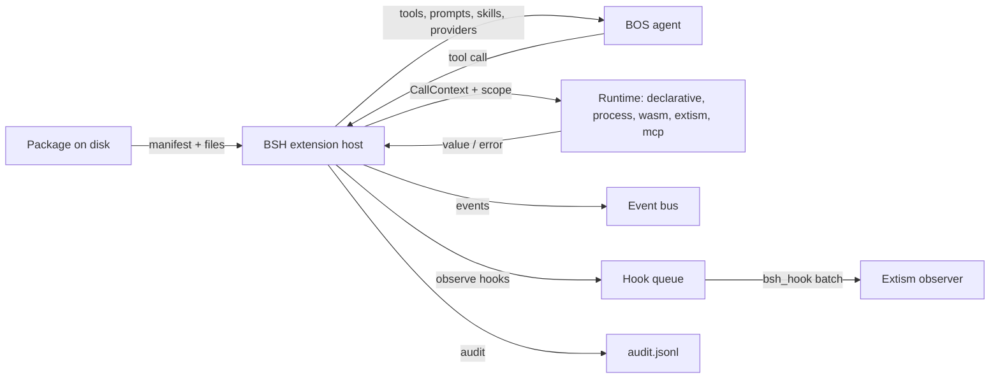
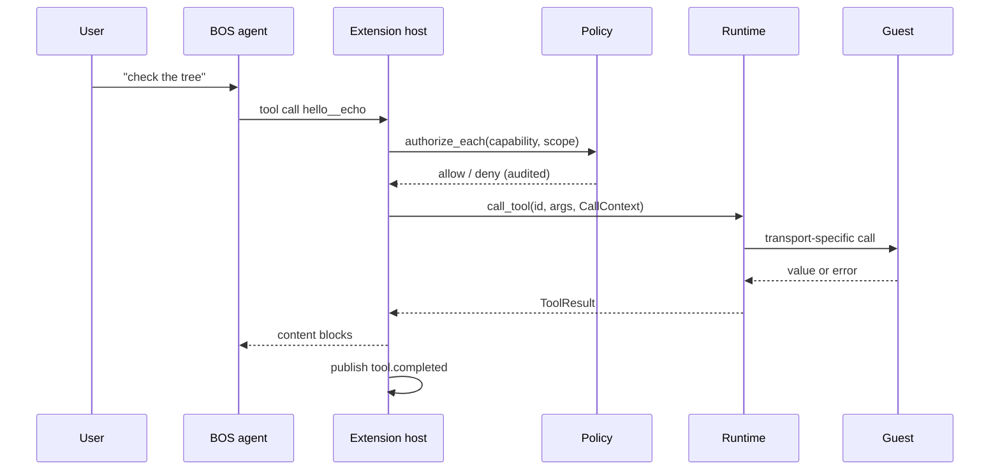
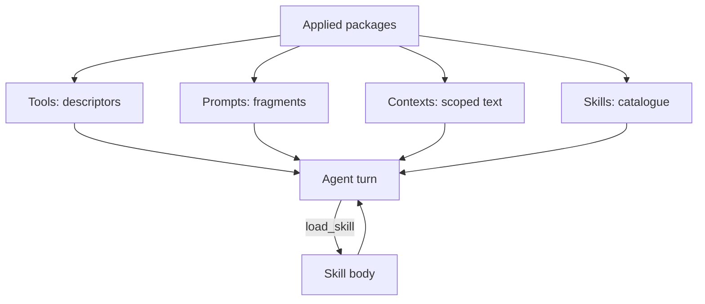
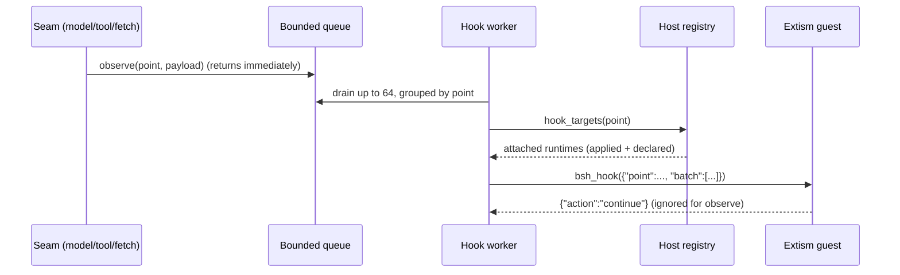

# BSH by Example

**Second edition — the BSH 3.0 extension framework**

This is a working book, not a specification. Most chapters include commands you
can run, output you should see, and the failure modes that waste the most time. The normative contract is [bsh-extension-standard.md](bsh-extension-standard.md);
when this book and the standard disagree, the standard wins and the book has a
bug.

The second edition adds what the framework grew after the first one:

- the observe-hook layer and the five points it dispatches today;
- `hooks.observe`, the twentieth capability;
- request correlation between `model.request`, `model.response` and
  `http.exchange`;
- a runnable Extism observer (`examples/extensions/extism-hook`);
- a sharper split between events (after the fact, many subscribers) and hooks
  (declared seam calls, one receiver class).

## Who this is for

Different readers use the book differently:

| You are | Start at | Then |
|---|---|---|
| Writing your first package | 1, 2, 3 | 4, 5, 7, 15 |
| Choosing a runtime | 1, 2, 10 | 11, 12, 13 |
| Instrumenting the agent | 2, 8, 22 | 23, 24, 25, 26 |
| Operating a store | 3, 9, 30 | 28, 29, 31, 32 |

## Conventions

- Commands assume the repository root and a debug build:

  ```bash
  cargo build -p bsh
  export BSH=./target/debug/bsh
  ```

- `$BSH` means that binary. `--root <dir>` isolates a lab from your real
  store; everything under `~/.bos/bsh/extensions` is otherwise live state.
- JSON is shown as one object per line when it is a payload, and pretty-printed
  when it is output. Field order is not significant.
- "Exit 1" means a refused operation, not a crash. "Exit 2" is a usage error.
- `validate` parses a package but never runs it. `test` parses and checks
  contribution files. `mock` runs a tool against a permissive mock host.
  `install` is the first command that writes managed state.
- The book is checked against the repository's BSH 3.0.2 baseline and extension API 1.0.0. Re-check the standard and implementation when either version changes.

## Table of contents

**Part I — Orientation**

1. [Quickstart in ten minutes](#1-quickstart-in-ten-minutes)
2. [The mental model](#2-the-mental-model)
3. [What is inside a package](#3-what-is-inside-a-package)

**Part II — The declarative core**

4. [The manifest, field by field](#4-the-manifest-field-by-field)
5. [Tools](#5-tools)
6. [Commands, prompts, contexts and skills](#6-commands-prompts-contexts-and-skills)
7. [Capabilities, grants and audit](#7-capabilities-grants-and-audit)
8. [Events](#8-events)
9. [Lifecycle and status](#9-lifecycle-and-status)

**Part III — Runtimes**

10. [The process runtime](#10-the-process-runtime)
11. [The WASM component runtime](#11-the-wasm-component-runtime)
12. [The Extism runtime](#12-the-extism-runtime)
13. [The MCP runtime](#13-the-mcp-runtime)
14. [The declarative runtime](#14-the-declarative-runtime)

**Part IV — Surfaces**

15. [Panels and declarative UI](#15-panels-and-declarative-ui)
16. [Themes, icons and images](#16-themes-icons-and-images)
17. [Storage and configuration](#17-storage-and-configuration)
18. [Instructions, skills and language services](#18-instructions-skills-and-language-services)
19. [Integrations](#19-integrations)
20. [Model providers, agent roles and presets](#20-model-providers-agent-roles-and-presets)
21. [Workflows](#21-workflows)

**Part V — Hooks and capture**

22. [Hooks are not events](#22-hooks-are-not-events)
23. [Declaring and authorizing hooks](#23-declaring-and-authorizing-hooks)
24. [The guest contract](#24-the-guest-contract)
25. [Build an observer end to end](#25-build-an-observer-end-to-end)
26. [Capture cookbook](#26-capture-cookbook)
27. [Debugging hooks](#27-debugging-hooks)

**Part VI — Ship and operate**

28. [Testing](#28-testing)
29. [Debugging playbook](#29-debugging-playbook)
30. [Store, integrity, signing and dependencies](#30-store-integrity-signing-and-dependencies)
31. [The CLI by task](#31-the-cli-by-task)
32. [Packaging, release and market](#32-packaging-release-and-market)
33. [Built-in extensions](#33-built-in-extensions)
34. [Security, limits and non-goals](#34-security-limits-and-non-goals)

**Appendices**

- [A. Manifest skeleton](#appendix-a-manifest-skeleton)
- [B. Capability matrix](#appendix-b-capability-matrix)
- [C. Hook payload reference](#appendix-c-hook-payload-reference)
- [D. Error catalog](#appendix-d-error-catalog)
- [E. Panel node reference](#appendix-e-panel-node-reference)
- [F. Example index](#appendix-f-example-index)
- [G. Author and reviewer checklists](#appendix-g-author-and-reviewer-checklists)
- [H. Glossary](#appendix-h-glossary)

---

# 1. Quickstart in ten minutes

The goal is not to understand every field yet. It is to install a package,
inspect what the host thinks of it, run one tool without an agent, and then
break it in a way the validator catches.

## 1.1 Build and validate

```bash
cargo build -p bsh
export BSH=./target/debug/bsh

$BSH ext validate examples/extensions/hello
```

Expected:

```text
id:      com.example.hello
version: 1.0.0
runtime: declarative
hash:    6b108662c25eb98a4bacda8aa873fdcb1a6a1428be1c372932e5f816d4c32176
valid
```

The hash is content-addressed. Change one byte of `tools/echo.json` and it
changes; change a file inside `.git` and it does not. That is by design: the
hash covers the package, not the checkout.

## 1.2 Run a tool without an agent

```bash
$BSH ext mock examples/extensions/hello echo '{"text":"hi"}'
```

Expected:

```json
{
  "text": "hi"
}
```

`mock` builds a permissive in-memory host: capability checks pass, the network
is absent, and no state is written. It answers one question — "does this tool
descriptor and implementation produce a value?" — and nothing else. A tool that
works under `mock` can still be denied at runtime; a tool that fails under
`mock` will not be saved by a grant.

## 1.3 Install into a laboratory store

Do not experiment in your real store until you are comfortable with
`--purge-data`.

```bash
$BSH --root /tmp/bsh-lab ext install examples/extensions/hello
$BSH --root /tmp/bsh-lab ext list
$BSH --root /tmp/bsh-lab ext info com.example.hello
```

`list` shows the columns that matter:

```text
ID                    VERSION  STATE   TRUST  APPLIED  TOOLS
com.example.hello     1.0.0    active  local  yes      hello__echo
```

Two different words appear:

- **state** is the lifecycle state (`discovered`, `active`, `failed`, …);
- **applied** says whether the package's contributions are in the running
  agent. A package can be `active` and not applied when it is manual, disabled,
  missing a required grant, or failed dependency resolution.

`info` explains both, plus the source, root, hash and capability decisions.
If a row says `failed`, read `info` before touching the package; the reason is
almost always one line long.

## 1.4 Grant what the package asks for

A local package defaults to trust level `local`. High and critical
capabilities need an explicit grant.

```bash
$BSH --root /tmp/bsh-lab ext grant com.example.hello agent.tools.register --scope any
$BSH --root /tmp/bsh-lab ext grant com.example.hello ui.panels --scope any
$BSH --root /tmp/bsh-lab ext grant com.example.hello ui.commands --scope any
```

`agent.tools.register` is low risk and normally allowed by policy, but granting
it explicitly makes the lab independent of policy defaults. The point of the
exercise is the second command:

```bash
$BSH --root /tmp/bsh-lab ext revoke com.example.hello agent.tools.register
$BSH --root /tmp/bsh-lab ext info com.example.hello
```

The required capability is now denied, so the package is not applied. This is
the framework working: a tool the agent cannot be allowed to call is not
registered just because the package is installed.

Grant it again before continuing.

## 1.5 Validate, test, mock, install: which one?

| Command | Parses manifest | Reads contribution files | Runs code | Writes state |
|---|---:|---:|---:|---:|
| `validate` | yes | no | no | no |
| `test` | yes | yes | no | no |
| `mock` | yes | yes | one tool | no |
| `install` | yes | yes | no | yes |
| `doctor` | yes | walks the store | no | no |

A package that only passes `validate` is not ready. Run `test` in CI and
`mock` for every tool with a representative argument object.

## 1.6 What could go wrong already

| Symptom | Cause | Fix |
|---|---|---|
| `validate` exits 1 with a field path | manifest or contribution error | fix the field named in the path |
| `hash` changes on every run | you edited a file while validating | stop editing; hashes are stable otherwise |
| `install` exits 1 with "already installed" | same id and version exist | uninstall, or bump the version |
| `list` shows `failed` and `APPLIED=no` | required capability denied | `ext info`, then grant or fix the manifest |
| `mock` cannot find the tool | you used the model-facing name | use the declared tool id (`echo`, not `hello__echo`) |

---

# 2. The mental model

BSH is a desktop shell. BOS is the agent stack inside it. The extension
framework is the seam between them: a package declares surfaces, the host
loads it, the agent sees the surfaces, and every reach across the seam is
authorized and audited.

## 2.1 Three planes



- **Package plane** — files, manifest, hash, signature, state.
- **Agent plane** — the tools, prompts, contexts, skills, providers and
  workflows that end up in a turn.
- **Runtime plane** — where code executes, and therefore what the host can
  enforce. A declarative tool cannot open a socket; a process can, so the host
  restricts its environment and needs a grant.

## 2.2 What the host owns

The host is deliberately boring and central:

1. **Validation.** The manifest is parsed strictly before any code runs.
2. **Resolution.** One version per id; dependencies before dependents.
3. **Authorization.** Activation checks required capabilities; every call
   checks per-call capabilities against a scope.
4. **Execution.** One `Runtime` trait for every transport.
5. **Isolation.** Timeouts, memory, output, queue and path bounds.
6. **Observation.** Bus events and seam hooks, with different guarantees.

If a feature cannot be enforced at one of those six points, it is not a
framework feature; it is a convention.

## 2.3 The runtime matrix

| Runtime | Code lives | Transport | Best at | Hook support today |
|---|---|---|---|---|
| builtin | linked into BSH | direct Rust | first-party surfaces | none |
| declarative | JSON files | host functions | echo/constant/template tools | none |
| process | any allowlisted child | NDJSON JSON-RPC over stdio | Python/Node tools, existing CLIs | none (events only) |
| wasm-component | Wasm component | WIT imports | sandboxed, typed code | none (events only) |
| extism | Extism plugin | `bsh_host` + exports | small plugins, many languages | **observe hooks** |
| mcp | stdio MCP server | JSON-RPC MCP | reuse an MCP server | none (events only) |

Only Extism can consume hooks in this build. That is a statement about the
current bridge, not about the design: a WASM component or a process can still be
the *source* of an `http.exchange` when it uses a host fetch (WASM) or when the
host taps its own LLM client. The consumer restriction is enforced in manifest
validation: a non-Extism package that declares `contributes.hooks` is refused.

## 2.4 One tool call, end to end



Three details are easy to miss:

- The **model-facing name** is qualified (`hello__echo`); the package file is
  `tools/echo.json` and the runtime sees `echo`.
- The **scope** is derived from the arguments before authorization. A tool that
  reads a file must name the argument `path`; a tool that fetches must name it
  `url`. Otherwise a path- or domain-scoped grant cannot match, and the call is
  denied even though the capability is granted.
- The **audit entry** is written whether the call is allowed or denied. A
  denial that does not appear in `audit.jsonl` is a host bug.

## 2.5 Events versus hooks

They look similar and are not:

| Question | Event | Observe hook |
|---|---|---|
| Who receives it? | any subscriber to the topic | packages that declared that point |
| When? | after the fact | at the seam, before the host forgets it |
| Can it block? | never | never in this build |
| Can it change the outcome? | no | no (intercept is not implemented) |
| Delivery | one event at a time, bounded queue | batches of up to 64 |
| Payload | event envelope + JSON payload | `{point, batch}` |
| Failure | dropped and counted | one package's failure does not stop the next |
| Typical use | cache invalidation, activity feed | capture, metrics, redaction review |

If you want to *change* a model request, a hook is still the wrong tool in this
build. Intercept hooks are designed but not implemented; use a plugin/provider
adapter or patch the host.

---

# 3. What is inside a package

A package is a directory. Its manifest is `extension.toml`; everything else is
resolved relative to it.

## 3.1 The minimum tree

```text
hello/
  extension.toml              required
  tools/git.status.json       one file per declared tool
  commands/greet.md           one file per declared command
  prompts/hello.md            one file per declared prompt
  panels/status.json          one file per declared panel
  README.md                   optional, ignored by the host
```

The manifest declares contribution ids, and the host derives each path from
the contribution kind and the **full id**. Dotted ids remain dotted in file
names; they are not reduced to their last segment.

| Contribution | File |
|---|---|
| tool `git.status` | `tools/git.status.json` |
| command `greet` | `commands/greet.md` |
| prompt `hello` | `prompts/hello.md` |
| context `guide` | `contexts/guide.md` |
| panel `status` | `panels/status.json` |
| workflow `inspect` | `workflows/inspect.json` |
| skill `helper` | `skills/helper/SKILL.md` |
| theme `midnight` | `themes/midnight.json` |
| language `rust` | `languages/rust.json` |
| integration `github` | `integrations/github.json` |
| model provider `demo` | `providers/models/demo.json` |
| agent provider `helper` | `providers/agents/helper.json` |
| preset `reader` | `presets/reader.json` |

A declared id without its file is a validation error, not an empty surface.
That is deliberate: a package that says it contributes a panel and then does
not ship one should fail loudly at install time, not silently show nothing.

## 3.2 What must not be there

- Absolute paths and `..` components in any package-relative path.
- Symlinks. The package must be self-contained; a symlink is refused at copy,
  hash and load time.
- `.git`, `.jj`, `target`, `node_modules` in the canonical hash and copy.
  They are ignored, so a development checkout can be installed without dragging
  build output along.
- More than one manifest. Nested packages are separate packages, not one.

## 3.3 The hash

The package hash is SHA-256 over each file's **relative path, byte length and
content digest**, in sorted path order. Directory metadata, timestamps and modes
are excluded. `package.sig` is excluded from the hash it signs; otherwise a
signature could never verify after signing.

Practical consequences:

- `chmod +x` on a script does not change the hash, but the executable bit is
  still preserved by the copy. Do not rely on the hash to catch a mode change.
- Reformatting JSON changes the hash. Build tools should normalize or accept it.
- Installing the same content twice produces the same hash, so a release is
  reproducible across machines.
- `bsh ext doctor` recomputes the hash of every installed package and reports a
  mismatch as post-install tampering.

## 3.4 The managed store

```text
~/.bos/bsh/extensions/
  installed/<id>/<version>/     immutable code and assets
  staging/                      an install in progress
  cache/                        downloaded archives
  quarantine/                   disabled or failed packages under review
  extension-data/<id>/          business data, survives upgrade
  extension-state/
    registry.toml               installed versions, hashes, sources
    state.toml                  enabled flags, last state, last error
    grants.toml                 capability grants
    lock.toml                   resolved dependency set
    trust.toml                  trusted publisher keys
  logs/extensions/
    audit.jsonl                 every capability decision
    audit.jsonl.1               rotated at 1 MiB
    <id>/                       package stdout/stderr
```

`BSH_EXTENSION_ROOT` or `--root` moves the whole tree. The data and state
directories move with it, which is why a lab root is a safe place to learn.

## 3.5 Immutability and versions

An installed `<id>/<version>` is immutable. An upgrade creates a new version
directory; a rollback switches the active version back. Uninstall removes the
state record but keeps `extension-data/<id>` unless `--purge-data` is passed.

This is the rule that makes rollback trustworthy: the code you roll back to is
the exact bytes you installed, not a rebuild.

## 3.6 Lab: see the hash and the store move

```bash
cp -R examples/extensions/hello /tmp/hello-lab
$BSH ext hash /tmp/hello-lab
printf '\n' >> /tmp/hello-lab/tools/echo.json
$BSH ext hash /tmp/hello-lab
```

The two hashes differ. Revert the newline, and the original hash returns. If
you make the file invalid JSON instead, `hash` still succeeds (it hashes bytes)
but `validate` fails; that difference is why the CLI has both commands.

---

# 4. The manifest, field by field

The parser rejects unknown fields. A misspelled optional field would otherwise
disappear silently, and a package would ask for nothing and receive nothing.
Optional additions use serde defaults; that is the forward-compatibility rule.

## 4.1 A complete annotated manifest

```toml
schema_version = "1.0"

[extension]
id = "com.example.git-assistant"
name = "Git Assistant"
version = "1.0.0"
description = "Git tools for the BSH agent"
authors = ["Example Developer"]
license = "MIT"
repository = "https://example.com/git-assistant"
homepage = "https://example.com"

[compatibility]
bsh = ">=3.0.0, <4.0.0"
extension_api = "^1.0"

[runtime]
kind = "process"
entry = "bin/server"
args = ["--stdio"]
startup = "on-demand"
protocol = "jsonrpc-2.0"
[runtime.env]
LOG_LEVEL = "info"

[capabilities]
required = ["agent.tools.register", "workspace.read"]
optional = ["workspace.write"]

[contributes]
tools = ["git.status", "git.diff"]
commands = ["git.refresh"]
panels = ["git.panel"]
prompts = ["git.prompt"]
contexts = ["git.context"]
languages = ["git.rust"]
integrations = ["git.github"]
skills = ["git.helper"]
workflows = ["git.release"]
themes = ["git.dark"]
events = ["workspace.opened", "tool.*"]
publishes = ["git.changed"]
hooks = ["model.request", "model.response"]

[configuration]
schema = "config.schema.json"
defaults = { "remote" = "origin" }

[resources]
max_memory_mb = 128
max_execution_ms = 5000
max_concurrent_calls = 4
max_output_bytes = 1048576

[dependencies]
"com.example.base" = "^1.0"
```

## 4.2 Top-level fields

| Field | Type | Required | Notes |
|---|---|---|---|
| `schema_version` | string | yes | exactly `"1.0"` |
| `extension` | table | yes | identity |
| `compatibility` | table | yes | BSH and API ranges |
| `runtime` | table | yes | execution mode |
| `capabilities` | table | no | required and optional requests |
| `contributes` | table | no | declared surfaces |
| `configuration` | table | no | JSON Schema + defaults |
| `resources` | table | no | requested ceilings |
| `dependencies` | table | no | id → version range, maximum 64 |

## 4.3 Identity rules

**Extension id**: 1–128 bytes, with at least two dot-separated segments.
Each segment is 1–63 bytes, contains lowercase ASCII letters, digits, `-` or
`_`, and starts and ends with a letter or digit. `com.example.hello` and
`com.example.hello_world` are valid; `Hello`, `com..hello`,
`com.example.-hello` and `com.example.hello_` are not.

**Contribution id**: 1–96 bytes, formed from one or more dot-separated
segments. Each segment is 1–63 bytes, starts with a lowercase ASCII letter or
digit, and contains only lowercase ASCII letters, digits, `-` or `_`.
`git.status`, `screen-size` and `v2.tool` are valid. An id must be unique across
all contribution kinds within one extension; a tool and a command cannot both
be named `git.status`.

**Model-facing tool name**: the host uses the extension's last id segment as
the namespace and flattens dots in the contribution id to underscores:
`com.example.git-assistant` + `git.status` becomes
`git-assistant__git_status`. Hyphens are preserved. Names longer than the
provider limit (64 characters) are shortened with a stable digest suffix, so
long ids do not collapse into the same tool name. Audit and policy continue to
use the full extension and contribution ids.

**Name, description, authors**: name 1–128 characters; description 1–4096
bytes; at most 32 authors.

## 4.4 Compatibility

```toml
[compatibility]
bsh = ">=3.0.0, <4.0.0"
extension_api = "^1.0"
```

`bsh` is the host application version. `extension_api` is the package-facing
generation. A host outside the range refuses the package with an
`Incompatible` error naming both the requirement and the host version.

Do not widen a range to "make it install". The API generation changes when a
manifest field or runtime contract changes incompatibly; a package that ignores
that will fail later, in a way that is harder to explain.

## 4.5 Runtime fields

| Field | Applies to | Rule |
|---|---|---|
| `kind` | all | `builtin`, `declarative`, `process`, `wasm-component`, `extism`, `mcp` |
| `entry` | process, wasm, extism, mcp | package-relative, no absolute path, no `..` |
| `args` | process | argv after the entry; no shell expansion |
| `startup` | all | `on-startup`, `on-demand`, `on-workspace-open`, `manual` |
| `protocol` | process | `jsonrpc-2.0` |
| `env` | process | extra environment; dangerous names are refused |

Process `entry` may also be one of the allowlisted launchers: `python3`,
`python`, `node`, `bun`, `deno`, `sh`, `bash`. A package-relative executable
does not need a launcher.

The host clears the environment and forwards only `PATH`, `HOME`, `TMPDIR`,
`LANG` and `LC_ALL`, plus the manifest's own variables. It refuses to set
`PATH`, `LD_PRELOAD`, `LD_LIBRARY_PATH`, any `DYLD_*`, `PYTHONPATH` or
`NODE_OPTIONS`. If your tool needs a secret, use the vault capability, not an
environment variable baked into the manifest.

## 4.6 Contributions

`events` are subscription topics; a trailing `.*` is allowed. `publishes` are
topics the package may emit; a wildcard is not allowed there. Topic segments are
lowercase letters, digits, hyphen and underscore, separated by dots.

`hooks` are observe hook points, not event topics. A package that declares one
must also require `hooks.observe`, and this build delivers hooks only through
the Extism runtime. The five points are `model.request`, `model.response`,
`tool.before`, `tool.after` and `http.exchange`.

Language and integration descriptors are validated at load: the referenced tool
or command must be declared by the same package. Provider descriptors must name
a model or role that the settings layer can select.

## 4.7 Resources

| Field | Range | Default | Enforced today |
|---|---|---|---|
| `max_memory_mb` | 1–4096 | 256 | wasm/Extism memory; process RLIMIT_AS |
| `max_execution_ms` | 1–600000 | 30000 | per call |
| `max_concurrent_calls` | 1–64 | 4 | declared; process serializes through one child |
| `max_output_bytes` | 1–16777216 | 1048576 | tool result |

A manifest asking above a ceiling is invalid rather than silently clamped. If
you need more than the ceiling, the host must change; editing a number is not a
workaround.

## 4.8 Dependencies

```toml
[dependencies]
"com.example.base" = "^1.0"
```

There is exactly one selected version per id in a resolution. A later range
that excludes the selected version is a conflict; the host does not install two
versions of one id, because they would share a storage namespace and a tool
namespace. Resolution is depth-first, dependencies before dependents, highest
matching version. Cycles and missing ids are named in the error. A disabled
package is not a candidate, even as a dependency; the dependent then fails to
resolve rather than running code the reader switched off.

## 4.9 Validation lab

Try each of these against a copy of `hello`:

1. Rename `tools/echo.json` to `tools/echo2.json` without changing the manifest.
   `validate` fails on the missing contribution file.
2. Add `unknown = true` at the top level. The parser refuses the unknown field.
3. Set `entry = "../server"` in a process manifest. The path containment check
   refuses it.
4. Set `kind = "builtin"` in a disk manifest. A package read from disk may not
   claim the built-in runtime.
5. Add `hooks = ["model.request"]` to a declarative package. Validation refuses
   hooks for a runtime that cannot receive them.

The exact message names the field path; read that path before reading the rest
of the sentence.

## 4.10 Manifest checklist

- [ ] `schema_version` is exactly `1.0`.
- [ ] id and every contribution id pass the grammar.
- [ ] `bsh` and `extension_api` ranges include the host you test on.
- [ ] runtime kind and entry agree; no absolute paths, no `..`.
- [ ] every required capability is actually needed; every optional one is
      checked per call.
- [ ] every declared contribution file exists and validates.
- [ ] hooks declare `hooks.observe` and use the Extism runtime.
- [ ] resources are realistic, not copied from another package.
- [ ] dependencies are pinned to a range you tested.

---

# 5. Tools

A tool is the one surface the model can call. Everything else is context or
UI. The descriptor is the contract: name, description, schema, capabilities and
(for declarative tools) an implementation.

## 5.1 The descriptor

```json
{
  "description": "Read the status of one Git path.",
  "input_schema": {
    "type": "object",
    "properties": { "path": { "type": "string" } },
    "required": ["path"]
  },
  "capabilities": ["workspace.read"],
  "implementation": { "kind": "echo_arguments" }
}
```

| Field | Required | Rule |
|---|---|---|
| `description` | no | 1–4096 bytes; defaults to package name and id |
| `input_schema` | no | JSON object; defaults to an empty object schema |
| `capabilities` | no | checked per call, in addition to activation |
| `implementation` | declarative only | one of three variants |

Process, WASM, Extism and MCP packages ignore `implementation`; their tool list
comes from the runtime.

## 5.2 The three declarative bodies

**Echo arguments** returns the call's arguments unchanged:

```json
{ "implementation": { "kind": "echo_arguments" } }
```

**Constant** returns a fixed value:

```json
{ "implementation": { "kind": "constant", "value": { "ok": true } } }
```

**Template** renders top-level placeholders:

```json
{
  "implementation": {
    "kind": "template",
    "text": "path={{path}} depth={{depth}}"
  }
}
```

A string argument renders as text; any other JSON value renders as compact
JSON; a missing argument renders as empty. Templates are not a programming
language: no conditionals, no loops, no nested paths.

## 5.3 Per-call capabilities

The descriptor's `capabilities` are the least-privilege seam. A package may
register ten tools but only one of them may ask for `workspace.write`:

```json
{
  "description": "Write one file.",
  "input_schema": {
    "type": "object",
    "properties": { "path": { "type": "string" }, "text": { "type": "string" } },
    "required": ["path", "text"]
  },
  "capabilities": ["workspace.write"]
}
```

At call time the host:

1. resolves the scope from the arguments (`path`, `url`, `secret`);
2. asks policy for each capability in the descriptor;
3. writes one audit record per decision;
4. only then calls the runtime.

A call that lacks the capability is denied before the runtime sees it. That is
why a tool that "works in mock" can still fail with a denial: mock does not
consult policy.

## 5.4 Naming

The runtime sees the declared id (`git.status`). The model sees
`git-assistant__git.status` (dots in the package segment become underscores).
The audit records the full extension id, the capability and the call scope, not
the model-facing alias.

If you rename a tool, you break prompts and saved trajectories that mention the
old name. Treat the id as public API.

## 5.5 Result shape

A tool returns content blocks, an optional structured value and an error flag:

```json
{
  "content": [{ "type": "text", "text": "clean" }],
  "structuredContent": { "clean": true },
  "isError": false
}
```

Helpers normalize a bare JSON value into one text block. An application-level
failure should set `isError: true` and explain what the caller can do; a
transport failure (process exit, WASM trap, MCP EOF) is a host error and may
close the session.

## 5.6 Lab: build three tools

In a copy of `hello`, add:

```json
// tools/echo.json
{
  "description": "Echo the arguments",
  "input_schema": {"type": "object"},
  "implementation": {"kind": "echo_arguments"}
}
```

```json
// tools/version.json
{
  "description": "Return the package version",
  "implementation": {"kind": "constant", "value": {"version": "1.0.0"}}
}
```

```json
// tools/read.json
{
  "description": "Read a path (declarative tools cannot actually read; this demonstrates the declaration)",
  "input_schema": {
    "type": "object",
    "properties": {"path": {"type": "string"}},
    "required": ["path"]
  },
  "capabilities": ["workspace.read"],
  "implementation": {"kind": "template", "text": "would read {{path}}"}
}
```

Declare them and run:

```bash
$BSH ext validate /tmp/hello-lab
$BSH ext mock /tmp/hello-lab echo '{"text":"hi"}'
$BSH ext mock /tmp/hello-lab version '{}'
$BSH ext mock /tmp/hello-lab read '{"path":"src/main.rs"}'
```

The third tool demonstrates an important limit: the declarative runtime has no
filesystem access. `workspace.read` is declared and authorized, but the
implementation only renders the path. Declarative tools are for pure data, not
for side effects.

## 5.7 Schema advice

- Name the argument `path` if it is a filesystem path, `url` if it is a URL,
  `secret` if it is a secret name. Scope extraction is name-based.
- Put `additionalProperties: false` on input schemas unless you deliberately
  accept future fields.
- Keep descriptions short and verb-first. The model sees them, not your README.
- Do not put secrets in defaults; schema defaults are visible in the manifest
  listing.

---

# 6. Commands, prompts, contexts and skills

These are the "soft" surfaces: they shape what the model knows and what the
reader can invoke, without adding a callable tool.

## 6.1 Commands

A command is a Markdown file with YAML frontmatter:

```markdown
---
description: Greet the reader and name the extension
---

Say hello from com.example.hello and name the open workspace.
```

The host registers the command under the package's namespace. Running it
inserts the body into the conversation; it does not execute code. A command is
useful when the prompt is long, reusable, and should be discoverable by name.

Rules:

- `description` is required and is what the UI shows;
- the body is inserted verbatim;
- a command id is a contribution id (`greet`, `git.refresh`);
- a command may be referenced by a panel action, but a panel action can also
  call a command implemented by the runtime.

## 6.2 Prompts

A prompt is a Markdown fragment contributed to the agent's instruction set:

```markdown
---
description: Hello prompt fragment
---

When the reader asks what this extension does, say that it is the BSH hello
example: an echo tool, a greet command and a status panel.
```

Prompts are not user-invoked. The host appends the fragments whose package is
applied, in a stable order. Keep them short and factual: every turn pays for
them.

## 6.3 Contexts

A context is scoped text with optional path globs:

```markdown
---
description: All-in-one demo scoped workspace context
paths: crates/**/*.rs, src/**/*.rs
---

This workspace contains Rust crates. The all-in-one extension can answer
questions about the extension framework: its `describe` tool reports the
package identity and the `events` tool reports the host topics it observed.
```

The `paths` glob is a hint for when the context applies. A context without
`paths` is scoped to the workspace as a whole. Contexts are selected by the
host's context builder, not by the model.

## 6.4 Skills

A skill is a directory with a `SKILL.md`:

```text
skills/
  helper/
    SKILL.md
    references/
      schema.md
```

The frontmatter is the catalogue entry; the body is loaded only when the model
asks for the skill:

```markdown
---
name: helper
description: Walk the reader through the BSH extension framework
version: 1.0.0
---

# Helper

Use this skill when the reader wants a guided tour.

1. Call `describe` to show the package identity.
2. Call `events` to show which host topics have reached the process.
```

The catalogue (name and description) is always in the prompt; the body is
loaded by `load_skill` on demand. That is the point of skills: many
capabilities, little prompt cost.

Rules:

- `name` and `description` are required; the directory name must equal `name`;
- a skill may include extra files, but they are inert until the model reads
  them through the skill tool;
- skills are agent-facing, not UI-facing.

## 6.5 How the surfaces enter a turn



Only applied packages contribute. A package can be installed, active, and still
not applied because a required capability was denied. In that case none of its
prompts, contexts or skills are in the turn — the host does not partially apply
a package.

## 6.6 Lab: a command and a skill

1. Copy `hello` to `/tmp/hello-cmd`.
2. Add `commands/explain.md` and declare `commands = ["greet", "explain"]`.
3. Add `skills/tour/SKILL.md` and declare `skills = ["tour"]`.
4. `bsh ext validate /tmp/hello-cmd`, then `bsh ext test /tmp/hello-cmd`.
5. Install and grant. Ask the agent to "explain the hello extension"; the
   command should be available, and the skill catalogue should name `tour`.

If the command does not appear, check `bsh ext info` first: `APPLIED` is the
only field that decides whether the turn can see it.

---

# 7. Capabilities, grants and audit

Capabilities are requests, never grants. The manifest asks; policy decides; the
audit records. This chapter is the one to reread before shipping.

## 7.1 The vocabulary

There are twenty capabilities in this build:

| Capability | Risk | What it allows |
|---|---|---|
| `workspace.read` | low | read inside the workspace |
| `workspace.write` | high | create, write or remove inside the workspace |
| `network.http` | high | outbound HTTP |
| `process.execute` | critical | start a child process |
| `computer.use` | critical | screen, keyboard, pointer |
| `secrets.read` | critical | read a named vault secret |
| `extension.storage` | low | the package's private storage |
| `agent.tools.register` | low | register tools |
| `agent.context.provide` | low | supply scoped context |
| `agent.prompts.provide` | low | supply prompt fragments |
| `agent.skills.provide` | medium | supply SKILL.md skills |
| `agent.models.provide` | medium | register model providers |
| `agent.agents.provide` | medium | register agent roles |
| `agent.workflows.provide` | medium | register workflows |
| `events.publish` | low | publish host events |
| `events.subscribe` | low | subscribe to host events |
| `hooks.observe` | high | receive observe-hook batches |
| `ui.panels` | low | contribute panels |
| `ui.commands` | low | contribute commands |
| `ui.theme` | low | contribute themes |

The risk bucket decides the default policy:

| Trust | low | medium | high | critical |
|---|---|---|---|---|
| builtin | allow | allow | allow | allow |
| verified | allow | allow | explicit grant | explicit grant |
| community / local | allow | explicit grant | explicit grant | explicit grant |

A package read from disk defaults to `local`. There is no publisher
verification path in this build; "verified" is a recorded level, not something
the host can prove.

## 7.2 Required versus optional

```toml
[capabilities]
required = ["agent.tools.register", "workspace.read"]
optional = ["workspace.write", "network.http"]
```

- **Required** is checked at activation. If denied, the package is not applied
  and its tools, prompts, contexts, skills, providers and hooks are absent.
- **Optional** is not checked at activation. It is checked when a call asks for
  it, using the tool descriptor's `capabilities`.

A capability in neither list is denied on any call. Declaring an optional
capability the package never uses is harmless but misleading; declaring a
required capability it never uses is a support burden.

## 7.3 Grants and scopes

Grants live in `extension-state/grants.toml`:

```toml
[grants."com.example.git-assistant"."workspace.write"]
scope = "workspace"
granted_at = 1790000000
note = "needed for the fix command"
```

Scopes:

| Scope | Covers |
|---|---|
| `any` | every call |
| `workspace` | a call with an open workspace |
| `path:/prefix` | a path or workspace starting with the prefix |
| `domain:example.com` | that host and its subdomains |
| `domain:example.com:POST` | that host, only for the named method |
| `program:python3` | that declared executable |
| `program:python3:--version` | that executable with exactly those arguments |
| `secret:NAME` | that one named secret |

A grant scoped to one path does not cover another. A call that does not match
its scope is denied with the scope in the reason, not silently widened.

Grant and revoke:

```bash
$BSH ext grant com.example.git-assistant workspace.write --scope path:/tmp/repo
$BSH ext grant com.example.git-assistant network.http --scope domain:api.github.com:GET
$BSH ext grant com.example.git-assistant secrets.read --scope secret:GITHUB_TOKEN
$BSH ext revoke com.example.git-assistant workspace.write
```

## 7.4 What a denial looks like

At activation:

```text
extension com.example.git-assistant requires capability workspace.write,
which policy denied: no grant and the default for trust local is deny
```

At call time:

```text
extension com.example.git-assistant is not authorized for workspace.write:
grant scope path:/tmp/repo does not cover /tmp/other/file.rs
```

Both are ordinary errors, not panics. The UI shows the denial with a **Grant**
action for a denied required capability; the CLI path is `ext grant`.

## 7.5 Per-call scope extraction

The host derives the scope from the arguments before authorization:

- `path`: the argument named `path`, resolved against the workspace when
  relative;
- `domain`: the host of an argument named `url`;
- `secret`: an argument named `secret`.

This is why the argument names in chapter 5 matter. A tool that reads
`file` instead of `path` will never match a path-scoped grant. Rename the
argument; do not widen the grant.

## 7.6 Audit

Every decision is appended to `logs/extensions/audit.jsonl`, one JSON object
per line:

```json
{"timestamp":1790000000,"extension":"com.example.hello","capability":"agent.tools.register","allowed":true,"scope":"any","trust":"community","reason":""}
```

The log rotates at 1 MiB to `audit.jsonl.1`. Secret values are never logged.
When a support report says "it worked yesterday", the audit is the first file to
read: it shows which grant changed, not just which call failed.

## 7.7 The hooks capability

`hooks.observe` is high risk because a hook payload can contain prompts,
tool arguments and results, and HTTP metadata. Two rules follow:

1. A package that declares `contributes.hooks` must list `hooks.observe` in
   `required`, so activation cannot silently proceed without the grant.
2. The grant is still explicit for verified/community/local; a hook observer is
   never installed "because it was in the manifest".

The payload is redacted and bounded by the host (chapter 24), but redaction is
not a substitute for a grant: a tool result can contain business data that no
pattern will catch.

## 7.8 Least-privilege recipe

1. Give every tool the smallest capability set that makes it work.
2. Prefer `optional` for capabilities used by one tool.
3. Use the narrowest scope that still works: a path prefix, a domain + method,
   a named secret.
4. Do not ask for `process.execute` to run a script the host could run itself.
5. Do not ask for `workspace.write` to write a cache; use storage.
6. Re-run `bsh ext doctor` after changing grants; a denied required capability
   makes the package unapplied, not unhealthy.

## 7.9 Lab: observe a denial

```bash
cp -R examples/extensions/hello /tmp/hello-denied
# add a tool that asks for workspace.write
# tools/write.json
# {"description":"write","capabilities":["workspace.write"],
#  "input_schema":{"type":"object","properties":{"path":{"type":"string"},"text":{"type":"string"}}}}
# declare tools = ["echo", "write"]
$BSH --root /tmp/bsh-denied ext install /tmp/hello-denied
$BSH --root /tmp/bsh-denied ext grant com.example.hello agent.tools.register --scope any
$BSH --root /tmp/bsh-denied ext mock /tmp/hello-denied write '{"path":"a.txt","text":"x"}'
```

`mock` succeeds because the mock host is permissive. That is the lesson: mock
tests the descriptor, not the policy. Install the package and call the tool
through the agent (or a host test) to see the denial and the audit entry.

---

# 8. Events

An event is a fact published after it happened. Anyone with the topic may
subscribe; the publisher never blocks; a full queue drops and counts.

## 8.1 The envelope

```json
{
  "id": "uuid",
  "source": "com.example.package",
  "event_type": "tool.completed",
  "schema_version": "1.0",
  "timestamp": 1790000000000,
  "correlation_id": "turn-1",
  "payload": {}
}
```

| Field | Meaning |
|---|---|
| `id` | unique event id |
| `source` | extension id, or a host source |
| `event_type` | the topic |
| `schema_version` | payload schema generation |
| `timestamp` | Unix epoch milliseconds |
| `correlation_id` | the turn or call this belongs to, when known |
| `payload` | JSON object |

## 8.2 Reserved topics

`app.started`, `app.shutdown`, `workspace.opened`, `workspace.closed`,
`workspace.changed`, `agent.started`, `agent.completed`, `agent.failed`,
`model.requested`, `model.completed`, `config.changed`, `tool.invoked`,
`tool.completed`, `tool.failed`, `extension.loaded`, `extension.unloaded`,
`extension.failed`, `session.created`, `session.updated`, `session.deleted`,
`trajectory.recorded`, `skill.loaded`, `instruction.build`,
`network.request`, `mcp.connected`, `audio.captured`, `ui.action`.

Topics are exact, or a trailing namespace wildcard in a subscription:
`tool.*` matches `tool.completed` but not `tool`. A publisher cannot use a
wildcard.

## 8.3 Subscribe and publish

A package declares:

```toml
[capabilities]
required = ["events.subscribe", "events.publish"]

[contributes]
events = ["workspace.changed", "tool.*"]
publishes = ["git.changed"]
```

Subscription mechanism differs by transport:

- process: the host subscribes from `contributes.events` at activation; the
  child receives notifications and does not send a subscribe request;
- MCP: the host subscribes from `contributes.events` and delivers once the
  server is running;
- WASM: the guest calls the host `subscribe(topic)` function; the topic must be
  declared in `contributes.events`;
- Extism: the guest calls `bsh_host` op `subscribe`; the topic must be declared.

Delivery:

- process receives an `events/event` JSON-RPC notification;
- WASM receives `on-event`;
- Extism receives `bsh_event`;
- MCP receives `bsh/events/event`.

## 8.4 Quotas

| Bound | Value |
|---|---|
| subscriber queue | default 64, max 4096 |
| event size | 256 KiB |
| publish rate | 200/s per source |
| overflow | drop + counter, never block |

A slow subscriber does not slow the publisher. If your package needs every
event, it must drain its queue; if it cannot, it should subscribe to less.

## 8.5 UI actions are events too

When a panel button dispatches an action, the host routes it to the owning
runtime and publishes `ui.action` with the extension, panel, action and the
revision the view was rendered from. An action whose revision does not match
the current panel revision is refused — a stale button cannot act on a new view.

## 8.6 Events versus hooks

Use an event when the fact is public and lossy is acceptable. Use a hook when
the package needs the seam payload and has declared that point. Do not emulate
hooks with events: by the time an event exists, an intercept decision is
already too late (and intercept is not implemented anyway).

## 8.7 Lab: watch a topic

1. Copy `hook-demo` or `allinone`; it already subscribes to host topics.
2. Install and grant it.
3. Open a workspace, run one agent turn, then call its `hook-log`/`events` tool.
4. Compare the topics it saw with `model.requested`/`model.completed` in the
   shell log. They are after-the-fact facts, not the model hook payload.

---

# 9. Lifecycle and status

## 9.1 State machine

```text
Discovered -> Validating -> Resolved -> Installing -> Installed
Installed -> Loading -> Starting -> Active
Active -> Suspending -> Suspended -> Starting
Active -> Stopping -> Unloaded
any non-Unloaded -> Failed
Failed -> Loading (retry)
Unloaded -> Loading (reinstall)
```

A transition the table does not define is an error, not a silent rewrite.
Failure is always legal: the point is to stop a broken package.

## 9.2 What each state means for you

| State | Meaning | Typical action |
|---|---|---|
| `discovered` | seen on disk, not validated | run `validate` |
| `validating` | manifest and contributions being checked | wait; read errors |
| `resolved` | dependencies selected | check the lockfile if surprising |
| `installing` | staged copy, hash, signature | wait; do not edit the source |
| `installed` | package bytes in the store | enable/activate |
| `loading` | runtime being built | watch logs if it hangs |
| `starting` | handshake / guest start | startup timeout is 10s |
| `active` | authorized and loaded | normal |
| `suspended` | paused by the host | resume or leave it |
| `failed` | last error recorded | `ext info`, fix, `ext retry` |
| `unloaded` | stopped or disabled | reinstall/enable |

## 9.3 Enabled, active, applied, configured

Four words that are not synonyms:

- **enabled** — the reader's switch in `state.toml`;
- **active** — lifecycle reached `Active` (authorized and loaded);
- **applied** — contributions are installed in the running agent for this build;
- **configured** — the package's configuration schema validated and defaults
  applied.

A package is often `active` but `applied=no` because a required capability was
denied, it is `manual`, or a dependency failed. `bsh ext info` prints all four
so you do not have to guess.

## 9.4 Startup policies

| Policy | When it is applied |
|---|---|
| `on-startup` | warmed right after the host loads it, detached |
| `on-demand` | descriptors registered; runtime starts on first call |
| `on-workspace-open` | applied when a workspace opens |
| `manual` | never automatically; the reader starts it |

`on-startup` does not block the build: the warm-up runs on a detached thread.
A process handshake has a 10-second deadline; a package that misses it fails
with a startup error.

## 9.5 Failure, retry, quarantine

- A failure records the last error and state in `state.toml`.
- `bsh ext retry <id>` clears the persisted failure and reloads.
- `bsh ext quarantine <id> --reason ...` moves the code out of the installed
  tree and disables it. Quarantine is for a package you do not trust enough to
  run again; it is not "disable".
- `bsh ext rollback <id>` activates the previous installed version, if any.

## 9.6 Lab: read a failure correctly

```bash
$BSH --root /tmp/bsh-fail ext install examples/extensions/process-echo
$BSH --root /tmp/bsh-fail ext revoke com.example.process-echo process.execute
$BSH --root /tmp/bsh-fail ext info com.example.process-echo
```

The state is likely `failed` and `APPLIED=no`; the reason names
`process.execute`. Grant it, then `ext retry` if the failure was persisted. The
important habit: fix the cause, then retry; do not reinstall first.

## 9.7 Lifecycle checklist

- [ ] the package is enabled and its required grants are present;
- [ ] `state` is `active` and `applied` is `yes`;
- [ ] if `on-startup`, the handshake completes within 10s;
- [ ] `configured` is true, or the configuration error is understood;
- [ ] a failure has a readable `last_error`, not just "failed".

---


# 10. The process runtime

Use a process when the tool already exists as a Python, Node, shell or compiled
program, or when the logic is too large for a declarative implementation. The
cost is a real child process: the host can bound it, but it can also do things
the declarative runtime cannot.

## 10.1 Package

```text
process-echo/
  extension.toml
  server.py
  tools/echo.json
```

```toml
[extension]
id = "com.example.process-echo"
name = "Process Echo"
version = "1.0.0"
description = "A minimal JSON-RPC process extension"

[compatibility]
bsh = ">=3.0.0, <4.0.0"
extension_api = "^1.0"

[runtime]
kind = "process"
entry = "python3"
args = ["server.py"]
protocol = "jsonrpc-2.0"
startup = "on-demand"

[capabilities]
required = ["process.execute", "agent.tools.register"]

[contributes]
tools = ["echo"]
```

```json
// tools/echo.json
{
  "description": "Echo the arguments through the child process",
  "input_schema": {"type": "object"}
}
```

The descriptor is still host-side: the process does not list its tools. The
manifest and `tools/*.json` define the surface; the child only answers calls.
That keeps the policy decision before any child code runs.

## 10.2 A complete server

```python
#!/usr/bin/env python3
"""A minimal BSH process extension.

One JSON object per line on stdin, one per line on stdout. The host sends
initialize, tools/call and shutdown; anything else may return an empty result.
"""
import json
import sys


def main() -> None:
    for line in sys.stdin:
        line = line.strip()
        if not line:
            continue
        try:
            request = json.loads(line)
        except json.JSONDecodeError:
            continue

        method = request.get("method")
        request_id = request.get("id")
        params = request.get("params") or {}

        if method == "initialize":
            # The token is the host's per-session nonce. Echo it or the host
            # kills the child and refuses the package.
            result = {
                "protocolVersion": "1.0",
                "token": params.get("token"),
            }
        elif method == "tools/call":
            arguments = params.get("arguments") or {}
            # Optional progress notification before the result.
            print(json.dumps({
                "jsonrpc": "2.0",
                "method": "$/progress",
                "params": {"message": "working", "progress": 1, "total": 2},
            }), flush=True)
            result = arguments
        elif method == "shutdown":
            result = {}
        else:
            result = {}

        print(json.dumps({
            "jsonrpc": "2.0",
            "id": request_id,
            "result": result,
        }), flush=True)


if __name__ == "__main__":
    main()
```

The handshake is mandatory:

1. host sends `initialize` with `protocolVersion`, `extensionId`, `host` and
   `token`;
2. server answers with a `protocolVersion` starting `1.` and the same token;
3. the host exports the token as `BSH_IPC_TOKEN` for launchers that cannot parse
   stdin.

A missing or mismatched token is a hard refusal. It prevents a child that
inherited the pipe from answering a different host.

## 10.3 Errors

An application-level error uses the JSON-RPC error object:

```json
{"jsonrpc":"2.0","id":2,"error":{"code":-32000,"message":"not a git repository"}}
```

That becomes a tool error and leaves the session usable. A transport failure —
stdout EOF, a timeout, an unparseable line — kills the session; the next call
starts a fresh child rather than reading a stale response.

Rules:

- responses with an unknown id are skipped as late answers;
- a process that closes stdout before answering fails the call;
- a timed-out call kills the child;
- stderr is diagnostic only and is logged under the extension id.

## 10.4 Limits

| Bound | Value |
|---|---|
| one line | 4 MiB |
| one result | `max_output_bytes` |
| one call | min(caller deadline, `max_execution_ms`) |
| handshake | 10s |
| concurrency | one child, calls serialized |

`max_concurrent_calls` is a declared allowance, not a promise that one child is
parallel. A pooled transport is future work.

## 10.5 Test it

```bash
$BSH ext validate examples/extensions/process-echo
$BSH ext mock examples/extensions/process-echo echo '{"text":"hi"}'
```

`mock` runs the real child with a permissive host. It proves the handshake and
the call shape, not capability policy. For policy, install and call through the
agent or a host test.

The runtime test suite is the reference:

```bash
cargo test -p bsh --lib -- extension::runtime::process
```

It covers handshake refusal, a timed-out call, progress notifications, output
caps and concurrent calls sharing one child.

## 10.6 What the host enforces

- environment cleared, then only the allowlist and manifest vars;
- working directory is the package root;
- executable must be package-relative or an allowlisted launcher;
- `process.execute` grant required, optionally scoped to program/args;
- process group and RLIMIT ceilings;
- macOS filesystem write sandbox profile (not a network sandbox);
- Linux Process and MCP runtimes enable bubblewrap by default; missing
  bubblewrap or namespace setup failure aborts the spawn (fail closed; no
  unsandboxed fallback). The current plan uses `--share-net`, so child
  networking remains shared;
- stdout/stderr captured and bounded.

## 10.7 Process checklist

- [ ] initialize echoes the token and protocol version;
- [ ] every response has the request id, one line, valid JSON;
- [ ] shutdown answers within 1s;
- [ ] progress notifications are optional and non-blocking;
- [ ] stderr is diagnostics, never protocol;
- [ ] the tool descriptor's schema matches what the server expects.

---

# 11. The WASM component runtime

A WASM component is the most sandboxed runtime: the guest has no ambient
filesystem, network or clock. Every host call is a typed import that policy can
deny. Use it when you want portability and a small trusted surface, and you can
pay the build-toolchain cost.

## 11.1 The contract

The WIT is in `crates/bsh/wit/extension.wit`. The host imports nothing; the
component imports `host` and exports `extension`:

```wit
world bsh-extension {
    import host;
    export extension;
}
```

Exports, called in this order: `initialize`, `activate`, then `tools`,
`call-tool`, `command`, `panel`, `on-event`, then `deactivate` and
`shutdown`.

Host functions:

| Function | Capability |
|---|---|
| `read-file` / `write-file` | workspace.read / workspace.write |
| `fetch` | network.http |
| `storage-get` / `storage-set` / `storage-list` | extension.storage |
| `read-secret` | secrets.read |
| `emit` / `subscribe` | events.publish / events.subscribe |
| `configuration` | none; returns the validated config |
| `now-millis` / `progress` / `log` | none |

Every function returns `result<_, host-error>` where the error is one of
`denied`, `not-found`, `limited`, `runtime`, `timeout`.

## 11.2 Manifest

```toml
[runtime]
kind = "wasm-component"
entry = "wasm/extension.wasm"
startup = "on-demand"

[capabilities]
required = ["agent.tools.register", "extension.storage"]
```

`entry` must be a package-relative `.wasm` component. The host compiles it on
activation; a malformed component fails the package, not the host.

## 11.3 A minimal guest (Rust)

```rust
wit_bindgen::generate!({ path: "wit", world: "bsh-extension" });

struct Echo;

impl exports::bsh::extension::extension::Guest for Echo {
    fn initialize(_host: String, _config: String) -> Result<(), HostError> { Ok(()) }
    fn activate() -> Result<(), HostError> { Ok(()) }
    fn deactivate() -> Result<(), HostError> { Ok(()) }
    fn shutdown() -> Result<(), HostError> { Ok(()) }

    fn tools() -> Vec<ToolDefinition> {
        vec![ToolDefinition {
            id: "echo".to_string(),
            description: "Echo arguments through the component".to_string(),
            input_schema: r#"{"type":"object"}"#.to_string(),
        }]
    }

    fn call_tool(_id: String, arguments: String, _correlation: String)
        -> Result<ToolResult, HostError>
    {
        host::progress(1, 2);
        Ok(ToolResult { content: arguments, is_error: false })
    }

    fn command(_id: String, _args: String) -> Result<String, HostError> {
        Ok(r#""command""#.to_string())
    }

    fn panel(_id: String) -> Result<String, HostError> {
        Ok(r#"{"schema_version":"1.0","root":{"type":"text","text":"wasm panel"}}"#.to_string())
    }

    fn on_event(_event: Event) {}
}

export!(Echo);
```

Build (the example uses `wasm-tools` to turn the core module into a component):

```bash
rustup target add wasm32-unknown-unknown
cd examples/extensions/wasm-echo/guest
cargo build --target wasm32-unknown-unknown --release
wasm-tools component new \
  target/wasm32-unknown-unknown/release/bsh_wasm_echo.wasm \
  -o ../wasm/extension.wasm
```

The committed `wasm/extension.wasm` is the source of truth for a host test.
The snippet above is abridged; the full guest in `guest/src/lib.rs` imports the
generated `bsh::extension` modules and is the file to copy.

## 11.4 Test and limits

```bash
$BSH ext validate examples/extensions/wasm-echo
$BSH ext mock examples/extensions/wasm-echo echo '{"text":"hi"}'
cargo test -p bsh --lib -- extension::runtime::wasm
```

Limits: `max_memory_mb` via StoreLimits, `max_execution_ms` via fuel/epoch,
`max_output_bytes` on the result. Cancellation traps the guest at its next host
call; a pure-compute guest may run to its fuel deadline because the host cannot
set an epoch while the synchronous store is held.

A WASM package cannot receive observe hooks in this build. It can still *cause*
`http.exchange` by calling `fetch`; an Extism observer can consume that.
Declaring `contributes.hooks` on a WASM package is refused at validation.

## 11.5 WASM checklist

- [ ] the component exports the full `extension` interface;
- [ ] every host call handles `denied` rather than assuming success;
- [ ] memory and output stay under the manifest ceilings;
- [ ] the guest does not busy-loop; cancellation depends on host calls;
- [ ] `wasm/extension.wasm` is built from the committed source.

---

# 12. The Extism runtime

Extism is the pragmatic plugin runtime: many languages, a small host bridge,
and — uniquely in this build — the ability to receive observe hooks. The price
is a JSON bridge with a specific envelope, and WASI disabled.

## 12.1 Exports

| Export | When |
|---|---|
| `bsh_tools` | host asks for descriptors |
| `bsh_call_tool` | a tool call |
| `bsh_command` | a command/action |
| `bsh_panel` | a dynamic panel |
| `bsh_event` | a subscribed event |
| `bsh_hook` | an observe hook batch (only if declared) |

A package that declares a hook point but does not export `bsh_hook` loads but
fails delivery; the host logs the runtime error rather than pretending the
observer is attached.

## 12.2 The bridge envelope

Every `bsh_host` call takes one JSON request and returns one JSON reply:

```json
{"ok":true,"value":...}
```

or

```json
{"ok":false,"error":"..."}
```

The guest must unwrap `value` on success and treat `ok:false` as an error. A
guest that reads the reply as a bare value will see `null` or fail to parse.
This is the most common Extism bug in the wild.

## 12.3 Operations

| Op | Capability | Notes |
|---|---|---|
| `read_file` / `write_file` | workspace.* | package or workspace relative, contained |
| `fetch` | network.http | HTTP(S), body capped |
| `storage_get` / `storage_set` / `storage_list` | extension.storage | own namespace only |
| `read_secret` | secrets.read | named secret |
| `emit` | events.publish | declared topic only |
| `subscribe` | events.subscribe | declared topic only |
| `config` | none | validated configuration |
| `now_millis` | none | wall clock |
| `log` | none | host log |

The bridge is the only filesystem/network path: WASI is disabled.

## 12.4 A guest that reads storage

```rust
use extism_pdk::*;
use serde_json::{json, Value};

#[host_fn]
extern "ExtismHost" {
    fn bsh_host(input: String) -> String;
}

fn host(request: Value) -> Option<Value> {
    let raw = unsafe { bsh_host(request.to_string()) }.ok()?;
    let reply: Value = serde_json::from_str(&raw).ok()?;
    if reply.get("ok").and_then(Value::as_bool) != Some(true) {
        return None;
    }
    Some(reply.get("value").cloned().unwrap_or(Value::Null))
}
```

That helper is the template for every Extism package in this book, including
the hook observer in chapter 25.

## 12.5 Build and test

```bash
cd examples/extensions/extism-echo/guest
cargo build --target wasm32-unknown-unknown --release
cp target/wasm32-unknown-unknown/release/bsh_extism_echo.wasm ../plugin.wasm

$BSH ext validate examples/extensions/extism-echo
$BSH ext mock examples/extensions/extism-echo echo '{"text":"hi"}'
cargo test -p bsh --lib -- extension::runtime::extism
```

The runtime tests exercise the bridge envelope, storage, panels and the hook
path. A guest that only works under `mock` may still fail the envelope test;
run both.

## 12.6 Limits and pitfalls

- one bridge body: 8 MiB;
- result capped by `max_output_bytes`;
- memory capped by `max_memory_mb`;
- `fetch` returns text or base64, never status/headers (those go to
  `http.exchange` instead);
- a guest call holds the plugin lock; a hook delivered while a tool call is
  running waits for that call (on the hook worker, not on the model path);
- a failed hook call is logged and does not stop other packages.

## 12.7 Extism checklist

- [ ] all host replies go through the `{ok,value}` envelope;
- [ ] `bsh_tools` returns an array with `id`, `description`, `input_schema`;
- [ ] `bsh_hook` exists if any hook point is declared;
- [ ] storage keys are relative and namespaced by the guest, not by path tricks;
- [ ] `plugin.wasm` is rebuilt after source changes.

---

# 13. The MCP runtime

Use MCP when you already have a Model Context Protocol server and want its
tools, resources and prompts in BSH without rewriting them.

## 13.1 Manifest

```toml
[runtime]
kind = "mcp"
entry = "python3"
args = ["server.py"]
protocol = "mcp"
startup = "on-demand"

[capabilities]
required = ["process.execute", "agent.tools.register",
            "agent.context.provide", "agent.prompts.provide"]

[contributes]
contexts = ["guide"]
prompts = ["greet"]
```

MCP is a process transport with an MCP handshake. It still needs
`process.execute`; the MCP runtime does not bypass the process policy.

## 13.2 The handshake and mapping

The host:

1. starts the server;
2. sends `initialize` with protocol version and client info;
3. sends `notifications/initialized`;
4. calls `tools/list`, `resources/list`, `prompts/list`;
5. maps:
   - MCP tools → BSH tools;
   - MCP resources → BSH contexts (read with `resources/read`);
   - MCP prompts → BSH prompt contributions (read with `prompts/get`).

Calls go through `tools/call`. Progress notifications from the server are
forwarded. Errors become tool errors; a transport EOF/timeout kills the
session and the next call starts a fresh server.

## 13.3 Declared contributions

A server may expose resources and prompts dynamically; the manifest's
`contributes` lists the ids the package expects to provide. A declared
contribution that the server does not return is a load error, not an empty
surface.

Events: a package that declares `contributes.events` receives
`bsh/events/event` notifications once its server is running. A host that has
not started the server drops the queued event instead of spawning it.

## 13.4 Test

```bash
$BSH ext validate examples/extensions/mcp-echo
$BSH ext mock examples/extensions/mcp-echo echo '{"text":"hi"}'
cargo test -p bsh --lib -- extension::runtime::mcp
```

The test covers tool/resource/prompt mapping and a server that returns all
three. If the server works with a generic MCP client but not here, compare the
`initialize` result: the host requires a `protocolVersion` string.

## 13.5 MCP limits

- MCP HTTP requests made by the server are not captured by the host (chapter
  26); use the server's own logging or a proxy.
- One server process; calls serialized.
- Timeouts and output caps follow the process runtime.
- A server that writes diagnostics to stdout breaks the protocol; use stderr.

---

# 14. The declarative runtime

The declarative runtime is the zero-code path: the host executes one of three
bodies from the tool descriptor.

Use it when:

- the tool is an echo, a constant, or a simple string template;
- you want a package that cannot fail at runtime;
- you are scaffolding before choosing a real runtime.

Do not use it when:

- you need filesystem, network, storage, secrets or time;
- you need to call another tool;
- you need progress, events or a dynamic panel.

It has no hooks, no host calls and no code execution. That is the feature, not
a gap: a declarative package is the easiest package to review.

Declarative tools still participate in capabilities and audit. A declared
capability that the implementation never uses is a warning sign in review: it
asks the reader for authority the code cannot exercise.

---


# 15. Panels and declarative UI

A panel is JSON, not HTML. The host owns the widgets; the package owns the
document. That is what makes a panel safe to render and cheap to review.

## 15.1 The file

```json
{
  "title": "Git Status",
  "icon": "asset/git.svg",
  "view": {
    "schema_version": "1.0",
    "root": {
      "type": "column",
      "children": [
        { "type": "heading", "text": "Git Status", "level": 2 },
        { "type": "text", "text": "Working tree clean" },
        { "type": "button", "label": "Refresh", "action": "git.refresh", "style": "primary" }
      ]
    }
  }
}
```

The renderer validates the document again at draw time. A file that passed
install can still be rejected by the renderer if it was hand-edited in the
store; that is why panels are validated twice.

## 15.2 Node reference

| Type | Key fields | Notes |
|---|---|---|
| `container` | `children` | generic group |
| `row` / `column` | `children` | layout |
| `text` | `text` | one text leaf |
| `heading` | `text`, `level` 1–6 | heading |
| `markdown` | `text` | rendered Markdown, no HTML |
| `button` | `label`, `action`, `style` | `primary`, `danger`, `ghost` |
| `input` | `label`, `placeholder`, `value`, `action` | submitted with an action |
| `select` | `label`, `options`, `value`, `action` | options are label/value pairs |
| `checkbox` | `label`, `checked`, `action` | boolean |
| `list` | `items` | up to 500 |
| `table` | `columns`, `rows` | up to 500×32 |
| `tree` | `nodes` | expandable |
| `tabs` | `tabs` | up to 16 |
| `progress` | `value` (0.0–1.0), `label` | determinate |
| `code` | `value`, `language` | read-only |
| `image` | `src`, `alt` | `asset/…` only |
| `notification` | `level`, `text` | inline message |
| `divider` | — | horizontal rule |
| `spacer` | `size` | vertical space in pixels |

Limits: depth 32, nodes 1000, one text leaf 16 KiB, all text 256 KiB, list 500
items, table 500 rows × 32 columns, cell 2048 characters, tabs 16, serialized
document 1 MiB. The renderer refuses beyond these; it does not truncate
silently.

## 15.3 Actions and revisions

An action is a contribution id owned by the package. When a button is pressed,
the host routes the action to the owning runtime's command handler and
publishes `ui.action` with:

- extension id;
- panel id;
- action id;
- the revision the view was rendered from;
- the form values, when the panel has inputs.

The runtime answers with a new view (or an empty value for an in-place action).
Every update carries a revision. A patch at or below the current revision is
stale and refused. An action carrying a revision that no longer matches is
refused too, so a button from an old view cannot act on a new one.

This is the concurrency rule that prevents the classic "clicked Refresh twice,
the first answer overwrote the second" bug.

## 15.4 Static and dynamic panels

- A panel file with a `view` is static: the host draws it as shipped.
- A runtime may implement `panel(id)` (Extism: `bsh_panel`; WASM: `panel`)
  and return a document. The file's `view` can be a placeholder; the runtime's
  answer is used when the panel is opened or refreshed.

A dynamic panel must still obey every node and size limit. It cannot return
HTML, script or CSS.

## 15.5 Images and icons

A panel's `icon` and an image node's `src` are `asset/…` paths inside the
package. The renderer loads the file. `data:`, `file:`, `javascript:`,
`http:` and `https:` are refused; this build has no remote image loader. An
icon that names a missing asset is a broken image, not a network fetch.

## 15.6 Failure modes

| Symptom | Likely cause |
|---|---|
| panel never appears | package not applied, or `ui.panels` denied |
| blank panel | view failed validation; look at host logs |
| button does nothing | action id not declared by the same package, or stale revision |
| image is a placeholder | missing `asset/` file, or a remote URL was refused |
| update refused as stale | two updates raced; send the current revision |
| text disappears | a limit was exceeded; the renderer refused, not truncated |

## 15.7 Lab: a counter panel

1. Copy `hello`; change `panels/status.json` to a column with a heading, a
   text node and a button with `action: "bump"`.
2. Add `commands/bump.md` and declare `commands = ["greet", "bump"]`.
3. Install and open the panel. Press the button.
4. The command runs; the panel does not update unless the runtime returns a new
   view. For a static panel, the button is an action, not state.

To make the counter dynamic, implement `bsh_panel` in an Extism guest and read
the count from storage (chapter 25 does exactly this).

---

# 16. Themes, icons and images

## 16.1 Themes

```json
{
  "name": "Midnight",
  "colors": {
    "page": "#0b0d10",
    "text": "#e6e8eb",
    "muted": "#9aa0a6",
    "accent": "#4176e6",
    "border": "#2a2f36",
    "new-session-fill": "#171a1f"
  }
}
```

Known tokens: `page`, `text`, `muted`, `faint`, `border`, `border-soft`,
`accent`, `error`, `success`, `warn`, `new-session-fill`, `hover`. A missing
token falls back to the active host palette. The first declared theme applies
to that extension's panels; Settings > Extensions can also select it globally,
overlaying its named tokens on the shell palette.

A theme is not CSS. It cannot add rules, fonts or animations; it maps tokens.

## 16.2 Icons and images

- panel `icon`: `asset/icon.svg`;
- image node `src`: `asset/screenshot.png`;
- both must exist inside the package;
- SVG is drawn as an image, not executed as script;
- remote URLs are refused in this build.

Package assets are copied into the immutable version directory and included in
the hash. A missing asset is a validation error only if it is referenced by a
panel; a package may ship unused assets.

---

# 17. Storage and configuration

## 17.1 Storage

Each extension owns `extension-data/<id>/`. Keys are relative paths; absolute
paths, `..`, `.` and backslashes are refused. The canonical parent must stay
inside the namespace, which catches a symlinked directory planted inside it. A
stored value cannot be a symlink.

| Bound | Value |
|---|---|
| one value | 8 MiB |
| files per namespace | 10,000 |
| writes | atomic (temp file, fsync, rename) |

The namespace is created and purged by the host. WASM and Extism reach it
through host calls; process and MCP packages cannot read it directly unless the
host provides a surface, because their own filesystem access is outside the
namespace.

Storage is for business data, not for code or caches you can rebuild. It
survives upgrades and is kept on uninstall unless `--purge-data` is passed.

## 17.2 Configuration

A package declares a schema and defaults:

```toml
[configuration]
schema = "config.schema.json"
defaults = { "remote" = "origin" }
```

The host validates the reader's configuration against the schema and passes the
result to the runtime:

- process: `initialize.params.config`;
- WASM: `configuration()`;
- Extism: `bsh_host` op `config`;
- MCP: `initialize.params.config` (an extra field; a server that does not know
  it may ignore it, so do not rely on it for required settings).

CLI:

```bash
$BSH ext config com.example.git-assistant
$BSH ext config com.example.git-assistant schema
$BSH ext config com.example.git-assistant set '{"remote":"upstream"}'
$BSH ext config com.example.git-assistant set config.json
```

A configuration error is a load error, not a silent default. The `configured`
field in `ext info` tells you whether the schema passed.

## 17.3 Storage versus workspace

- **storage** is private, bounded, backed up with the extension, and available
  without a workspace;
- **workspace** is the user's files, requires a workspace and a grant, and is
  visible to other tools.

Do not store user documents in extension storage. Do not write caches into the
workspace. The grant model makes this distinction visible in review.

---

# 18. Instructions, skills and language services

## 18.1 Instructions

Prompt fragments and contexts are composed into the instruction set. The host
publishes `instruction.build` when it composes them; that event is useful when
a prompt looks wrong: it shows which package contributed what, without exposing
the full text in logs.

Rules for prompt text:

- state facts, not policy the host already enforces;
- avoid repeating the tool description;
- keep each fragment short; every turn pays for it;
- do not include secrets or user data that the model does not need.

## 18.2 Skills

A skill is a directory with `SKILL.md`. The frontmatter is the catalogue entry;
the body is loaded on demand by `load_skill`.

Validation rules:

- `name` and `description` required;
- directory name equals `name`;
- no absolute paths in the body;
- the skill directory is copied and hashed with the package.

A skill that is only a copy of the README adds prompt cost and no capability.
A good skill names the tool calls, the order, and the failure handling.

## 18.3 Language services

```json
// languages/rust.json
{
  "name": "Rust",
  "extensions": ["rs"],
  "tool": "diagnostics",
  "syntax": "rust"
}
```

The `tool` must be declared by the same package. The host uses the descriptor to
answer "which language owns this file" and calls the tool for diagnostics.

```bash
$BSH ext languages
$BSH ext language-check com.example.rust rust src/main.rs
```

## 18.4 Instructions and skills checklist

- [ ] prompt fragment is short and non-duplicative;
- [ ] skill body is loaded only when needed, and says what to do on failure;
- [ ] language descriptor names a declared tool;
- [ ] no secrets or workspace data in prompt text.

---

# 19. Integrations

An integration names an external system and the action that drives it:

```json
// integrations/github.json
{
  "name": "GitHub",
  "kind": "github",
  "action": "issues"
}
```

Kinds: `github`, `browser`, `terminal`, `custom`. The action must be a tool or
command declared by the same package.

```bash
$BSH ext integrations
$BSH ext integrate com.example.github github '{"repo":"open1s/bos"}'
```

The host validates the reference at load time. An integration whose action is
missing fails the package; it does not appear as an empty menu entry.

Integrations are a discovery surface, not a new transport. The action still goes
through the same runtime, capability and audit path as a tool or command.

---

# 20. Model providers, agent roles and presets

These descriptors let a package contribute settings entries, not arbitrary
code. That limit is deliberate: a provider is a configuration document the host
can validate, not a plugin that can rewrite the LLM client.

## 20.1 A model provider

```json
// providers/models/demo.json
{
  "name": "All-in-One Example",
  "base_url": "https://example.invalid/v1",
  "api_mode": "chat",
  "requires_key": false,
  "demo-model": {
    "model": "demo-model",
    "name": "Demo Model",
    "max_tokens": 4096,
    "input_types": ["text"]
  }
}
```

The top-level fields describe the endpoint; each remaining key is a model
nickname with its own descriptor. `requires_key = false` declares an open lane;
absent or true reads as key-bearing, the safe default. A keyless descriptor
makes the build send no credential rather than inventing a missing-key refusal.

## 20.2 An agent role

```json
// providers/agents/helper.json
{
  "name": "All-in-One Helper",
  "description": "A read-only agent role",
  "plugins": ["files"],
  "permission": "read_only",
  "level": 1
}
```

## 20.3 A preset

A preset bundles provider/model/agent selections for the settings layer. The
host applies it through the preset map; it is not a runtime object.

## 20.4 Naming and selection

The settings layer lists contributions by package and descriptor name. A
descriptor that is valid but not selected is inert. If two packages contribute
the same nickname, the settings layer must disambiguate; do not rely on order.

```bash
$BSH ext providers
```

## 20.5 Limits

- no code-level adapter API beyond the descriptor contract;
- no arbitrary base URL rewriting at call time;
- no per-model capability grants; the package-level capability is the grant;
- a model provider cannot receive observe hooks directly.

---

# 21. Workflows

A workflow is a named sequence of tool calls. It gives the model one tool
instead of many, and gives the reader a repeatable recipe.

## 21.1 The file

```json
{
  "description": "Inspect the demo: identity, configuration and last events",
  "input_schema": {
    "type": "object",
    "properties": {
      "limit": {"type": "integer", "minimum": 1, "maximum": 20}
    },
    "additionalProperties": false
  },
  "steps": [
    {"name": "about", "tool": "describe", "arguments": {}},
    {"name": "settings", "tool": "config", "arguments": {}},
    {"name": "log", "tool": "events", "arguments": {"limit": "{{input.limit}}"}}
  ]
}
```

## 21.2 Semantics

- steps run in order;
- a step's arguments may reference `{{input.name}}` and
  `{{steps.name.field}}` for an earlier step's output;
- the first failing step fails the workflow; there is no optional step in this
  build;
- the workflow result contains each step's output keyed by `name`;
- a workflow may only call tools declared by the same package.

A workflow is not a general programming language: no loops, no conditionals, no
arbitrary code. If you need those, write a process tool.

## 21.3 Test

```bash
$BSH ext validate examples/extensions/allinone
$BSH ext test examples/extensions/allinone
# On a host that may spawn children, also run the workflow itself:
$BSH ext mock examples/extensions/allinone inspect '{"limit":3}'
```

The `test` line is safe in any environment; the `mock` line spawns the Python
child and fails in a nested sandbox that denies `sandbox-exec`.

## 21.4 Workflow checklist

- [ ] each step names a declared tool;
- [ ] placeholders match the input schema;
- [ ] failure behavior is what the caller expects;
- [ ] the workflow is shorter than the equivalent prompt, or it is not worth it.

---


# 22. Hooks are not events

An event says "this happened". A hook says "you asked to be called at this seam".
The difference is not cosmetic: hooks are declared per point, delivered in
batches to a package that opted in, and are allowed to carry the seam payload
that the public event deliberately omits.

This build implements **observe** hooks only. An observe hook cannot deny,
replace or delay the operation (beyond queueing); it watches. Intercept hooks —
deny, replace, timeout budgets, priorities — are designed but not implemented,
and no manifest field enables them.

## 22.1 The five points

| Point | Produced by | Payload is about | Typical use |
|---|---|---|---|
| `model.request` | BOS `BeforeLlmCall` | model, sampling, prompt bytes, message previews, request_id | capture, prompt-shape metrics |
| `model.response` | BOS `AfterLlmCall` | usage, response type/text, request_id | cost, latency, answer shape |
| `tool.before` | BOS `BeforeToolCall` | tool name, call id, arguments | audit, redaction review |
| `tool.after` | BOS `AfterToolCall` | tool name, call id, result | audit, error analysis |
| `http.exchange` | WASM/Extism `fetch`; built-in LLM vendor tap | status, sizes, TTFB, request_id | wire-level capture |

## 22.2 What observe guarantees

- **No blocking of the seam.** `observe` pushes to a bounded queue and returns.
- **Batching.** Up to 64 events per guest call; events for one point per call.
- **Bounded memory.** Queue 1024; overflow is dropped and counted, never grown.
- **Redaction.** `sk-`, `ghp_` and `Bearer ` values are masked; each field is
  capped at 8 KiB.
- **Isolation.** One package's failure does not stop the next package; the
  failure is logged, and the producer is unaffected.
- **No host lock while the guest runs.** The worker copies targets, releases
  the host lock, then calls the runtime.

## 22.3 What observe does not guarantee

- **Delivery.** A full queue drops; a slow guest causes later events to wait in
  the queue, not in the model path.
- **Ordering across points.** Batching groups by point; do not assume global
  order between `model.request` and `http.exchange`.
- **Exactly once.** A retry or fallback produces another observation with the
  same `request_id`; that is correct, not a duplicate bug.
- **Bodies.** Headers and bodies are absent; `hooks.bodies` is not implemented.
- **Process/MCP HTTP.** Those children make their own requests; the host is not
  in that path.

## 22.4 Delivery path



The worker is a dedicated thread with a current-thread Tokio runtime. It sleeps
50 ms when the queue is empty; it does not busy-spin.

## 22.5 Who can consume

Only an applied Extism package that declares the point. "Applied" matters: a
package installed but unapplied (missing grant, manual, failed dependency)
receives nothing, because it has no runtime in the host's target list.

A package may declare a point and still fail delivery if it does not export
`bsh_hook`. The host logs the runtime error; it does not pretend the observer
works.

---

# 23. Declaring and authorizing hooks

## 23.1 Manifest

```toml
[runtime]
kind = "extism"
entry = "plugin.wasm"

[capabilities]
required = ["hooks.observe", "extension.storage", "ui.panels"]

[contributes]
panels = ["inspector"]
tools = ["stats"]
hooks = ["model.request", "model.response", "http.exchange"]
```

Rules enforced by validation:

1. every point is one of the five;
2. no duplicates;
3. at most 32 points (the list is a declaration, not a subscription storm);
4. `runtime.kind` is `extism` in this build;
5. `hooks.observe` is in `required`, not merely `optional`.

Each rule exists for a reason:

- unknown points would silently never fire;
- duplicates would deliver twice per batch;
- non-Extism cannot receive in this build;
- `hooks.observe` in `required` makes activation fail if the grant is missing,
  instead of loading a package whose hooks can never be delivered.

## 23.2 Grant

`hooks.observe` is **high** risk. Defaults:

| Trust | Default |
|---|---|
| builtin | allow |
| verified | explicit grant |
| community / local | explicit grant |

```bash
$BSH ext grant com.example.extism-hook hooks.observe --scope any
```

There is no finer scope for a hook today. If a future version adds per-point or
per-body scopes, the manifest shape should not need to change.

## 23.3 Lifecycle

Hooks are installed with the agent build, after the extension platform has
applied its packages:

- if no applied package declares a hook point, no BOS agent hook is registered;
- if a package is installed later, the next agent build sees it;
- if the package is unapplied, its runtime is absent from the target list and
  delivery stops.

This avoids serializing hook context on every model/tool call for a host with
no observers.

## 23.4 Validation lab

Try each failure:

1. `hooks = ["model.telepathy"]` → unknown point.
2. `hooks = ["model.request", "model.request"]` → duplicate.
3. `kind = "process"` + hooks → "delivered by the extism runtime".
4. valid hooks but no `hooks.observe` in `required` → capability error.
5. `hooks.observe` in `optional` only → still an error; required is the rule.

The error field starts with `contributes.hooks`. Read that first; the sentence
explains which of the five rules failed.

---

# 24. The guest contract

## 24.1 One call, one batch

The host calls the guest export with:

```json
{
  "point": "model.request",
  "batch": [
    { "agent": "assistant", "data": { "...": "..." } },
    { "agent": "assistant", "data": { "...": "..." } }
  ]
}
```

The batch is at most 64 events, all for the same point. A guest should:

1. parse the envelope;
2. iterate `batch`;
3. do bounded work per event (count, hash, append a small record);
4. return `{"action":"continue"}` (the host ignores the action for observe, but
   a valid JSON reply keeps the call healthy).

A guest that returns an empty string or invalid JSON makes `call` fail to parse;
the host logs it. Return an object.

## 24.2 Model request payload

The event is wrapped in `{agent, data}`; the `data` map carries the hook
context. `data.request` is a JSON string produced by the agent:

```json
{
  "agent": "assistant",
  "data": {
    "model": "gpt-4o",
    "request_id": "req-1790000000000-1",
    "request": "{\"request_id\":\"req-1790000000000-1\",\"model\":\"gpt-4o\",\"api_mode\":\"chat\",\"temperature\":0.7,\"max_tokens\":null,\"prompt_bytes\":1834,\"messages\":[{\"role\":\"system\",\"bytes\":1200,\"preview\":\"You are...\"}]}"
  }
}
```

The preview is 512 characters per message; at most the last 48 messages are
included. The full prompt is not present. That is deliberate: a hook is a
capture seam, not a prompt dump.

## 24.3 Model response payload

Complete:

```json
{
  "agent": "assistant",
  "data": {
    "request_id": "req-...",
    "response_type": "react",
    "response": "{\"response_type\":\"react\",\"usage\":{\"prompt_tokens\":120,\"completion_tokens\":40,\"total_tokens\":160}}"
  }
}
```

Stream:

```json
{
  "agent": "assistant",
  "data": {
    "request_id": "req-...",
    "response_type": "stream",
    "response_bytes": "320",
    "response_text": "...",
    "had_tool_call": "false"
  }
}
```

The stream path receives the accumulated text at the end of the step, not each
token. A per-token hook would be a different point with different backpressure.

## 24.4 Tool payloads

Before:

```json
{"agent":"assistant","data":{"tool_name":"hello__echo","call_id":"call-1","tool_args":"{\"text\":\"hi\"}"}}
```

After:

```json
{"agent":"assistant","data":{"tool_name":"hello__echo","call_id":"call-1","tool_result":"{\"text\":\"hi\"}"}}
```

`tool_args` and `tool_result` are JSON strings; a result can be large, and is
capped at 8 KiB by the host before delivery.

## 24.5 HTTP exchange payload

`http.exchange` is not wrapped in `data`; it is the event itself:

```json
{
  "source": "llm",
  "request_id": "req-...",
  "method": "POST",
  "host": "api.deepseek.com",
  "path": "/chat/completions",
  "status": 200,
  "request_bytes": 1834,
  "response_bytes": 0,
  "content_type": "text/event-stream",
  "ttfb_ms": 430,
  "total_ms": 438,
  "error": null
}
```

- `source` is `llm` or `llm.models` for the vendor tap, or a package id for a
  WASM/Extism `fetch`;
- `request_id` joins the model observations; it is `null` for an extension
  fetch that is not a model call;
- `response_bytes` is `content-length` when present, often 0 for a stream;
- no headers, no body; URL query is not copied into `path`.

## 24.6 Limits and redaction

| Bound | Value |
|---|---|
| queue | 1024 events |
| batch | 64 |
| field | 8 KiB |
| worker poll | 50 ms |
| retries | none; a failed call is logged |

Redaction masks `sk-`, `ghp_` and `Bearer ` tokens. It does not mask arbitrary
business data. A tool result that contains a customer name or a file path is
delivered as-is (up to the cap). Treat the observer as a trusted reader: the
grant is the privacy boundary, not the pattern.

## 24.7 Guest checklist

- [ ] export `bsh_hook` if any point is declared;
- [ ] parse `{point, batch}`, not a single event;
- [ ] handle an empty batch and an unknown point;
- [ ] return valid JSON;
- [ ] do bounded work; no unbounded append;
- [ ] use storage for counters, not memory, if the panel must survive reopen.

---

# 25. Build an observer end to end

This chapter follows `examples/extensions/extism-hook`, a small observer that
counts model and HTTP events and exposes the counts through a tool and a panel.

## 25.1 Manifest

```toml
schema_version = "1.0"

[extension]
id = "com.example.extism-hook"
name = "Extism Hook Observer"
version = "1.0.0"
description = "Consumes BSH observe hooks and counts them per point"

[compatibility]
bsh = ">=3.0.0, <4.0.0"
extension_api = "^1.0"

[runtime]
kind = "extism"
entry = "plugin.wasm"
startup = "on-demand"

[capabilities]
required = ["hooks.observe", "extension.storage", "agent.tools.register", "ui.panels"]

[contributes]
tools = ["stats"]
panels = ["inspector"]
hooks = ["model.request", "model.response", "http.exchange"]
```

## 25.2 Guest

The guest keeps a JSON object in storage, keyed by point. It uses the
`bsh_host` envelope helper from chapter 12; the abbreviated part is:

```rust
fn read_counts() -> Value {
    host(json!({"op": "storage_get", "key": "counts"}))
        .and_then(|value| value.get("text").cloned())
        .and_then(|text| text.as_str().and_then(|text| serde_json::from_str(text).ok()))
        .unwrap_or_else(|| json!({}))
}

#[plugin_fn]
pub fn bsh_hook(input: String) -> FnResult<String> {
    let payload: Value = serde_json::from_str(&input).unwrap_or(Value::Null);
    let point = payload["point"].as_str().unwrap_or("unknown");
    let count = payload["batch"].as_array().map(|b| b.len() as u64).unwrap_or(1);

    let mut counts = read_counts();
    if let Some(object) = counts.as_object_mut() {
        let current = object.get(point).and_then(Value::as_u64).unwrap_or(0);
        object.insert(point.to_string(), json!(current + count));
        let _ = host(json!({
            "op": "storage_set",
            "key": "counts",
            "data": counts.to_string(),
        }));
    }
    Ok(json!({"action": "continue"}).to_string())
}
```

The panel reads the same counts and renders text lines; the `stats` tool returns
the JSON. Neither surface is special: they are ordinary Extism exports.

## 25.3 Build

```bash
cd examples/extensions/extism-hook/guest
cargo build --target wasm32-unknown-unknown --release
cp target/wasm32-unknown-unknown/release/bsh_extism_hook.wasm ../plugin.wasm
cd -
```

The committed `plugin.wasm` is built this way. Rebuild after editing the guest;
the host hashes the new bytes.

## 25.4 Install and grant

```bash
$BSH --root /tmp/bsh-hook ext install examples/extensions/extism-hook
$BSH --root /tmp/bsh-hook ext grant com.example.extism-hook hooks.observe --scope any
$BSH --root /tmp/bsh-hook ext grant com.example.extism-hook extension.storage --scope any
$BSH --root /tmp/bsh-hook ext grant com.example.extism-hook agent.tools.register --scope any
$BSH --root /tmp/bsh-hook ext grant com.example.extism-hook ui.panels --scope any
$BSH --root /tmp/bsh-hook ext info com.example.extism-hook
```

`APPLIED` must be `yes`. If it is not, the missing grant is named.

## 25.5 Run the agent

Open a workspace and send one turn. The agent calls the model; the observer's
worker receives `model.request` and `model.response` batches. Open the
**Observe hooks** panel or call the `stats` tool:

```json
{"model.request":2,"model.response":2,"http.exchange":2}
```

Two model calls in one turn are normal: a tool step and a final answer. The
counts are batches, not tokens.

## 25.6 Test without an agent

The host test constructs the runtime, calls `hook` twice and reads the panel:

```bash
cargo test -p bsh --lib -- extension::runtime::extism::tests::observe_hooks_reach_an_extism_plugin
```

It asserts `model.request: 2` and `http.exchange: 1` in the rendered panel. This
is the fastest end-to-end check of a guest: no LLM, no UI, no grants UI.

## 25.7 What this example deliberately does not do

- no body capture;
- no per-request timeline (only counts);
- no redaction beyond the host's patterns;
- no attempt to deny a call (observe cannot);
- no cross-process HTTP capture (process/MCP children are not tapped).

Extend it by storing per-`request_id` records (chapter 26), not by adding
unbounded strings to the counter object.

---

# 26. Capture cookbook

## 26.1 Join one model call

Given `request_id`, collect:

1. `model.request` with the same id — model, prompt bytes, message roles;
2. `model.response` with the same id — usage, response type;
3. `http.exchange` with the same id — status, sizes, TTFB.

A retry or fallback produces multiple `http.exchange` records with one id; sort
by `timestamp` (the batch does not add one, so record arrival time in the guest).

## 26.2 A minimal timeline schema

```json
{
  "request_id": "req-...",
  "started_ms": 1790000000123,
  "model": "deepseek-chat",
  "prompt_bytes": 1834,
  "http": [{"status": 200, "ttfb_ms": 430, "bytes": 0}],
  "usage": {"prompt_tokens": 120, "completion_tokens": 40},
  "response_type": "stream"
}
```

Store one record per id in extension storage under
`timeline/<request_id>.json`, and a bounded index of recent ids. Do not store
the full prompt or answer; store sizes and hashes unless the reader explicitly
enables bodies (not available yet).

## 26.3 Tool audit

`tool.before` + `tool.after` with the same `call_id` form a duration pair:

- before carries the arguments;
- after carries the result;
- the host's `tool.completed` event carries the public counterpart.

If you need latency, record arrival time in the guest; the payload has no
timestamp. If you need the tool's own timing, use the event's timestamp, not the
hook's.

## 26.4 HTTP timeline

- `source` tells you whether this was an LLM vendor call or a package fetch;
- `host`/`path` are safe to store; the query is dropped;
- `status` is absent on a transport error; `error` then carries the message;
- `response_bytes` is 0 for a stream or a chunked response without
  content-length; do not treat 0 as "no body".

## 26.5 Redaction and privacy

The host masks obvious credentials before delivery. That is not enough for a
production observer:

- decide what you need: counts, timings, sizes, hashes, or text;
- if you store text, bound it and encrypt at rest if the data is sensitive;
- never upload a hook payload by default; make it an explicit reader action;
- log denials and dropped counts, not payloads;
- remember that `tool_args` can contain a customer's data even when no
  credential pattern matches.

## 26.6 Quotas in the guest

The host can deliver at most 64 events per call; a busy turn can produce many
batches. A guest that writes storage per event will be slow and may hit the
worker's queue. Batch inside the guest:

1. merge counters in memory for the call;
2. write once at the end;
3. keep the stored record bounded (for example, last 200 request ids).

## 26.7 Recipes

| Want | Observe | Do not |
|---|---|---|
| Turn cost | `model.response` usage | parse prompts |
| Latency | `http.exchange` ttfb/total | infer from model text |
| Tool usage | `tool.before/after` | scrape logs |
| Prompt size | `model.request` prompt_bytes | store full messages |
| Wire failures | `http.exchange` status/error | retry inside the hook |
| Per-call timeline | join by request_id | assume global order |

---

# 27. Debugging hooks

| Symptom | Check |
|---|---|
| no hook calls at all | is any package applied with a declared point? `ext list` |
| package applied, no calls | does the manifest declare the point and `hooks.observe`? |
| calls fail | does the guest export `bsh_hook`? look at package logs |
| counts never change | is the guest returning valid JSON? is storage granted? |
| events dropped | queue 1024; a slow guest or a burst; drop count is internal and not yet in metrics |
| duplicate observations | retries/fallbacks share request_id; dedupe by id + source |
| no model events | the agent build did not install hooks; check applied packages before the turn |
| no HTTP events from a process | process HTTP is not tapped; use the child's logs/proxy |
| panel empty | panel document failed validation, or the runtime did not return one |

Five habits:

1. Run the runtime test first; it removes the agent and the UI.
2. Read `audit.jsonl` for a denied `hooks.observe` at activation.
3. Read the package log for a guest error; a failed hook is not a failed turn.
4. Check `APPLIED` before debugging the payload.
5. For a missing HTTP record, confirm the source: only the vendor tap and the
   WASM/Extism `fetch` bridge produce `http.exchange`.

---


# 28. Testing

The framework gives you four levels. Use all four; each catches a different
class of mistake.

## 28.1 The four levels

| Level | Command | Catches | Does not catch |
|---|---|---|---|
| schema | `ext validate` | manifest, ids, paths, references | runtime behavior |
| contributions | `ext test` | missing/invalid tool, panel, prompt files | runtime behavior |
| tool | `ext mock` | descriptor + one tool's output | grants, agent, UI |
| host | runtime tests / E2E | policy, lifecycle, transport, UI document | your production data |

## 28.2 `ext test` versus `ext validate`

`validate` parses the manifest and checks semantic rules. `test` additionally
loads every declared contribution file and validates its schema. A panel with a
node type the renderer does not know passes `validate` but fails `test`.

```bash
$BSH ext validate examples/extensions/allinone
$BSH ext test examples/extensions/allinone
```

## 28.3 `ext mock`

`mock` builds a permissive in-memory host and runs one tool. It is the fastest
way to check the tool's return shape:

```bash
$BSH ext mock examples/extensions/hello echo '{"text":"hi"}'
$BSH ext mock examples/extensions/process-echo echo '{"text":"hi"}'
$BSH ext mock examples/extensions/wasm-echo echo '{"text":"hi"}'
$BSH ext mock examples/extensions/extism-echo echo '{"text":"hi"}'
$BSH ext mock examples/extensions/mcp-echo echo '{"text":"hi"}'
```

It does not enforce capabilities, does not write state and does not exercise the
agent. A tool that works here can still be denied at runtime.

## 28.4 Host tests

The runtime test modules are the reference for transport behavior:

```bash
cargo test -p bsh --lib -- extension::runtime::process
cargo test -p bsh --lib -- extension::runtime::wasm
cargo test -p bsh --lib -- extension::runtime::extism
cargo test -p bsh --lib -- extension::runtime::mcp
cargo test -p bsh --lib -- extension::host
cargo test -p bsh --lib -- extension::hooks
```

They cover handshake refusal, timeouts, output caps, progress, the bridge
envelope, storage, panels, hook batching and the Extism observer end to end.

## 28.5 A conformance matrix for your package

Write this down before release:

| Surface | Validated | Tested | Notes |
|---|---|---|---|
| manifest | `validate` | CI | |
| each tool | `mock` | one happy + one error | |
| panel | `test` | opened once | revision action |
| command | `test` | invoked once | |
| prompt/context | `test` | appears in turn | |
| skill | `test` | `load_skill` | |
| hooks | `validate` | observer test | only Extism |
| grants | `doctor` | denied path | |

## 28.6 CI recipe

```bash
cargo fmt --all -- --check
cargo clippy -p bsh --all-targets --no-deps -- -D warnings
cargo test -p bsh --lib -- extension::
cargo build -p bsh
./target/debug/bsh ext validate examples/extensions/hello
./target/debug/bsh ext test examples/extensions/hello
./target/debug/bsh ext mock examples/extensions/hello echo '{"text":"ci"}'
```

The process runtime tests spawn children. In a nested sandbox that denies
`sandbox-exec`, those tests fail for environmental reasons; the other extension
tests still pass. Record the known-environment failures instead of hiding them.

## 28.7 Test data

- use a temporary `--root` per test;
- do not depend on the developer's `~/.bos`;
- pin a package hash when testing the store;
- clean `extension-data` between tests unless the test is about persistence;
- for a hook observer, call `runtime.hook` directly instead of driving an LLM.

---

# 29. Debugging playbook

## 29.1 The first five commands

```bash
$BSH ext list
$BSH ext info <id>
$BSH ext doctor
$BSH ext logs <id>
$BSH ext metrics
```

`list` tells you state + applied. `info` tells you why. `doctor` tells you
whether the store, hashes, dependencies and policy agree. `logs` shows audit and
runtime output. `metrics` shows calls, events and subscriptions.

## 29.2 Symptom to cause

| Symptom | First check | Usual cause |
|---|---|---|
| not in `list` | root and install path | installed elsewhere, or install failed |
| `failed` | `info` last error | missing grant, bad manifest, handshake |
| `active` but `APPLIED=no` | info's reason | required capability denied, manual, dependency |
| tool missing from agent | applied, capability, descriptor | package unapplied or tool not declared |
| tool call denied | audit + grant scope | argument name not `path`/`url`/`secret` |
| tool times out | `max_execution_ms`, child logs | child blocked or handshake slow |
| panel blank | logs + `ext test` | invalid view, missing asset, stale revision |
| events not arriving | subscription, queue, topic | queue full, wildcard misuse, not applied |
| hooks not arriving | applied + declared point + export | missing grant, missing `bsh_hook` |
| hash mismatch in doctor | install mutation | edited installed files; reinstall |

## 29.3 Read the audit

```bash
tail -n 20 ~/.bos/bsh/extensions/logs/extensions/audit.jsonl
```

Each line answers: which extension, which capability, allowed, scope, trust,
reason. A denial without a line is a host bug; report it with the call's
correlation id.

## 29.4 Blank panel

1. Is the package applied?
2. Did `ext test` accept the panel file?
3. Does the runtime's `panel` export return a document (dynamic panels)?
4. Did the renderer reject a node or a limit? Look for a validation error in the
   host log, not in the package log.
5. Is the action revision stale?

## 29.5 A failing handshake

The process handshake has a 10s deadline. A server that prints a banner to
stdout before its JSON breaks the protocol; a server that forgets the token is
killed. Test the server by hand:

```bash
printf '%s\n' '{"jsonrpc":"2.0","id":1,"method":"initialize","params":{"protocolVersion":"1.0","token":"t"}}' | python3 server.py
```

The first line must be a JSON response with the same token.

## 29.6 Debugging hooks without an agent

Call the runtime directly:

```rust
runtime.hook("model.request", json!({
    "point": "model.request",
    "batch": [{"agent": "test", "data": {"request_id": "req-1"}}]
})).await?;
let panel = runtime.panel("inspector").await?;
```

That is exactly what the observer test does. If it works here and not in a turn,
the problem is installation/application, not the guest.

---

# 30. Store, integrity, signing and dependencies

## 30.1 The store

See chapter 3 for the tree. Two rules matter operationally:

- installed code is immutable; an upgrade is a new version directory;
- `extension-data` survives uninstall unless `--purge-data`.

## 30.2 Hash and tampering

The hash covers relative path, byte length and content digest, sorted, with
`.git`, `.jj`, `target`, `node_modules` excluded and `package.sig` excluded
from the hash it signs. `doctor` recomputes it and reports a mismatch.

```bash
$BSH ext hash examples/extensions/hello
$BSH ext doctor
```

## 30.3 Sign and trust

```bash
$BSH ext keygen acme --out /tmp/acme.key
$BSH ext sign /tmp/hello-release --publisher acme --key /tmp/acme.key
$BSH ext trust acme <public-key>
$BSH ext verify /tmp/hello-release
```

The signature is Ed25519 over `bsh-package-v1`, id, exact version and package
hash. Install behavior:

- valid signature by a trusted publisher → trust `verified`;
- valid signature by an untrusted publisher → warning, trust remains local;
- invalid signature → installation refused.

A hash proves integrity. Only a verified signature proves who produced the
package.

## 30.4 Dependencies and the lock

```bash
$BSH ext reproduce extension-state/lock.toml
$BSH ext versions <id>
$BSH ext rollback <id>
```

The lock records format, host, extension API, and per package the exact version,
hash, source and resolved dependency versions. It is sorted and deterministic.
Reproduction covers Git/registry remotes and the recorded local source path of a
directory install.

## 30.5 Upgrade, rollback, quarantine

| Action | Command | Effect |
|---|---|---|
| upgrade | `ext update <path>` | install new version and activate |
| rollback | `ext rollback <id>` | activate previous version |
| retry | `ext retry <id>` | clear failure and reload |
| quarantine | `ext quarantine <id> --reason ...` | move code out, disable |
| uninstall | `ext uninstall <id> [--purge-data]` | remove, keep data by default |

Do not "fix" a bad install by editing files in `installed/`. The hash will
disagree with the registry, and doctor will report tampering.

---

# 31. The CLI by task

Global options: `--root <path>` and `--json`. Exit codes: 0 success, 1 failure,
2 usage.

## 31.1 Author

| Task | Command |
|---|---|
| scaffold | `ext new com.example.thing --dir ./thing` |
| validate | `ext validate ./thing` |
| test contributions | `ext test ./thing` |
| run one tool | `ext mock ./thing tool '{"arg":1}'` |
| hash | `ext hash ./thing` |
| package | `ext build ./thing --out dist` |

## 31.2 Inspect

| Task | Command |
|---|---|
| list | `ext list` / `ext list --json` |
| one package | `ext info <id>` / `--json` |
| capabilities | `ext capabilities` |
| providers | `ext providers` |
| languages | `ext languages` |
| integrations | `ext integrations` |
| metrics | `ext metrics` |
| health | `ext doctor` / `--json` |

## 31.3 Install and decide

| Task | Command |
|---|---|
| install directory | `ext install ./thing` |
| install archive | `ext install dist/thing-1.0.0.tar.gz` |
| install Git | `ext install git+https://...` |
| grant | `ext grant <id> <cap> --scope <scope> [--note ...]` |
| revoke | `ext revoke <id> <cap>` |
| enable/disable | `ext enable <id>` / `ext disable <id>` |
| retry | `ext retry <id>` |
| quarantine | `ext quarantine <id> --reason ...` |

## 31.4 Maintain

| Task | Command |
|---|---|
| versions | `ext versions <id>` |
| rollback | `ext rollback <id>` |
| reproduce | `ext reproduce <lock>` |
| logs | `ext logs <id>` |
| config | `ext config <id> [set ...|schema]` |
| uninstall | `ext uninstall <id> [--purge-data]` |

## 31.5 Publish

| Task | Command |
|---|---|
| keygen | `ext keygen <publisher> --out <path>` |
| sign | `ext sign <path> --publisher <name> --key <file-or-base64>` |
| verify | `ext verify <path>` |
| trust | `ext trust <publisher> <public-key>` |
| registry | `ext registry add|list|remove ...` |
| search | `ext search [query] [--registry <name>]` |
| market | `ext market [query]`, `ext market install <id>` |

## 31.6 Scripting

Use `--json` and exit codes:

```bash
if ! $BSH ext validate ./thing >/tmp/validate.txt 2>&1; then
  cat /tmp/validate.txt
  exit 1
fi
$BSH ext info com.example.thing --json | jq '.applied'
```

`validate` returns 1 on an invalid manifest or a missing/unparseable
contribution file. `doctor` returns 1 when an error-severity issue exists.

---

# 32. Packaging, release and market

## 32.1 Build

```bash
$BSH ext build examples/extensions/hello --out /tmp/bsh-dist
```

Expected:

```text
built /tmp/bsh-dist/com.example.hello-1.0.0.tar.gz
hash:  6b108662c25eb98a4bacda8aa873fdcb1a6a1428be1c372932e5f816d4c32176
```

The archive contains the package directory, not the store metadata. The hash in
the output is the package hash; record it in the release notes.

## 32.2 Sign

```bash
# Sign the package directory before building: package.sig lives inside it.
$BSH ext sign examples/extensions/hello --publisher acme --key /tmp/acme.key
$BSH ext verify examples/extensions/hello
$BSH ext build examples/extensions/hello --out /tmp/bsh-dist
```

`package.sig` is excluded from the hash it signs, so signing does not change
the hash. The signature covers id, exact version and package hash, not the
archive bytes.

## 32.3 A Git market

The market provider is a Git repository with `index.json` at its root:

```json
{
  "schema_version": 1,
  "extensions": [
    {
      "id": "com.example.hello",
      "name": "Hello",
      "version": "1.0.0",
      "description": "A minimal declarative extension",
      "path": "packages/hello",
      "hash": "6b1086..."
    }
  ]
}
```

Installing an entry copies the directory named by `path` into the normal hashed
store with community trust, so the same lifecycle, policy and audit apply. The
market URL comes from `BSH_EXTENSION_MARKET`, the reader's setting, or the
official provider, in that order.

## 32.4 An HTTP registry

A registry is an index the CLI can search and install from. Keep the same
promise as the Git market: the registry entry is not trusted because it is
listed; the package hash and signature are what make it trustworthy.

## 32.5 Release checklist

- [ ] version bumped (semver) and compatibility ranges still true;
- [ ] `validate`, `test`, `mock` for every tool;
- [ ] runtime tests pass (or environment failures documented);
- [ ] hash recorded;
- [ ] signed and verified;
- [ ] README states required grants and runtime;
- [ ] changelog names breaking changes;
- [ ] archive does not contain `target`, `.git`, test data or secrets;
- [ ] install from the archive into a clean root succeeds.

---

# 33. Built-in extensions

A built-in extension is first-party Rust linked into BSH. A manifest read from
disk may not claim `kind = "builtin"`; the built-in registry owns those ids.

The visible built-in is the **Extension Inspector**:

| Field | Value |
|---|---|
| id | `com.bos.bsh.extensions` |
| runtime | builtin |
| tool | `extensions__list` |
| capability | `agent.tools.register` |

It reports the extensions installed on the machine and their host state. Its
value is not the tool itself; it is the pattern: the agent can inspect the
extension platform through the same policy and audit path as any package.

Built-ins cannot be uninstalled. They can be disabled? No — the host owns them.
Treat their status rows as host diagnostics, not as packages you can repair with
`ext retry`.

---

# 34. Security, limits and non-goals

## 34.1 Threat model in one page

Trust boundaries:

- package code is untrusted until a grant says otherwise;
- the model is untrusted input to tools;
- the workspace is user data, not a sandbox;
- the extension store is host state, not a package's private directory;
- hook payloads can contain business data and credentials.

Controls:

- strict manifest validation before code;
- path containment and symlink refusal;
- capability checks at activation and per call;
- environment filtering and executable allowlists;
- timeouts, output, memory and queue bounds;
- no HTML/script/CSS in UI;
- atomic state writes and an audit line per decision;
- hash verification and signature trust.

## 34.2 The security checklist

- [ ] every package-relative path is contained;
- [ ] every storage key is contained and not a symlink;
- [ ] required grants are explicit for high/critical capabilities;
- [ ] tool argument names match scope extraction (`path`, `url`, `secret`);
- [ ] process environment is filtered and the executable is either package-relative or an allowlisted launcher;
- [ ] UI has no executable content and images are local assets;
- [ ] hooks declare `hooks.observe` and are Extism-only;
- [ ] audit has a line for every allow/deny;
- [ ] `doctor` passes on a clean install;
- [ ] no secret is logged, including in hook payloads.

**Process/MCP runtime warning:** `process.execute` authorizes arbitrary child code. macOS applies a filesystem-write profile to ProcessRuntime, not a network sandbox. Linux enables bubblewrap by default for ProcessRuntime and McpRuntime; if bubblewrap or namespace setup is unavailable, spawning fails closed rather than launching unsandboxed. The current Linux plan uses `--share-net`, so it does not isolate child networking. `network.http` governs host-mediated HTTP calls, not arbitrary sockets opened by a child process.

## 34.3 Deliberate limits

1. Tool progress is live for process, MCP and WASM; a runtime that cannot stream
   delivers its final result as chunks.
2. Model/agent/preset providers are descriptors, not a code-level adapter API.
3. Themes apply to the package's panels; the Settings selection can overlay the
   shell palette.
4. Lock reproduction covers Git/registry and the recorded local source path.
5. Process children get RLIMIT ceilings and a process group. macOS applies a
   filesystem write sandbox to ProcessRuntime (not a network sandbox). Linux
   enables bubblewrap by default for ProcessRuntime and McpRuntime and fails
   closed if it cannot start; `--share-net` means child network access remains
   shared with the host.
6. Cancellation stops a process/MCP child immediately, traps WASM at its next
   host call, and lets a pure-compute guest run to its fuel deadline.
7. Windows/Linux process limits are compiled but not exercised here.
8. The built-in runtime is first-party code; disk packages cannot claim it.
9. The extension root is `~/.bos/bsh/extensions`, not `~/.bsh`.
10. Images are local package assets; remote image URLs are refused.
11. MCP events require a running server; a queued event does not spawn one.
12. Hooks are observe-only and Extism-only; process/MCP HTTP is not captured;
    bodies and intercept are not implemented.

## 34.4 Non-goals

- running arbitrary JavaScript in the UI;
- a package that can grant itself a capability;
- two versions of one id at once;
- silent fallback when a contribution fails to load;
- a hook that blocks the model path;
- a body capture that is on by default.

## 34.5 Where to go next

- [BSH Extension Standard 1.0](bsh-extension-standard.md) — the normative contract.
- [Hook layer design](bsh-hook-system.md) — observe/intercept reasoning, phases.
- [Observability capture](bsh-observability-capture.md) — capture planes and schemas.
- [Peer review](bsh-extension-peer-review.md) — what was fixed and what remains.
- `examples/extensions/` — ten runnable packages, one per runtime and surface.

---

# Appendix A. Manifest skeleton

```toml
schema_version = "1.0"

[extension]
id = "com.example.package"
name = "Package"
version = "0.1.0"
description = "What this package does"
authors = ["You"]
license = "MIT"
repository = "https://example.com/package"
homepage = "https://example.com"

[compatibility]
bsh = ">=3.0.0, <4.0.0"
extension_api = "^1.0"

[runtime]
kind = "declarative"        # builtin | declarative | process | wasm-component | extism | mcp
# entry = "bin/server"      # process, wasm, extism, mcp
# args = ["--stdio"]        # process only
# protocol = "jsonrpc-2.0"  # process only
startup = "on-demand"       # on-startup | on-demand | on-workspace-open | manual
# [runtime.env]
# LOG_LEVEL = "info"

[capabilities]
required = ["agent.tools.register"]
# optional = ["workspace.read"]

[contributes]
tools = ["echo"]
# commands = ["greet"]
# prompts = ["hello"]
# contexts = ["guide"]
# languages = ["rust"]
# integrations = ["github"]
# skills = ["helper"]
# panels = ["status"]
# themes = ["midnight"]
# workflows = ["inspect"]
# events = ["workspace.changed", "tool.*"]
# publishes = ["thing.changed"]
# hooks = ["model.request", "model.response"]

# [configuration]
# schema = "config.schema.json"
# defaults = { "key" = "value" }

[resources]
max_memory_mb = 256
max_execution_ms = 30000
max_concurrent_calls = 4
max_output_bytes = 1048576

# [dependencies]
# "com.example.base" = "^1.0"
```

---

# Appendix B. Capability matrix

| Capability | Risk | Built-in | Verified | Community/local |
|---|---|---|---|---|
| workspace.read | low | allow | allow | allow (workspace-scoped) |
| extension.storage | low | allow | allow | allow |
| agent.tools.register | low | allow | allow | allow |
| agent.context.provide | low | allow | allow | allow |
| agent.prompts.provide | low | allow | allow | allow |
| agent.skills.provide | medium | allow | allow | allow |
| events.publish | low | allow | allow | allow |
| events.subscribe | low | allow | allow | allow |
| hooks.observe | high | allow | explicit grant | explicit grant |
| ui.panels | low | allow | allow | allow |
| ui.commands | low | allow | allow | allow |
| ui.theme | low | allow | allow | allow |
| agent.models.provide | medium | allow | allow | explicit grant |
| agent.agents.provide | medium | allow | allow | explicit grant |
| agent.workflows.provide | medium | allow | allow | explicit grant |
| workspace.write | high | allow | explicit grant | explicit grant |
| network.http | high | allow | explicit grant | explicit grant |
| process.execute | critical | allow | explicit grant | explicit grant |
| computer.use | critical | allow | explicit grant | explicit grant |
| secrets.read | critical | allow | explicit grant | explicit grant |

---

# Appendix C. Hook payload reference

## C.1 Envelope

```json
{"point":"model.request","batch":[event, ...]}
```

## C.2 Model request event

```json
{"agent":"assistant","data":{
  "model":"gpt-4o",
  "request_id":"req-...",
  "request":"{...json string...}"
}}
```

Request JSON: `request_id`, `model`, `api_mode`, `temperature`, `max_tokens`,
`prompt_bytes`, `messages` (role, bytes, preview).

## C.3 Model response event

Complete:

```json
{"agent":"assistant","data":{
  "request_id":"req-...",
  "response_type":"react",
  "response":"{\"usage\":{\"prompt_tokens\":1,\"completion_tokens\":1,\"total_tokens\":2}}"
}}
```

Stream:

```json
{"agent":"assistant","data":{
  "request_id":"req-...",
  "response_type":"stream",
  "response_bytes":"320",
  "response_text":"...",
  "had_tool_call":"false"
}}
```

## C.4 Tool events

```json
{"agent":"assistant","data":{"tool_name":"pkg__tool","call_id":"call-1","tool_args":"{...}"}}
{"agent":"assistant","data":{"tool_name":"pkg__tool","call_id":"call-1","tool_result":"{...}"}}
```

## C.5 HTTP exchange event

```json
{"source":"llm","request_id":"req-...","method":"POST","host":"api.example.com",
 "path":"/v1/chat","status":200,"request_bytes":1834,"response_bytes":0,
 "content_type":"text/event-stream","ttfb_ms":430,"total_ms":438,"error":null}
```

---

# Appendix D. Error catalog

| Class | Example message | What to do |
|---|---|---|
| IO | `path: No such file` | check the path, package root and permissions |
| TOML | `invalid TOML: expected ...` | fix syntax; the message names the line |
| JSON | `invalid JSON: ...` | fix the contribution file |
| Manifest | `path: field: problem` | read the field path, fix the manifest |
| InvalidId | `invalid extension id` | id grammar |
| InvalidContribution | `invalid contribution id` | contribution grammar |
| InvalidVersion | `invalid version/range` | fix semver |
| Incompatible | `requires bsh ..., host ...` | widen compatibility only if true |
| Lifecycle | `cannot move from X to Y` | host bug or manual state edit |
| UnsupportedRuntime | `runtime ... not implemented` | use a supported kind |
| MissingCapability | `requires capability ...` | grant or remove the request |
| Denied | `not authorized for ...` | grant the right scope |
| Dependency | `dependency error ...` | fix range, missing id or cycle |
| Cycle | `dependency cycle: ...` | break the cycle |
| Runtime | `runtime error: ...` | read the package log |
| Remote | `remote error ...` | application-level error from server |
| Timeout | `timed out after ...` | raise the ceiling or fix the child |
| Limit | `exceeds ...` | reduce output or raise a legal ceiling |
| Corrupt | `plugin lock poisoned` / `component missing` | reinstall |
| NotFound | `... not found` | check the declared id |

---

# Appendix E. Panel node reference

| Type | Fields |
|---|---|
| `container` | `children` |
| `row` | `children` |
| `column` | `children` |
| `text` | `text` |
| `heading` | `text`, `level` |
| `markdown` | `text` |
| `button` | `label`, `action`, `style` |
| `input` | `label`, `placeholder`, `value`, `action` |
| `select` | `label`, `options`, `value`, `action` |
| `checkbox` | `label`, `checked`, `action` |
| `list` | `items` |
| `table` | `columns`, `rows` |
| `tree` | `nodes` |
| `tabs` | `tabs` |
| `progress` | `value` (0.0–1.0), `label` |
| `code` | `value`, `language` |
| `image` | `src`, `alt` |
| `notification` | `level`, `text` |
| `divider` | — |
| `spacer` | `size` |

Limits: depth 32, nodes 1000, text leaf 16 KiB, all text 256 KiB, list 500,
table 500×32, cell 2048, tabs 16, document 1 MiB.

---

# Appendix F. Example index

| Example | Runtime | Teaches |
|---|---|---|
| `hello` | declarative | manifest, tool, command, prompt, panel |
| `allinone` | process | full surface, workflow, providers, skills |
| `process-echo` | process | handshake, JSON-RPC, progress |
| `wasm-echo` | wasm-component | WIT, host calls, progress |
| `extism-echo` | extism | exports, bridge envelope, panels |
| `extism-hook` | extism | observe hooks, storage counters, request_id |
| `mcp-echo` | mcp | tools, resources, prompts mapping |
| `hook-demo` | process | event topics and hook points |
| `language-python` | process | language service descriptor |
| `computer-use` | process | nine tools, panel, workflow, integrations |

Run `bsh ext validate examples/extensions/<name>` before using one as a
template.

---

# Appendix G. Author and reviewer checklists

## G.1 Author

- [ ] manifest fields valid; unknown fields absent;
- [ ] every contribution file exists and passes `test`;
- [ ] each tool has the smallest capability set;
- [ ] scope argument names are `path`, `url`, `secret`;
- [ ] runtime choice is justified (declarative → process → wasm/extism → mcp);
- [ ] prompts are short and do not duplicate tool descriptions;
- [ ] panel has a revision strategy and local assets;
- [ ] hooks declare `hooks.observe` and export `bsh_hook`;
- [ ] no secret is logged or stored in plain text;
- [ ] `validate`, `test`, `mock` and at least one host test pass.

## G.2 Reviewer

- [ ] can a malicious tool call escape its path/domain/secret scope?
- [ ] does a declared capability exceed what the code does?
- [ ] is the process environment filtered and the executable allowlisted?
- [ ] does the guest handle `ok:false` from the bridge?
- [ ] are hook payloads bounded, redacted and stored minimally?
- [ ] does the UI avoid remote images and executable content?
- [ ] does the lifecycle handle a missing grant without silently applying?
- [ ] is the audit line present for allow and deny?
- [ ] is the package signed and reproducible?
- [ ] are the limits realistic and within the standard?

---

# Appendix H. Glossary

| Term | Meaning |
|---|---|
| **applied** | contributions are installed in the running agent |
| **active** | lifecycle state: authorized and loaded |
| **builtin** | first-party Rust linked into BSH |
| **capability** | a named permission a package requests |
| **contribution** | a tool, command, panel, prompt, context, skill, provider, workflow, theme, language or integration |
| **declarative** | runtime that executes one of three host-defined tool bodies |
| **event** | after-the-fact fact on the bus |
| **grant** | a policy record allowing a capability, optionally scoped |
| **hook** | a declared seam call delivered to an attached runtime |
| **intercept** | a hook class that can deny/replace; not implemented |
| **observe** | a hook class that only watches; implemented |
| **package** | a directory with a manifest and its contributions |
| **qualified name** | model-facing tool name `pkg__tool` |
| **request_id** | correlation id shared by model and HTTP observations |
| **scope** | path/domain/program/secret restriction on a grant |
| **store** | the managed extension root |
| **trust** | builtin, verified, community or local |
| **runtime** | where code executes: declarative, process, wasm, extism, mcp, builtin |

---

*End of the second edition. If a command in this book does not behave as shown,
run the corresponding test under `crates/bsh` and file the difference: the book
is expected to track the code, not the other way around.*

