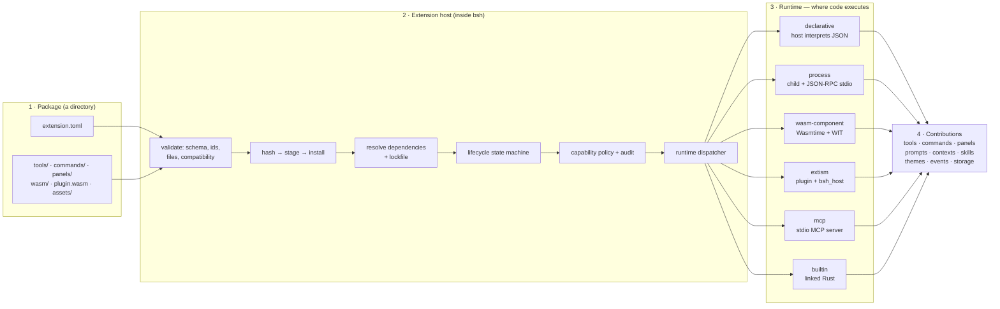
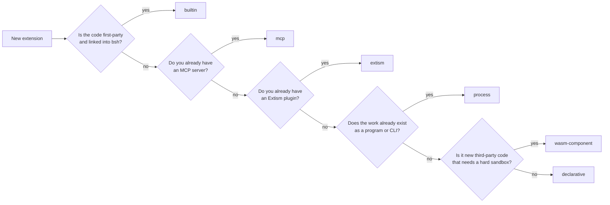
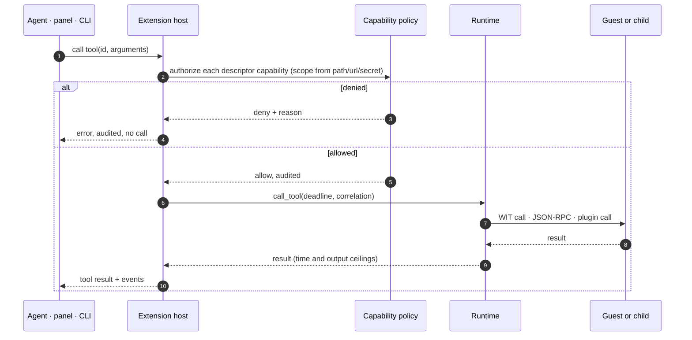

# BSH by Example

*A hands-on introduction to the BSH extension framework, in the spirit of
[Rust by Example](https://doc.rust-lang.org/rust-by-example/): every idea
arrives as a package you can validate, install, call and inspect.*

BSH is the desktop shell built on the BOS framework. Its extension platform is a
contract, not a plugin API: a package is a directory with an `extension.toml`,
the host reads it, hashes it, authorizes it, and only then runs it. This book
walks that contract one runnable example at a time.

The normative text is [bsh-extension-standard.md](bsh-extension-standard.md).
Where this book and the standard disagree, the standard wins. The design
rationale is in [BSH_Extension_Framework_Design.md](BSH_Extension_Framework_Design.md),
and the current implementation status is in
[bsh-extension-conformance.md](bsh-extension-conformance.md).

## How to run the examples

Every example is a directory under `examples/extensions`. From the BOS workspace:

```text
cargo build -p bsh                      # or use a release build
alias bsh=./target/debug/bsh

bsh ext validate examples/extensions/hello
bsh ext install  examples/extensions/hello
bsh ext info     com.example.hello
bsh ext mock     examples/extensions/hello echo '{"text":"hi"}'
```

Conventions used throughout:

- paths are relative to the workspace root unless stated otherwise;
- `bsh ext …` is the developer CLI (chapter 23 is the task index);
- a package id is reverse-domain (`com.example.hello`); a contribution id is
  dotted and lowercase (`echo`, `git.status`);
- a tool's model-facing name is the package's last id segment plus `__` plus the
  tool id, with dots flattened: `com.example.git-assistant` + `git.status` →
  `git-assistant__git_status`.

## Table of contents

- [Architecture and runtimes at a glance](#architecture-and-runtimes-at-a-glance)
1. [Hello, extension](#1-hello-extension)
2. [The package tree](#2-the-package-tree)
3. [The manifest](#3-the-manifest)
4. [Tools](#4-tools)
5. [Commands](#5-commands)
6. [Prompts and contexts](#6-prompts-and-contexts)
7. [Capabilities and grants](#7-capabilities-and-grants)
8. [The process runtime](#8-the-process-runtime)
9. [The WASM component runtime](#9-the-wasm-component-runtime)
10. [The Extism runtime](#10-the-extism-runtime)
11. [The MCP runtime](#11-the-mcp-runtime)
12. [Workflows](#12-workflows)
13. [Panels](#13-panels)
14. [Themes, icons and images](#14-themes-icons-and-images)
15. [Skills](#15-skills)
16. [Language services](#16-language-services)
17. [Integrations](#17-integrations)
18. [Model providers, agent roles and presets](#18-model-providers-agent-roles-and-presets)
19. [Storage and configuration](#19-storage-and-configuration)
20. [Events and hooks](#20-events-and-hooks)
21. [Lifecycle](#21-lifecycle)
22. [Store, integrity and signing](#22-store-integrity-and-signing)
23. [The CLI by task](#23-the-cli-by-task)
24. [Testing](#24-testing)
25. [Debugging](#25-debugging)
26. [Packaging and publishing](#26-packaging-and-publishing)
27. [Built-in extensions](#27-built-in-extensions)
28. [Limits and non-goals](#28-limits-and-non-goals)
- [Appendix A. Manifest skeleton](#appendix-a-manifest-skeleton)
- [Appendix B. Capability reference](#appendix-b-capability-reference)
- [Appendix C. Event reference](#appendix-c-event-reference)
- [Appendix D. UI nodes and limits](#appendix-d-ui-nodes-and-limits)
- [Appendix E. CLI index](#appendix-e-cli-index)
- [Appendix F. Example index](#appendix-f-example-index)
- [Appendix G. Glossary](#appendix-g-glossary)

---

# Architecture and runtimes at a glance

Everything in this book is one pipeline. A package is read from disk, proved to
be what it claims, authorized, and only then handed to a runtime. The runtime is
the only place code executes, and which runtime a package picks decides what
"code" even means: a JSON document, a child process, a WASM component, an Extism
plugin, an MCP server, or Rust linked into the host.

## The whole system



Read it in four steps:

1. **Package** — the manifest declares identity, compatibility, capabilities and
   contributions; every declaration must have its file.
2. **Host** — validate, hash, install into an immutable store, resolve
   dependencies, move the lifecycle state, authorize capabilities, and dispatch.
3. **Runtime** — the single execution seam. Everything before this step is
   static; everything after it is the package's code (or, for declarative, the
   host interpreting the package's JSON).
4. **Contributions** — the same runtime result feeds the agent's tool registry,
   the composer, panels, prompts/contexts, skills, events and storage.

Only step 3 differs between runtimes. Steps 1, 2 and 4 are shared, which is why
the rest of the contract can be uniform.

Static renders of the three figures (for readers whose Markdown viewer does not
draw Mermaid): [architecture](assets/charts/architecture.png),
[runtime choice](assets/charts/runtime-choice.png),
[call path](assets/charts/call-path.png).

## The six runtimes

| Runtime | Where the code lives | Contract | Choose it when | Avoid it when |
|---|---|---|---|---|
| **declarative** | nowhere: the host evaluates JSON descriptors | files in the package | the work is a prompt, a template, a panel, a theme or a fixed answer | you need I/O, state or computation |
| **process** | a child process | newline JSON-RPC on stdin/stdout | the work already exists as a program or CLI | you want a per-call OS sandbox guarantee |
| **wasm-component** | a Wasmtime component | WIT world `bsh-extension` | you ship new, untrusted code that needs a hard sandbox | you need native libraries or unrestricted networking |
| **extism** | an Extism plugin | PDK exports + `bsh_host` | you already have an Extism plugin | you need WASI or full WASM components |
| **mcp** | an external MCP server | MCP over stdio | you already have an MCP server | you need panel UI or command contributions |
| **builtin** | Rust linked into bsh | the `BuiltinExtension` trait | the code is first-party | a third party needs to ship it |

A package cannot mix runtimes: one `runtime.kind` per package.

## What every runtime shares

- the same manifest, hash, install, lifecycle and status row;
- the same per-call capability check, with the scope derived from `path`, `url`
  or `secret` — for agent calls, panel actions, language checks and integrations;
- the same deadline and output ceiling;
- the same audit line for every decision;
- the same event envelope, queue bounds and rate limit.

What differs is how a call travels and how it is stopped:

| Runtime | Start | Call | Progress | Cancel | Event delivery |
|---|---|---|---|---|---|
| declarative | none | host evaluates the descriptor | — | immediate | not delivered |
| process | `initialize` + nonce | `tools/call` | `$/progress` | child killed | `events/event` |
| wasm-component | `initialize`, `activate` | WIT `call-tool` | `progress()` | traps at next host call; epoch/fuel bound | `on-event` |
| extism | plugin load | `bsh_call_tool` | final result only | traps at next `bsh_host` call | `bsh_event` |
| mcp | MCP `initialize` | `tools/call` | `notifications/progress` | child killed by pid | `bsh/events/event` |
| builtin | trait `activate` | Rust call | — | trait `cancel` | — |

## Picking a runtime



The order matters: an existing MCP server or Extism plugin is a better fit than
rewriting it as a process, and a new untrusted extension should not become a
process just because that is the easiest path.

## One call, end to end



Two consequences of that order:

- a denied call never reaches the runtime, so a package cannot "fail open" by
  returning a value while unauthorized;
- the runtime never sees the caller's credentials or the policy engine, only the
  call and its deadline — which is why all six runtimes can implement the same
  seam.

**See also:** [Design boundaries](BSH_Extension_Framework_Design.md#41-architectural-boundaries),
[capability model](bsh-extension-standard.md#6-capability-model),
[lifecycle](bsh-extension-standard.md#7-lifecycle).

---

# 1. Hello, extension

The smallest useful package declares one tool. Create it:

```text
bsh ext new com.example.hello --dir hello
bsh ext validate hello
```

`new` writes this tree:

```text
hello/
  extension.toml
  README.md
  tools/echo.json
  commands/refresh.md
```

The manifest:

```toml
schema_version = "1.0"

[extension]
id = "com.example.hello"
name = "Hello"                      # title-cased from the last id segment
version = "0.1.0"
description = "A BSH extension"

[compatibility]
bsh = ">=3.0.0, <4.0.0"
extension_api = "^1.0"

[runtime]
kind = "declarative"
startup = "on-demand"

[capabilities]
required = ["agent.tools.register"]
optional = ["workspace.read"]

[contributes]
tools = ["echo"]
commands = ["refresh"]

[resources]
max_execution_ms = 5000
```

The tool descriptor:

```json
{
  "description": "Echo the arguments back to the model",
  "input_schema": {
    "type": "object",
    "properties": {}
  },
  "implementation": { "kind": "echo_arguments" }
}
```

Run it without installing anything:

```text
$ bsh ext mock hello echo '{"text":"hi"}'
{
  "text": "hi"
}
```

Now install it and look at what the host recorded:

```text
$ bsh ext install hello
$ bsh ext info com.example.hello
id:          com.example.hello
version:     0.1.0
runtime:     declarative
trust:       local
state:       active
applied:     true
tools:       hello__echo
commands:    hello__refresh
# … source, root, hash, signature, health, configured
```

Three things happened that are worth naming:

1. **Validation** parsed the manifest, checked compatibility, required every
   declared contribution to have a file, and computed the package hash.
2. **Install** copied the tree into a hashed, immutable store
   (`~/.bos/bsh/extensions/installed/com.example.hello/0.1.0/`).
3. **Activation** checked the required capabilities and registered
   `hello__echo` with the agent. `agent.tools.register` is low risk, so a local
   package is allowed by default.

The model sees `hello__echo`, not `echo`: tool names are a flat namespace shared
with every other provider.

**See also:** [The extension standard §1](bsh-extension-standard.md#1-what-an-extension-is),
[hello example](../examples/extensions/hello).

---

# 2. The package tree

A package is a directory whose file names are contribution ids. Nothing is
discovered by convention beyond the manifest:

```text
my-extension/
  extension.toml            required
  README.md                 recommended
  LICENSE                   recommended
  plugin.wasm               Extism entry
  wasm/<name>.wasm          component entry
  tools/<id>.json           one per declared tool
  commands/<id>.md          one per declared command
  prompts/<id>.md           one per declared prompt
  contexts/<id>.md          one per declared context
  languages/<id>.json       one per declared language service
  integrations/<id>.json    one per declared integration
  skills/<id>/SKILL.md      one per declared skill
  panels/<id>.json          one per declared panel
  workflows/<id>.json       one per declared workflow
  themes/<id>.json          one per declared theme
  providers/models/<id>.json   model provider descriptors
  providers/agents/<id>.json   agent role descriptors
  presets/<id>.json            agent/module presets
  migrations/<name>.toml       data migrations
  schemas/                     configuration schemas
  assets/                      icons and images (`asset/…`)
```

The file name is the **full** contribution id. A tool `git.status` lives at
`tools/git.status.json`, never `tools/status.json`. That is what keeps two tools
with the same leaf name from colliding on disk.

Two rules the host enforces before any code runs:

```text
declared but missing    -> validate/install fails; the package contributes nothing
extra file not declared -> ignored by the contract (it is still hashed)
symlink anywhere        -> refused; packages must be self-contained
```

The hash excludes `.git`, `.jj`, `target` and `node_modules`, and excludes
`package.sig` (the signature covers the tree, so it cannot cover itself).

**See also:** [Package layout §3](bsh-extension-standard.md#3-package-layout).

---

# 3. The manifest

The manifest is deliberately strict: unknown fields are rejected, because a
misspelled mandatory field that disappears silently is how a package asks for
nothing and receives nothing.

A fully annotated manifest:

```toml
schema_version = "1.0"              # exactly this

[extension]
id = "com.example.git-assistant"    # reverse-domain, lowercase
name = "Git Assistant"              # 1..=128 characters
version = "1.2.0"                   # SemVer 1.0
description = "Git tools for BSH"   # 1..=4096 bytes
authors = ["Example Developer"]     # at most 32
license = "MIT"
repository = "https://example.com/git-assistant"

[compatibility]
bsh = ">=3.0.0, <4.0.0"             # checked against the host crate
extension_api = "^1.0"              # checked against EXTENSION_API_VERSION
# ui_api = "^1.0"                   # optional; a mismatch is a warning

[runtime]
kind = "process"                    # builtin | declarative | process |
                                    # wasm-component | extism | mcp
entry = "bin/server"                # process/wasm/extism/mcp only
args = ["--stdio"]                  # process only
startup = "on-demand"               # on-startup | on-demand |
                                    # on-workspace-open | manual
protocol = "jsonrpc-2.0"            # process only

[runtime.env]
LOG_LEVEL = "info"                  # PATH/LD_*/DYLD_*/PYTHONPATH/NODE_OPTIONS
                                    # are refused at validation

[capabilities]
required = ["process.execute", "agent.tools.register"]
optional = ["workspace.write", "network.http"]

[contributes]
tools = ["git.status", "git.diff"]
commands = ["git.refresh"]
prompts = ["git.guide"]
contexts = ["git.workspace"]
languages = ["git.rust"]
integrations = ["git.github"]
skills = ["git.helper"]
panels = ["git.panel"]
workflows = ["git.release"]
themes = ["git.dark"]
presets = ["git.reader"]
model_providers = ["git.example"]
agent_providers = ["git.reviewer"]
events = ["workspace.opened", "tool.*"]   # trailing wildcard allowed
publishes = ["git.changed"]               # no wildcard here

[configuration]
schema = "schemas/config.json"
defaults = { strict = true }

[resources]
max_memory_mb = 128                 # 1..=4096, default 256
max_execution_ms = 5000             # 1..=600000, default 30000
max_concurrent_calls = 4            # 1..=64, default 4
max_output_bytes = 1048576          # 1..=16777216, default 1048576

[dependencies]
"com.example.base" = "^1.0"         # at most 64
```

A request above a ceiling is an **error**, not a silent clamp. That is the point:
a package that asks for 8 GiB should be told no, not quietly given 256 MiB.

**See also:** [Manifest reference §4](bsh-extension-standard.md#4-manifest-reference),
[manifest skeleton](#appendix-a-manifest-skeleton).

---

# 4. Tools

A tool is a descriptor plus a body. The descriptor is what the model sees; the
body is where it runs.

## 4.1 The descriptor

```json
{
  "description": "Read the status of one Git path.",
  "input_schema": {
    "type": "object",
    "properties": { "path": { "type": "string" } },
    "required": ["path"]
  },
  "capabilities": ["workspace.read"],
  "implementation": { "kind": "echo_arguments" }
}
```

- `description` defaults to the package name and id;
- `input_schema` defaults to an object with no properties;
- `capabilities` are checked **per call**, in addition to activation;
- `implementation` is required for declarative tools and ignored by process
  tools.

The per-tool capability list is the least-privilege seam: a package may register
ten tools and let only one of them ask for `workspace.write`. The same check runs
when the tool is called by the agent, by a panel action, by
`bsh ext language-check`, or by an integration.

## 4.2 The three declarative bodies

Echo:

```json
{"description":"Echo","implementation":{"kind":"echo_arguments"}}
```

Constant:

```json
{"description":"Version","implementation":{"kind":"constant","value":{"version":"1.2.0"}}}
```

Template:

```json
{
  "description": "Greet one person",
  "input_schema": {
    "type": "object",
    "properties": {"name": {"type":"string"}}
  },
  "implementation": {
    "kind": "template",
    "text": "Hello {{name}}, from {{package}}"
  }
}
```

Placeholders read **top-level** argument names. A string renders as its text, any
other JSON value renders as compact JSON, and a missing argument renders as
empty. Output is capped by `max_output_bytes`.

## 4.3 Calling a tool

From the CLI, through a permissive mock host:

```text
bsh ext mock examples/extensions/hello echo '{"text":"hi"}'
```

From the agent, through the model-facing name:

```text
hello__echo
```

From a panel, with an action id equal to the tool id (chapter 13).

## 4.4 Errors a tool can return

```text
not found            the id is not declared by this package
permission denied    a declared capability is not granted (audited)
timeout              the call exceeded min(caller, max_execution_ms)
limit                the result exceeded max_output_bytes
runtime/protocol     the guest or transport failed
```

A denied call is a tool error the model can read, not a panic and not a silent
no-op.

**See also:** [Tool descriptors §5](bsh-extension-standard.md#5-tool-descriptors).

---

# 5. Commands

A command is a Markdown template the composer inserts. It runs as prompt text,
not as code — unless the runtime implements `commands/execute` and the command is
dispatched by the host (panel actions, integrations, the CLI).

```markdown
---
description: Greet the reader
---
Say hello from com.example.hello and name the open workspace.
```

The file is `commands/greet.md` and the declaration is `commands = ["greet"]`.
The composer shows the command as `hello__greet`, with the package name in the
description.

Command ids follow the same rules as tool ids, and registering the same id as a
tool and a command is a validation error.

**See also:** [Contributions §4.5](bsh-extension-standard.md#45-contributions).

---

# 6. Prompts and contexts

Prompts are always appended to the system prompt. Contexts are appended only
when their workspace globs match.

## 6.1 A prompt

```markdown
---
description: House style
---
Prefer short answers. Quote file paths as `path:line`.
```

## 6.2 A scoped context

```markdown
---
description: Rust workspace facts
paths: src/**/*.rs, tests/**/*.rs
---
This workspace is a Rust project. Integration tests live under `tests/`.
```

- an empty or absent `paths:` is unscoped and always matches;
- a scoped context with no open workspace never matches;
- each contribution adds at most 8 KiB, and all extensions together add at most
  64 KiB to one build.

**See also:** [Context scope](bsh-extension-standard.md#45-contributions).

---

# 7. Capabilities and grants

A capability in the manifest is a **request**. The host decides whether to grant
it, and it records every decision.

## 7.1 Declaring

```toml
[capabilities]
required = ["agent.tools.register", "workspace.read"]
optional = ["workspace.write", "network.http"]
```

Required capabilities are checked at activation; optional ones are checked when
a call asks for them (that is what a tool descriptor's `capabilities` list is).

## 7.2 Defaults by trust

| Capability | Risk | Built-in | Verified | Community / local |
|---|---|---|---|---|
| workspace.read | low | allow | allow | allow, scoped to the workspace |
| extension.storage | low | allow | allow | allow |
| agent.tools.register | low | allow | allow | allow |
| agent.context.provide | low | allow | allow | allow |
| agent.prompts.provide | low | allow | allow | allow |
| agent.skills.provide | medium | allow | allow | allow |
| events.publish / subscribe | low | allow | allow | allow |
| ui.panels / commands / theme | low | allow | allow | allow |
| agent.models.provide | medium | allow | allow | explicit grant |
| agent.agents.provide | medium | allow | allow | explicit grant |
| agent.workflows.provide | medium | allow | allow | explicit grant |
| workspace.write | high | allow | explicit grant | explicit grant |
| network.http | high | allow | explicit grant | explicit grant |
| process.execute | critical | allow | explicit grant | explicit grant |
| computer.use | critical | allow | explicit grant | explicit grant |
| secrets.read | critical | allow | explicit grant | explicit grant |

A package read from disk starts at `local`. A valid publisher signature raises it
to `verified`; a Git/market install starts at `community`.

## 7.3 Grants and scopes

```text
bsh ext grant <id> <capability> [--scope <scope>] [--note <text>]
```

| Scope | Covers |
|---|---|
| `any` | every call |
| `workspace` | a call with an open workspace |
| `path:/prefix` | a call whose path (or workspace) starts with the prefix |
| `domain:example.com` | that host and its subdomains |
| `domain:example.com:POST` | that host, only for the named HTTP method |
| `program:python3` | that declared executable |
| `program:python3:--version` | that executable with exactly those arguments |
| `secret:NAME` | that one named secret |

Examples:

```text
bsh ext grant com.example.tool workspace.write --scope workspace
bsh ext grant com.example.tool network.http --scope domain:api.example.com
bsh ext grant com.example.tool secrets.read --scope secret:GITHUB_TOKEN
bsh ext grant com.example.process-echo process.execute --scope program:python3
bsh ext grant com.example.process-echo process.execute --scope program:python3:--version
```

Scopes are matched after **normalizing** the path, so `../outside` cannot escape a
`path:` grant. They are matched exactly on secret names, and on the dot boundary
for domains, so `domain:example.com` does not match `evil-example.com`.

## 7.4 What a denial looks like

```text
extension com.example.tool is not authorized for workspace.write:
workspace.write requires an explicit grant for a local extension
(run 'bsh ext grant com.example.tool workspace.write')
```

Two different denials:

- **no grant** — "requires an explicit grant"; run the command it prints;
- **wrong scope** — "grant is scoped to …, which does not cover this call";
  widen deliberately or name `path`/`url`/`secret` exactly.

The Extensions pane has a **Grant** button for denied required capabilities. It
writes the narrowest scope it can infer (workspace for path capabilities, the
declared program for process) and it **refuses** to auto-grant `secrets.read` or
`network.http`, because a scope-free grant would be wider than `secret:NAME` and
`domain:host`. Those two keep their denial text with the exact command.

## 7.5 Audit

Every evaluation is one JSON line in `logs/extensions/audit.jsonl`:

```json
{"timestamp":1790000000,"extension":"com.example.tool","capability":"workspace.write","allowed":false,"scope":null,"trust":"local","reason":"…"}
```

The log rotates at 1 MiB to `audit.jsonl.1`. Secret values are never written.

**See also:** [Capability model §6](bsh-extension-standard.md#6-capability-model).

---

# 8. The process runtime

Use the process runtime when the work already exists as a program: Python, Node,
a CLI, a service that speaks newline-delimited JSON-RPC.

## 8.1 The package

```toml
[extension]
id = "com.example.process-echo"
name = "Process Echo"
version = "1.0.0"
description = "An echo tool served by Python"

[runtime]
kind = "process"
entry = "python3"              # allowlisted launcher, or a package-relative file
args = ["server.py"]
protocol = "jsonrpc-2.0"
startup = "on-demand"

[capabilities]
required = ["process.execute", "agent.tools.register"]

[contributes]
tools = ["echo"]
commands = ["refresh"]
events = ["session.created", "tool.completed"]
```

The launcher allowlist is exactly `python3`, `python`, `node`, `bun`, `deno`, `sh`,
`bash`. Anything else must be a package-relative executable, and it may not be
absolute or contain `..`.

## 8.2 The server

One JSON object per line on stdin/stdout. This is a complete echo server:

```python
import json
import os
import sys

TOKEN = os.environ.get("BSH_IPC_TOKEN", "")

def send(message):
    print(json.dumps(message), flush=True)

def main():
    for line in sys.stdin:
        request = json.loads(line)
        method = request.get("method")
        params = request.get("params") or {}
        request_id = request.get("id")

        if method == "initialize":
            # Echo the nonce. A mismatch kills the child and refuses the package.
            result = {"protocolVersion": "1.0", "token": params.get("token")}
        elif method == "tools/call":
            # Optional live progress; the host forwards it to the agent.
            send({"jsonrpc": "2.0", "method": "$/progress",
                  "params": {"progress": 1, "total": 2}})
            result = params.get("arguments", {})
        elif method == "commands/execute":
            result = {"id": params.get("name"), "arguments": params.get("arguments", {})}
        elif method == "events/event":
            continue                     # notification: no response
        elif method == "shutdown":
            result = {}
        else:
            result = {}

        send({"jsonrpc": "2.0", "id": request_id, "result": result})

if __name__ == "__main__":
    main()
```

The host sends:

```json
{"jsonrpc":"2.0","id":1,"method":"initialize","params":{"protocolVersion":"1.0","extensionId":"com.example.process-echo","host":{"name":"bsh","version":"3.0.2"},"token":"<nonce>"}}
```

and expects the same nonce back. `protocolVersion` must start with `1.`.

## 8.3 Calls, errors and events

```json
{"jsonrpc":"2.0","id":2,"method":"tools/call","params":{"name":"echo","arguments":{"x":1},"correlationId":"…"}}
```

A normal result is the tool's JSON value. An error object is an
application-level answer: the session stays alive. Only a transport failure
(stdout closed, timeout, malformed line) kills the session, and the next call
starts a fresh child.

Events arrive as notifications:

```json
{"jsonrpc":"2.0","method":"events/event","params":{"event_type":"session.created","payload":{}}}
```

## 8.4 What the host enforces

```text
handshake        10 s, token must match
one line         4 MiB
one result       max_output_bytes
one call         min(caller deadline, max_execution_ms)
concurrency      one child; calls are serialized
environment      cleared; only PATH, HOME, TMPDIR, LANG, LC_ALL + manifest vars
working dir      the package root
cancel           the child is killed; the next call respawns
shutdown         a 1 s request, then kill
stderr           logged with the extension id
```

On macOS the child runs under a filesystem profile that allows writes only in
the package, the open workspace, the data namespace and temp; Linux uses the
bubblewrap plan. The profile is a filesystem boundary, not a network one.

## 8.5 Grants and a first call

```text
bsh ext install examples/extensions/process-echo
bsh ext grant com.example.process-echo process.execute --scope program:python3
bsh ext grant com.example.process-echo agent.tools.register --scope any
bsh ext info com.example.process-echo
bsh ext mock examples/extensions/process-echo echo '{"x":1}'
```

A `program:` scope must match the manifest entry exactly. A narrower
`program:python3:arg` grant is also supported and must match the declared
argument vector.

**See also:** [Process protocol §8](bsh-extension-standard.md#8-process-protocol),
[process-echo example](../examples/extensions/process-echo).

---

# 9. The WASM component runtime

WASM is the preferred third-party code boundary: the guest gets memory, fuel and
an epoch deadline, and it reaches the host only through declared imports.

## 9.1 The contract

```toml
[runtime]
kind = "wasm-component"
entry = "wasm/extension.wasm"
```

The published world is `crates/bsh/wit/extension.wit`:

```text
world bsh-extension {
    import host;        // every function is policy-checked
    export extension;   // initialize, activate, tools, call-tool, …
}
```

The host interface:

```text
log, emit, subscribe, unsubscribe
read-file, write-file, fetch
storage-get, storage-set, storage-list
read-secret, configuration
now-millis, progress
```

The extension interface:

```text
initialize(host-version, config)
activate / deactivate / shutdown
tools() -> list<tool-definition>
call-tool(id, arguments, correlation-id) -> tool-result
command(id, arguments) -> string
panel(id) -> string
on-event(event)
```

## 9.2 Build a guest

```text
rustup target add wasm32-unknown-unknown
cargo build --target wasm32-unknown-unknown --release
wasm-tools component new target/wasm32-unknown-unknown/release/guest.wasm \
  -o wasm/extension.wasm
```

The smallest working guest is [wasm-echo](../examples/extensions/wasm-echo). Its
export list is the contract; its imports are only the host functions it uses.

## 9.3 Limits

```text
memory       resources.max_memory_mb -> StoreLimits
time         max_execution_ms -> fuel + epoch deadline
output       max_output_bytes -> checked before the result reaches the agent
calls        the host clamps a host-initiated call to the manifest ceiling
```

Cancellation traps the guest at its next host call; a guest that performs pure
computation with no host calls runs to its deadline. That is the honest limit of
a synchronous Wasmtime store.

## 9.4 Test

```text
bsh ext validate examples/extensions/wasm-echo
bsh ext install  examples/extensions/wasm-echo
bsh ext mock     examples/extensions/wasm-echo echo '{"text":"hi"}'
```

A component package may also ship the declarative files (prompts, contexts,
commands, panels, themes) like any other runtime.

**See also:** [WASM contract](../crates/bsh/wit/extension.wit),
[wasm-echo](../examples/extensions/wasm-echo).

---

# 10. The Extism runtime

Extism is a WASM flavor with one host bridge and a PDK-friendly export set. Use it
for an existing Extism plugin.

## 10.1 The package

```toml
[runtime]
kind = "extism"
entry = "plugin.wasm"
```

WASI is disabled. The plugin reaches the host only through `bsh_host`.

## 10.2 Exports and bridge

```rust
#[plugin_fn] pub fn bsh_tools(_: String) -> FnResult<String> { … }
#[plugin_fn] pub fn bsh_call_tool(input: String) -> FnResult<String> { … }
#[plugin_fn] pub fn bsh_command(input: String) -> FnResult<String> { … }
#[plugin_fn] pub fn bsh_panel(_: String) -> FnResult<String> { … }
#[plugin_fn] pub fn bsh_event(_: String) -> FnResult<String> { … }

#[host_fn]
extern "ExtismHost" { fn bsh_host(input: String) -> String; }
```

Bridge operations:

```text
read_file, write_file, fetch
storage_get, storage_set, storage_list
read_secret, emit, subscribe
config, now_millis, log
```

The request is JSON: `{"op":"read_file","path":"notes.md"}`. The response is
either `{"ok":true,"value":…}` or `{"ok":false,"error":…}`. Every operation is
checked against the same policy as the component runtime, and `emit` is limited
to the topics in `contributes.publishes`.

## 10.3 Build

```text
cd examples/extensions/extism-echo/guest
cargo build --target wasm32-unknown-unknown --release
cp target/wasm32-unknown-unknown/release/bsh_extism_echo.wasm ../plugin.wasm
```

## 10.4 Test

```text
bsh ext validate examples/extensions/extism-echo
bsh ext install  examples/extensions/extism-echo
bsh ext mock     examples/extensions/extism-echo echo '{"text":"hi"}'
```

**See also:** [Extism contract](bsh-extension-standard.md#43-runtime),
[extism-echo](../examples/extensions/extism-echo).

---

# 11. The MCP runtime

MCP is an adapter: the host starts a stdio Model Context Protocol server and maps
its inventory onto BSH surfaces.

## 11.1 The package

```toml
[runtime]
kind = "mcp"
entry = "python3"
args = ["server.py"]
protocol = "mcp"
```

The server must implement the MCP handshake and answer `tools/list`. The host
performs `initialize` and `notifications/initialized`.

## 11.2 The mapping

| MCP | BSH |
|---|---|
| `tools/list`, `tools/call` | tools |
| `resources/list`, `resources/read` | contexts |
| `prompts/list`, `prompts/get` | prompts |
| `notifications/progress` | tool progress |
| declared `contributes.events` | `bsh/events/event` notifications |

No panel UI is mapped: a panel needs the BSH declarative contract.

## 11.3 What the host enforces

- spawning the server requires an explicit **process.execute** grant, scoped to
  the declared program and arguments, exactly like the process runtime;
- tool names are preserved: the server's `getUser` is called as `getUser` even
  though the local contribution id is sanitized;
- a call runs on the blocking pool under
  `min(caller deadline, max_execution_ms)`; a timeout or cancel kills the child;
- a decoded JSON-RPC error keeps the session; a transport failure does not;
- a result above `max_output_bytes` is refused.

## 11.4 Test

```text
bsh ext install examples/extensions/mcp-echo
bsh ext grant com.example.mcp-echo process.execute --scope program:python3
bsh ext mock examples/extensions/mcp-echo echo '{"x":1}'
```

**See also:** [MCP runtime](bsh-extension-standard.md#43-runtime),
[mcp-echo](../examples/extensions/mcp-echo).

---

# 12. Workflows

A workflow is a bounded sequence of calls to the **same** package's tools. The
host advertises it as one tool.

## 12.1 The file

```json
{
  "description": "Fetch, transform and report",
  "input_schema": {
    "type": "object",
    "properties": {"path": {"type": "string"}}
  },
  "steps": [
    {"name": "read", "tool": "echo", "arguments": {"path": "{{input.path}}"}},
    {"name": "report", "tool": "echo", "arguments": {"from": "{{steps.read.path}}"}}
  ]
}
```

Placeholders are `{{input.name}}` and `{{steps.name.field}}`.

## 12.2 What the host does

- computes the union of the step tools' capabilities and puts it on the workflow
  tool, so everything the workflow can reach is authorized before step one;
- runs the steps in order, forwarding progress and cancellation to the running
  step;
- never reaches another package: a step names a tool of the same extension.

A workflow that names an undeclared tool fails at that step. Declare the tools.

**See also:** [Workflows §4.5](bsh-extension-standard.md#45-contributions).

---

# 13. Panels

A panel is a bounded JSON document the host renders with its own widgets. No
HTML, script, CSS, or GPUI object crosses the boundary.

## 13.1 The file

```json
{
  "title": "Git Status",
  "icon": "asset/git.svg",
  "location": "right",
  "default_visibility": "visible",
  "view": {
    "schema_version": "1.0",
    "root": {
      "type": "column",
      "children": [
        {"type": "heading", "text": "Git Status", "level": 2},
        {"type": "text", "text": "Working tree clean"},
        {"type": "button", "label": "Refresh", "action": "git.refresh", "style": "primary"}
      ]
    }
  }
}
```

`location` is `left`, `right`, `bottom` or `center`. `default_visibility` is
`visible` or `hidden`.

## 13.2 Nodes

```text
container, row, column, tabs        layout
text, heading, markdown, code       text
button, input, select, checkbox     controls
list, table, tree                   collections
progress, notification, divider,
spacer, image                       status and decoration
```

Limits, enforced before rendering:

```text
depth 32, nodes 1000, one text 16 KiB, all text 256 KiB
list 500 items, table 500x32, cell 2048 chars, tabs 16
serialized document 1 MiB
```

## 13.3 Actions

A button's `action` is a contribution id owned by the package. The host routes it
to a tool first and to the runtime's command seam second.

Two revisions are involved:

1. the document revision the host rendered;
2. the action request carries **that** revision.

A control painted from an old document is therefore refused when the view has
moved on:

```text
action at revision 3 but the view is at 4; the control was stale
```

An action may return a new document. The host applies it at `revision + 1`:

```json
{
  "schema_version": "1.0",
  "root": {"type": "text", "text": "Refreshed"}
}
```

Any other JSON value becomes a one-line status message under the panel.

## 13.4 Images and icons

`src` and `icon` accept an `asset/…` path inside the package:
`{"type":"image","src":"asset/icons/logo.png","alt":"Logo"}`. Remote images
(`https://`) are refused by validation: this host has no remote image loader, and
a node the renderer cannot honour is worse than a validation error.

## 13.5 Failure modes

```text
invalid document      error printed in the panel, not a blank frame
missing action        tool/command not found, shown inline
stale action          refused by revision
image outside package refused by validate
```

**See also:** [Declarative UI §10](bsh-extension-standard.md#10-declarative-ui),
[appendix D](#appendix-d-ui-nodes-and-limits).

---

# 14. Themes, icons and images

A theme is a token map. Missing tokens fall back to the host palette, so a
partial theme is a refinement, not a broken frame.

```json
{
  "name": "Midnight",
  "colors": {
    "page": "#0b0d10",
    "text": "#e6e8eb",
    "muted": "#9aa0a6",
    "accent": "#4176e6",
    "border": "#2a2f36",
    "new-session-fill": "#171a1f"
  }
}
```

Known tokens: `page`, `text`, `muted`, `faint`, `border`, `border-soft`, `accent`,
`error`, `success`, `warn`, `new-session-fill`, `hover`.

Two ways a theme is used:

- the first theme a package declares applies to **that extension's panels**;
- Settings → Extensions also lists it as a **global** selection, which overlays
  its named tokens on the shell palette.

A panel's `icon` and an `image` node are drawn from `asset/…` files in the
package. Keep them small: they are loaded from disk when the panel paints.

**See also:** [Themes §10](bsh-extension-standard.md#10-declarative-ui).

---

# 15. Skills

A skill is a `SKILL.md` directory the agent loads into its skill set.

```text
skills/helper/SKILL.md
```

```markdown
---
name: helper
description: How to inspect this workspace
---
When asked about the workspace, read `README.md` first and cite paths as
`path:line`.
```

Declare it:

```toml
[contributes]
skills = ["helper"]
```

The host validates that `skills/helper/SKILL.md` exists, registers the directory
with the agent, and reports the skill on the status row. A package whose **only**
contribution is a skill still applies; skills are not an afterthought to tools.

```text
bsh ext install examples/extensions/allinone
bsh ext info com.example.allinone
```

**See also:** [Skills §4.5](bsh-extension-standard.md#45-contributions).

---

# 16. Language services

A language service names a language, its bare file extensions, and the tool that
answers diagnostics for a document.

```json
{"name":"Python","extensions":["py"],"tool":"diagnose","syntax":"python"}
```

The tool is required and must be declared by the same package. The host calls it
with:

```json
{"path":"/workspace/sample.py","text":"def ok():\n    return 1\n","language":"python"}
```

and expects a diagnostics-shaped value. `examples/extensions/language-python`
uses `ast.parse` for a real syntax check.

```text
bsh ext install examples/extensions/language-python
bsh ext grant com.example.language-python process.execute --scope program:python3
printf 'def broken(:\n' > /tmp/bad.py
bsh ext language-check com.example.language-python python /tmp/bad.py
```

The same per-call capability check runs here as for an agent tool call: a
diagnostics tool that declares `workspace.read` is checked, and a denial is an
error, not a silent empty result.

**See also:** [Languages §4.5](bsh-extension-standard.md#45-contributions),
[language-python](../examples/extensions/language-python).

---

# 17. Integrations

An integration descriptor names an external system and the tool or command that
drives it.

```json
{"name":"GitHub","kind":"github","action":"github-search"}
```

The kind is `github`, `browser`, `terminal` or `custom`. The action is required
and must be declared by the same package.

```text
tool action      dispatch through the runtime's tool call
command action   dispatch through the runtime's command seam
```

A declarative package's commands are prompt templates, so a command action needs
a runtime that implements `commands/execute` (process, Extism, WASM, workflow).
When in doubt, make the action a tool.

```text
bsh ext integrate com.example.language-python github '{"query":"bsh"}'
```

**See also:** [Integrations §4.5](bsh-extension-standard.md#45-contributions).

---

# 18. Model providers, agent roles and presets

Three JSON descriptor kinds make a package selectable in Settings without a
code-level adapter.

## 18.1 A model provider

```json
{
  "name": "Example",
  "base_url": "https://api.example.com/v1",
  "api_mode": "chat",
  "requires_key": true,
  "fast": {
    "model": "example-small",
    "name": "Example Fast",
    "max_tokens": 8192
  }
}
```

Each model is one flattened table keyed by nickname. `requires_key = false`
declares an open or anonymous lane: the build sends no credential instead of
refusing a missing key.

## 18.2 An agent role and a preset

```json
{
  "level": 1,
  "permission": "read_only",
  "plugins": ["files", "plan"],
  "tools": ["read_file", "grep", "glob"],
  "extensions": ["com.example.reader"]
}
```

An agent role descriptor maps onto a selectable preset: plugins, permission
level, tool allowlist and extension allowlist.

## 18.3 How they are named

The host namespaces every contributed descriptor:

```text
ext.<extension-id>.<contribution-id>
ext.<extension-id>.agent.<contribution-id>     (agent roles)
```

The contributed maps are read when Settings loads and are selectable in the
provider and preset pickers. Declaring `agent.models.provide`,
`agent.agents.provide` or `agent.workflows.provide` is what the policy checks.

**See also:** [Providers §4.5](bsh-extension-standard.md#45-contributions).

---

# 19. Storage and configuration

## 19.1 Storage

Each extension owns `extension-data/<id>/`. A key is a relative path:

```text
notes/today.md          ok
../other-extension/x    refused
/absolute/path          refused
a\b                     refused (backslash)
```

Rules:

```text
one value        8 MiB
one namespace    10,000 files (enforced on write)
writes           temp file, fsync, rename
symlinks         refused, and the parent must stay inside the namespace
```

WASM components call `storage_get`/`storage_set`/`storage_list`; Extism calls
the same operations through `bsh_host`. The process runtime has no storage bridge:
a process package manages its own files, and the sandbox permits writes under its
data namespace, but the host does not expose the storage API to it.

## 19.2 Configuration

A package can declare a JSON Schema and defaults:

```toml
[configuration]
schema = "schemas/config.json"
defaults = { strict = true }
```

```text
bsh ext config <id>                 # read the effective document
bsh ext config <id> schema          # print the schema
bsh ext config <id> set '{"strict":false}'
bsh ext config <id> set ./config.json
```

Values are validated against the schema and migrated on a version change.
There is no configuration editor in Settings yet; the CLI is the supported
surface (see [chapter 28](#28-limits-and-non-goals)).

**See also:** [Storage §11](bsh-extension-standard.md#11-storage).

---

# 20. Events and hooks

An event is a notification. Delivery is bounded, never blocking, and only to
subscribers that declared the topic.

## 20.1 The envelope

```json
{
  "id": "uuid",
  "source": "com.example.package",
  "event_type": "tool.completed",
  "schema_version": "1.0",
  "timestamp": 1790000000000,
  "correlation_id": "turn-1",
  "payload": {}
}
```

## 20.2 Subscribe and publish

```toml
[contributes]
events = ["session.created", "tool.*"]
publishes = ["git.changed"]
```

A trailing `.*` selects a namespace. `publishes` may not use a wildcard.

Where the event arrives depends on the runtime:

```text
process     {"jsonrpc":"2.0","method":"events/event","params":{…}} notification
WASM        on-event(event)
Extism      bsh_event(<json envelope>)
MCP         bsh/events/event notification (once the server is running)
declarative no delivery; use a tool/panel action instead
```

A component publishes only topics in `publishes`; `tool.*` is always allowed for
component tools.

## 20.3 Topics the host publishes

```text
app.started, app.shutdown
workspace.opened, workspace.closed, workspace.changed
session.created, session.updated, session.deleted
trajectory.recorded
agent.started, agent.completed, agent.failed
skill.loaded, instruction.build
model.requested, model.completed
mcp.connected
tool.invoked, tool.completed, tool.failed
network.request, audio.captured
extension.loaded, extension.unloaded, extension.failed
config.changed
ui.action
```

`ui.action` carries the extension, panel, action and revision when a declarative
panel routes a control.

## 20.4 Bounds

```text
subscriber queue   default 64, maximum 4096; a full queue drops, never blocks
event size         256 KiB before publication
rate               one source may publish 200 events in a second
```

The bus counters (published, delivered, dropped, rejected) are in `bsh ext metrics`.

**Hooks are not events.** A hook is a call at a seam (`model.request`,
`model.response`, `tool.before`, `tool.after`) delivered only to a package that
declared it; it is bounded, batched and redacted. The hook layer and its current
limits are in [bsh-hook-system.md](bsh-hook-system.md).

**See also:** [Events §9](bsh-extension-standard.md#9-events),
[appendix C](#appendix-c-event-reference).

---

# 21. Lifecycle

A package moves through a state machine, not a set of conventions.

```text
Discovered -> Validating -> Resolved -> Installing -> Installed
Installed  -> Loading -> Starting -> Active
Active     -> Suspending -> Suspended -> Starting
Active     -> Stopping -> Unloaded
any non-Unloaded -> Failed
Failed     -> Loading            (retry)
Unloaded   -> Loading            (reinstall)
```

A transition the table does not define is an error, not a silent rewrite.
Failure is legal from anywhere except `Unloaded`: the point is to stop a broken
package.

Persistence lives in `extension-state/state.toml`: the enabled flag, last state,
last error and last start time. Three consequences worth knowing:

- an **upgrade preserves** the enabled flag; installing v2 does not re-enable a
  package the reader switched off;
- a **corrupt** state document is treated as disabled, not as enabled: a broken
  file must not switch code back on;
- a package that was applied and then stops being applied publishes
  `extension.unloaded`.

## 21.1 Startup policies

```text
on-startup          warmed right after the host loads it (detached thread)
on-demand           descriptors load now; the runtime starts on first call
on-workspace-open   only with an open workspace
manual              never applied automatically
```

A package can be enabled and still not applied: manual, disabled, missing a
required grant, failed dependency resolution. The status row says which.

**See also:** [Lifecycle §7](bsh-extension-standard.md#7-lifecycle).

---

# 22. Store, integrity and signing

## 22.1 Where things live

```text
~/.bos/bsh/extensions/
  installed/<id>/<version>/     immutable package code
  staging/                      an install in progress
  cache/                        downloaded packages
  quarantine/                   disabled or failed packages
  extension-data/<id>/          business data (survives uninstall unless purged)
  extension-state/
    registry.toml               installed versions, hashes, sources
    state.toml                  enabled flags, last state, last error
    grants.toml                 capability grants
    lock.toml                   the resolved dependency set
  logs/extensions/
    audit.jsonl                 capability decisions
    <id>/                       package logs
```

Set `BSH_EXTENSION_ROOT` to move the root.

## 22.2 The hash

SHA-256 over each file's relative path, byte length and content digest, in sorted
path order. Directory metadata, timestamps and modes are excluded. `.git`,
`.jj`, `target` and `node_modules` are excluded; so is `package.sig`, because a
signature cannot cover itself.

## 22.3 Install and verify

```text
source -> validate -> copy to staging -> hash -> rename into installed/
```

An existing id/version is refused; an upgrade is a new version directory.
Verification does not stop at install: on every load the host recomputes the
hash, compares it with `registry.toml`, and re-verifies a signature against
`extension-state/trust.toml`. A mismatch refuses activation (and the doctor
reports it); a removed publisher demotes the trust level.

## 22.4 Signatures

```text
bsh ext keygen example --out keys
bsh ext sign   ./my-extension --publisher example --key keys/example.key
bsh ext verify ./my-extension
bsh ext trust  example <public-key>        # add a publisher
bsh ext untrust example                    # remove one
bsh ext publishers
```

The signature is Ed25519 over `bsh-package-v1`, the id, the exact version and the
hash, stored in `package.sig`. A valid signature by a trusted publisher installs
as `verified`; an untrusted publisher is recorded as a warning; an invalid
signature refuses installation.

## 22.5 Dependencies and reproduction

```toml
[dependencies]
"com.example.base" = "^1.0"
```

There is exactly one selected version per id. Resolution is depth-first,
dependencies before dependents, highest matching version; cycles and missing ids
are named. A disabled package is not a candidate, even as a dependency.

The lockfile records format, host, extension API, and for each package its id,
exact version, hash, source and resolved dependencies. `bsh ext reproduce <lock>`
re-fetches exactly those bytes: an installed directory with the right name but
the wrong hash is an error, not "present".

**See also:** [Store and locking §12](bsh-extension-standard.md#12-store-integrity-and-locking).

---

# 23. The CLI by task

The CLI is the first consumer of the same host the desktop build uses. Global
options, `--root <path>` and `--json`, are accepted before or after the command.

## 23.1 Author

```text
bsh ext new <id> [--dir <path>] [--force]
bsh ext validate <path>
bsh ext hash <path>
bsh ext build <path> [--out <dir>]      # alias: package
bsh ext test <path>
bsh ext mock <path> [tool] [json]
```

`validate` exits 1 on an invalid manifest **or** a missing/unparseable
contribution file, for every runtime kind. `mock` runs one tool against a
permissive host; it proves the runtime contract, not the policy.

## 23.2 Install and inspect

```text
bsh ext install <path|archive|git+url> [--registry <name|url> <id>[@version]]
bsh ext uninstall <id> [--purge-data]
bsh ext list [--json]
bsh ext info <id> [--json]
bsh ext enable <id> | disable <id>
bsh ext versions <id>
bsh ext doctor [--json]
```

## 23.3 Grant and decide

```text
bsh ext grant <id> <capability> [--scope <scope>] [--note <text>]
bsh ext revoke <id> <capability>
bsh ext capabilities
```

## 23.4 Maintain

```text
bsh ext reproduce <lock>
bsh ext update <path>
bsh ext rollback <id>
bsh ext retry <id>
bsh ext quarantine <id> [--reason <text>]
bsh ext config <id> [set <json|file>|schema]
bsh ext logs <id>
bsh ext metrics
```

## 23.5 Providers, languages and integrations

```text
bsh ext providers
bsh ext languages
bsh ext integrations
bsh ext language-check <id> <language> <path>
bsh ext integrate <id> <integration> [json]
```

## 23.6 Keys, registries, market

```text
bsh ext keygen/sign/verify/trust/untrust/publishers
bsh ext registry add|list|remove/search
bsh ext market [query]
bsh ext market install <id>
```

Exit codes: 0 success, 1 failure, 2 usage. `doctor` returns 1 when an
error-severity issue exists.

**See also:** [CLI §13](bsh-extension-standard.md#13-diagnostics-and-cli),
[appendix E](#appendix-e-cli-index).

---

# 24. Testing

Test in layers, because each layer proves a different thing.

| Layer | Proves | Command |
|---|---|---|
| Validation | bytes and declarations | `bsh ext validate` |
| Mock | runtime contract, no policy | `bsh ext mock` |
| Host | store, hash, lifecycle, grants | `install` + `info` |
| Agent build | tools/commands/prompts/contexts/skills registered | agent tests |
| UI | panel renders and routes an action | GPUI test |
| Events | publish reaches a real runtime | host E2E test |
| Market | index → install → community status | extension E2E |
| Security | denial, scope, traversal, quotas | capability/process tests |
| Shutdown | children, threads, subscriptions released | host shutdown test |

The BSH-side E2E suite runs against the real store and host:

```text
cargo test -p bsh --lib extension::e2e
```

Write these tests for your own package:

```text
undeclared topic publish/subscribe
path traversal and absolute path
domain outside the grant
process executable/args outside the grant
oversized result/line/event
malformed request/response
stale panel action revision
missing or revoked capability
cancellation and timeout
upgrade with data retained
```

CI runs the extension suite on Ubuntu and Windows; use
`cargo clippy -p bsh --lib --tests -- -D warnings` before pushing.

**See also:** [Testing strategy §17](BSH_Extension_Framework_Design.md#17-testing-strategy).

---

# 25. Debugging

## 25.1 A loop that finds almost everything

```text
1. bsh ext validate <path>     manifest and contribution files
2. bsh ext info <id>           state, error, grants, trust, applied
3. bsh ext logs <id>           audit decisions and runtime logs
4. bsh ext mock <path> <tool>  runtime only
5. bsh ext doctor              store, hashes, dependencies, policy
6. only then: the panel document and the action ids
```

## 25.2 Symptom to cause

| Symptom | Likely cause | Fix |
|---|---|---|
| status `resolved`, never `active` | required grant missing or scope mismatch | read the error; grant the exact scope |
| "requires an explicit grant" | default policy refuses this trust/risk pair | run the grant command it prints |
| "does not cover this call" | a grant exists with a narrower scope | name `path`/`url`/`secret`, or widen deliberately |
| tool not found | model-facing name mismatch | use `<last-id>__<tool-id>` |
| panel action "not found" | action is neither a declared tool nor a command | declare it, or route it as a tool |
| stale action refused | the view moved on | return the new document; the host applies revision + 1 |
| context never appears | `paths:` does not match the open workspace | use workspace-relative globs |
| skill not listed | not declared, or `SKILL.md` missing | declare it and run `validate` |
| provider absent | descriptor invalid, or capability denied | validate the JSON; check `agent.models.provide` |
| language check "not declared" | wrong descriptor id | use the id, not the display name |
| market empty | no cached index | run `bsh ext market` to refresh |
| market install refused | path, hash, identity or signature | read the inline error; validate the package |
| process exits during handshake | token not echoed, or a missing launcher | echo the nonce; check the entry |
| "there is no reactor running" | tokio spawned from the GPUI thread | use `extension::run_on_tokio` |
| "cannot update Shell while already updated" | nested `Entity::update` in a listener | mutate `this` directly |
| image renders nothing | `https://` source | use `asset/…` inside the package |

## 25.3 When the UI is blank

- does the document validate? `bsh ext validate` reports panel errors;
- is the package applied, not merely installed?
- is the location right? a right panel does not appear in the center tab;
- is the theme token the same as the background?
- is the control from an older revision?

**See also:** [Diagnostics §13](bsh-extension-standard.md#13-diagnostics-and-cli).

---

# 26. Packaging and publishing

## 26.1 Build

```text
bsh ext hash ./my-extension
bsh ext package ./my-extension --out dist
```

The archive contains the package root; VCS directories, build output,
`node_modules` and symlinks are excluded.

## 26.2 Sign

```text
bsh ext keygen example --out keys
bsh ext sign ./my-extension --publisher example --key keys/example.key
bsh ext verify ./my-extension
```

Publish the public key through a channel your readers trust, then
`bsh ext trust example <public-key>`.

## 26.3 A Git market

The provider is a repository with an `index.json` at its root and packages under
it:

```text
provider/
  index.json
  packages/hello/extension.toml
  packages/hello/tools/echo.json
```

```json
{
  "schema_version": 1,
  "extensions": [
    {"id":"com.example.hello","name":"Hello","version":"1.0.0",
     "description":"hello","path":"packages/hello"}
  ]
}
```

The host checks the entry's path is package-relative, installs the directory the
entry names, and verifies that the installed id, version and (when declared)
hash match the entry. A private provider uses the same layout; point
`BSH_EXTENSION_MARKET` at it, or set the URL in Settings → Extensions.

## 26.4 An HTTP registry

Serve an index with `format` and `packages` entries (id, version, url, sha256),
then:

```text
bsh ext registry add official https://example/index.json
bsh ext search --registry official
bsh ext install --registry official com.example.x@1.0.0
```

## 26.5 Release checklist

```text
[ ] id, version and compatibility are correct
[ ] every declaration has its file
[ ] validate and doctor pass
[ ] every tool passes mock
[ ] install + grant + info reaches active
[ ] panel actions work, including a stale click
[ ] language/integration dispatch works
[ ] uninstall keeps data; reinstall sees it
[ ] archive is signed and the key is published
[ ] README states capabilities, data and network behaviour
```

**See also:** [Registry and market §13](bsh-extension-standard.md#13-diagnostics-and-cli).

---

# 27. Built-in extensions

A built-in is first-party Rust linked into the host. An installed package may not
claim the `builtin` runtime.

```rust
struct HelloBuiltin;

#[async_trait]
impl BuiltinExtension for HelloBuiltin {
    fn manifest_toml(&self) -> &'static str {
        r#"
schema_version = "1.0"
[extension]
id = "com.example.hello-builtin"
name = "Hello Builtin"
version = "1.0.0"
description = "A linked-in tool"
[compatibility]
bsh = ">=3.0.0, <4.0.0"
extension_api = "^1.0"
[runtime]
kind = "builtin"
entry = "hello"
[capabilities]
required = ["agent.tools.register"]
[contributes]
tools = ["hello"]
"#
    }

    fn tools(&self) -> Vec<ToolDescriptor> {
        vec![ToolDescriptor {
            id: ContributionId::parse("hello").unwrap(),
            description: "Say hello".to_string(),
            input_schema: json!({"type": "object", "properties": {}}),
            capabilities: Vec::new(),
        }]
    }

    fn call_tool(&self, name: &str, _arguments: &Value) -> Result<Value, ExtensionError> {
        match name {
            "hello" => Ok(json!({"message": "hello"})),
            other => Err(ExtensionError::NotFound { id: other.to_string() }),
        }
    }
}

let runtime = BuiltinRuntime::new(Arc::new(HelloBuiltin))?;
```

Rules: a reverse-domain id; every tool id declared in `contributes.tools`; the
manifest validated exactly like an external package; capabilities checked; no
filesystem, network or process access outside the capability API.
`examples/extensions/builtin-template/README.md` is the template.

**See also:** [Built-in runtime](bsh-extension-standard.md#43-runtime).

---

# 28. Limits and non-goals

## 28.1 Decisions

- **No public Rust trait ABI.** The ABI is the manifest, JSON, WIT and the
  process protocol. Built-in Rust is first-party only.
- **GPUI objects stay in the host.** Declarative UI is the public UI contract.
- **WASM Component is the primary third-party runtime; Extism is supported** for
  existing PDK plugins. Process is first-class, not a fallback.
- **MCP is an adapter**, not the core API.
- **Capability declarations are not grants.** Every effect is authorized.
- **The store is hashed and immutable.** Data is separate; uninstall is explicit.
- **The market is Git.** The index is reviewable.

## 28.2 Non-goals

```text
native dynamic libraries
arbitrary guest GPUI embedding
a public Rust extension ABI
unrestricted host access
a JavaScript or HTML UI runtime
a hosted marketplace with accounts and payments
```

## 28.3 Honest limits

- A WASM or Extism guest that performs pure computation cannot be interrupted
  mid-instruction; it stops at its deadline (WASM) or returns normally (Extism).
  Host-call-heavy guests stop at the next host call.
- Images are local package assets only; an `https://` source is refused because
  this host has no remote image loader.
- Audio has no capture producer of its own; `audio.captured` fires for an audio
  attachment.
- `computer.use` is a critical capability and an activation/audit gate, not a
  host-owned screen/pointer API. A package that implements screen control is a
  normal process extension and must say so.
- Language diagnostics dispatch through the host, CLI and agent, but are not yet
  an editor gutter.
- Integration actions are declared tool/command dispatch, not a generic outbound
  proxy.
- There is no configuration editor in Settings; use `bsh ext config`.
- Windows process limits are compiled but not exercised in the macOS test
  environment; the Linux bubblewrap plan is implemented but not executed there.
- The store is shared by one process at a time; a concurrent CLI grant and a
  desktop host do not live-reload each other.

**See also:** [Deliberate limits §15](bsh-extension-standard.md#15-deliberate-limits-of-this-implementation),
[peer review](bsh-extension-peer-review.md).

---

# Appendix A. Manifest skeleton

```toml
schema_version = "1.0"

[extension]
id = "com.example.package"
name = "Package"
version = "1.0.0"
description = "What it does"
authors = ["You"]
license = "MIT"

[compatibility]
bsh = ">=3.0.0, <4.0.0"
extension_api = "^1.0"

[runtime]
kind = "declarative"   # declarative | process | wasm-component | extism | mcp | builtin
# entry = "…"
# args = ["…"]
# startup = "on-demand"

[capabilities]
required = ["agent.tools.register"]
optional = []

[contributes]
# tools = []
# commands = []
# prompts = []
# contexts = []
# languages = []
# integrations = []
# skills = []
# panels = []
# themes = []
# workflows = []
# presets = []
# model_providers = []
# agent_providers = []
# events = []
# publishes = []

[resources]
max_memory_mb = 128
max_execution_ms = 5000
max_concurrent_calls = 4
max_output_bytes = 1048576
```

---

# Appendix B. Capability reference

```text
workspace.read      low      scoped to the workspace
workspace.write     high     explicit grant
extension.storage   low      own namespace
network.http        high     domain/method scoped
process.execute     critical program/args scoped
computer.use        critical activation/audit gate
secrets.read        critical secret-name scoped
agent.tools.register        low
agent.context.provide       low
agent.prompts.provide       low
agent.skills.provide        medium (allowed at every trust level)
agent.models.provide        medium (explicit grant for community)
agent.agents.provide        medium (explicit grant for community)
agent.workflows.provide     medium (explicit grant for community)
events.publish/subscribe    low
hooks.observe               high (explicit grant; observe batches only)
ui.panels/ui.commands/ui.theme low
```

---

# Appendix C. Event reference

```text
app.started, app.shutdown
workspace.opened, workspace.closed, workspace.changed
session.created, session.updated, session.deleted
trajectory.recorded
agent.started, agent.completed, agent.failed
skill.loaded, instruction.build
model.requested, model.completed
mcp.connected
tool.invoked, tool.completed, tool.failed
network.request, audio.captured
extension.loaded, extension.unloaded, extension.failed
config.changed
ui.action
```

---

# Appendix D. UI nodes and limits

```text
container, row, column, tabs, list, table, tree
text, heading, markdown, button, input, select, checkbox,
progress, code, image, notification, divider, spacer
```

```text
depth 32
nodes 1000
one text leaf 16 KiB; all text 256 KiB
list 500 items
table 500 rows x 32 columns; cell 2048 characters
tabs 16
serialized document 1 MiB
```

A document has `schema_version` and `root`. A panel file adds `title`, optional
`icon`, `location` and `default_visibility`.

---

# Appendix E. CLI index

```text
new <id> [--dir <path>] [--force]
validate <path>
hash <path>
build|package <path> [--out <dir>]
test <path>
mock <path> [tool] [json]
install <path|archive|git+url> [--registry <name|url> <id>[@version]]
uninstall <id> [--purge-data]
list [--json]
info <id> [--json]
enable <id> | disable <id>
versions <id>
reproduce <lock>
update <path>
rollback <id>
retry <id>
quarantine <id> [--reason <text>]
grant <id> <capability> [--scope <scope>] [--note <text>]
revoke <id> <capability>
capabilities
config <id> [set <json|file>|schema]
logs <id>
metrics
providers
languages
integrations
language-check <id> <language> <path>
integrate <id> <integration> [json]
market [query]
market install <id>
doctor [--json]
keygen <publisher> [--out <path>]
sign <path> --publisher <name> --key <file-or-base64>
verify <path>
trust <publisher> <public-key>
untrust <publisher>
publishers
registry add|list|remove|search
```

Global options: `--root <path>`, `--json`. Exit codes: 0 success, 1 failure,
2 usage.

---

# Appendix F. Example index

| Example | Runtime | Shows |
|---|---|---|
| [hello](../examples/extensions/hello) | declarative | one tool, one command |
| [allinone](../examples/extensions/allinone) | declarative | every contribution kind |
| [hook-demo](../examples/extensions/hook-demo) | process | every hook topic, skills, languages, integrations |
| [process-echo](../examples/extensions/process-echo) | process | handshake, token, tools, events, commands |
| [wasm-echo](../examples/extensions/wasm-echo) | WASM component | WIT exports, progress |
| [extism-echo](../examples/extensions/extism-echo) | Extism | PDK exports, host bridge |
| [mcp-echo](../examples/extensions/mcp-echo) | MCP | tools, resources, prompts, progress |
| [language-python](../examples/extensions/language-python) | process | real Python diagnostics, GitHub integration |
| [extism-hook](../examples/extensions/extism-hook) | Extism | observe hooks: model/tool/http counters in a panel |
| [computer-use](../examples/extensions/computer-use) | process | 9 tools, panel, command, prompt, skill, integrations, workflow |
| [builtin-template](../examples/extensions/builtin-template) | built-in | Rust trait and manifest snippet |

---

# Appendix G. Glossary

- **Contribution** — one declared surface (tool, panel, prompt, …).
- **Runtime** — where code executes (declarative, process, WASM, Extism, MCP,
  built-in).
- **Capability** — a permission vocabulary item.
- **Grant** — a scoped allow stored in `grants.toml`.
- **Trust** — built-in, verified, community or local.
- **Store** — the hashed, immutable package tree.
- **Lock** — the resolved dependency set and its sources.
- **Hook** — a host event delivered to a subscribed runtime.
- **Model-facing tool name** — `<last-id>__<tool-id>`.
- **Declarative UI** — a bounded JSON tree rendered by the host.
- **Action revision** — the document revision a panel action was rendered from.
- **Lazy activation** — descriptors load now, the runtime starts on first call.
- **Community trust** — an unsigned package from a market or registry.

---

*End of book. The normative bytes are in
[bsh-extension-standard.md](bsh-extension-standard.md); the current implementation
status is in [bsh-extension-conformance.md](bsh-extension-conformance.md); known
gaps and residuals are in [bsh-extension-peer-review.md](bsh-extension-peer-review.md).*


