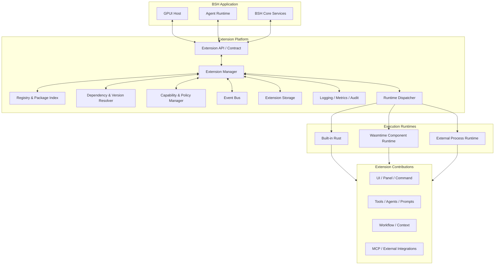
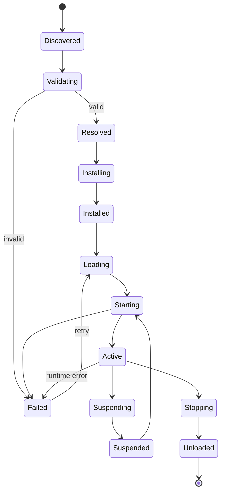

# BSH Extension Framework
## Technical Architecture & Implementation Design

**Document status:** Architecture adopted; implementation mapping in section 25  
**Version:** 1.0  
**Date:** 2026-10-30  
**Target:** BSH (Rust + GPUI AI Agent Harness)  
**Primary objective:** Define a secure, extensible, runtime-independent extension platform for BSH.

> **Implementation:** Phase 1 (core), Phase 2's Wasmtime, Extism and process
> runtimes, and Phase 3's agent, MCP and event surfaces are implemented in
> `crates/bsh/src/extension/`. The normative package and wire
> standard is `docs/bsh-extension-standard.md`; the developer walkthrough is
> `docs/bsh-extension-dev-guide.md`. See section 25 for the mapping and the
> deliberate limits.

---

## 1. Executive Summary

BSH should implement an extension platform rather than a GPUI-specific plugin loader.

GPUI is the desktop UI framework. It should not own extension discovery, package management, lifecycle, permissions, dependency resolution, runtime isolation, or inter-extension communication. Those responsibilities belong to an independent BSH Extension Platform.

The platform should support:

- Built-in Rust extensions for first-party capabilities.
- WebAssembly Components for portable, sandboxed third-party extensions.
- External processes for MCP servers, CLI integrations, language services, and independently managed services.
- GPUI-native host-managed UI contributions.
- Declarative UI for portable extension interfaces.
- Agent-native contributions: tools, context providers, prompts, model providers, agents, and workflows.
- A consistent capability and authorization model across runtimes.
- Versioned APIs, package integrity checks, dependency resolution, lifecycle management, diagnostics, and developer tooling.

### 1.1 Recommended baseline

| Area | Recommendation |
|---|---|
| Platform architecture | Host + Extension Manager + Runtime Dispatcher |
| Core runtime | Built-in Rust |
| Third-party runtime | Wasmtime + WebAssembly Component Model |
| Process integration | External process + JSON-RPC 2.0 |
| Interface definition | WIT for WASM contracts; versioned Rust types internally |
| UI extension | Host-managed GPUI extension points + declarative UI |
| Agent integration | Unified BSH Tool / Context / Prompt contracts |
| Security | Capability-based authorization, quotas, audit |
| Package format | Directory package initially; archive distribution later |
| Registry | Local, Git, official, and private registries |
| Native dynamic libraries | Not part of the initial public extension API |

### 1.2 Non-goals for the first release

The first release should not attempt to:

1. Allow arbitrary third-party code to access GPUI `App`, `Window`, `Context`, or `Entity<T>`.
2. Expose Rust Trait Objects across a dynamic-library ABI boundary.
3. Implement a full marketplace before package and runtime contracts stabilize.
4. Embed arbitrary guest GPUI applications as a production feature.
5. Treat MCP as the platform's internal extension protocol.
6. Provide unrestricted filesystem, network, process, or Computer Use access to extensions.

---

## 2. Design Principles

1. **Extension-first:** First-party features should use the same contribution model wherever practical.
2. **Runtime-independent contracts:** Extension APIs must not expose implementation-specific host objects.
3. **Capability-based security:** Declaring a capability is a request, not a grant.
4. **Least privilege:** Permissions are scoped to a workspace, resource, operation, and duration where possible.
5. **Agent-native:** Tools, prompts, context, workflows, and model integrations are first-class extension contributions.
6. **UI-hosted:** The host owns GPUI objects, windows, focus, layout, and rendering.
7. **Event-driven:** Commands, events, and streams are distinct communication primitives.
8. **Versioned contracts:** Manifest, API, WIT, UI schema, and persisted data have explicit versions.
9. **Fault containment:** A third-party extension must not be able to crash or block the UI thread.
10. **Observable by default:** Lifecycle transitions, permission decisions, failures, and resource usage are traceable.
11. **Reproducible installation:** Exact package versions, hashes, and dependency resolutions are lockable.
12. **Data survives code upgrades:** Extension code, configuration, runtime state, and user data are stored separately.

---

## 3. Extension Taxonomy

Extension type and execution runtime are independent dimensions.

### 3.1 Contribution types

| Contribution | Purpose | Examples |
|---|---|---|
| UI Extension | Add host-managed interface surfaces | Sidebar, panel, inspector, widget |
| Tool Extension | Register Agent-callable tools | Git status, code search, issue lookup |
| Agent Extension | Add agent roles or execution strategies | Reviewer, planner, researcher |
| Model Extension | Add model/provider adapters | OpenAI-compatible, local model |
| MCP Extension | Connect to MCP servers | MCP client/server integration |
| Workflow Extension | Define reusable task flows | Build, review, release workflow |
| Context Extension | Supply scoped context | Workspace, Git, document context |
| Prompt Extension | Provide prompt templates | Task prompts, role prompts |
| Command Extension | Register commands and keybindings | Palette commands, actions |
| Event Extension | Subscribe to or publish events | Workspace or Agent lifecycle |
| Theme Extension | Provide visual resources | Colors, icons, syntax themes |
| Language Extension | Provide language-related capabilities | Syntax, diagnostics, language services |
| Storage Extension | Provide domain-specific storage | Indexes, structured project data |
| Integration Extension | Connect external systems | GitHub, browser, terminal |

### 3.2 Execution runtimes

| Runtime | Intended use | Isolation |
|---|---|---|
| Built-in Rust | First-party core features | Same process |
| Trusted native module | Exceptional high-performance integrations | Same process; trusted code |
| WASM Component | Portable third-party logic | Wasmtime sandbox |
| External Process | MCP, CLI, language server, external service | OS process boundary |

**Policy:** The initial public extension ecosystem should prioritize WASM Components and External Processes. Built-in Rust is for first-party code. Native dynamic libraries are deferred.

---

## 4. System Architecture



### 4.1 Architectural boundaries

**GPUI Host**
- Owns all GPUI `App`, `Window`, `Context`, `Entity<T>`, focus, layout, and rendering objects.
- Provides extension points and applies UI state updates.
- Never synchronously waits for an extension operation.

**Agent Runtime**
- Owns Agent execution, Tool discovery, Tool invocation, cancellation, and result handling.
- Uses BSH extension contracts rather than runtime-specific APIs.

**Extension Manager**
- Discovers extensions.
- Validates manifests and compatibility.
- Resolves dependencies.
- Coordinates lifecycle.
- Dispatches extensions to the correct runtime.
- Tracks health and failures.

**Capability Manager**
- Evaluates requested permissions.
- Issues scoped access to host services.
- Records allow/deny decisions.
- Supports revocation and policy changes.

**Runtime Dispatcher**
- Routes lifecycle, RPC, command, and event requests to Built-in Rust, WASM, or process runtimes.

### 4.2 Dependency direction

```text
bsh-application
    ├── bsh-gpui-host
    ├── bsh-agent-runtime
    └── bsh-extension

bsh-extension
    ├── bsh-extension-types
    ├── bsh-extension-manifest
    ├── bsh-extension-manager
    ├── bsh-extension-security
    └── bsh-extension-runtime-api

bsh-extension-runtime-api
    └── bsh-extension-types

bsh-runtime-wasm
    ├── bsh-extension-runtime-api
    ├── bsh-extension-types
    └── wasmtime

bsh-extension-ui
    ├── bsh-extension-types
    └── bsh-gpui-host-adapter
```

The public extension API must not depend on the BSH application crate or GPUI implementation crate.

---

## 5. Package Format and Manifest

### 5.1 Package layout

```text
my-extension/
├── extension.toml
├── README.md
├── LICENSE
├── CHANGELOG.md
├── assets/
│   ├── icons/
│   └── resources/
├── schemas/
│   ├── config.schema.json
│   └── tool.schema.json
├── wasm/
│   └── extension.wasm
├── prompts/
│   └── system.md
├── workflows/
│   └── default.yaml
└── migrations/
    └── 001.toml
```

All directories except the manifest are optional. A theme or snippet package may contain no executable code.

### 5.2 Manifest example

```toml
schema_version = "1.0"

[extension]
id = "com.example.git-assistant"
name = "Git Assistant"
version = "1.0.0"
description = "Git tools for BSH Agent"
authors = ["Example Developer"]
license = "MIT"
repository = "https://example.com/git-assistant"

[compatibility]
bsh = ">=0.1.0, <1.0.0"
extension_api = "^1.0"
ui_api = "^1.0"

[runtime]
kind = "wasm-component"
entry = "wasm/extension.wasm"
startup = "on-demand"

[capabilities]
required = [
    "agent.tools.register",
    "workspace.read"
]
optional = [
    "workspace.write",
    "network.http"
]

[contributes]
tools = ["git.status", "git.diff"]
commands = ["git-assistant.refresh"]
panels = ["git-assistant.panel"]
events = ["workspace.opened"]

[configuration]
schema = "schemas/config.schema.json"

[resources]
max_memory_mb = 128
max_execution_ms = 5000
max_concurrent_calls = 4
```

### 5.3 Manifest rules

- Extension IDs are globally unique reverse-domain identifiers.
- Versions use SemVer.
- Compatibility ranges must be validated before runtime initialization.
- Requested capabilities never imply authorization.
- Contribution IDs must be unique within an extension and globally qualified when registered.
- Runtime entry paths must be package-relative and reject traversal.
- Resource requests are subject to host-enforced ceilings.
- Unknown mandatory manifest fields or unsupported schema versions fail validation.
- Optional fields must have defined forward-compatibility behavior.

### 5.4 Package integrity

Each installed package should have:
- Canonical package hash (BLAKE3 or SHA-256; choose one and standardize).
- Publisher identity and signature metadata where available.
- Source registry and source revision.
- Exact extension version.
- Dependency lock information.
- Installation timestamp and verification result.

A valid signature proves package origin and integrity, not that the extension is safe.

---

## 6. Extension API Design

The API is divided into three layers.

| Layer | Scope | Contract |
|---|---|---|
| Core API | Lifecycle, metadata, errors, context | Versioned contract |
| Domain API | Agent, tools, workflow, events, storage | Versioned domain interfaces |
| UI API | Panels, commands, declarative views | Versioned UI contract |

### 6.1 API modules

```text
core/
  lifecycle
  metadata
  context
  errors
  logging
  cancellation

capabilities/
  filesystem
  network
  process
  storage
  secrets

agent/
  tool
  prompt
  context_provider
  agent_provider
  model_provider

workflow/
  trigger
  action
  execution

events/
  publisher
  subscriber

ui/
  panel
  view
  command
  notification
  theme
```

### 6.2 Contract rules

- Never expose GPUI internal types across the extension boundary.
- Never expose host file descriptors or unrestricted OS handles by default.
- Use explicit request/response schemas.
- Include correlation IDs and cancellation support for long-running operations.
- Bound payload size and stream rate.
- Version every externally persisted or transported schema.
- Keep host implementation types private.
- Map runtime-specific transport into common domain semantics.

### 6.3 Rust lifecycle interface (internal illustration)

```rust
#[async_trait::async_trait]
pub trait Extension: Send + Sync {
    async fn initialize(
        &self,
        context: ExtensionContext,
    ) -> Result<(), ExtensionError>;

    async fn activate(&self) -> Result<(), ExtensionError>;

    async fn deactivate(&self) -> Result<(), ExtensionError>;

    async fn shutdown(&self) -> Result<(), ExtensionError>;
}
```

This is an internal interface for trusted Rust extensions. WASM Components and external processes must implement equivalent lifecycle semantics through WIT or RPC, not by implementing this Rust trait across an ABI boundary.

---

## 7. Lifecycle and State Management

### 7.1 Lifecycle state machine



### 7.2 Required lifecycle behavior

- Discovery and static validation.
- Compatibility and dependency resolution.
- Installation into a staging directory.
- Atomic promotion to installed state.
- Lazy loading and on-demand activation.
- Graceful deactivation and shutdown.
- Cancellation of outstanding work.
- Health monitoring and crash handling.
- Retry with bounded backoff.
- State persistence independent of executable package files.
- Explicit uninstall and data-retention policy.

### 7.3 Startup policy

Support:
- `on-startup`
- `on-demand`
- `on-workspace-open`
- `manual`

Default third-party extensions to `on-demand`.

### 7.4 Failure handling

A failed extension should:
- Be marked unhealthy.
- Stop receiving new requests.
- Have in-flight work cancelled or timed out.
- Release runtime resources.
- Produce diagnostic information.
- Not take down the host or unrelated extensions.

---

## 8. Runtime Architecture

### 8.1 Built-in Rust

Use for first-party functionality that requires tight integration or high performance.

- Statically linked into BSH.
- Uses internal Rust interfaces.
- Does not need a public dynamic ABI.
- Still follows contribution registration and lifecycle conventions where practical.

### 8.2 WASM Component Runtime

**Recommendation:** Wasmtime + Component Model + WIT.

Responsibilities:
- Load and validate components.
- Bind host interfaces.
- Enforce memory, fuel, and execution limits.
- Provide only authorized host functions.
- Support cancellation and lifecycle calls.
- Convert component errors into normalized extension errors.
- Track runtime metrics.

WASM does not automatically make an extension safe. Host functions, resource limits, component validation, and capability enforcement remain essential.

### 8.3 External Process Runtime

Use for:
- MCP servers.
- CLI integrations.
- Language servers.
- Independently deployed services.
- Extensions requiring dependencies unsuitable for WASM.

Recommended initial transport:
- JSON-RPC 2.0 over stdin/stdout for portable process integration.
- Dedicated pipes or sockets for larger or streaming workloads where justified.
- Structured stderr logging.
- Explicit startup handshake and protocol version negotiation.

The process runtime must enforce executable allowlists or user approval, environment-variable filtering, working-directory restrictions, timeout, output limits, and OS-level sandboxing where available.

### 8.4 Native dynamic libraries

Defer from the public extension system.

Rust does not provide a general stable ABI for arbitrary Rust types and trait objects across compiler versions. A future trusted-native mode would need a deliberately designed C-compatible ABI, opaque handles, explicit ownership rules, panic containment, and strict versioning. It would not provide sandbox isolation.

---

## 9. GPUI UI Extension Architecture

The host owns all GPUI objects. Extensions contribute content through stable UI contracts.

### 9.1 UI extension modes

#### Mode A — Host-managed native panels (Phase 1 UI)

The extension registers a panel contribution. A BSH-owned GPUI adapter creates and manages the actual GPUI entities.

Example contribution:

```rust
pub struct PanelContribution {
    pub id: String,
    pub title: String,
    pub icon: Option<String>,
    pub location: PanelLocation,
    pub default_visibility: Visibility,
}
```

The panel implementation is provided by a host adapter or an approved first-party integration. This mode is not a promise that arbitrary WASM code can create native GPUI views.

#### Mode B — Declarative UI (recommended public UI API)

Extensions return a bounded UI tree that the host renders using GPUI components.

Example:

```json
{
  "schema_version": "1.0",
  "type": "column",
  "children": [
    {
      "type": "heading",
      "text": "Git Status"
    },
    {
      "type": "text",
      "value": "Working tree clean"
    },
    {
      "type": "button",
      "label": "Refresh",
      "action": "git.refresh"
    }
  ]
}
```

Initial component set:
- Container / Row / Column
- Text / Heading / Markdown
- Button
- Input / Select / Checkbox
- List / Table / Tree
- Tabs
- Progress
- Code
- Image
- Notification

Host responsibilities:
- Validate schema and payload size.
- Enforce component and nesting limits.
- Route action IDs to the owning extension.
- Apply state patches.
- Manage focus and keyboard navigation.
- Handle loading, errors, and extension unavailability.
- Prevent stale actions after deactivation.

Do not permit arbitrary executable JavaScript or HTML in the initial declarative UI contract.

#### Mode C — Embedded guest GPUI (research only)

Investigate guest GPUI compiled to WASM and rendered through a host surface/display-list contract.

This is a later R&D track, not a production dependency for the initial framework. Risks include GPUI version compatibility, text input and IME, focus routing, accessibility, GPU resource lifecycle, display-list validation, and cross-runtime performance.

### 9.2 UI interaction protocol

```text
User interaction
      |
      v
GPUI Host receives action_id
      |
      v
Extension Bridge validates owner and permission
      |
      v
Runtime RPC / Component call
      |
      v
Extension processes action
      |
      v
Response: result + state patch + optional events
      |
      v
Host validates patch and updates GPUI state
```

### 9.3 UI contract requirements

- UI schema versioning.
- Bounded tree depth and node count.
- Bounded text, image, and table payloads.
- Action ownership and authorization.
- State revision numbers to reject stale patches.
- Explicit loading and error states.
- Accessibility labels and keyboard behavior.
- No direct GPUI object references across the boundary.

---

## 10. Agent-Native Extension API

Agent integration is a first-class platform feature.

### 10.1 Contribution interfaces

| Provider | Responsibility |
|---|---|
| Tool Provider | Register and execute Agent tools |
| Context Provider | Supply scoped context |
| Prompt Provider | Supply prompts and templates |
| Model Provider | Adapt model APIs and metadata |
| Agent Provider | Register agent roles or execution strategies |
| Workflow Provider | Register triggers, actions, and workflows |

### 10.2 Tool contract

Illustrative Rust types:

```rust
pub struct ToolDefinition {
    pub id: String,
    pub name: String,
    pub description: String,
    pub input_schema: serde_json::Value,
}

pub struct ToolResult {
    pub content: Vec<ToolContent>,
    pub is_error: bool,
}
```

The actual contract should also support:
- Text.
- Images.
- Structured data.
- File references.
- Streaming output.
- Progress notifications.
- Cancellation.
- Timeouts.
- Error categories.
- Correlation IDs.

Tool registration permission and permission to perform a tool's underlying operation are separate. A plugin that can register a tool must not automatically receive terminal, filesystem, network, or Computer Use privileges.

### 10.3 MCP integration

MCP is an integration protocol, not the internal BSH extension architecture.

```text
MCP Server
    |
MCP Client Adapter
    |
BSH Tool / Resource / Prompt Registry
    |
Agent Runtime
```

The adapter should:
- Map MCP tools to BSH Tool definitions.
- Map MCP resources to BSH context/resource contracts where appropriate.
- Preserve structured content and errors.
- Apply BSH permission policy before calls.
- Handle server lifecycle, reconnect, timeout, and cancellation.
- Avoid leaking MCP-specific types into the core Agent API.

---

## 11. Event Bus, RPC, and Streaming

Use three distinct communication primitives.

| Primitive | Use |
|---|---|
| Command / RPC | Request-response operations |
| Event Bus | Notifications and state changes |
| Stream | Long-running output, logs, progress, generated content |

### 11.1 Event envelope

```rust
pub struct ExtensionEvent {
    pub id: String,
    pub source: String,
    pub event_type: String,
    pub schema_version: String,
    pub timestamp: u64,
    pub correlation_id: Option<String>,
    pub payload: serde_json::Value,
}
```

### 11.2 Event topics

```text
app.started
app.shutdown

workspace.opened
workspace.closed
workspace.changed

agent.started
agent.completed
agent.failed

tool.invoked
tool.completed
tool.failed

model.requested
model.completed

extension.loaded
extension.unloaded
extension.failed
```

### 11.3 Required controls

- Topic allowlists and subscription filters.
- Schema versioning.
- Correlation IDs.
- Bounded queues and backpressure.
- Payload and rate limits.
- Cancellation propagation.
- Delivery semantics documented per event type.
- Error isolation.
- No unbounded in-memory event history.

Agent token streams, application events, and durable audit logs should not share one unbounded queue or storage path.

---

## 12. Capability-Based Security

Security is a core architectural concern, not a later enhancement.

### 12.1 Permission model

Example manifest declaration:

```toml
[capabilities]
required = [
    "workspace.read",
    "agent.tools.register"
]

optional = [
    "workspace.write",
    "network.http",
    "terminal.execute",
    "computer.use"
]
```

### 12.2 Capability categories

| Category | Example | Default policy |
|---|---|---|
| Read | `workspace.read` | Scoped workspace grant |
| Write | `workspace.write` | Explicit grant |
| Network | `network.http` | Domain and method policy |
| Process | `terminal.execute` | Explicit, high-risk grant |
| Computer Use | `computer.use` | Explicit, per-operation policy |
| Secrets | `secrets.read` | Named secret and purpose scope |
| Storage | `extension.storage` | Per-extension namespace |

### 12.3 Authorization flow

```text
Extension request
      |
      v
Capability API
      |
      v
Policy evaluation
      |
   +--+--+
   |     |
 Allow  Deny
   |     |
   v     v
Host    Audit
service record
   |
   v
Resource enforcement
   |
   v
Operation
```

### 12.4 Trust levels

| Level | Source | Execution |
|---|---|---|
| Builtin | BSH first-party | Native |
| Verified | Verified publisher/package | WASM or process |
| Community | Community source | WASM or process |
| Local | User's local development | User-approved |
| Unknown | Unverified source | Disabled until reviewed/approved |

A signature proves source and integrity, not benign behavior.

### 12.5 Mandatory security controls

- Filesystem path scoping and traversal prevention.
- Network domain and protocol policy.
- Process executable and argument policy.
- CPU/fuel and wall-clock limits.
- Memory and concurrency limits.
- Host-call authorization.
- IPC authentication and message validation.
- Secret redaction in logs.
- Per-extension storage isolation.
- Permission revocation.
- Audit trail.
- Package hash and signature verification.
- Extension disable/quarantine controls.

For Computer Use, screen reading, keyboard/mouse input, terminal execution, and filesystem access must be separate capabilities.

---

## 13. Registry, Installer, and Dependency Management

### 13.1 Supported sources

1. Official registry.
2. Git repository.
3. Local directory (development).
4. Local package archive.
5. Enterprise/private registry.

### 13.2 Installation pipeline

```text
Extension Source
      |
      v
Download / Checkout
      |
      v
Package Hash and Signature Verification
      |
      v
Manifest Validation
      |
      v
Compatibility Check
      |
      v
Dependency Resolution
      |
      v
Install to Staging
      |
      v
Atomic Promotion
      |
      v
Extension Manager
      |
      v
Runtime Dispatcher
```

### 13.3 Directory layout

```text
~/.bsh/
├── extensions/
│   ├── installed/
│   │   ├── com.example.git-assistant/
│   │   │   ├── 1.0.0/
│   │   │   └── 1.1.0/
│   │   └── com.example.theme/
│   ├── cache/
│   ├── staging/
│   └── quarantine/
├── extension-data/
│   ├── com.example.git-assistant/
│   └── com.example.theme/
├── extension-state/
│   ├── registry.toml
│   └── lock.toml
└── logs/
    └── extensions/
```

### 13.4 Data separation

Keep separate:
- Immutable package code and assets.
- User configuration.
- Runtime state.
- Extension business data.
- Logs and diagnostics.
- Registry and dependency lock data.

Uninstall must have an explicit data-retention policy. Upgrades must not overwrite user data.

### 13.5 Lockfile

The lockfile should record:
- Extension ID and exact version.
- Package hash.
- Source and source revision.
- Resolved dependencies.
- API compatibility information.
- Signature verification result.
- Installation metadata.

---

## 14. Rust Workspace Proposal

Start with a manageable crate structure. Split further only when ownership or compilation boundaries justify it.

```text
bsh/
├── crates/
│   ├── bsh-extension/
│   ├── bsh-extension-types/
│   ├── bsh-extension-api/
│   ├── bsh-extension-manifest/
│   ├── bsh-extension-registry/
│   ├── bsh-extension-manager/
│   ├── bsh-extension-resolver/
│   ├── bsh-extension-security/
│   ├── bsh-extension-events/
│   ├── bsh-extension-storage/
│   ├── bsh-extension-runtime-api/
│   ├── bsh-runtime-wasm/
│   ├── bsh-runtime-process/
│   ├── bsh-extension-ui/
│   ├── bsh-extension-agent/
│   ├── bsh-extension-mcp/
│   └── bsh-extension-devtools/
├── wit/
│   ├── core/
│   ├── agent/
│   ├── tools/
│   ├── events/
│   ├── storage/
│   └── ui/
├── examples/
│   ├── hello-extension/
│   ├── git-tool/
│   ├── declarative-panel/
│   └── mcp-integration/
└── tests/
    ├── compatibility/
    ├── security/
    ├── lifecycle/
    └── integration/
```

### 14.1 Crate responsibilities

| Crate | Responsibility |
|---|---|
| `bsh-extension-types` | Stable shared domain types |
| `bsh-extension-api` | Extension author SDK |
| `bsh-extension-manifest` | Parse and validate manifests |
| `bsh-extension-registry` | Discover and query sources |
| `bsh-extension-resolver` | Resolve versions and dependencies |
| `bsh-extension-manager` | Lifecycle and orchestration |
| `bsh-extension-security` | Capability and policy enforcement |
| `bsh-extension-events` | Event bus and subscriptions |
| `bsh-extension-storage` | Per-extension configuration and data |
| `bsh-extension-runtime-api` | Runtime-neutral invocation contract |
| `bsh-runtime-wasm` | Wasmtime integration |
| `bsh-runtime-process` | External process management |
| `bsh-extension-ui` | UI contract and GPUI adapter |
| `bsh-extension-agent` | Tool, Agent, Prompt, Context APIs |
| `bsh-extension-mcp` | MCP adapter |
| `bsh-extension-devtools` | CLI, diagnostics, scaffolding, testing |

### 14.2 Dependency constraints

- `bsh-extension-types` must remain lightweight.
- `bsh-extension-api` must not depend on GPUI or Wasmtime.
- `bsh-extension-manager` must depend on runtime abstractions, not concrete runtime internals.
- `bsh-runtime-wasm` owns Wasmtime-specific code.
- `bsh-runtime-process` owns process and JSON-RPC transport.
- `bsh-extension-ui` is the only layer that adapts extension UI contracts to GPUI.
- Avoid cyclic dependencies between Agent Runtime and Extension Platform.
- Avoid leaking Tokio-specific types into portable WIT contracts.

---

## 15. Technology Selection

| Area | Candidate | Proposed use |
|---|---|---|
| WASM runtime | Wasmtime | Primary Component Model runtime |
| Interface definition | WIT | Host/guest contract |
| Async execution | Tokio | Background runtime and process supervision |
| Serialization | Serde | Rust data serialization |
| Manifest | TOML + Serde | Package metadata |
| JSON schema | Schemars or equivalent | Config and tool schema generation |
| Hashing | BLAKE3 or SHA-256 | Select one canonical package hash |
| Signatures | Ed25519 implementation | Publisher/package signatures |
| Versioning | SemVer | API and package versions |
| Dependency graph | `petgraph` or custom resolver | Dependency ordering |
| Process RPC | JSON-RPC 2.0 | External extension protocol |
| Cancellation | `tokio-util` or host abstraction | Cancellation tokens |
| Logging | `tracing` | Structured diagnostics |
| Storage | Existing BSH storage or SQLite | Metadata and extension state |

Selection must be validated against the actual BSH workspace, MSRV, license policy, target platforms, and existing dependencies before implementation.

### 15.1 Wasmtime versus Extism

| Dimension | Wasmtime + WIT | Extism |
|---|---|---|
| Interface model | Component Model, typed interfaces | Function-oriented plugin calls |
| Complex API | Strong fit | Requires additional conventions |
| Language ecosystem | Component Model toolchains | Multiple language SDKs |
| Host capability design | Explicit WIT imports | Host functions |
| BSH long-term contract | Recommended | Optional adapter/evaluation |
| UI rendering | Requires BSH UI contract | Not a UI framework |

Use Wasmtime + WIT as the core architecture. Evaluate Extism only if a concrete extension ecosystem or developer-experience requirement justifies it.

---

## 16. Observability and Developer Experience

### 16.1 Per-extension diagnostics

Expose:
- Installed version and source.
- Runtime kind.
- Lifecycle state.
- Granted and denied capabilities.
- Startup duration.
- Request count and latency.
- Memory/fuel usage where available.
- Active tasks and subscriptions.
- Last error and crash history.
- Dependency and compatibility status.

### 16.2 Developer CLI proposal

```text
bsh ext new <id>
bsh ext validate <path>
bsh ext build
bsh ext test
bsh ext package
bsh ext install <package-or-source>
bsh ext list
bsh ext info <id>
bsh ext enable <id>
bsh ext disable <id>
bsh ext update <id>
bsh ext uninstall <id>
bsh ext logs <id>
bsh ext doctor
```

CLI command names are proposed, not existing BSH interfaces.

### 16.3 Developer SDK requirements

Provide:
- Extension templates.
- Manifest validation.
- WIT bindings and examples.
- Local development mode.
- Mock host services.
- Integration test harness.
- Runtime logs and traces.
- Compatibility checker.
- Package builder.
- Security/capability diagnostics.

---

## 17. Testing Strategy

### 17.1 Unit tests

- Manifest parsing and validation.
- ID and version validation.
- Dependency resolution.
- Lifecycle transition validity.
- Capability evaluation.
- Event filtering and backpressure.
- UI schema validation.
- Package path validation.
- Lockfile determinism.

### 17.2 Integration tests

- Built-in extension registration.
- WASM component load and invocation.
- External process startup and shutdown.
- Tool discovery and invocation.
- Tool cancellation and timeout.
- UI action routing.
- State patch validation.
- Permission denial.
- Extension crash isolation.
- Upgrade and rollback.
- Data preservation across upgrades.

### 17.3 Security tests

- Path traversal.
- Unauthorized filesystem access.
- Unauthorized network access.
- Process execution denial.
- Oversized messages.
- Deeply nested UI payloads.
- Excessive event publication.
- Memory/fuel exhaustion.
- Malformed WIT/RPC payloads.
- Stale action invocation.
- Revoked capability use.
- Package tampering and invalid signatures.

### 17.4 Cross-platform matrix

Test at minimum:
- macOS Apple Silicon.
- macOS Intel if supported.
- Linux x86_64.
- Linux aarch64 if supported.
- Windows x86_64.

External process sandboxing and filesystem policy need platform-specific implementations and tests.

---

## 18. Delivery Roadmap

The roadmap is deliberately incremental. Do not build the marketplace or guest GPUI runtime before the core contracts are stable.

### Phase 1 — Extension Core

Deliver:
- Shared extension types.
- Manifest parser and validator.
- Registry abstraction.
- Lifecycle manager.
- Built-in runtime adapter.
- Capability model and policy interface.
- Basic diagnostics.

Acceptance criteria:
- Discover, validate, load, activate, deactivate, and unload a built-in extension.
- Reject invalid manifests and incompatible API versions.
- Lifecycle failures do not crash BSH.
- Extension state and configuration are stored separately from package code.

### Phase 2 — WASM and Extism Runtimes

Deliver:
- WIT core contract.
- Wasmtime integration.
- Component loader.
- Host function binding.
- Extism PDK adapter and bsh_host bridge.
- Resource limits.
- WASM/Extism error normalization.
- Package integrity verification.

Acceptance criteria:
- Load and invoke a separately compiled example component.
- Enforce memory, fuel/time, and concurrency limits.
- Deny unauthorized host calls.
- Cancel and unload components safely.
- Run compatibility tests on supported platforms.

### Phase 3 — Agent Integration

Deliver:
- Tool Provider.
- Context Provider.
- Prompt Provider.
- Event Bus.
- MCP adapter.
- External process runtime.
- Streaming and cancellation.

Acceptance criteria:
- Agent can discover and invoke an extension tool.
- Tool invocation enforces permissions independently of registration.
- Cancellation and timeout propagate.
- MCP server failures are isolated.
- Structured tool results are preserved.

### Phase 4 — GPUI UI Extension

Deliver:
- UI extension points.
- Panel registration.
- Declarative UI schema.
- GPUI renderer.
- Action routing.
- State patch protocol.
- Theme contributions.

Acceptance criteria:
- An extension can register a host-managed panel.
- A declarative view renders in GPUI.
- User actions route to the owning extension.
- Invalid or stale patches are rejected.
- Extension failure produces a recoverable UI state.

### Phase 5 — Ecosystem

Deliver:
- Official/private registry.
- Package manager.
- Dependency resolver and lockfile.
- Upgrade and rollback.
- Developer CLI and SDK.
- Extension documentation and examples.
- Embedded GPUI research prototype (separate track).

Acceptance criteria:
- Install, update, disable, rollback, and uninstall packages.
- Reproduce a resolved extension environment from lockfile.
- Preserve user data across upgrades.
- Verify package integrity.
- Complete developer onboarding using documented templates.

---

## 19. Agile User Stories

Each story is estimated at no more than three engineering workdays. Estimates are planning assumptions and exclude review, integration overhead, rework, and external dependency delays.

| ID | User Story / Deliverable | Estimate |
|---|---|---:|
| EXT-001 | Define extension IDs, versions, and common types | 2d |
| EXT-002 | Implement TOML manifest parser | 2d |
| EXT-003 | Implement manifest validation | 2d |
| EXT-004 | Implement local extension registry | 2d |
| EXT-005 | Implement lifecycle manager and state machine | 3d |
| EXT-006 | Implement built-in runtime adapter | 2d |
| EXT-007 | Define runtime-neutral Extension API contract | 3d |
| EXT-008 | Define WIT core interfaces | 3d |
| EXT-009 | Integrate Wasmtime Component runtime | 3d |
| EXT-010 | Implement WASM host functions | 3d |
| EXT-011 | Implement capability authorization | 3d |
| EXT-012 | Implement WASM resource limits | 2d |
| EXT-013 | Implement bounded Event Bus | 3d |
| EXT-014 | Implement Agent Tool Provider contract | 3d |
| EXT-015 | Implement Context and Prompt Provider contracts | 3d |
| EXT-016 | Implement MCP adapter | 3d |
| EXT-017 | Implement External Process runtime | 3d |
| EXT-018 | Implement GPUI panel registration | 3d |
| EXT-019 | Implement declarative UI renderer | 3d |
| EXT-020 | Implement UI action routing and state patches | 2d |
| EXT-021 | Implement package installer and staging | 3d |
| EXT-022 | Implement dependency resolver and lockfile | 3d |
| EXT-023 | Implement Extension Developer CLI | 3d |
| EXT-024 | Implement compatibility and security integration tests | 3d |

**Initial estimate:** approximately 65 engineer-days. This is a rough sum of story estimates, not a committed schedule. Parallel work, code review, platform-specific work, and stabilization may change the calendar duration.

### 19.1 Definition of Done for every story

- Code compiles on the supported target matrix relevant to the story.
- Unit tests cover normal and failure paths.
- Public contracts are documented.
- Errors are structured and actionable.
- No unbounded queues or unbounded input payloads are introduced.
- Security-sensitive operations have explicit authorization checks.
- Tracing fields include extension ID and correlation ID where applicable.
- No new dependency is added without license, maintenance, and platform review.

---

## 20. Key Risks and Mitigations

| Risk | Severity | Mitigation |
|---|---|---|
| GPUI API changes | High | Keep GPUI behind host adapter |
| WIT/API incompatibility | High | Versioned contracts and compatibility tests |
| Excessive plugin permissions | Critical | Capability policy and least privilege |
| Rust dynamic ABI instability | High | Defer public native dynamic plugins |
| UI thread blocking | High | Async bridge; never block GPUI thread |
| Plugin crash | High | WASM/process isolation and health manager |
| UI schema complexity | Medium | Bounded, versioned component set |
| Data loss on upgrade | High | Separate data directory and migrations |
| Dependency conflicts | Medium | Resolver and lockfile |
| Supply-chain compromise | High | Hash, signatures, source policy, quarantine |
| External process abuse | High | Executable policy, environment filtering, OS sandbox |
| Event flood | High | Backpressure, quotas, bounded queues |

---

## 21. Architecture Decisions (ADRs)

These decisions should be recorded and revisited explicitly when requirements change.

### ADR-001: Extension Platform is independent of GPUI

**Decision:** Extension Manager, Registry, Runtime, and Security do not depend on GPUI.

**Reason:** Preserve portability and prevent UI framework changes from breaking extension contracts.

### ADR-002: Wasmtime Component Model is the primary third-party runtime

**Decision:** Use Wasmtime and WIT as the primary sandboxed runtime.

**Reason:** Typed interfaces and a suitable foundation for a multi-domain extension API.

### ADR-003: External Process is a first-class runtime

**Decision:** Support independently managed processes and JSON-RPC.

**Reason:** MCP, CLI, language services, and existing tools often fit process isolation better than WASM.

### ADR-004: No public Rust Trait ABI

**Decision:** Do not expose ordinary Rust trait objects through dynamic libraries.

**Reason:** Rust ABI and ownership compatibility are not generally stable across compiler versions.

### ADR-005: Host owns GPUI objects

**Decision:** Extensions never receive GPUI `App`, `Window`, `Context`, or `Entity<T>` across the public boundary.

**Reason:** Preserve UI safety, lifecycle ownership, and runtime independence.

### ADR-006: Declarative UI is the first public UI contract

**Decision:** Implement host-rendered UI schema before guest GPUI embedding.

**Reason:** Smaller attack surface, portable contract, easier compatibility management.

### ADR-007: MCP is an adapter, not the core API

**Decision:** Map MCP capabilities into BSH domain contracts.

**Reason:** Avoid coupling BSH's architecture and lifecycle to an external integration protocol.

### ADR-008: Capability declarations are not grants

**Decision:** Every sensitive operation is authorized by the host at execution time.

**Reason:** Prevent privilege escalation through contribution registration or manifest declarations.

---

## 22. Immediate Implementation Backlog

The recommended first engineering milestone is a vertical slice, not a large collection of empty crates.

### Milestone 1: Built-in extension vertical slice

1. Create `bsh-extension-types`.
2. Create `bsh-extension-manifest`.
3. Parse and validate one example `extension.toml`.
4. Create `bsh-extension-manager`.
5. Implement the lifecycle state machine.
6. Register one built-in example extension.
7. Add enable/disable and diagnostic output.
8. Add tests for invalid manifest, invalid transition, startup failure, and shutdown.

**Milestone exit condition:** BSH can discover, validate, activate, deactivate, and diagnose a built-in extension without any GPUI-specific types in the extension core.

### Milestone 2: Runtime-neutral contract

1. Finalize extension identity and error types.
2. Define request/response envelopes.
3. Define cancellation and timeout semantics.
4. Define contribution registration contracts.
5. Define compatibility/version policy.
6. Write the first WIT core interface.
7. Add contract compatibility tests.

**Milestone exit condition:** The same extension semantics can be represented by the built-in runtime and a future WASM/process runtime.

### Milestone 3: First WASM tool

1. Build a minimal WIT component.
2. Load it through Wasmtime.
3. Register one Agent tool.
4. Invoke it with schema-validated input.
5. Enforce a capability denial case.
6. Enforce execution and memory limits.
7. Test cancellation and runtime failure.

**Milestone exit condition:** A separately compiled WASM extension can safely expose one useful BSH Agent tool.

---

## 23. Open Questions to Resolve Before Production

1. What is the current BSH workspace structure and which existing crates own Agent, Tool, event, storage, and GPUI services?
2. Which Tokio/runtime strategy is already used by BSH, and how should it coexist with GPUI's application executor?
3. What is the minimum supported macOS/Linux/Windows version?
4. Should third-party extensions be allowed to publish UI in the first public release?
5. Is the initial extension distribution model local/Git-based, or is a central registry required?
6. Which package hash and publisher identity model should be standardized?
7. What are the default filesystem and network policies for local workspaces?
8. Which extension APIs must be stable before external developers are invited?
9. Should extension data use an existing BSH storage subsystem or a dedicated per-extension SQLite database?
10. What are the expected maximum number of installed extensions, concurrent extension calls, and UI contributions?

These questions should be answered against the actual BSH repository and threat model before finalizing implementation details.

---

## 24. Reference Projects and Further Research

Use upstream documentation and source as the authority when implementing. Verify current APIs, release status, licenses, and platform support at the time of adoption.

- **Zed Extensions:** https://zed.dev/docs/extensions
- **Zed source repository:** https://github.com/zed-industries/zed
- **Embedded GPUI research:** https://github.com/zed-industries/embedded-gpui
- **GPUI Kit:** https://github.com/longbridge/gpui-component
- **Wasmtime:** https://github.com/bytecodealliance/wasmtime
- **Wasmtime documentation:** https://docs.wasmtime.dev/
- **WebAssembly Component Model:** https://component-model.bytecodealliance.org/
- **WIT documentation:** https://component-model.bytecodealliance.org/design/wit.html
- **Extism:** https://github.com/extism/extism
- **abi_stable:** https://github.com/rodrimati1992/abi_stable
- **JSON-RPC 2.0:** https://www.jsonrpc.org/specification
- **Model Context Protocol:** https://modelcontextprotocol.io/


---

## 25. Implementation status (2026-10-31)

The platform lives in `crates/bsh/src/extension/` and is independent of GPUI.
The normative byte-level standard is `docs/bsh-extension-standard.md`; the
exhaustive requirement matrix is `docs/bsh-extension-conformance.md`.

| Design area | Implementation |
|---|---|
| Shared types and identity | types.rs: reverse-domain ids, SemVer, lifecycle vocabulary, errors |
| Manifest and validation | manifest.rs: strict TOML, compatibility, paths, env policy, resources, providers |
| Registry and package store | package.rs: scan, SHA-256 tree hash, staging, atomic install, active version, quarantine |
| Signing and trust | signing.rs: Ed25519 package.sig, trust.toml, install verification, keygen/sign/trust/verify |
| Sources and registries | sources.rs: directory, tar.gz, Git revision, HTTP index, named registries |
| Dependency resolver and lockfile | resolver.rs: highest satisfying version, cycle/conflict errors, deterministic lock |
| Lifecycle manager | lifecycle.rs: explicit transition table, health, counters |
| Capability policy and audit | capability.rs: 18 capabilities, defaults by trust, scoped grants, JSONL audit |
| Built-in runtime | runtime/builtin.rs: first-party Rust; the inspector ships as an example |
| Declarative runtime | runtime/declarative.rs: tools, commands, prompts, contexts, panels, workflows, providers |
| Process runtime | runtime/process.rs: JSON-RPC 2.0, handshake, timeouts, env filtering, rlimits, line caps |
| WASM Component runtime | runtime/wasm.rs: Wasmtime 50, WIT host functions, fuel, StoreLimits, epoch timeout |
| Extism runtime | runtime/extism.rs: PDK plugin, bsh_host bridge, policy-checked fs/network/storage/secrets/events, fuel and memory limits |
| MCP adapter | runtime/mcp.rs: initialize, tools/resources/prompts, stdio, timeouts, reconnect on next call |
| Workflow executor | runtime/workflow.rs: sequential same-package tools, capability union, templates |
| Runtime-neutral invocation | runtime/mod.rs: Runtime trait, rich ToolContent/ToolResult, LazyRuntime delegation, pump |
| Agent integration | agent.rs: qualified tools, per-call authorization, cancellation, streaming chunks, metrics |
| Event bus | events.rs: bounded queues, filters, payload ceiling, workspace/model publishers, metrics |
| Storage | storage.rs: contained namespace, atomic writes, caps |
| Configuration | config.rs: defaults, JSON Schema subset, migrations |
| Declarative UI | ui.rs + ui/extension_panel.rs: versioned tree, limits, actions, revisions, GPUI renderer |
| Host orchestration | host.rs: discovery, resolution, authorization, status rows, panels, metrics, doctor |
| Developer CLI | cli.rs: new, validate, hash, build/package, test, install, sources, versions, rollback, quarantine, keygen, sign, trust, verify, config, metrics, providers, logs, doctor |
| WIT contract | crates/bsh/wit/extension.wit |
| Examples | examples/extensions/{hello,process-echo,wasm-echo,mcp-echo,extism-echo} |

**Acceptance evidence:** the extension suite covers the manifest, hash, install,
signature/trust, sources, resolver, lifecycle, policy, event bounds, storage
containment, UI limits, process framing, WASM component invocation, MCP
tools/resources/prompts, workflow execution, configuration migrations and the
host vertical slice. The CLI is exercised end to end: new -> validate -> build ->
install -> list -> info -> grant -> doctor -> uninstall, plus keygen/sign/verify,
registry install, versions/rollback and config.

**Deliberate limits, stated rather than hidden:** process tools and MCP servers
deliver live progress through run_streaming, while WASM guests still deliver only
their final result; model, agent and preset providers are selectable through the
settings plugin maps; theme contributions apply to their extension's panels but
not app-wide; lockfile reproduction covers Git, registry and local source paths;
the process child has RLIMIT limits and a macOS write sandbox profile but no
Linux namespace; cancellation stops the tool future but does not always kill the
guest at the same instant. The legacy Codex/DSH shim in
`crates/agent/src/extensions` still backs the old inventory pane; it is not used
by this platform.

---

## Final Recommendation

Build BSH's extension system as a runtime-independent platform with four execution modes:

1. **Built-in Rust** for first-party core functionality.
2. **Wasmtime + WIT** for sandboxed, portable third-party components.
3. **Extism** for PDK plugins whose host surface is one policy-checked bridge.
4. **External Process + JSON-RPC** for MCP, CLI, language services, and independent integrations.

Keep GPUI behind a host-owned UI adapter. Start with host-managed panels and a declarative UI contract. Treat embedded guest GPUI as a separate research project.

The first deliverable should be a working built-in extension vertical slice with manifest validation, lifecycle management, capability interfaces, and diagnostics. Only after that contract is stable should the team add WASM execution, Agent integrations, UI rendering, and distribution infrastructure.

**The architectural invariant:** an extension contributes capabilities to BSH; it does not own or bypass BSH's host, security, lifecycle, or UI boundaries.
