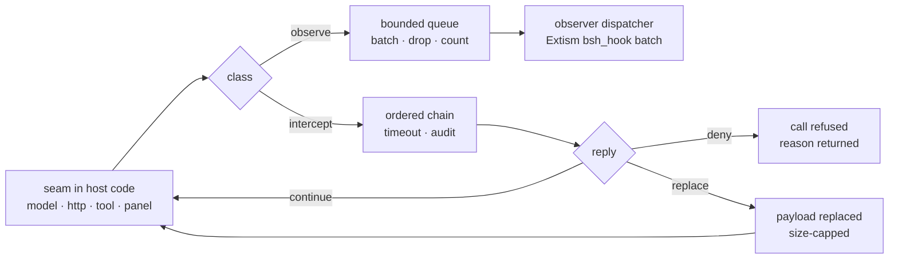

# The BSH/BOS Hook Layer

**Status:** observe hooks are implemented (2026-11-01): `model.request`,
`model.response`, `tool.before`, `tool.after`, and `http.exchange` (from the
WASM/Extism `fetch` bridge and the built-in LLM vendors). Delivery is
Extism-only via `bsh_hook`, installed from the existing BOS `AgentHook`
registry. Intercept hooks, process/MCP HTTP capture, bodies, and the WASM/process
transports are design only.
**Purpose:** make key seams in BSH and BOS call into Extism (and the other
runtimes) at the moment work happens, so an extension can observe — and where
declared, intercept — prompts, HTTP exchanges, tool calls and panel actions.
This is the mechanism behind [LLM and traffic capture](bsh-observability-capture.md).

## 1. Hooks are not events

Events are notifications published *after* something happened. A hook is a call
*at* the seam, with the data still in hand. That difference decides the design:

| | Event bus | Hook |
|---|---|---|
| Timing | after the fact | inline, at the seam |
| Backpressure | bounded queue, drop | caller chooses: drop (observe) or wait (intercept) |
| Can change the outcome | no | yes, for intercept hooks |
| Cost visible to the user | no | a slow hook is latency on the model/tool path |
| Consumer | any subscriber | the package that declared that hook point |

Mixing the two is the common failure: a "capture" feature implemented as an
intercept hook stalls every LLM call. So the layer has **two classes**, declared
per point:

- **observe** — fire-and-forget, bounded queue, batched, dropped-and-counted.
  Used for capture, metrics, audit enrichment. Never blocks the caller.
- **intercept** — awaited in order, per-hook timeout, may return
  `continue`, `deny` or `replace`. Used for policy gates and prompt/response
  rewriting. A timeout follows the point's failure policy (fail closed for
  security points, continue for cosmetic ones).



## 2. Hook contract

The host-side types live in `crates/bsh/src/extension/hooks.rs` (new module) and
the runtime adapter in `runtime/mod.rs`. The payload is JSON so every runtime
sees the same bytes: Extism, WASM (WIT), process (JSON-RPC), built-in (Rust).

```rust
/// A named seam. Points are stable strings; adding one is a standard change.
#[derive(Debug, Clone, Copy, PartialEq, Eq, PartialOrd, Ord)]
pub(crate) enum HookPoint {
    ModelRequest,       // "model.request"   intercept + observe
    ModelResponse,      // "model.response"  observe
    HttpRequest,        // "http.request"    intercept + observe
    HttpExchange,       // "http.exchange"   observe (one per completed call)
    ToolBefore,         // "tool.before"     intercept + observe
    ToolAfter,          // "tool.after"      observe
    PanelAction,        // "panel.action"    intercept + observe
    ExtensionActivate,  // "extension.activate" intercept + observe
    StorageAccess,      // "storage.access"  observe (audit)
    ProcessSpawn,       // "process.spawn"   intercept (policy)
}

/// One invocation. The payload is point-specific and size-capped.
pub(crate) struct HookRequest {
    pub(crate) point: &'static str,
    pub(crate) id: String,            // uuid, unique per invocation
    pub(crate) correlation: Option<String>,
    pub(crate) payload: Value,
}

/// What an intercept hook decided.
pub(crate) enum HookReply {
    Continue,
    Deny { reason: String },
    Replace { payload: Value },
}
```

A runtime adapter implements:

```rust
async fn hook(&self, point: &str, request: &HookRequest) -> Result<HookReply, ExtensionError> {
    Err(ExtensionError::UnsupportedRuntime { kind: format!("hook {point}") })
}
```

with Extism calling `bsh_hook`, WASM calling `on-hook`, process sending a
`hooks/hook` request (not a notification: an intercept hook needs an answer),
and built-in calling the trait method directly.

## 3. Manifest and capabilities

A package declares the points it attaches to, and the class it wants:

```toml
[contributes]
hooks = ["model.request", "model.response", "http.exchange"]

[hook_options]
mode = "observe"            # observe | intercept
priority = 50               # intercept order, lower first
max_payload_bytes = 262144  # this package's input ceiling
```

Capabilities are the consent gate, not the declaration:

| Capability | Risk | What it allows |
|---|---|---|
| `hooks.observe` | high | receive the declared points, observe class only |
| `hooks.intercept` | critical | join the intercept chain; may deny or rewrite |
| `hooks.bodies` | critical | payloads include request/response bodies (else metadata only) |

Defaults: deny for community/local, explicit grant for verified, allow for
built-in. A hook is delivered only when the reader's
`observability.hooks = off | metadata | bodies` setting also admits it. The two
gates are independent: a grant without the setting still receives nothing.

Rules:

- a package may only attach to points it declared;
- an intercept hook must declare `mode = "intercept"` and hold
  `hooks.intercept`;
- `hooks.intercept` on `model.request` can rewrite the prompt, so it is shown
  in the grant prompt with that exact sentence;
- every delivery and every denial is audited with the point, package and
  payload bytes.

## 4. Where the hooks go

This is the catalogue that matters. Each row names the seam, what the hook sees,
and whether it may change the outcome.

| Point | Seam (file) | Payload | Class |
|---|---|---|---|
| `model.request` | `react::llm::LlmClient` wrapper, installed by `agent::build_vendor` | provider, model, api_mode, messages (role/bytes/hash/preview), tool schemas, sampling | intercept: deny/rewrite prompt; observe: capture |
| `model.response` | same wrapper, end of `complete`/stream | outcome, status, usage, finish, first-token/total ms, chunks, tool calls | observe |
| `http.request` | host HTTP tap (shared client) | method, host, path, headers allowlist, body preview | intercept: deny host/method; observe |
| `http.exchange` | same tap, after response | status, bytes, content-type, TTFB, total, SSE frames/gaps | observe (capture) |
| `tool.before` | agent tool dispatch (built-in and extension tools) | tool id, source, arguments preview, call id | intercept: deny/replace args |
| `tool.after` | same dispatch, after result | result bytes/hash/preview, duration, error class | observe |
| `panel.action` | `ui/extension_panel.rs` dispatch | extension, panel, action, revision, payload | intercept: deny; observe |
| `extension.activate` | `host.rs` rebuild | id, trust, capabilities, runtime | intercept: deny activation; observe |
| `storage.access` | `extension/storage.rs` | extension, key, bytes, op | observe (audit) |
| `process.spawn` | process/MCP runtime start | program, args, env keys | intercept: deny (defence in depth) |

Two rules keep this honest:

1. **a hook site is added with its payload type and its test** — no site that
   passes an empty object "for now";
2. **once a point exists, later points reuse the same dispatch** — no second
   interception mechanism per runtime.

## 5. Dispatch semantics

### 5.1 Observe

```text
caller -> push(request) into a bounded per-point queue (capacity 1024)
       -> return immediately (never awaits a guest)
worker -> drain up to 64 requests or 16 KiB
       -> one bsh_hook call per package with {"point": ..., "batch": [...]}
       -> guest replies ignored; drops are counted
```

Batching is what makes capture affordable: a 200-chunk stream is one batch, not
200 guest invocations. A full queue increments `hooks_dropped`; the capture panel
can show it, so a missing packet is visible rather than silent.

### 5.2 Intercept

```text
caller -> for each package attached to this point, in (priority, id) order:
            authorize hooks.intercept (audited)
            await runtime.hook(point, request) with the point's timeout
            Continue  -> next package
            Replace   -> cap payload; next package sees the replacement
            Deny      -> stop; the seam returns the reason
          timeout -> the point's failure policy:
                     security points (process.spawn, model.request when
                     hooks.intercept is granted) fail closed; cosmetic points
                     continue
```

Hard rules:

- no host lock is held while a guest runs (clone the runtime Arcs first);
- recursion depth is tracked; a hook that causes the same point again is
  refused with `hook recursion` (a hook cannot call a tool that re-enters it);
- the total intercept budget is capped (for example 250 ms on the model path,
  2 s on tool/panel) so one slow package cannot freeze a turn;
- a `Replace` payload is validated against the point's schema and size, never
  trusted as bytes.

## 6. Wiring, file by file

| Layer | Change |
|---|---|
| `crates/react/src/llm/hook.rs` (new) | `LlmHook` trait, `RequestTrace`/`ResponseTrace`, `HookedClient<C>`, stream summarizer |
| `crates/react/src/llm/mod.rs` | re-export |
| `crates/agent/src/agent/agentic/llm.rs` | wrap every `build_vendor` result with the hook when configured |
| `crates/agent/src/agent/agentic/mod.rs` | `Agent::from_config_with_hooks(config, hooks)`; keep `from_config` delegating |
| `crates/agent/src/…/engine.rs` | call `tool.before`/`tool.after` around tool execution (one seam, not per tool) |
| `crates/bsh/src/extension/hooks.rs` (new) | `HookPoint`, `HookRequest`/`HookReply`, per-point queues, batch worker, ordering, budgets, audit |
| `crates/bsh/src/extension/runtime/mod.rs` | `Runtime::hook` default + `HookReply` types |
| `crates/bsh/src/extension/runtime/extism.rs` | `hook()` via `bsh_hook`; batch input; response `{action, payload}` |
| `crates/bsh/src/extension/runtime/wasm.rs` | `on-hook` export (WIT 1.1) |
| `crates/bsh/src/extension/runtime/process.rs` | `hooks/hook` request/response |
| `crates/bsh/src/extension/manifest.rs` | `contributes.hooks` + `hook_options` + validation |
| `crates/bsh/src/extension/capability.rs` | three capabilities, risk and defaults |
| `crates/bsh/src/extension/host.rs` | registry of attached packages; observe/intercept entry points |
| `crates/bsh/src/ui/shell.rs` + `caps.rs` | install the model hook; register the HTTP tap |
| `docs/bsh-extension-standard.md` | §6 capability rows, §9 hook points |

## 7. Extism side

The guest gets one export:

```rust
#[plugin_fn]
pub fn bsh_hook(input: String) -> FnResult<String> {
    let input: serde_json::Value = serde_json::from_str(&input)?;
    let point = input["point"].as_str().unwrap_or_default();
    let batch = input["batch"].as_array().cloned().unwrap_or_default();
    for event in &batch {
        // capture / aggregate; never block for long
    }
    Ok(json!({"action": "continue"}).to_string())
}
```

An observe batch is answered with `continue` (the host ignores it); an intercept
call carries one event and the answer is read:

```json
{"action": "deny", "reason": "prompt contains a private key"}
```
```json
{"action": "replace", "payload": {"prompt": "redacted"}}
```

Capture helpers ride the existing bridge: `storage_set` for aggregates,
`capture_list`/`capture_get` for the host ring (section 7 of the capture doc).
No new network authority is granted by a hook capability.

## 8. What this enables, concretely

### 8.1 LLM request and response capture

Attach to `model.request` (observe) and `model.response`:

- prompts, roles, tool schemas and sampling at the moment they are sent;
- usage, finish reason, first-token and total latency on the way back;
- correlation id shared with `http.exchange` so semantic tokens and wire bytes
  line up.

An intercept hook at `model.request` is a prompt firewall: deny a request that
contains a secret, or rewrite a system prompt. It is deliberately a separate
grant from observe.

### 8.2 Packet / traffic capture

Attach to `http.exchange` and receive:

- method, host, path (query optional/hashed), status, content-type;
- request/response bytes, TTFB, total, SSE frame count and gap statistics;
- header **names** by default, values only from an allowlist, bodies only with
  `hooks.bodies` and the reader's setting.

True wire capture (pcap, TLS records) stays outside the guest: a hook provides
the decrypted exchange at the application layer, which is what an analyzer can
actually use. For packet-level forensics, the host diagnostic mode
(`SSLKEYLOGFILE` + `pktap`/`tcpdump`) is a separate, privileged feature; the
guest reads the same `http.exchange` records with per-phase timings added.

### 8.3 Tool and panel capture

`tool.before`/`tool.after` give an extension the same view of tool calls that
the agent has, including arguments and result sizes. `panel.action` lets an
observer see every UI action with its revision, and an intercept hook can refuse
a destructive action from a stale view.

## 9. Failure, ordering and trust

- **Ordering:** intercept hooks run by `(priority, extension id)`, deterministic
  across restarts. Observe hooks have no ordering promise.
- **Failure policy per point:** a table in the standard, not a per-package
  choice. `process.spawn` and `model.request` fail closed; cosmetic points
  continue.
- **Trust:** built-in hooks may run inline; community/verified hooks run under
  the same timeout and budget. A hook never sees another package's grant.
- **Audit:** `hook.observe.delivered`, `hook.intercept.call`,
  `hook.intercept.deny`, `hook.dropped` lines, with point and bytes.
- **Consent:** Settings shows every attached package per point, with a toggle
  and the class it holds. Turning hooks off affects new calls, not history.

## 10. What landed in Phase A

- `extension/hooks.rs`: bounded observe queue (1024), 64-event batches, a
  dedicated worker, redaction of `sk-`, `ghp_` and `Bearer ` values, 8 KiB
  per field, and a drop counter.
- `contributes.hooks` + validation: only the four points, only the Extism
  runtime, and `hooks.observe` must be required (so activation carries the
  grant).
- `Runtime::hook` and the Extism adapter: the batch is passed to `bsh_hook`.
- BOS -> BSH bridge: `ExtensionAgentHook` implements `AgentHook` for
  `BeforeLlmCall`/`AfterLlmCall`/`BeforeToolCall`/`AfterToolCall`; it is
  installed only when an applied package declares a hook point.
- Context enrichment: the agent now puts a bounded request summary (model,
  api_mode, sampling, prompt bytes, last 48 message previews) into the
  `BeforeLlmCall` context, and usage/type into `AfterLlmCall`.
- Correlation: each model request gets a `request_id` in `model.request`; the
  same id is carried into `model.response` (complete and stream) and by the LLM
  vendor HTTP tap into `http.exchange`, so all three observations for one send
  can be joined.
- Tests: manifest refusals (runtime, capability, unknown point), redaction and
  bounds, and the BOS-event -> hook-point mapping.

A runnable consumer ships at [examples/extensions/extism-hook](../examples/extensions/extism-hook):
it declares `model.request`, `model.response` and `http.exchange`, counts each
batch with `bsh_hook`, and exposes the counters through a tool and a panel. The
test `observe_hooks_reach_an_extism_plugin` drives it end to end.

Pending from the sections above: intercept (deny/replace), LLM/process/MCP HTTP
capture, bodies, panel/storage/process points, WASM `on-hook`, process
`hooks/hook`, and a reader consent switch.

## 11. Phased landing

**Phase A — the layer and the model point (the requested slice)**
1. `hooks.rs`: points, queues, batch worker, budgets, audit.
2. `runtime/mod.rs` + Extism `bsh_hook` + manifest/capabilities.
3. react/agent model wrapper; bsh installs the hook in `caps.rs`.
4. Tests: batch coalescing, drop counting, intercept deny/replace/timeout,
   recursion refusal, no host lock while the guest runs, one request + one
   response per stream.
5. E2E: an Extism fixture declares `hooks = ["model.request","model.response"]`,
   receives the batch, and its answer is visible in a panel.

**Phase B — HTTP exchange:** host HTTP tap, `http.exchange`, body gate.
**Phase C — tool and panel points:** one dispatch in the agent engine, one in
the panel view.
**Phase D — WASM `on-hook` and process `hooks/hook`:** the same contract over
the other transports; built-in uses the trait directly.

## 12. Open decisions

- Should `model.request` allow rewrite at all, or only deny? Rewriting a prompt
  changes model behaviour; denial is easier to explain and audit.
- Batch size and worker count: 64 events / 16 KiB is a starting point; measure
  with a 200-chunk stream.
- Does an observe hook need its own thread per package, or one shared worker
  with per-package queues? Start shared; per-package isolation only if a guest
  can stall.
- Body capture defaults: off everywhere, including built-in. A built-in can be
  trusted, but a log file is still a leak.

## See also

- [LLM and traffic capture](bsh-observability-capture.md) — the data model and
  analysis recipes this layer feeds.
- [Extension standard §6 capabilities](bsh-extension-standard.md#6-capability-model)
- [BSH by Example: runtimes](BOS-BSH-Textbook.md#architecture-and-runtimes-at-a-glance)
