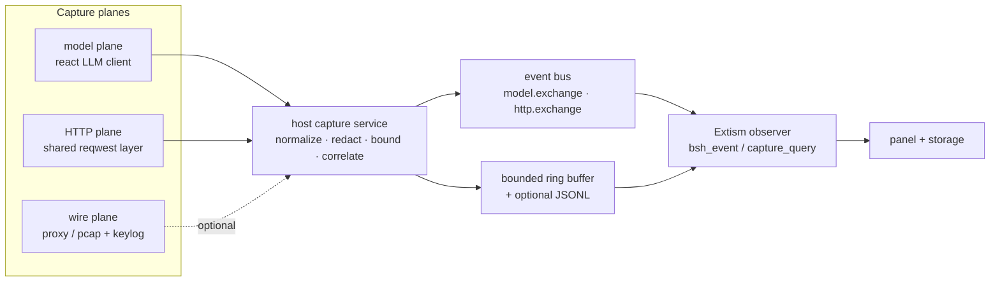

# LLM and Traffic Capture for BSH

**Status:** design proposal (implementation-ready), 2026-11-01.
**Question it answers:** how can an Extism extension observe BSH's LLM
requests and detailed traffic, instead of only the coarse `model.requested` / `network.request` events published today?

**Mechanism:** the capture planes below are reached through the
[BSH/BOS hook layer](bsh-hook-system.md); read that first when deciding where a
hook belongs.

**Implemented today:** model metadata (`model.request`/`model.response`) and
HTTP exchange metadata (`http.exchange`) from the Extism/WASM `fetch` bridge and
the built-in LLM vendors. `model.request`, `model.response` and the vendor `http.exchange` share
`request_id`, so the three records join. Bodies, a recording proxy, pcap export and
intercept hooks are not implemented.

## 1. Why the current integration is "basic"

Extism is a good sandbox, but an Extism guest has no ambient view of the host:
it sees what the host pushes to it. Today that is:

| Surface | What the host publishes | What is missing |
|---|---|---|
| model lifecycle | `model.requested`: model, session, user-text bytes; `model.completed`: session, failed | messages, tool schemas, response text, usage, timings, status |
| network | `network.request`: url, method, domain, from the WASM/Extism `fetch` bridge only | status, headers, response bytes, timing, streaming frames, other HTTP clients |
| Extism bridge | `fetch` returns the body only | a `http_request` that returns status/headers/timing |
| capture store | none | retention, query, redaction, consent |

The LLM call itself is built inside `agent` and never passes through BSH:

```text
caps.rs builds AgentConfig
  -> Agent::from_config
     -> agent::agentic::llm::build_vendor(config)      crates/agent/src/agent/agentic/llm.rs:93
        -> OpenAiClient / DeepSeek / Anthropic / ...
           -> LlmClient::stream_complete(req, session)  crates/react/src/llm/client.rs:31
```

So an extension cannot see a prompt, a streamed chunk, a token count or an
HTTP status. The fix is a **tap at the client seam**, not a larger event payload
bolted onto the shell.

## 2. Three capture planes (do not conflate them)

| Plane | Captures | Where it is tapped | Fidelity | Cost |
|---|---|---|---|---|
| **Model** | messages, tool schemas, sampling, usage, finish reason, first-token and total latency, stream chunk statistics, errors | `LlmClient` wrapper in `react`, installed by `agent` | application semantics; survives SSE, retries and fallbacks | low |
| **HTTP** | method, host, path, status, request/response bytes, content-type, TTFB, total, SSE frame count and gaps, redirects | shared `reqwest::Client` layer (or a per-client wrapper) | transport view of every host HTTP call | medium |
| **Wire** | packets, TLS records, DNS, TCP retransmits | recording proxy or `pcap` sidecar + TLS key log | ground truth; needs privileges and key material | high; not an extension job |



The model plane is the only one that requires a code change in `react`/`agent`;
the other two are host-side and can be added later without touching the engine.

## 3. Model plane: tap the LLM client

### 3.1 The seam

`react::llm::client::LlmClient` is the one interface every vendor implements
(`complete` and `stream_complete`). `ReactSession::history()` exposes the
message list, and `StreamToken` exposes text, reasoning, tool calls, usage and
termination. That is enough for a structured, provider-independent trace.

### 3.2 New trait (proposed `crates/react/src/llm/tap.rs`)

```rust
/// One request, before it is sent.
pub struct RequestTrace {
    pub model: String,
    pub api_mode: ApiMode,
    pub messages: Vec<MessageTrace>,   // role + bytes + bounded preview
    pub tool_schemas: usize,
    pub tool_schema_bytes: usize,
    pub temperature: Option<f32>,
    pub max_tokens: Option<u32>,
    pub prompt_bytes: u64,
}

pub struct ResponseTrace {
    pub outcome: &'static str,         // ok | provider_error | transport_error | cancelled
    pub status: Option<u16>,
    pub prompt_tokens: Option<u64>,
    pub completion_tokens: Option<u64>,
    pub reasoning_tokens: Option<u64>,
    pub finish_reason: Option<String>,
    pub first_token_ms: Option<u64>,
    pub total_ms: u64,
    pub chunks: u64,
    pub text_bytes: u64,
    pub tool_calls: usize,
    pub error: Option<String>,
}

/// Installed once per agent; called on the thread that drives the model.
pub trait ModelTap: Send + Sync {
    fn on_request(&self, id: &str, trace: &RequestTrace);
    fn on_response(&self, id: &str, trace: &ResponseTrace);
    /// Aggregated, not per token; the host decides whether to keep gaps.
    fn on_stream_summary(&self, id: &str, summary: &StreamSummary) {}
}
```

### 3.3 The wrapper (proposed `TappedClient<C>`)

```rust
impl<S: ReactSession, C: LlmClient<S, Ctx>, Ctx> LlmClient<S, Ctx> for TappedClient<C> {
    async fn stream_complete(&self, persona: Option<String>, req: LlmRequest,
                             session: &mut S, context: &mut Ctx) -> Result<TokenStream, LlmError> {
        let id = Uuid::new_v4().to_string();
        let started = Instant::now();
        self.tap.on_request(&id, &trace_request(&req, session));
        let stream = self.inner.stream_complete(persona, req, session, context).await?;
        Ok(tap_stream(stream, id, started, self.tap.clone()))
    }
    // complete() is the same with an LlmResponse and usage() on the way out.
}
```

`tap_stream` counts chunks, records first-token time, collects `Usage`, and
emits **one** `on_response` when the stream ends, errors, or is stopped. It
never sends one event per token: the event bus allows 200 events per second per
source and a long answer has thousands of chunks.

### 3.4 Installing it (`agent`)

```rust
// crates/agent/src/agent/agentic/llm.rs
let vendor = build_vendor(&config).1;
let vendor = match &tap { Some(tap) => Box::new(TappedClient::new(vendor, tap.clone())), None => vendor };
```

Add `Agent::from_config_with_tap(config, tap)` and keep `from_config` delegating
with `None`. Wrap every registered fallback the same way: a fallback that
succeeds after a primary failure must still produce one trace, with the
fallback's provider name.

## 4. HTTP plane: one exchange event for every host request

The LLM tap gives semantics but not transport detail. Add a small
`HttpTap` around the shared HTTP client(s):

- **metadata always:** method, scheme, host, path (query optional/hashed),
  status, request/response bytes, content-type, TTFB, total, redirect count,
  SSE frame count, connection error class;
- **headers:** allowlist names only (`content-type`, `content-length`,
  `x-request-id`, `retry-after`, `server`); everything else is
  `[redacted]`;
- **bodies:** off by default; when enabled, bounded previews (4 KiB per
  message, 64 KiB per exchange), content-addressed (SHA-256 + size) so a
  repeated prompt is stored once;
- **timing:** reqwest does not expose DNS/TLS separately; the honest fields are
  TTFB and total. For per-phase timing, move the tap under hyper or use the
  wire plane.

Do not publish one event per SSE frame. Publish one `http.exchange` at the end
with `frames`, `first_frame_ms`, `max_gap_ms`, `p95_gap_ms`.

## 5. Wire plane: what "detailed packet capture" can actually mean

| Option | What you get | Requirements | Verdict |
|---|---|---|---|
| HTTP tap | decrypted headers/bodies at the app layer | none (host code) | ship first |
| recording proxy (MITM) | raw HTTP/1.1, HTTP/2, SSE, all clients that honour the proxy | local CA installed/trusted, proxy allowlist, opt-in | if raw bodies are a product requirement |
| `pcap` + TLS key log | packets + decrypted TLS in Wireshark | root/BPF, `SSLKEYLOGFILE` from the TLS stack, storage | diagnostics mode, never an extension capability |
| plain `pcap` | encrypted TLS records only | root/BPF | not useful alone |

An Extism guest cannot do any of these: it has no sockets, no root, and no
visibility into another process's TLS. The realistic product is: host captures,
extension analyses. For true packets, expose a **host diagnostic mode** that
sets `SSLKEYLOGFILE` for the reqwest/rustls client and starts a `pktap`/`tcpdump`
session, with an explicit warning that the key log decrypts all traffic.

## 6. Event schemas

### 6.1 `model.exchange` (metadata; bodies only with a body grant)

```json
{
  "schema_version": "1.0",
  "id": "5d0c…",
  "event_type": "model.exchange",
  "source": "bsh",
  "timestamp": 1790000000000,
  "correlation": {"session": "s-1", "turn": "t-3", "request": "5d0c…"},
  "provider": "deepseek",
  "model": "deepseek-chat",
  "api_mode": "chat",
  "request": {
    "messages": [
      {"role": "system", "bytes": 4210, "sha256": "…", "preview": "You are BSH…"},
      {"role": "user", "bytes": 87, "sha256": "…", "preview": "explain this error"}
    ],
    "message_count": 12,
    "prompt_bytes": 18234,
    "tool_schemas": 9,
    "tool_schema_bytes": 6402,
    "temperature": 0.7,
    "max_tokens": null
  },
  "response": {
    "outcome": "ok",
    "status": 200,
    "prompt_tokens": 4410,
    "completion_tokens": 812,
    "reasoning_tokens": 0,
    "finish_reason": "stop",
    "first_token_ms": 420,
    "total_ms": 6100,
    "chunks": 214,
    "text_bytes": 3120,
    "tool_calls": 2,
    "error": null
  },
  "redaction": {"bodies": "preview", "fields": ["messages[0].content"]}
}
```

### 6.2 `http.exchange`

```json
{
  "schema_version": "1.0",
  "id": "a91e…",
  "event_type": "http.exchange",
  "timestamp": 1790000000000,
  "correlation": {"session": "s-1", "turn": "t-3", "request": "5d0c…"},
  "method": "POST",
  "scheme": "https",
  "host": "api.deepseek.com",
  "path": "/chat/completions",
  "status": 200,
  "content_type": "text/event-stream",
  "request_bytes": 18402,
  "response_bytes": 91234,
  "ttfb_ms": 430,
  "total_ms": 6110,
  "frames": 214,
  "first_frame_ms": 430,
  "max_gap_ms": 180,
  "p95_gap_ms": 42,
  "redirects": 0,
  "error": null,
  "request_headers": {"content-type": "application/json", "authorization": "[redacted]"},
  "response_headers": {"content-type": "text/event-stream", "x-request-id": "…"}
}
```

Correlation is the join key: a `model.exchange` and its `http.exchange` share
`correlation.request`, so an analyzer can compare semantic tokens with wire
bytes without either event embedding the other.

## 7. What Extism needs from the host

The event subscription mechanism already exists (`contributes.events` plus
`bsh_event`), so the model/exchange events can be consumed with no new transport.
Four gaps remain:

1. **Metadata for its own calls.** Add a bridge op `http_request` returning
   `{status, headers, body_base64, ttfb_ms, total_ms}`. Keep `fetch` unchanged
   for compatibility.
2. **A query API over the capture ring** (events alone drop under load and
   cannot be re-read):
   `capture_list {"filter": {"kind": "model.*", "since": 0}, "limit": 50}` →
   metadata records; `capture_get {"id": "...", "body": false}` → one record
   (bodies only with the body grant).
3. **Batched delivery.** `bsh_event` is invoked once per event by the pump;
   for a burst, add an optional `bsh_events` export that receives an array, or
   cap delivery to one invocation per 150 ms pump tick with a batch.
4. **Backpressure visibility.** Return `queue_dropped` in `bsh_host config` or
   a `capture_status` op, so the analyzer can say "N events were dropped"
   instead of silently under-reporting.

## 8. Capabilities, consent and redaction

Capture sees prompts, tool arguments and possibly credentials. Treat it as a
critical capability, not as `events.subscribe`.

| Capability | Risk | Default | Grants |
|---|---|---|---|
| `model.observe` | high | deny for community/local; explicit grant | metadata of every model exchange |
| `model.capture` | critical | deny | message/response bodies (previews or full) |
| `network.capture` | high | deny | `http.exchange` metadata |
| `network.capture.body` | critical | deny | request/response bodies |

Rules:

- **Opt-in per package and per reader.** A setting
  `observability.capture = off | metadata | bodies` gates publishing at the
  source; a grant alone does not switch it on.
- **Redaction before publication.** Always strip `authorization`,
  `proxy-authorization`, `api-key`, `x-api-key`, `cookie`, `set-cookie`; scan
  for the active vault secrets and for key shapes (`sk-…`, `ghp_…`, `AKIA…`);
  replace with `[redacted:…]`. A redaction count goes in the event.
- **Bounds.** 4 KiB per message preview, 64 KiB per exchange, 256 KiB per event
  (the bus ceiling), 10k exchanges in the ring, one JSONL file per session with
  1 MiB rotation.
- **Audit.** Every `capture_get` with bodies and every delivery to a package is
  an audit line (extension, capability, exchange id, bytes).
- **No default capture of binaries.** Images/audio become type + size + hash.

## 9. Analysis recipes an Extism observer can implement

- **Latency:** `first_token_ms`, `total_ms`, tokens/sec =
  completion_tokens / ((total_ms - first_token_ms) / 1000).
- **Prompt cost:** prompt_bytes per token, tool-schema share of the prompt,
  context growth across a session (compare message hashes).
- **Streaming health:** `frames` vs `chunks`, `max_gap_ms`, `p95_gap_ms`;
  a gap >> median is a stalled connection, not a slow model.
- **Retries and fallbacks:** count failed `outcome` per correlation and pair
  with the successful fallback; a provider switch is one turn with two
  requests and one response.
- **Error classes:** 429/5xx/timeout, with `retry_after` and total wall time.
- **Cost:** tokens × the reader's price table (stored in extension data).
- **Prompt diff:** normalized message hashes; show what actually changed
  between two turns.
- **Anomaly:** a tool result that doubles the prompt, a model that emits 10×
  the median chunks, an auth header that appears in a body (redaction failure).

## 10. Implementation plan

**Phase 0 — model metadata, no bodies**
1. `react`: add `llm/tap.rs` (traits + trace structs), `TappedClient`,
   `tap_stream`; export from `react::llm`.
2. `agent`: `from_config_with_tap`; wrap primary and fallbacks; tests with a
   mock client (complete, stream, error, stopped).
3. `bsh`: `observability/model_tap.rs` implementing `ModelTap`: correlate by
   session/turn, redact, publish `model.exchange`, write the ring buffer.
4. `bsh`: hook the tap in `caps.rs` at the two `Agent::from_config` sites
   (main build and child agents).
5. `extension`: new capability `model.observe`, setting, standard §6/§9 update.
6. Tests: a fake tap asserts one request + one response per stream; redaction
   tests; event schema snapshot; no per-token events.

**Phase 1 — transport metadata + Extism consumer**
1. `HttpTap` around the host's shared HTTP client; publish `http.exchange`;
   correlate with the model tap via the request id.
2. Extism bridge: `http_request` (metadata) and `capture_list`/`capture_get`
   (metadata only).
3. New example `examples/extensions/llm-observer`: subscribes to
   `model.exchange` and `http.exchange`, aggregates into storage, draws a panel
   (p50/p95 latency, tokens/sec, error mix, top prompt sizes).
4. Tests: a fake HTTP server, an SSE fixture, the guest's aggregation.

**Phase 2 — bodies and retention**
- `model.capture`/`network.capture.body`, preview/full modes, content-addressed
  body store, retention settings, audit of body reads.
- Panel: a turn inspector (request, response, HTTP exchange, redactions).

**Phase 3 — wire plane (optional)**
- recording proxy with local CA, or a diagnostic `pcap + SSLKEYLOGFILE` mode.
- Never inside the Extism guest; the guest reads the same `http.exchange`
  records, enriched with per-phase timings.

## 11. Risks and open decisions

- **Privacy is the product decision.** Bodies off by default is the only
  defensible default; the model plane metadata (roles, bytes, hashes) is
  already enough for cost/latency analysis.
- **Event bus ceilings.** Metadata events are small (~1–4 KiB), but a 200/s
  burst from retries is possible; the ring buffer is the backpressure sink, not
  the bus.
- **Tap timing.** `on_request` runs after the engine built the request and
  before the vendor writes it; that is the only place where "what was sent" is
  authoritative.
- **Fallbacks.** Decide whether a fallback reuses the request id (one logical
  exchange) or gets its own (two requests). Recommended: same `correlation`,
  distinct `id`, so retry analysis is possible.
- **Third-party capture.** A community package with `model.capture` can read
  every prompt. Keep it deny-by-default and show the package id in the grant
  prompt.
- **Proxy vs keylog.** A proxy gives bodies without key material; a keylog
  gives packets but exposes every TLS session. If both are offered, they are
  separate diagnostics with separate warnings.

## 12. Appendix: Extism observer skeleton

An Extism guest has no background loop: it reacts to `bsh_event`, answers
`bsh_panel`, and persists aggregates with `bsh_host`. That shape is a feature
for a capture consumer — it cannot busy-poll, so every cost is bounded by an
event.

```rust
use extism_pdk::*;
use serde_json::{json, Value};

#[host_fn]
extern "ExtismHost" {
    fn bsh_host(input: String) -> String;
}

fn host(request: Value) -> Value {
    let raw = unsafe { bsh_host(request.to_string()) }.unwrap_or_default();
    serde_json::from_str(&raw).unwrap_or(json!({"ok": false, "error": "bad host reply"}))
}

#[plugin_fn]
pub fn bsh_event(input: String) -> FnResult<()> {
    let event: Value = serde_json::from_str(&input)?;
    match event["event_type"].as_str() {
        Some("model.exchange") => {
            let response = &event["response"];
            let _ = host(json!({
                "op": "storage_set",
                "key": format!("exchanges/{}.json", event["id"].as_str().unwrap_or("x")),
                "value": event.to_string()
            }));
            // Aggregate latency / tokens here; do not keep every prompt in memory.
            let _ = (response["total_ms"].as_u64(), response["completion_tokens"].as_u64());
        }
        Some("http.exchange") => {
            // Join on correlation.request with the model record.
        }
        _ => {}
    }
    Ok(())
}

#[plugin_fn]
pub fn bsh_panel(_: String) -> FnResult<String> {
    let listed = host(json!({"op": "capture_list",
                             "filter": {"kind": "model.*"}, "limit": 50}));
    let total = listed["value"].as_array().map(|rows| rows.len()).unwrap_or(0);
    Ok(json!({
        "schema_version": "1.0",
        "root": {"type": "column", "children": [
            {"type": "heading", "text": "LLM activity", "level": 2},
            {"type": "text", "text": format!("{total} exchanges in the ring")}
        ]}
    }).to_string())
}
```

The package manifest declares the topics and the capability, nothing else:

```toml
[capabilities]
required = ["events.subscribe", "model.observe", "extension.storage"]
optional = ["network.capture", "ui.panels"]

[contributes]
events = ["model.exchange", "http.exchange"]
panels = ["observer"]
```

A panel is read-only here: it renders the aggregate. The body-level inspector is
Phase 2, because it needs the body grant and the retention policy.

## See also

- [Extension standard §6 capabilities](bsh-extension-standard.md#6-capability-model),
  [§9 events](bsh-extension-standard.md#9-events)
- [Design: runtime architecture](BSH_Extension_Framework_Design.md)
- [BSH by Example: the six runtimes](BOS-BSH-Textbook.md#architecture-and-runtimes-at-a-glance)
- Current event payloads: `crates/bsh/src/ui/shell.rs` (model), `crates/bsh/src/extension/runtime/extism.rs` (network.request)
